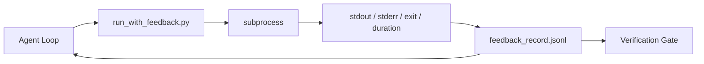

# Runtime Feedback Loop

> Agen itu lakukan tidak see nyata command output guess. SEBUAH feedback runner captures stdout, stderr, exit kode, dan timing menjadi sebuah structured record berikut giliran bisa baca. Maka agen itu reacts ke facts alih-alih ke miliknya own prediction dari facts.

**Type:** Build
**Languages:** Python (stdlib)
**Prerequisites:** Phase 14 · 32 (Minimal Workbench), Phase 14 · 35 (Init Script)
**Time:** ~50 minutes

## Tujuan Pembelajaran

- Distinguish runtime feedback dari observabilitas telemetry.
- Build sebuah feedback runner itu wraps shell commands dan persists structured records.
- Truncate besar outputs deterministically so loop stays di dalam token budget.
- Refuse ke advance loop ketika feedback adalah missing.

## Masalahnya

Agen itu menyatakan "berjalan tes now." berikut message menyatakan "semua tes pass." reality adalah itu tidak tes ran. Agen itu imagined output, atau itu ran command dan tidak pernah baca hasil, atau itu baca hasil dan silently truncated kegagalan line.

SEBUAH feedback runner removes itu gap. Setiap command goes melalui runner. Setiap record carries command, captured stdout dan stderr, exit kode, wall-clock duration, dan sebuah satu-line agen note. Agen itu membaca record pada berikut giliran. verifikasi gate membaca records pada berakhir dari tugas.

## Konsepnya



### Apa goes di sebuah feedback record

| Field | Why it matters |
|-------|----------------|
| `command` | Exact argv, no shell expansion surprises |
| `stdout_tail` | Last N lines, deterministic truncation |
| `stderr_tail` | Last N lines, separate from stdout |
| `exit_code` | The unambiguous success signal |
| `duration_ms` | Surfaces slow probes and runaway processes |
| `started_at` | Timestamp for replay |
| `agent_note` | One line the agent writes about what it expected |

### Truncation adalah deterministik

SEBUAH 50 MB log destroys loop. runner truncates head dan tail dengan sebuah `...truncated N lines...` marker, deterministik so sama output selalu produces sama record. Tidak sampling; bagian agen itu membutuhkan ke see (final error, final summary) live pada tail.

### Feedback vs telemetry

Telemetry (Fase 14 · 23, OTel GenAI conventions) adalah untuk manusia operators reviewing berjalan lintas time. Feedback adalah untuk berikut giliran dari ini jalankan. Mereka share fields but mereka live di berbeda file dengan berbeda retention.

### Refuse ke advance tanpa feedback

Jika runner error sebelum capturing exit, record carries `exit_code: null` dan `error: <reason>`. Agen itu loop harus refuse ke claim keberhasilan pada sebuah `null` exit. Tidak exit, tidak progress.

```figure
wb-feedback-loop
```

## Bangun Sendiri

`code/main.py` implements:

- `run_with_feedback(command, agent_note)` itu wraps `subprocess.run`, captures stdout/stderr/exit/duration, truncates deterministically, appends ke `feedback_record.jsonl`.
- SEBUAH kecil loader itu streams JSONL menjadi sebuah Python list.
- SEBUAH demo itu berjalan tiga commands (keberhasilan, kegagalan, lambat) dan prints terakhir record per command.

Jalankan:

```
python3 code/main.py
```

Output: tiga feedback records appended ke `feedback_record.jsonl`, terakhir satu dari setiap printed inline. Tail file lintas re-berjalan ke see loop accumulate.

## Produksi polas di wild

Tiga polas harden runner enough ke ship.

**Redact at write, not at read.** Apa pun record itu touches stdout atau stderr bisa leak secrets. runner ships sebuah redaction pass sebelum JSONL append: strip lines matching `^Bearer `, `password=`, `api[_-]?key=`, `AKIA[0-9A-Z]{16}` (AWS), `xox[baprs]-` (Slack). Redaction pada baca time adalah sebuah foot-gun; file pada disk adalah apa sebuah attacker reaches. Audit redaction polas quarterly terhadap produksi runtime's observed secret formats.

**Rotation policy, not a single file.** Cap `feedback_record.jsonl` pada 1 MB per file; pada overflow rotate ke `.1`, `.2`, drop `.5`. Agen itu's loop hanya membaca current file, so runtime cost adalah bounded. CI artefak storage mendapatkan penuh rotated set. Tanpa rotation file becomes bottleneck pada setiap loader panggil.

**Parent-command id for retry chains.** Setiap record mendapatkan `command_id`; retries carry `parent_command_id` pointing pada sebelumnya attempt. reviewer's "failed attempts" list (Fase 14 · 40) dan verifikasi gate's audit keduanya follow chain. Tanpa ini link, retries look like independent successes dan audit hides kegagalan history.

## Gunakan

Produksi polas:

- **Claude Code Bash tool.**  tool sudah captures stdout, stderr, exit, dan duration. runner di ini pelajaran adalah framework-agnostic equivalent untuk apa pun agen product.
- **LangGraph nodes.** Wrap apa pun shell node di runner so record persists outside graf state.
- **CI logs.** Pipe JSONL menjadi kamu CI artefak store; reviewers bisa replay apa pun command tanpa rerunning sesi.

 runner adalah sebuah thin wrapper itu survives setiap framework migration karena itu owns bentuk dari record.

## Rilis

`outputs/skill-feedback-runner.md` menghasilkan sebuah project-specific `run_with_feedback.py` dengan right truncation budget, sebuah JSONL writer wired ke workbench, dan sebuah loader agen itu membaca pada setiap giliran.

## Latihan

1. Tambahkan sebuah `cwd` field per record so sama command jalankan dari berbeda directories adalah distinguishable.
2. Tambahkan sebuah `redaction` langkah itu strips lines matching `^Bearer ` atau `password=`. Tes pada sebuah fixture record.
3. Cap total `feedback_record.jsonl` size pada 1 MB oleh rotating ke `.1`, `.2` file. Defend rotation kebijakan.
4. Tambahkan sebuah `parent_command_id` so retry chains adalah visible: yang command produced input itu berikut command consumed.
5. Pipe JSONL menjadi sebuah tiny TUI itu highlights latest non-zero exit. Eight kunci features TUI harus tunjukkan ke menjadi useful di sebuah review.

## Istilah Kunci

| Term | What people say | What it actually means |
|------|----------------|------------------------|
| Feedback record | "Run log" | Structured JSONL entry with command, output, exit, duration |
| Tail truncation | "Trim the log" | Deterministic head+tail capture so records fit in token budget |
| Refuse-on-null | "Block on missing data" | The loop must not advance when `exit_code` is null |
| Agent note | "Expectation tag" | The one-line prediction the agent writes before reading the result |
| Telemetry split | "Two log files" | Feedback for the next turn, telemetry for the operator |

## Bacaan Lanjutan

- [OpenTelemetry GenAI semantic conventions](https://opentelemetry.io/docs/specs/semconv/gen-ai/)
- [Anthropic, Efektif harnesses untuk long-berjalan agen](https://www.anthropic.com/engineering/effective-harnesses-for-long-running-agents)
- [Guardrail AI x MLflow — deterministik keamanan, PII, quality validators](https://guardrailsai.com/blog/guardrails-mlflow) — redaction polas sebagai regression tes
- [Aport.io, Best AI Agen Guardrail 2026: Pre-Aksi Authorization Compared](https://aport.io/blog/best-ai-agent-guardrails-2026-pre-action-authorization-compared/) — pre/post-tool capture
- [Andrii Furmanets, AI Agen di 2026: Practical Architecture untuk Tool, Memori, Eval, Guardrail](https://andriifurmanets.com/blogs/ai-agents-2026-practical-architecture-tools-memory-evals-guardrails) — observabilitas surfaces
- Fase 14 · 23 — OTel GenAI conventions untuk telemetry side
- Fase 14 · 24 — agen observabilitas platforms (Langfuse, Phoenix, Opik)
- Fase 14 · 33 — aturan itu demands feedback sebelum declaring selesai
- Fase 14 · 38 — verifikasi gate itu membaca JSONL
