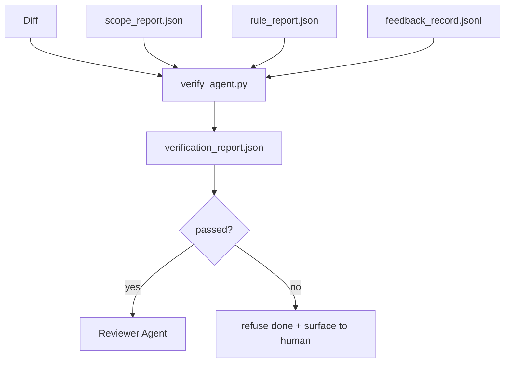

# Verifikasi Gates

> Agen itu melakukan tidak dapatkan ke mark miliknya own kerja sebagai selesai. SEBUAH verifikasi gate membaca scope kontrak, feedback log, aturan report, dan diff, dan menjawab sebuah tunggal pertanyaan: adalah ini tugas actually complete? Jika gate menyatakan tidak, tugas adalah tidak selesai, tidak matter apa chat menyatakan.

**Type:** Build
**Languages:** Python (stdlib)
**Prerequisites:** Phase 14 · 33 (Rules), Phase 14 · 36 (Scope), Phase 14 · 37 (Feedback)
**Time:** ~55 minutes

## Tujuan Pembelajaran

- Definisikan sebuah verifikasi gate sebagai sebuah deterministik function atas workbench artefak.
- Combine aturan report, scope report, feedback records, dan diff menjadi sebuah tunggal verdict.
- Emit sebuah `verification_report.json` reviewer agen dan CI bisa keduanya baca.
- Refuse ke advance sebuah tugas pada apa pun block-severity kegagalan, tanpa exception.

## Masalahnya

Agen declare keberhasilan too easily. Tiga kegagalan shapes dominate:

- "Looks baik." model baca miliknya own diff dan decided itu adalah benar.
- "Tes passed." Said dengan confidence. Tidak record dari tes actually berjalan.
- "Acceptance met." Acceptance criteria interpreted loosely enough ke mean "anything resembling selesai."

 workbench fix adalah sebuah tunggal verifikasi gate itu membaca artefak agen itu memiliki sudah produced dan membuat panggil. gate adalah deterministik. gate adalah di version kontrol. gate adalah wired menjadi CI. Agen itu cannot bribe itu.

## Konsepnya



### Apa gate checks

| Check | Source artifact | Severity |
|-------|-----------------|----------|
| All acceptance commands ran | `feedback_record.jsonl` | block |
| All acceptance commands exited zero | `feedback_record.jsonl` | block |
| Scope check has no forbidden writes | `scope_report.json` | block |
| Scope check has no off-scope writes | `scope_report.json` | block or warn |
| All block-severity rules pass | `rule_report.json` | block |
| No `null` exit codes in feedback | `feedback_record.jsonl` | block |
| Touched files match `scope.allowed_files` | both | warn |

SEBUAH `warn` finding annotates verdict; sebuah `block` finding prevents `passed: true`.

### Deterministik, tidak probabilistic

 gate harus produce sama verdict untuk sama artefak set setiap time. Tidak LLM judges. LLM judges belong pada reviewer side (Fase 14 · 39) di mana tujuan adalah qualitative evaluasi, tidak status.

### Satu report, satu path

 gate meng-emit satu `verification_report.json` per tugas tutup-out, written di bawah `outputs/verification/<task_id>.json`. CI consumes sama path. Multiple gates dengan berbeda paths fork source dari truth.

### Refuse tanpa exception

Block-severity findings cannot menjadi overridden oleh agen itu. Mereka bisa hanya menjadi overridden oleh sebuah manusia, dengan sebuah recorded `override_reason` dan sebuah `overridden_by` user id. override adalah sebuah signed change, tidak sebuah agen decision.

```figure
wb-gate-sequence
```

## Bangun Sendiri

`code/main.py` implements:

- SEBUAH loader untuk setiap input artefak, semua stubbed locally so pelajaran adalah mandiri-contained.
- SEBUAH `verify(task_id, artifacts) -> VerdictReport` pure function.
- SEBUAH printer itu menunjukkan per-check hasil dan final pass/gagal.
- SEBUAH demo dengan tiga tugas scenarios: clean pass, scope creep, missing acceptance.

Jalankan:

```
python3 code/main.py
```

Output: tiga verdict reports, setiap saved berikut ke script.

## Produksi polas di wild

Empat polas elevate gate dari "another lint job" ke " deciding edge."

**Defense-in-depth, not single gate.** Pre-commit hook → CI status check → pre-tool authz hook → pre-merge gate. Setiap layer adalah deterministik so sebuah kegagalan di satu layer adalah caught oleh berikut. microservices.io's March 2026 playbook adalah eksplisit: pre-commit hook adalah non-bypassable karena, unlike sebuah model-side skill, itu melakukan tidak depend pada agen itu following instructions. verifikasi gate sits pada CI / pre-merge layer.

**Defense by deterministic check, model-judge only for nuance.** Anthropic's 2026 Hibrida Norm pairing: verifiable rewards (unit tes, schema checks, exit codes) jawaban "melakukan kode solve masalah?" — LLM rubrics jawaban "adalah kode readable, secure, pada-style?" gate berjalan pertama class; reviewer (Fase 14 · 39) berjalan kedua. Mixing mereka collapses signal.

**Signed override log, not Slack threads.** Setiap override meng-emit sebuah row di `outputs/verification/overrides.jsonl` dengan: timestamp, finding kode, reason, signing user, current HEAD commit. runtime refuses apa pun override itu lacks signature; audit trail adalah git-tracked. Ini adalah line antara sebuah override kebijakan dan sebuah override theater.

**Coverage floor as a first-class check.** SEBUAH `coverage_report.json` mengumpankan sebuah `coverage_floor` (default 80%) check. gate gagal jika measured coverage drops di bawah floor atau di bawah sebelumnya merge's floor oleh more than 1 percentage inti. Tanpa ini check, agen quietly delete tes itu gagal dan verifikasi reports stay green.

**`--strict` mode promotes warns to blocks.** Untuk release branches, ship-blocking PRs, atau post-incident triage, `--strict` membuat setiap warning sebuah hard gagal. flag adalah opt-di oleh branch; tidak global default, karena strict-pada-everything corrodes day-ke-day flow.

## Gunakan

Produksi polas:

- **CI step.** SEBUAH `verify_agent` job berjalan gate terhadap agen itu's final artefak. Merge protection refuses tanpa `passed: true`.
- **Pre-handoff hook.** Agen itu runtime memanggil gate sebelum generating handoff doc. Tidak green verdict, tidak handoff.
- **Manual triage.** Operators baca report ketika sebuah agen claims keberhasilan dan sebuah manusia suspects itu.

 gate adalah deciding edge di workbench flow. Setiap other surface adalah upstream dari itu.

## Rilis

`outputs/skill-verification-gate.md` wires gate menjadi sebuah specific project: yang acceptance commands umpankan itu, yang rules adalah block-severity, yang off-scope menulis adalah tolerated, bagaimana override audit log adalah stored.

## Latihan

1. Tambahkan sebuah `coverage_floor` check: tes command harus produce sebuah coverage report dengan pada least 80%. Putuskan yang artefak carries floor.
2. Dukung sebuah `--strict` mode itu promotes setiap `warn` ke `block`. Document cases di mana strict mode adalah right default.
3. Buat gate produce sebuah Markdown summary di addition ke JSON. Defend yang fields belong di summary.
4. Tambahkan sebuah `time_since_last_human_touch` check: apa pun file edited di dalam 60 seconds dari sebuah manusia keystroke adalah exempt dari off-scope flags.
5. Jalankan gate pada sebuah nyata agen diff dari kamu product. Bagaimana banyak findings adalah nyata dan bagaimana banyak adalah noise? Di mana melakukan gate butuhkan ke grow?

## Istilah Kunci

| Term | What people say | What it actually means |
|------|----------------|------------------------|
| Verification gate | "The check that stops things" | Deterministic function over workbench artifacts producing a pass/fail verdict |
| Block severity | "Hard fail" | A finding that prevents `passed: true` and requires a signed override |
| Override log | "Why we let it through" | Signed entries with reason and user id, audited by review |
| Acceptance command | "The proof" | A shell command whose zero exit is what `done` means |
| One report path | "Source of truth" | `outputs/verification/<task_id>.json`, consumed by CI and humans alike |

## Bacaan Lanjutan

- [Anthropic, Harness design untuk long-berjalan application development](https://www.anthropic.com/engineering/harness-design-long-running-apps)
- [OpenAI Agen SDK guardrail](https://openai.github.io/openai-agents-python/guardrails/)
- [microservices.io, GenAI dev platform: guardrail](https://microservices.io/post/architecture/2026/03/09/genai-development-platform-part-1-development-guardrails.html) — pertahanan di depth antara pre-commit dan CI
- [ICMD, 2026 Playbook untuk Agentic AI Ops](https://icmd.app/article/the-2026-playbook-for-agentic-ai-ops-guardrails-costs-and-reliability-at-scale-1776661990431) — approval-gate ladder (draft → approval → auto di bawah thresholds)
- [Type-Checked Compliance: Deterministik Guardrail (arXiv 2604.01483)](https://arxiv.org/pdf/2604.01483) — Lean 4 sebagai upper bound dari deterministik gating
- [logi-cmd/agen-guardrail — merge gate spec](https://github.com/logi-cmd/agent-guardrails) — scope + mutation-testing gates
- [Guardrail AI x MLflow](https://guardrailsai.com/blog/guardrails-mlflow) — deterministik validators sebagai CI scorers
- Fase 14 · 27 — prompt injeksi defenses ( gate's adversarial pair)
- Fase 14 · 36 — scope kontrak ini gate enforces
- Fase 14 · 37 — feedback log ini gate scores
- Fase 14 · 39 — reviewer agen gate hands off ke
