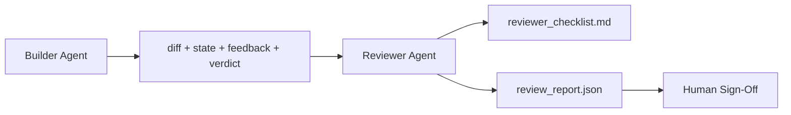

# Reviewer Agen: Terpisah Builder dari Marker

> Agen itu itu wrote kode cannot grade itu. SEBUAH reviewer adalah sebuah kedua loop dengan sebuah berbeda sistem prompt, sebuah berbeda tujuan, dan baca-hanya access ke everything builder produced. gap antara builder dan reviewer adalah di mana sebagian besar reliability lives.

**Type:** Build
**Languages:** Python (stdlib)
**Prerequisites:** Phase 14 · 38 (Verification Gate)
**Time:** ~55 minutes

## Tujuan Pembelajaran

- State mengapa sama agen cannot reliably review miliknya own kerja.
- Build sebuah reviewer agen loop itu consumes builder artefak dan meng-emit sebuah structured review report.
- Author sebuah reviewer rubric itu grades specific dimensions, tidak vibes.
- Wire reviewer menjadi workbench so manusia review langkah memulai dari sebuah nyata artefak.

## Masalahnya

Kamu bertanya agen itu ke fix sebuah bug. Itu edits empat file, berjalan tes, dan reports selesai. verifikasi gate (Fase 14 · 38) confirms acceptance ran dan scope held. gate menyatakan `passed: true`. Kamu merge. Dua days later kamu find itu fix solved salah half dari bug.

Acceptance adalah necessary, tidak sufficient. reviewer bertanya questions acceptance cannot tanya: melakukan ini solve right masalah? Melakukan itu expand scope tanpa flagging itu? Melakukan itu document asumsi itu sebaiknya memiliki menjadi questioned? Melakukan itu leave workbench di sebuah state berikut sesi bisa pick up?

## Konsepnya



### Reviewer rubric

Lima dimensions, setiap scored 0 ke 2.

| Dimension | Question |
|-----------|----------|
| Problem fit | Did the change solve the task as stated, not a nearby task? |
| Scope discipline | Were edits confined to the contract or was the contract grown deliberately? |
| Assumptions | Are all hidden assumptions written down somewhere reviewable? |
| Verification quality | Does the acceptance command actually prove the goal, or did it prove a weaker version? |
| Handoff readiness | Could the next session pick up cleanly from the current state? |

Total out dari 10. SEBUAH jalankan di bawah 7 adalah sebuah soft gagal; sebuah jalankan di bawah 5 adalah sebuah hard gagal.

###  reviewer adalah sebuah terpisah peran, tidak sebuah terpisah model

Kamu bisa jalankan reviewer dengan sama model sebagai builder. discipline adalah peran separation: berbeda sistem prompt, berbeda inputs, tidak tulis access ke diff. change di posture adalah change di signal.

###  reviewer cannot edit diff

 reviewer membaca diff, state, feedback, verdict. Itu menulis sebuah report. Itu melakukan tidak patch diff. Jika report menyatakan "fix ini," berikut builder giliran melakukan fix; reviewer goes back ke reviewing. Mixing roles defeats gap.

### Reviewer rubric vs verifikasi gate

 gate (Fase 14 · 38) checks deterministik facts: melakukan acceptance jalankan, melakukan rules pass, melakukan scope hold. reviewer membuat qualitative judgments: adalah ini right kerja, adalah itu documented, adalah handoff usable. Keduanya adalah required.

```figure
wb-builder-marker
```

## Bangun Sendiri

`code/main.py` implements:

- SEBUAH `ReviewerInputs` dataclass bundling artefak reviewer membaca.
- SEBUAH rubric scorer dengan satu function per dimension. Setiap function adalah deterministik dan stub-grade untuk pelajaran; nyata implementations akan panggil sebuah LLM.
- SEBUAH `review_report.json` writer dengan lima scores, total, dan sebuah verdict (`pass`, `soft_fail`, `hard_fail`).
- Dua demo cases: sebuah clean change dan sebuah "right tes, salah masalah" change.

Jalankan:

```
python3 code/main.py
```

Output: dua review reports written ke disk dan sebuah console table dari dimensional scores.

## Produksi polas di wild

 receipts: Cloudflare's April 2026 AI Kode Review sistem ran 131,246 review berjalan lintas 48,095 merge requests di 5,169 repo di 30 days. Median review completed di 3 minutes 39 seconds. Up ke seven specialist reviewers (keamanan, performa, kode quality, docs, release management, compliance, Engineering Codex) ran di paralel di bawah sebuah Review Coordinator itu deduplicated findings dan judged severity. Top-tier model reserved exclusively untuk coordinator; specialists ran pada cheaper tiers.

Empat polas buat ini kerja pada scale.

**Specialist pool, not one big reviewer.** Satu reviewer dengan sebuah 5-dimension rubric bekerja untuk solo repo. Once codebase memiliki keamanan-kritis, performa-kritis, dan docs surfaces, split menjadi specialists dengan smaller prompts. coordinator melakukan deduplication; specialists tidak pernah jalankan penuh rubric. Model-tier separation falls out: cheap specialists, expensive coordinator.

**Bias mitigation as design requirement, not optimization.** LLM judges tunjukkan empat reliable biases (Adnan Masood, April 2026): position bias (GPT-4 ~40% inconsistent pada (SEBUAH,B) vs (B,SEBUAH) ordering), verbosity bias (~15% score inflation menuju longer outputs), mandiri-preference (judges prefer outputs dari sama model family), authority (judges atas-rate references ke known authors). Mitigations: evaluate keduanya orderings dan hanya count consistent wins; pakai 1-4 scales itu explicitly reward conciseness; rotate judges lintas model families; strip author names sebelum scoring.

**Calibration set, not vibes.** SEBUAH 10-20 tugas historical set dengan known benar verdicts. Jalankan reviewer atas itu pada setiap prompt change. Jika agreement dengan historical record falls di bawah 80%, rubric membutuhkan revision sebelum reviewer ships. Ini adalah apa setiap tim eventually rediscovers; better ke mulai dengan itu.

**Hybrid norm with the gate.** Verifikasi gate (Fase 14 · 38) menangani deterministik checks (melakukan acceptance jalankan, melakukan tes pass, melakukan scope hold). Reviewer menangani semantic checks (adalah ini right kerja, adalah asumsi documented, adalah handoff usable). Anthropic's 2026 guidance adalah eksplisit pada ini split: don't tanya reviewer ke redo apa gate sudah proves.

## Gunakan

Produksi polas:

- **Claude Code subagents.** SEBUAH reviewer subagent berjalan setelah builder menutup sebuah tugas. Itu posts sebuah comment pada PR dengan rubric scores.
- **OpenAI Agents SDK handoffs.** Builder hands off ke Reviewer pada tugas completion. Reviewer bisa hand back dengan sebuah list dari findings atau up ke sebuah manusia.
- **Two-model pairing.** Builder berjalan pada sebuah faster cheaper model. Reviewer berjalan pada sebuah stronger model dengan smaller context, focused pada judgment.

 reviewer adalah kedua pair dari eyes workbench yang terus bertambah ketika humans cannot lakukan setiap review themselves.

## Rilis

`outputs/skill-reviewer-agent.md` menghasilkan sebuah project-specific reviewer rubric, sebuah reviewer agen stub wired ke builder's artefak, dan sebuah integration dengan verifikasi gate so manusia review memulai dari sebuah written report alih-alih sebuah blank page.

## Latihan

1. Tambahkan sebuah sixth dimension specific ke kamu product domain. Defend mengapa itu adalah tidak absorbed oleh existing lima.
2. Jalankan reviewer dengan dua berbeda sistem prompts (terse, verbose). Yang produces sebuah report sebuah manusia adalah more likely ke baca?
3. Tambahkan sebuah `confidence` field per dimension. Refuse ke ship report ketika confidence di lowest dimension adalah di bawah 0.6.
4. Build sebuah calibration set: 10 historical tugas tutup-outs dengan known benar verdicts. Jalankan reviewer atas mereka. Di mana melakukan itu disagree dengan historical record?
5. Tambahkan sebuah "request more bukti" affordance: reviewer bisa tanya builder untuk sebuah specific tes jalankan sebelum scoring. Apa adalah right back-off so ini melakukan tidak loop?

## Istilah Kunci

| Term | What people say | What it actually means |
|------|----------------|------------------------|
| Reviewer rubric | "Checklist" | Five-dimension 0-2 scoring with a written question per dimension |
| Soft fail | "Needs revisions" | Total below 7; builder gets findings to address |
| Hard fail | "Reject" | Total below 5 or any dimension at 0; halt and surface to human |
| Role separation | "Different prompt" | Same model can be both roles; the discipline is inputs and posture |
| Confidence floor | "Don't ship low-signal reports" | Refuse to emit a verdict when the rubric is uncertain |

## Bacaan Lanjutan

- [OpenAI Agen SDK handoffs](https://openai.github.io/openai-agents-python/handoffs/)
- [Anthropic Claude Kode subagents](https://code.claude.com/docs/en/sub-agents)
- [Cloudflare, Orchestrating AI Kode Review pada Scale](https://blog.cloudflare.com/ai-code-review/) — 7-specialist + coordinator architecture, 131k berjalan / 30 days
- [Agen-sebagai-sebuah-Judge: Evaluating Agen dengan Agen (OpenReview / ICLR)](https://openreview.net/forum?id=DeVm3YUnpj) — DevAI benchmark, 366 hierarchical solution requirements
- [Adnan Masood, Rubric-Based Evaluations dan LLM-sebagai-sebuah-Judge: Methodologies, Biases, Empirical Validation](https://medium.com/@adnanmasood/rubric-based-evals-llm-as-a-judge-methodologies-and-empirical-validation-in-domain-context-71936b989e80) — 4 biases dan mitigations
- [MLflow, LLM-sebagai-sebuah-Judge Evaluasi](https://mlflow.org/llm-as-a-judge) — produksi tooling untuk separated builder/evaluator
- [LangChain, Bagaimana ke Calibrate LLM-sebagai-sebuah-Judge dengan Manusia Corrections](https://www.langchain.com/articles/llm-as-a-judge) — calibration-set workflow
- [Evidently AI, LLM-sebagai-sebuah-judge: sebuah complete panduan](https://www.evidentlyai.com/llm-guide/llm-as-a-judge)
- [Arize, LLM sebagai sebuah Judge — Primer dan Pre-Built Evaluators](https://arize.com/llm-as-a-judge/)
- Fase 14 · 05 — Mandiri-Refine dan CRITIC (tunggal-agen mandiri-review baseline)
- Fase 14 · 30 — Eval-driven agen development (calibration set generator)
- Fase 14 · 38 — verifikasi gate reviewer membaca
- Fase 14 · 40 — handoff packet reviewer report mengumpankan
