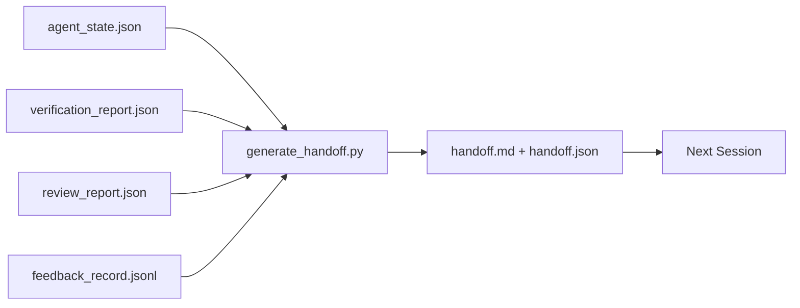

# Multi-Sesi Handoff

>  sesi adalah going ke berakhir. kerja adalah tidak. handoff packet adalah artefak itu giliran "agen itu worked untuk sebuah hour" menjadi " berikut sesi adalah productive di pertama minute." Build itu pada purpose, tidak sebagai sebuah afterthought.

**Type:** Build
**Languages:** Python (stdlib)
**Prerequisites:** Phase 14 · 34 (Repo Memory), Phase 14 · 38 (Verification), Phase 14 · 39 (Reviewer)
**Time:** ~50 minutes

## Tujuan Pembelajaran

- Identifikasi seven fields setiap handoff packet membutuhkan.
- Hasilkan sebuah handoff dari workbench artefak tanpa hand-writing prose.
- Trim besar feedback logs menjadi sebuah handoff-sized summary.
- Buat berikut sesi's pertama aksi deterministik.

## Masalahnya

 sesi berakhir. Agen itu menyatakan "great, kita made progress." berikut sesi membuka. berikut agen bertanya "di mana melakukan kita leave off?" pertama agen's jawaban adalah gone. berikut agen rediscovers, re-berjalan sama commands, re-bertanya manusia sama questions, dan burns thirty minutes recovering terakhir thirty seconds dari sebelumnya sesi.

 cost dari sebuah buruk handoff adalah paid setiap sesi untuk life dari tugas. fix adalah sebuah packet generated automatically pada sesi berakhir: apa changed, mengapa, apa adalah tried, apa failed, apa adalah left, apa ke lakukan pertama berikut time.

## Konsepnya



### Seven fields setiap handoff carries

| Field | Question it answers |
|-------|---------------------|
| `summary` | One paragraph of what was done |
| `changed_files` | The diff at a glance |
| `commands_run` | What was actually executed |
| `failed_attempts` | What was tried and why it did not work |
| `open_risks` | What could bite next session, with severity |
| `next_action` | The first concrete step next session takes |
| `verdict_pointer` | Path to the verification + review reports |

 `next_action` field adalah penopang beban satu. SEBUAH handoff dengan everything except `next_action` adalah sebuah status report, tidak sebuah handoff.

### Handoffs adalah generated, tidak written

SEBUAH hand-written handoff adalah sebuah handoff itu mendapatkan skipped pada sebuah hard day. generator membaca workbench artefak dan meng-emit packet. Agen itu's job adalah ke leave workbench di sebuah state generator bisa summarize, tidak ke tulis summary.

### Dua forms: manusia-readable dan machine-readable

`handoff.md` adalah apa manusia membaca. `handoff.json` adalah apa berikut agen loads. Keduanya come dari sama source artefak. Jika mereka diverge, JSON wins.

### Feedback log trimming

 penuh `feedback_record.jsonl` dapat menjadi hundreds dari entries. handoff carries hanya terakhir K plus setiap entry dengan sebuah non-zero exit. berikut sesi loads penuh log jika itu membutuhkan ke, but packet stays kecil.

### Leave sebuah clean state

SEBUAH handoff describes kerja. SEBUAH clean state membuat kerja resumable. Mereka adalah tidak sama hal. SEBUAH perfect `handoff.md` adalah worthless jika berikut sesi membuka ke sebuah half-applied diff, sebuah temp file agen itu forgot, sebuah stray branch, dan tes itu error sebelum mereka even jalankan. berikut agen maka spends miliknya pertama ten minutes cleaning up setelah terakhir satu alih-alih building, dan cost compounds setiap sesi untuk life dari tugas.

So sesi melakukan tidak berakhir ketika feature bekerja. Itu berakhir ketika workbench adalah di sebuah state generator bisa summarize dan berikut sesi bisa trust. Cleanup adalah miliknya own fase, jalankan sebelum handoff, dan itu adalah sebuah check, tidak sebuah habit, karena sebuah habit adalah hal itu mendapatkan skipped pada sebuah hard day.

| Check | Clean means | Dirty blocks because |
|-------|-------------|----------------------|
| Working tree | Every change committed or explicitly stashed with a note | A half-applied diff looks like intentional work to the next agent |
| Temp artifacts | No `*.tmp`, scratch dirs, debug prints, or commented-out blocks left behind | Stray files pollute the diff and the next agent's mental model |
| Tests | Green, or red with the failure named in `open_risks` | A silent red test is a trap the next session steps in |
| Feature board | `feature_list.json` status reflects reality (Phase 14 · 36) | A stale board sends the next session to work that is already done |
| Branch | On the expected branch, no detached HEAD, no orphan branches | Wrong branch means the next session's first commit lands in the wrong place |

 cleanup fase meng-emit sebuah `clean_state.json` dari blocking issues; sebuah kosong list adalah precondition handoff generator asserts sebelum itu menulis sebuah packet. SEBUAH handoff built pada sebuah dirty tree adalah tidak sebuah handoff, itu adalah sebuah forwarded mess. dua artefak pair: cleanup proves workbench adalah safe ke leave, handoff proves berikut sesi knows di mana ke mulai.

```figure
wb-handoff-packet
```

## Bangun Sendiri

`code/main.py` implements:

- SEBUAH loader itu gathers state, verdict, review, dan feedback menjadi sebuah tunggal `WorkbenchSnapshot`.
- SEBUAH `generate_handoff(snapshot) -> (markdown, payload)` function.
- SEBUAH filter itu picks terakhir K feedback entries plus semua non-zero exits.
- SEBUAH demo jalankan itu menulis `handoff.md` dan `handoff.json` berikut ke script.

Jalankan:

```
python3 code/main.py
```

Output: sebuah printed handoff body, plus keduanya file pada disk.

## Produksi polas di wild

Codex CLI, Claude Kode, dan OpenCode setiap ship sebuah berbeda compaction story; structured handoff packet sits di atas semua tiga.

**Compaction strategies vary; the packet schema does not.** Codex CLI's POST /v1/responses/compact adalah sebuah server-side opaque AES blob (cepat path untuk OpenAI model); fallback adalah sebuah lokal "handoff summary" appended sebagai sebuah `_summary` user-peran message. Claude Kode berjalan lima-stage progressive compaction pada 95% dari context. OpenCode melakukan timestamp-based message hiding plus sebuah 5-heading LLM summary. Tiga berbeda mechanisms, sama butuhkan: serialize apa survives compression menjadi sebuah portable artefak. packet adalah itu artefak.

**Fresh-session handoff is not compaction.** Compaction Perluass sebuah sesi; handoff menutup satu cleanly dan memulai berikut. Hermes Issue #20372 framing (April 2026) adalah right: ketika di-place compression memulai degrading, agen itu sebaiknya tulis sebuah compact handoff, berakhir sesi, dan resume di fresh context. packet adalah apa membuat itu transition cheap. mistake adalah ke keep compressing sampai quality collapses; fix adalah ke budget untuk sebuah early, clean handoff.

**One active handoff per branch and topic.** Multi-agen coordination breaks down pada stale handoffs more than pada buruk model output. Selalu sertakan `branch`, `last_known_good_commit`, dan sebuah `status` dari `active | superseded | archived`. Stale handoffs adalah archived; hanya active satu drives berikut sesi. Ini adalah difference antara handoff-sebagai-notes dan handoff-sebagai-state.

**Wrap up before 50-75% context, not at the wall.**  hand-written-pola playbook (CLAUDE.md + HANDOVER.md) reports best hasil ketika sesi berakhir pada 50-75% context budget alih-alih 95%. packet generator berjalan cleanly sebelum compression artefak pollute source state. Cheap ke tulis sementara context adalah intact; expensive ketika model adalah sudah losing miliknya place.

## Gunakan

Produksi polas:

- **Session-end hook.**  runtime fires generator ketika user menutup chat. packet goes menjadi `outputs/handoff/<session_id>/`.
- **PR template.**  generator's markdown adalah juga sebuah PR body. Reviewers baca itu tanpa opening lima other file.
- **Cross-agent handoff.** Build dengan satu product (Claude Kode), lanjutkan dengan another (Codex). packet adalah lingua franca.

 packet adalah kecil, regular, dan cheap ke produce. cost saving compounds dengan setiap sesi.

## Rilis

`outputs/skill-handoff-generator.md` produces sebuah generator tuned ke sebuah project's artefak paths, sebuah berakhir-dari-sesi hook itu berjalan itu, dan sebuah `handoff.json` schema berikut agen membaca pada startup.

## Latihan

1. Tambahkan sebuahn `assumptions_to_validate` field itu surfaces setiap asumsi builder logged but reviewer melakukan tidak score di atas 1.
2. Trim feedback summary differently untuk failing berjalan vs passing ones. Defend asymmetry.
3. Sertakan sebuah "questions untuk manusia" list. Apa adalah threshold untuk sebuah pertanyaan ke buat itu menjadi packet vs menjadi sebuah chat message?
4. Buat generator idempotent: berjalan itu twice produces sama packet. Apa membutuhkan ke menjadi stable untuk itu ke hold?
5. Tambahkan sebuah "berikut sesi prereqs" bagian listing exactly artefak berikut sesi harus load sebelum bertindak.

## Istilah Kunci

| Term | What people say | What it actually means |
|------|----------------|------------------------|
| Handoff packet | "Session summary" | Generated artifact carrying the seven fields, both markdown and JSON |
| Next action | "What to do first" | The one concrete step that starts the next session |
| Feedback trim | "Log summary" | Last K records plus every non-zero exit |
| Status report | "What we did" | A document missing `next_action`; useful, but not a handoff |
| Verdict pointer | "Receipt" | Path to the verification + review reports for traceability |

## Bacaan Lanjutan

- [Anthropic, Efektif harnesses untuk long-berjalan agen](https://www.anthropic.com/engineering/effective-harnesses-for-long-running-agents)
- [OpenAI Agen SDK handoffs](https://openai.github.io/openai-agents-python/handoffs/)
- [Codex Blog, Codex CLI Context Compaction: Architecture, Configuration, Managing Long Sesi](https://codex.danielvaughan.com/2026/03/31/codex-cli-context-compaction-architecture/) — POST /v1/responses/compact dan lokal fallback
- [Justin3go, Shedding Heavy Memori: Context Compaction di Codex, Claude Kode, OpenCode](https://justin3go.com/en/posts/2026/04/09-context-compaction-in-codex-claude-code-and-opencode) — tiga-vendor compaction comparison
- [JD Hodges, Claude Handoff Prompt: Bagaimana ke Keep Context Lintas Sesi (2026)](https://www.jdhodges.com/blog/ai-session-handoffs-keep-context-across-conversations/) — CLAUDE.md + HANDOVER.md, 50-75% context budget
- [Mervin Praison, Managing Handoffs di Multi-agen Coding Sesi: Fresh Context Tanpa Losing Continuity](https://mer.vin/2026/04/managing-handoffs-in-multi-agent-coding-sessions-fresh-context-without-losing-continuity/) — distributed-sistem framing
- [Hermes Issue #20372 — automatic fresh-sesi handoff ketika compression becomes risky](https://github.com/NousResearch/hermes-agent/issues/20372)
- [Hermes Issue #499 — Context Compaction Quality Overhaul](https://github.com/NousResearch/hermes-agent/issues/499) — handoff-oriented prompts di Codex CLI
- [Microsoft Agen Framework, Compaction](https://learn.microsoft.com/en-us/agent-framework/agents/conversations/compaction)
- [OpenCode, Context Management dan Compaction](https://deepwiki.com/sst/opencode/2.4-context-management-and-compaction)
- [LangChain, Context Engineering untuk Agen](https://www.langchain.com/blog/context-engineering-for-agents)
- Fase 14 · 34 — state file generator membaca
- Fase 14 · 38 — verifikasi verdict packet points pada
- Fase 14 · 39 — reviewer report bundled menjadi packet
