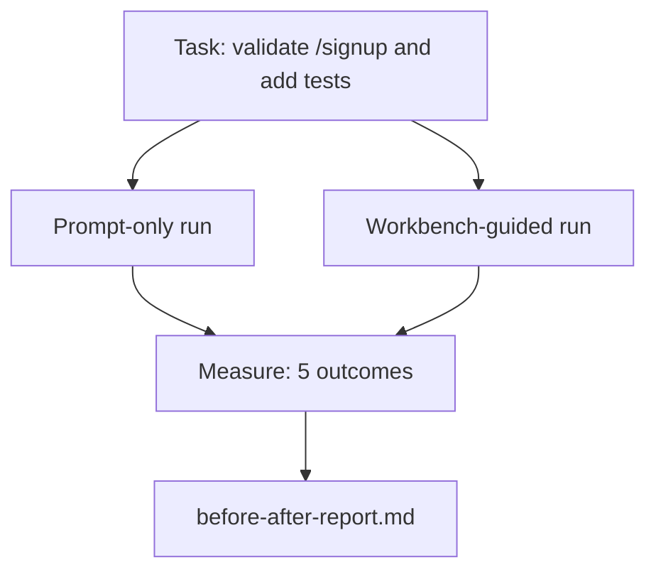

#  Workbench pada sebuah Nyata Repo

> Eleven pelajaran dari surfaces adalah worth nothing jika mereka lakukan tidak survive contact dengan sebuah nyata codebase. Ini pelajaran berjalan sama tugas twice pada sebuah kecil sample app: prompt-hanya vs workbench-guided. numbers lakukan arguing.

**Type:** Build
**Languages:** Python (stdlib)
**Prerequisites:** Phases 14 · 32 to 14 · 40
**Time:** ~60 minutes

## Tujuan Pembelajaran

- Bring seven workbench surfaces together pada sebuah kecil application.
- Jalankan sama tugas twice (prompt-hanya dan workbench-guided) dan measure lima outcome.
- Baca sebelum/setelah report dan putuskan yang surfaces gave sebagian besar leverage.
- Defend workbench terhadap sebuah "but my model adalah baik enough" pushback.

## Masalahnya

SEBUAH demo pada sebuah toy tugas convinces tidak satu. case untuk workbench adalah made ketika sebuah nyata-feeling tugas pada sebuah nyata-feeling repo lands di produksi dengan fewer kegagalan, fewer reverts, dan sebuah packet berikut sesi bisa pakai.

Ini pelajaran ships itu nyata-feeling repo dan berjalan sama tugas melalui keduanya pipelines. hasil adalah sebuah sebelum/setelah report kamu bisa hand ke sebuah skeptic.

## Konsepnya



###  sample app

SEBUAH minimal FastAPI-style handler di `sample_app/`:

- `app.py` dengan `/signup` (tidak validation yet).
- `test_app.py` dengan satu happy-path tes.
- `README.md` dan `scripts/release.sh` sebagai forbidden-zone bait.

###  tugas

> Add input validation ke `/signup`: reject passwords shorter than 8 characters, kembalikan 422 dengan sebuah typed error envelope. Tambahkan sebuah tes itu proves baru perilaku.

###  dua pipelines

Prompt-hanya:

1. Baca README.
2. Baca `app.py`.
3. Edit file.
4. Claim selesai.

Workbench-guided:

1. Jalankan init script (Pelajaran 35).
2. Baca scope kontrak (Pelajaran 36).
3. Baca state (Pelajaran 34).
4. Edit allowed file hanya.
5. Jalankan acceptance command via feedback runner (Pelajaran 37).
6. Jalankan verifikasi gate (Pelajaran 38).
7. Jalankan reviewer (Pelajaran 39).
8. Hasilkan handoff (Pelajaran 40).

###  lima outcome measured

| Outcome | Why it matters |
|---------|----------------|
| `tests_actually_run` | Most "tests passed" claims are unverifiable |
| `acceptance_met` | The test that proves the goal must be the test that ran |
| `files_outside_scope` | Scope creep is the dominant silent failure |
| `handoff_quality` | The next session pays for or benefits from this |
| `reviewer_total` | Qualitative judgment on top of the gate |

```figure
wb-ab-runs
```

## Bangun Sendiri

`code/main.py` orchestrates dua pipelines terhadap sama sample app fixture. Keduanya pipelines adalah scripted (tidak LLM di loop) so measurement adalah reproducible. script menulis comparison menjadi `before-after-report.md` dan `comparison.json`.

Jalankan:

```
python3 code/main.py
```

Output: sebuah console table dari outcome per pipeline, markdown report saved berikut ke script, dan JSON untuk whoever menginginkan ke chart itu.

## Produksi polas di wild

 skeptic's pertanyaan adalah "bagaimana much melakukan workbench actually bantu?" 2026 numbers nyatakan sebuah lot more than explanation.

**Terminal Bench Top-30 to Top-5 on the same model.** LangChain's *Anatomy dari sebuah agen Harness* (April 2026): sebuah coding agen jumped dari outside top 30 ke rank lima pada Terminal Bench 2.0 oleh changing hanya harness. Sama model. Berbeda surfaces. Twenty-lima-rank delta.

**Vercel 80% to 100% by deleting tools.** Vercel reported deleting 80% dari miliknya agen's tool moved tingkat keberhasilan dari 80% ke 100%. Smaller tool surface, sharper scope, fewer ways ke gagal. Negative space wins.

**Harvey 2x accuracy via harness alone.** Legal agen more than doubled mereka accuracy melalui harness optimization, tidak model change.

**88% of enterprise AI agent projects fail to reach production.**  preprints.org *Harness Engineering untuk Language Agen* paper (March 2026) traces kegagalan ke runtime, tidak penalaran: stale state, brittle retries, overgrown context, poor recovery dari intermediate mistakes.

**Long-context collapse.** WebAgent baseline 40-50% keberhasilan drops ke di bawah 10% di long-context conditions, mostly dari infinite loop dan tujuan loss. Ralph Loop dan handoff packet exist ke absorb itu.

**False negatives still exist.** Tunggal-langkah factual tugas, satu-line lints, formatter berjalan, anything model memiliki memorized verbatim — ini jalankan faster prompt-hanya. benchmark sebaiknya enumerate mereka honestly so workbench adalah tidak framed sebagai overkill.

 takeaway adalah tidak "harness wins forever." Model lakukan absorb harness tricks atas time. takeaway adalah itu today, engineering load sits di seven surfaces, dan numbers prove itu.

## Gunakan

Ini pelajaran adalah case file kamu cite ketika:

- Someone bertanya mengapa setiap PR carries sebuah `agent-rules.md` dan sebuah scope kontrak.
- SEBUAH tim menginginkan ke drop verifikasi gate "just untuk ini sprint."
- SEBUAH baru agen product launches dan kamu butuhkan sebuah portable benchmark untuk whether itu actually saves time.

 numbers travel further than explanation.

## Rilis

`outputs/skill-workbench-benchmark.md` adalah sebuah portable evaluasi harness itu berjalan apa pun agen product melalui keduanya pipelines terhadap sebuah project's own sample app dan reports lima outcome.

## Latihan

1. Tambahkan sebuah sixth outcome: time-ke-pertama-meaningful-edit. Bagaimana lakukan kamu measure itu cleanly?
2. Jalankan comparison pada sebuah nyata kedua-day tugas di kamu codebase. Di mana lakukan workbench numbers slip?
3. Tambahkan sebuah "false negative" pass: tugas di mana prompt-hanya akan memiliki menjadi faster dan workbench overhead adalah nyata cost. Defend keeping workbench anyway.
4. Ganti scripted "agen" dengan sebuah nyata LLM panggil. Yang outcome dapatkan noisier?
5. Author sebuah satu-page summary aimed pada sebuah non-engineer. Apa survives cut?

## Istilah Kunci

| Term | What people say | What it actually means |
|------|----------------|------------------------|
| Sample app | "Toy repo" | Small but realistic enough to exercise all seven surfaces |
| Pipeline | "Workflow" | Ordered sequence of surface reads/writes the agent follows |
| Before/after report | "The receipts" | The artifact you hand to a skeptic |
| False negative | "Workbench overkill" | Tasks where prompt-only is faster; useful to enumerate honestly |
| Workbench benchmark | "Reliability score" | Portable harness that runs the comparison on your codebase |

## Bacaan Lanjutan

- [LangChain, Anatomy dari sebuah agen Harness](https://blog.langchain.com/the-anatomy-of-an-agent-harness/) — Terminal Bench Top-30 ke Top-5 receipt
- [MongoDB, Agen itu Harness: Mengapa LLM Adalah Terkecil Bagian dari Kamu Agen Sistem](https://www.mongodb.com/company/blog/technical/agent-harness-why-llm-is-smallest-part-of-your-agent-system) — Vercel + Harvey numbers
- [preprints.org, Harness Engineering untuk Language Agen](https://www.preprints.org/manuscript/202603.1756) — 88% enterprise kegagalan rate, runtime root causes
- [HN: Improving 15 LLMs pada Coding di Satu Afternoon. Hanya Harness Changed](https://news.ycombinator.com/item?id=46988596) — replicated lintas 15 model
- [Cloudflare, Orchestrating AI Kode Review pada Scale](https://blog.cloudflare.com/ai-code-review/) — 131k review berjalan / 30 days di produksi
- [Anthropic, Building Efektif Agen](https://www.anthropic.com/research/building-effective-agents)
- Fase 14 · 32 ke 14 · 40 — surfaces ini pelajaran latihan ujung-ke-ujung
- Fase 14 · 19 — SWE-bench, GAIA, AgentBench sebagai macro benchmark ini pelajaran complements
- Fase 14 · 30 — eval-driven agen development sama harness plugs menjadi
