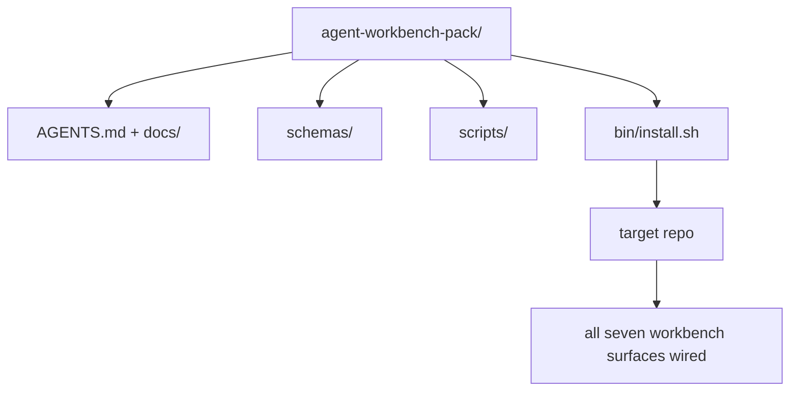

# Capstone: Ship sebuah Reusable Agen Workbench Pack

>  mini-lacak berakhir dengan sebuah pack kamu drop menjadi apa pun repo. Eleven pelajaran dari surfaces compressed menjadi sebuah directory kamu bisa `cp -r` dan memiliki sebuah agen working reliably berikut morning. capstone adalah artefak ini curriculum trades pada.

**Type:** Build
**Languages:** Python (stdlib)
**Prerequisites:** Phases 14 · 31 to 14 · 41
**Time:** ~75 minutes

## Tujuan Pembelajaran

- Package seven workbench surfaces menjadi satu drop-di directory.
- Pin schemas, scripts, dan templat so sebuah baru repo mendapatkan sebuah known-baik baseline.
- Tambahkan sebuah tunggal installer script itu lays down pack idempotently.
- Putuskan apa stays di pack dan apa stays out, defending cut untuk setiap.

## Masalahnya

SEBUAH workbench itu lives di sebuah Google Doc, sebuah chat history, dan tiga half-remembered scripts adalah sebuah workbench itu mendapatkan rebuilt setiap quarter. cure adalah sebuah versioned pack: sebuah repo atau directory dengan surfaces, schemas, scripts, dan sebuah satu-command installer.

Kamu akan berakhir ini pelajaran dengan `outputs/agent-workbench-pack/` shipped pada disk dan sebuah `bin/install.sh` itu drops itu menjadi apa pun target repo.

## Konsepnya



###  pack layout

```
outputs/agent-workbench-pack/
├── AGENTS.md
├── docs/
│   ├── agent-rules.md
│   ├── reliability-policy.md
│   ├── handoff-protocol.md
│   └── reviewer-rubric.md
├── schemas/
│   ├── agent_state.schema.json
│   ├── task_board.schema.json
│   └── scope_contract.schema.json
├── scripts/
│   ├── init_agent.py
│   ├── run_with_feedback.py
│   ├── verify_agent.py
│   └── generate_handoff.py
├── bin/
│   └── install.sh
└── README.md
```

### Apa stays di, apa stays out

Di:

- Surface schemas. Mereka adalah kontrak.
-  empat scripts di atas. Mereka adalah runtime.
-  empat docs. Mereka adalah rules dan rubric.

Out:

- Project-specific tugas. Tugas belong pada target repo's board, tidak di pack.
- Vendor SDK memanggil. pack adalah framework-agnostic.
- Onboarding prose. pack lives berikut ke tim's existing onboarding, tidak di dalam itu.

###  installer

SEBUAH short `bin/install.sh` (atau `bin/install.py`):

1. Refuses ke install atas sebuah existing pack tanpa `--force`.
2. Copies pack menjadi target repo.
3. Wires up CI jika sebuah `.github/workflows/` exists.
4. Prints berikut langkah: fill di board, set acceptance commands, jalankan init script.

### Versioning

 pack carries sebuah `VERSION` file. Schema bumps dan script changes itu butuhkan migrations bump major. Doc-hanya changes bump patch. target repo's `agent_state.json` records yang pack version itu adalah initialized terhadap.

```figure
wb-pack-install
```

## Bangun Sendiri

`code/main.py` assembles pack menjadi `outputs/agent-workbench-pack/` berikut ke pelajaran, seeded dengan schemas dan scripts dari sebelumnya pelajaran di ini mini-lacak dan docs kamu sudah wrote.

Jalankan:

```
python3 code/main.py
```

 script copies dan pins surfaces, menulis README, prints pack tree, dan exits zero. Re-berjalan adalah idempotent.

## Produksi polas di wild

SEBUAH pack adalah hanya valuable jika itu survives forks, updates, dan sebuah unfriendly upstream. Empat polas buat itu kerja.

**`VERSION` is the contract, not the marketing.** Major bumps butuhkan sebuah state migration. Minor bumps butuhkan sebuah checker re-jalankan. Patch bumps adalah doc-hanya. installer menulis `.workbench-version` menjadi target repo pada setiap install; `lint_pack.py` refuses ke ship jika target's lock disagrees dengan pack's `VERSION`. Ini adalah bagaimana `npm`, `Cargo`, dan `pyproject.toml` survive 10 years dari churn; nothing tentang agen changes rules.

**Single source for cross-tool distribution.** Nx ships satu `nx ai-setup` itu lays down `AGENTS.md`, `CLAUDE.md`, `.cursor/rules/`, `.github/copilot-instructions.md`, dan sebuah MCP server dari sebuah tunggal config. pack sebaiknya lakukan sama; installer meng-emit symlinks (`ln -s AGENTS.md CLAUDE.md`) so sebuah tunggal source dari truth fans out ke setiap coding agen. Forking pack ke dukung satu tool atas another adalah sebuah mode kegagalan.

**`uninstall.sh` that refuses on non-trivial state.** Uninstalling pack harus tidak delete user's `agent_state.json`, `task_board.json`, atau `outputs/`. uninstaller removes schemas, scripts, docs, dan `AGENTS.md` (dengan `--keep-agents-md` opt-out) dan refuses ke proceed jika state file memiliki apa pun uncommitted changes. State belongs ke user; pack melakukan tidak menguasainya.

**Skill-as-publishable. SkillKit-style distribution.**  pack ships sebagai sebuah SkillKit skill: `skillkit install agent-workbench-pack` lays itu down lintas 32 AI agen dari sebuah tunggal source. pack repo adalah source dari truth; SkillKit adalah distribution kanal. Vendor lock-di collapses; seven surfaces stay sama.

## Gunakan

Tiga places pack ships:

- **As a directory you drop into a repo.** `cp -r outputs/agent-workbench-pack /path/to/repo`.
- **As a public template repo.** Fork-dan-customize, dengan `VERSION` controlling drift.
- **As a SkillKit skill.** Wired menjadi kamu agen product so sebuah tunggal command lays itu down.

 pack adalah resep. Setiap install adalah sebuah serving.

## Rilis

`outputs/skill-workbench-pack.md` menghasilkan sebuah project-tuned pack: rules sharpened ke tim's history, scope globs matched ke repo, rubric dimensions Perluased dengan satu domain-specific entry.

## Latihan

1. Putuskan yang optional fifth doc deserves promotion menjadi kanonikal pack. Defend cut.
2. Rewrite installer sebagai Python dengan sebuah `--dry-run` flag. Bandingkan ergonomics terhadap bash.
3. Tambahkan sebuah `bin/uninstall.sh` itu safely removes pack dan refuses jika state file memiliki non-trivial history. Apa counts sebagai non-trivial?
4. Tambahkan sebuah `lint_pack.py` itu gagal ketika pack drifts dari `VERSION`. Wire itu menjadi CI untuk pack's own repo.
5. Author migration runbook dari sebuah hand-rolled workbench ke ini pack. Apa adalah order dari operations itu minimizes downtime?

## Istilah Kunci

| Term | What people say | What it actually means |
|------|----------------|------------------------|
| Workbench pack | "The starter kit" | A versioned directory carrying all seven surfaces |
| Installer | "Setup script" | `bin/install.sh` that lays the pack down idempotently |
| Pack version | "VERSION" | Major bumps for schema/script changes, patch for doc-only |
| Drop-in pack | "cp -r and go" | Pack works without per-repo customization on day one |
| Forkable template | "GitHub template" | Public repo that GitHub's "Use this template" can clone from |

## Bacaan Lanjutan

- Fase 14 · 31 ke 14 · 41 — setiap surface ini pack bundles
- [SkillKit](https://github.com/rohitg00/skillkit) — install ini skill lintas 32 AI agen
- [Nx Blog, Teach Kamu AI Agen Bagaimana ke Kerja di sebuah Monorepo](https://nx.dev/blog/nx-ai-agent-skills) — tunggal-source generator lintas six tool
- [agen.md — buka spec](https://agents.md/) — apa kamu pack's router harus implementasikan
- [HKUDS/OpenHarness](https://github.com/HKUDS/OpenHarness) — implementasi referensi dari sebuah pack-equivalent
- [Augment Kode, SEBUAH baik AGEN.md adalah sebuah model upgrade](https://www.augmentcode.com/blog/how-to-write-good-agents-dot-md-files) — pack docs quality bar
- [Anthropic, Efektif harnesses untuk long-berjalan agen](https://www.anthropic.com/engineering/effective-harnesses-for-long-running-agents)
- [Anthropic, Harness design untuk long-berjalan application development](https://www.anthropic.com/engineering/harness-design-long-running-apps)
- Fase 14 · 30 — eval-driven agen development itu consumes pack's verifikasi gate
- Fase 14 · 41 — sebelum/setelah benchmark ini pack meningkatkan pada
