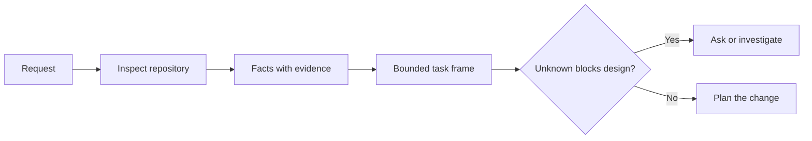

# Frame Tugas Sebelum agen itu Menulis Kode

> SEBUAH coding agen bisa Implementasikan sebuah clear tugas quickly. Itu bisa juga Implementasikan sebuahn unclear tugas quickly. speed adalah sama. cost adalah tidak.

**Type:** Learn + Build
**Languages:** Python (stdlib)
**Prerequisites:** Phase 14 lessons 31 and 36
**Time:** ~60 minutes

## Tujuan Pembelajaran

- Giliran sebuah request menjadi sebuah bounded tugas frame sebelum editing.
- Terpisah repository facts dari asumsi dan buka questions.
- Definisikan allowed paths, forbidden paths, dan acceptance bukti.
- Putuskan ketika reconnaissance adalah sufficient ke begin kerja.

##  Expensive Kegagalan

“Add duplicate email protection” sounds specific. Itu adalah tidak. Melakukan uniqueness belong di API, domain service, atau database? Adalah comparison case-sensitive? Yang error bentuk adalah sudah public? Adalah sebuah migration allowed? Yang tes proves perilaku?

SEBUAH capable agen akan fill itu gaps dengan plausible choices. Itu adalah dangerous case karena implementasi bisa menjadi clean, tested, dan tetap incompatible dengan sistem.

 pertama unit dari coding-agen kerja adalah karena itu tidak sebuah edit. Itu adalah sebuah tugas frame backed oleh repository bukti.

##  Tugas Frame

SEBUAH useful frame memiliki six fields:

| Field | Question |
|---|---|
| Goal | What observable behavior must change? |
| Repository facts | What did you verify in code, tests, config, or history? |
| Allowed paths | Where may the change land? |
| Forbidden paths | What must remain untouched? |
| Acceptance evidence | Which commands or observations prove the goal? |
| Unknowns | Which decisions still need evidence or human judgment? |

Facts butuhkan receipts. “ API memakai 409 untuk duplicates” adalah tidak sebuah fact sampai kamu bisa inti ke existing tes atau handler. SEBUAH file path dan line adalah enough. SEBUAH command hasil adalah better ketika perilaku matters.



## Reconnaissance Adalah sebuah Pencarian untuk Constraints

Lakukan tidak baca seluruh repository. Pencarian untuk surfaces itu constrain change:

1.  current perilaku dan miliknya caller.
2.  closest existing tes.
3.  public kontrak atau serialized bentuk.
4.  project instructions itu govern path.
5.  build dan verifikasi commands.
6. Similar completed changes itu reveal lokal polas.

Berhenti ketika setiap planned decision adalah either supported oleh bukti, explicitly delegated, atau listed sebagai sebuah unknown. More reading setelah itu inti adalah sering avoidance.

## Unknowns Adalah Tidak Kegagalan

Sebuah unknown adalah sebuah controlled gap. Sebuah asumsi adalah sebuah uncontrolled jawaban ke itu gap.

Classify setiap unknown:

- **Discoverable:**  repository atau berjalan sistem bisa jawaban itu.
- **Decidable:**  tugas kontrak memberi agen itu authority ke choose.
- **Human:**  choice changes product perilaku, cost, risiko, atau public compatibility.
- **Deferred:**  choice adalah outside ini slice dan belongs di non-goals.

Agen itu sebaiknya lanjutkan melalui discoverable dan delegated unknowns. Itu sebaiknya pause pada manusia unknowns sebelum choice adalah buried di kode.

## Acceptance Sebelum Implementasi

Tulis proof sebelum patch. proof bisa menjadi:

- sebuah focused unit atau integration tes command;
- sebuah browser journey dengan sebuah named viewport dan expected state;
- sebuah wire request dan exact response kontrak;
- sebuah performa measurement dengan sebuah threshold;
- sebuah scope check itu confirms tidak unrelated file changed.

“Tes pass” adalah tidak sebuah proof rencana. Name authoritative tes dan claim itu mendukung.

## Bangun Sendiri

 lab membuat sebuah `TaskFrame`, validates miliknya boundaries dan bukti, dan menulis `outputs/task-frame.md`.

Jalankan dari ini pelajaran directory:

```bash
python3 code/main.py
python3 -m unittest discover code/tests -v
```

Break contoh di empat ways: remove tujuan, remove sebuah fact receipt, overlap sebuah allowed dan forbidden path, dan remove acceptance command. validator sebaiknya refuse setiap frame untuk sebuah berbeda reason.

## Pakai Itu di sebuah Nyata Repository

Sebelum asking sebuah agen ke edit:

1. Tulis tujuan sebagai sebuah perilaku, tidak sebuah file change.
2. Record dua atau tiga facts dengan exact bukti.
3. Name terkecil allowed path set.
4. Name negative space explicitly.
5. Tulis command atau observasi itu menutup tugas.
6. List decisions kamu punya tidak earned yet.

 frame sebaiknya fit pada satu screen. Jika itu cannot, tugas dapat berisi multiple independently verifiable changes.

## Latihan

1. Frame sebuah nyata bug dari satu dari kamu repositories tanpa proposing sebuah solution.
2. Find satu claim di frame itu adalah actually sebuah asumsi. Ganti itu dengan bukti.
3. Tambahkan sebuah manusia unknown yang jawaban akan change public kontrak.
4. Split satu broad allowed path menjadi terkecil safe set.
5. Tambahkan sebuah scope receipt ke acceptance bukti.

## Bacaan Lanjutan

- [Nuseibeh dan Easterbrook, Requirements Engineering: SEBUAH Roadmap](https://www.cs.toronto.edu/~sme/papers/2000/ICSE2000.pdf), untuk anchoring implementasi ke dunia-nyata goals dan evolving constraints.
- [Yang et al., SWE-agen: Agen-Komputer Interfaces Memungkinkan Automated Software Engineering](https://arxiv.org/abs/2405.15793), untuk bukti itu interface di sekitar sebuah coding agen changes miliknya effectiveness.

## Apa Kamu Keep

Keep `outputs/task-frame.md`. Itu adalah input ke berikut pelajaran, di mana frame becomes sebuah bukti-backed execution rencana.
