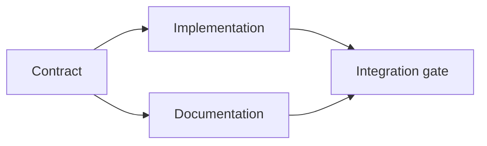

# Build sebuah Bukti-Backed Execution Rencana

> SEBUAH rencana adalah tidak sebuah prettier ke-lakukan list. Itu adalah sebuah dependency graf di yang setiap change memiliki sebuah reason dan setiap terminal node memiliki proof.

**Type:** Learn + Build
**Languages:** Python (stdlib)
**Prerequisites:** Phase 14 lesson 43
**Time:** ~65 minutes

## Tujuan Pembelajaran

- Convert sebuah tugas frame menjadi kerja items dengan bukti dan proof.
- Model ordering sebagai dependencies alih-alih prose sequence.
- Detect missing facts, unknown dependencies, dan cycles sebelum editing.
- Terpisah langkah itu bisa jalankan together dari langkah itu harus wait.

## Mengapa Agen Rencana Gagal

Weak rencana repeat request di future tense:

1. Update API.
2. Add tes.
3. Update dokumentasi.

Nothing di itu list menyatakan apa adalah found, mengapa itu file adalah benar, yang kontrak changes pertama, atau apa bisa happen concurrently. Sebuah agen bisa follow setiap langkah dan tetap buat rework.

SEBUAH strong rencana membuat lima commitments untuk setiap kerja item:

| Commitment | Purpose |
|---|---|
| Identifier | Stable reference for dependencies and handoff |
| Change | The smallest behavior or contract change |
| Evidence | Repository facts that justify the change |
| Dependencies | Work that must be true first |
| Proof | The exact check that closes the item |

## Rencana Kontrak Sebelum Miliknya Implementations

Ketika multiple surfaces depend pada sama perilaku, definisikan perilaku pertama. Tes, implementasi, dokumentasi, dan integration bisa maka share satu kontrak alih-alih inventing empat versions.



 graf exposes safe concurrency. Implementasi dan dokumentasi bisa proceed together setelah kontrak adalah fixed. Integration waits untuk keduanya.

## Bukti Changes Rencana

Repository bukti adalah tidak decoration. Itu sebaiknya menjadi capable dari changing kerja:

- Sebuah existing helper removes sebuah planned baru abstraction.
- SEBUAH compatibility tes forces sebuah migration langkah.
- SEBUAH deployment constraint moves sebuah schema change menjadi another tugas.
- SEBUAH public response type changes order dari implementasi dan dokumentasi.

Jika bukti cannot change rencana, itu adalah probably tidak bukti untuk itu decision.

## Design untuk Interruption

Coding-agen sesi berakhir unexpectedly. SEBUAH resumable rencana memiliki kerja items kecil enough itu another sesi bisa determine:

- yang item adalah complete;
- yang proof ran;
- yang artefak changed;
- yang dependencies adalah now unblocked;
- apa berikut safe item adalah.

Lakukan tidak encode state hanya di checked boxes di dalam sebuah chat. Store rencana berikut ke kerja.

## Rencana Validation

Reject rencana sebelum execution ketika:

- sebuah identifier adalah duplicated;
- sebuah kerja item memiliki tidak bukti;
- sebuah kerja item memiliki tidak proof;
- sebuah dependency names sebuah unknmenguasainyaem;
-  graf berisi sebuah cycle;
-  pertama irreversible aksi occurs sebelum relevant uncertainty adalah resolved.

 pertama lima checks adalah mechanical. terakhir membutuhkan judgment dan sebaiknya menjadi called out explicitly.

## Bangun Sendiri

`code/main.py` model kerja items, validates mereka receipts, computes execution waves dengan sebuah topological sort, dan menulis `outputs/evidence-plan.json`.

Jalankan:

```bash
python3 code/main.py
python3 -m unittest discover code/tests -v
```

 contoh produces tiga waves. Kontrak definition berjalan pertama. Implementasi dan dokumentasi jalankan together. integration gate berjalan terakhir.

## Pakai Itu dengan sebuah Coding Agen

Tanya agen itu ke produce rencana sebelum itu changes file. Review rencana untuk tiga hal:

1. Setiap path dan perilaku claim memiliki sebuah repository receipt.
2. Setiap item memiliki satu clear completion proof.
3.  graf delays expensive atau irreversible kerja sampai uncertainty itu depends pada adalah resolved.

Approve rencana, tidak sebuah vague promise ke menjadi careful.

## Latihan

1. Tambahkan sebuah migration item itu membutuhkan eksplisit manusia approval.
2. Buat sebuah cycle dan jelaskan hidden product disagreement di balik itu.
3. Split satu item itu memiliki dua proof commands.
4. Tambahkan sebuah kerja item itu bisa jalankan di kedua wave tanpa touching either existing branch.
5. Render rencana sebagai Markdown sementara keeping JSON sebagai source dari truth.

## Bacaan Lanjutan

- [Nuseibeh dan Easterbrook, Requirements Engineering: SEBUAH Roadmap](https://www.cs.toronto.edu/~sme/papers/2000/ICSE2000.pdf), untuk iterative relationship antara goals, spesifikasi, agreement, dan evolution.
- [Barry Boehm, SEBUAH Spiral Model dari Software Development dan Enhancement](https://dl.acm.org/doi/10.1145/12944.12948), untuk ordering development di sekitar risiko resolution rather than sebuah fixed linear sequence.

## Apa Kamu Keep

Keep `outputs/evidence-plan.json`. Itu becomes delegasi kontrak di berikut pelajaran.
