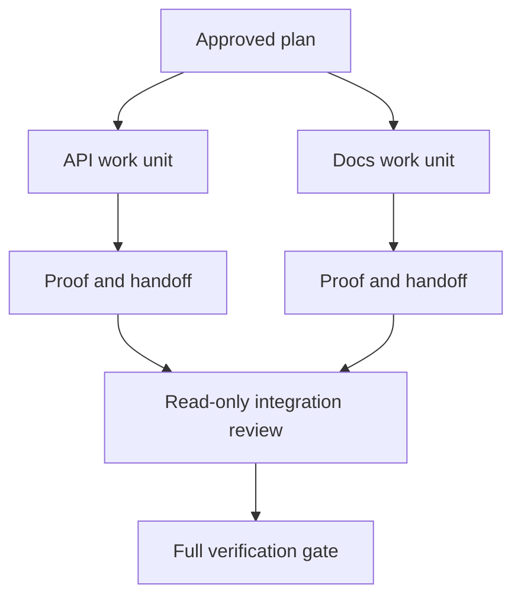

# Delegasikan Agen Kerja dengan Isolasi dan Merge Contracts

> Paralel agen save wall time hanya ketika kerja adalah independent. Otherwise mereka convert satu clear tugas menjadi sebuah coordination masalah dengan sebuah faster kegagalan rate.

**Type:** Learn + Build
**Languages:** Python (stdlib)
**Prerequisites:** Phase 14 lessons 39 and 44
**Time:** ~70 minutes

## Tujuan Pembelajaran

- Putuskan whether delegasi adalah justified oleh nyata independence.
- Beri setiap worker exclusive file ownership dan eksplisit proof.
- Compute execution waves dari dependencies.
- Design sebuah merge kontrak untuk combining agen kerja safely.

##  Parallelism Tes

Lakukan tidak delegasikan karena more agen adalah available. Delegasikan ketika pada least satu dari ini adalah true:

- dua investigations bisa jawaban berbeda unknowns independently;
- dua implementations own disjoint file dan contracts;
- sebuah reviewer bisa inspect sebuah completed artefak tanpa changing itu;
- sebuah lambat eksternal check bisa jalankan sementara lokal kerja melanjutkan.

Keep kerja serial ketika agen butuhkan sama file, sama unresolved decision, atau sama mutable environment.

## SEBUAH Kerja Unit Adalah sebuah Kontrak

Setiap delegated unit membutuhkan:

| Field | Meaning |
|---|---|
| Goal | One observable result |
| Owner | One accountable worker |
| Paths | Exclusive write ownership |
| Dependencies | Completed units required before starting |
| Proof | Exact evidence returned to the integrator |
| Handoff | Files changed, decisions made, remaining risk |

“Tangani backend” adalah tidak sebuah kerja unit. “Implementasikan duplicate check di `app/accounts.py` dan prove itu dengan focused account tes” adalah.

## Isolasi Memiliki Tiga Layers

1. **Filesystem isolation:** terpisah worktrees atau sandboxes prevent accidental shared edits.
2. **Ownership isolation:** contracts prevent dua workers dari intentionally editing sama path.
3. **State isolation:** terpisah logs dan outputs prevent satu worker dari overwriting another worker’s bukti.

Filesystem isolasi melakukan tidak solve ownership. Dua clean worktrees bisa tetap produce conflicting designs. merge kontrak harus resolve shared interfaces sebelum kerja begins.



##  Integrator Melakukan Tidak Rebuild Kerja

 integrator sebaiknya:

1. confirm setiap handoff matches miliknya assigned scope;
2. baca proof output, tidak just worker’s summary;
3. combine changes di dependency order;
4. jalankan penuh cross-unit gate;
5. reject hidden scope expansion;
6. record conflicts sebagai baru decisions, tidak silent edits.

Jika integration membutuhkan rewriting sebagian besar dari sebuah worker’s hasil, original decomposition adalah salah.

## Manusia dan Agen Roles

Delegasi melakukan tidak remove manusia judgment. manusia tetap owns choices itu change public perilaku, risiko, authority, atau irreversible cost. Agen bisa own bounded investigation, implementasi, verifikasi, dan review.

Ini adalah calibrated autonomy: sistem grants freedom di mana bukti dan rollback adalah strong, dan membutuhkan sebuah checkpoint di mana consequence adalah high.

## Bangun Sendiri

 lab checks path overlap, validates dependencies, computes safe execution waves, dan menulis `outputs/delegation-plan.json`.

Jalankan:

```bash
python3 code/main.py
python3 -m unittest discover code/tests -v
```

Change docs unit ke own `app/`. rencana sebaiknya block karena itu parent path overlaps API unit.

## Latihan

1. Decompose sebuah nyata change menjadi dua independent kerja units dan satu integrator.
2. Find sebuah proposed paralel split itu hanya looks independent. State shared decision.
3. Tambahkan sebuah baca-hanya riset worker yang output adalah sebuah fact table.
4. Tambahkan sebuah merge gate itu checks final changed-file set terhadap semua unit contracts.
5. Definisikan sebuah cancellation aturan untuk sebuah worker yang dependency becomes invalid.

## Bacaan Lanjutan

- [Reid Smith, Kontrak Net Protokol](https://doi.org/10.1109/TC.1980.1675516), untuk sebuah early formal treatment dari distributed tugas allocation dan hasil reporting.
- [Eric Horvitz, Principles dari Mixed-Initiative User Interfaces](https://dl.acm.org/doi/10.1145/302979.303030), untuk deciding ketika automation sebaiknya bertindak dan ketika itu sebaiknya kembalikan kontrol ke sebuah person.

## Apa Kamu Keep

Keep `outputs/delegation-plan.json`. Itu records mengapa split adalah safe, yang owns setiap path, dan apa proof integration harus terima.
