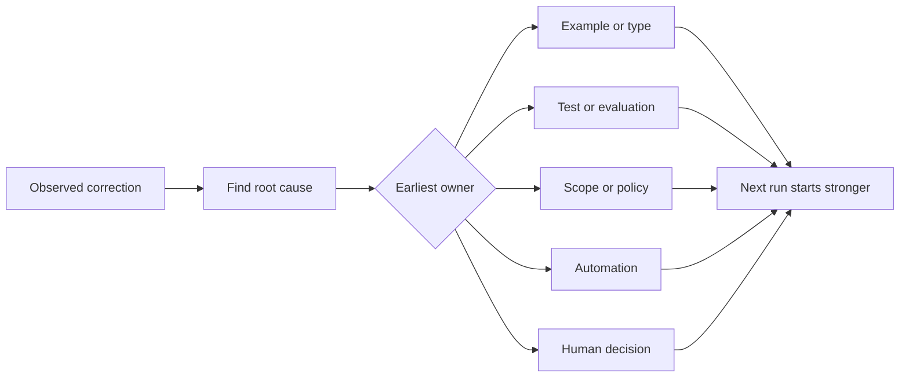

# Giliran Setiap agen Correction menjadi sebuah Sistem Improvement

> SEBUAH correction itu lives hanya di chat fixes satu jalankan. SEBUAH correction promoted menjadi sebuah tes, boundary, contoh, atau tool meningkatkan setiap later jalankan.

**Type:** Learn + Build
**Languages:** Python (stdlib)
**Prerequisites:** Phase 14 lessons 37 to 41
**Time:** ~65 minutes

## Tujuan Pembelajaran

- Convert agen corrections menjadi durable mengontrol.
- Place setiap kontrol pada earliest layer itu bisa prevent recurrence.
- Deduplicate repeated pelajaran dengan stable fingerprints.
- Retire mengontrol itu tidak longer protect sebuah nyata risiko.

## Corrections Adalah Bukti

Ketika kamu tell sebuah agen “lakukan tidak edit itu file,” kamu punya learned itu scope boundary adalah tidak executable. Ketika kamu nyatakan “ini output bentuk adalah salah,” kamu punya learned itu sebuah contoh atau tes adalah missing. Ketika setup gagal again, kamu punya learned itu environment knowledge belongs di automation.

Treat correction sebagai sebuah observasi tentang kerja sistem, tidak sebagai sebuah prompt-writing kegagalan.

## Promote ke Earliest Efektif Layer

Pakai ini order:

| Recurring failure | Durable destination |
|---|---|
| Wrong result or regression | Test or evaluation |
| Off-scope or unsafe action | Scope or permission policy |
| Repeated setup or command mistake | Automation or tool |
| Repeated output-format mistake | Canonical example plus validator |
| Ambiguous local convention | Instruction with a scenario check |
| Product disagreement | Human decision record |

Earlier mengontrol adalah cheaper. SEBUAH type itu prevents sebuah invalid state adalah stronger than sebuah review comment itu catches itu later. SEBUAH focused tes adalah stronger than sebuah paragraph asking agen itu ke remember.



##  Ratchet Record

Capture:

- symptom;
- root cause;
- consequence;
- recurrence count;
- chosen kontrol;
- verifikasi untuk kontrol;
- owner;
- date ke review atau retire itu.

Lakukan tidak promote setiap satu-off preference. Promote sebuah correction ketika recurrence atau consequence justifies permanent complexity.

## Terpisah Cause dari Symptom

“Agen itu edited README” adalah sebuah symptom. Possible causes sertakan:

-  tugas allowed repository root;
- docs adalah implicitly considered safe;
-  rencana bundled implementasi dan dokumentasi;
- dua workers memiliki overlapping ownership.

Setiap cause belongs ke sebuah berbeda kontrol. SEBUAH aturan itu merely repeats symptom akan gagal di berikut slightly berbeda case.

## Mengontrol Juga Decay

Lama mengontrol bisa conflict, bloat context, dan encode sebuah sistem itu tidak longer exists. Setiap promoted aturan membutuhkan sebuah retirement check. Remove atau rewrite itu ketika:

-  underlying architecture changed;
- sebuah stronger executable kontrol Gantid itu;
-  kegagalan memiliki tidak recurred lintas sebuah meaningful window;
-  kontrol membuat more friction than risiko itu prevents.

 tujuan adalah tidak longest instruction file. Itu adalah terkecil sistem itu preserves hard-won judgment.

## Bangun Sendiri

 lab classifies corrections, promotes mereka menjadi mengontrol, fingerprints duplicates, dan menulis `outputs/feedback-ratchet.json`.

Jalankan:

```bash
python3 code/main.py
python3 -m unittest discover code/tests -v
```

Add dua differently worded corrections dengan sama cause. Tingkatkan normalization sampai mereka collapse menjadi satu kontrol tanpa collapsing unrelated kegagalan.

## Latihan

1. Ambil lima corrections dari sebuah recent coding sesi dan classify mereka nyata owners.
2. Ganti satu prose aturan dengan sebuah executable tes.
3. Add consequence weighting so sebuah severe pertama occurrence bisa menjadi promoted immediately.
4. Tambahkan sebuahn owner dan retirement date ke lab output.
5. Review satu existing agen instruction dan delete itu hanya setelah proving sebuah stronger kontrol exists.

## Bacaan Lanjutan

- [Basili, Caldiera, dan Rombach, Tujuan Pertanyaan Metrik Pendekatan](https://www.cs.toronto.edu/~sme/CSC444F/handouts/GQM-paper.pdf), untuk turning goals menjadi questions dan operasional measurements.
- [Shinn et al., Reflexion](https://arxiv.org/abs/2303.11366), untuk memakai feedback traces ke tingkatkan later decisions tanpa changing model weights.
- [Madaan et al., Mandiri-Refine](https://arxiv.org/abs/2303.17651), untuk iterative feedback dan revision di dalam sebuah tugas loop.

## Apa Kamu Keep

Keep `outputs/feedback-ratchet.json`. Itu adalah durable berakhir dari agen itu-Assisted Engineering path dan input ke future workbench changes.
