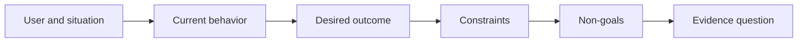

# Definisikan Outcome Sebelum Kamu Choose Output

> Cepat implementasi meningkatkan penalty untuk choosing salah masalah. Bentuk outcome pertama so speed points di right direction.

**Type:** Learn + Build
**Languages:** Python (stdlib)
**Prerequisites:** None
**Time:** ~60 minutes

## Tujuan Pembelajaran

- Tulis sebuah outcome frame tanpa naming sebuah solution.
- Identifikasi user, situation, current perilaku, dan desired change.
- Buat constraints dan non-goals eksplisit.
- Detect solution leakage sebelum itu hardens menjadi scope.

## Output Adalah Tidak Outcome

“Build sebuah incident assistant” names sebuah output. Itu melakukan tidak nyatakan yang membutuhkan itu, apa becomes better, atau apa harus remain safe.

Sebuah outcome frame menyatakan:

> Ketika sebuah produksi alert arrives, pada-panggil engineer identifies failing service dan sebuah safe berikut aksi di dalam dua minutes, sementara diagnosis remains baca-hanya dan auditable.

Itu sentence bisa menjadi satisfied oleh software, sebuah runbook, sebuah data repair, atau sebuah smaller interface change. Itu keeps tim attached ke hasil rather than pertama artefak someone imagined.

##  Six-Bagian Frame

| Part | Question |
|---|---|
| User | Who experiences the problem directly? |
| Situation | When and where does it occur? |
| Current behavior | What happens today, including workarounds? |
| Desired outcome | What observable state should improve? |
| Constraints | Which safety, policy, cost, or compatibility limits are fixed? |
| Non-goals | What tempting adjacent work is excluded? |



## Find Solution Leakage

Outcome statements leak solutions ketika mereka berisi sebuah product form, interface, model choice, framework, atau architecture itu memiliki tidak menjadi earned oleh bukti.

- “Users terima sebuah weekly AI summary” leaks summary dan cadence.
- “Users pahami account changes sebelum approval” states hasil.
- “Deploy sebuah vector database” leaks infrastructure.
- “Relevant kebijakan bukti adalah available selama review” states sebuah kapabilitas.

Constraints bisa name technology ketika compatibility truly fixes itu. Record mengapa itu adalah fixed.

## Constraints Protect Outcome

Constraints adalah tidak implementasi details. Mereka adalah bagian dari dunia-nyata tujuan:

- tidak produksi menulis selama diagnosis;
- response di dalam incident time budget;
- existing audit events remain authoritative;
- tidak baru runtime dependency;
- accessibility perilaku remains intact.

SEBUAH build itu reaches outcome oleh violating sebuah constraint memiliki tidak reached outcome.

## Non-Goals Buat sebuah Boundary

Non-goals prevent sebuah useful slice dari turning menjadi sebuah platform. Baik non-goals adalah concrete enough ke reject kerja:

- tidak automatic remediation;
- tidak baru alert-routing sistem;
- tidak Gantiment dari incident commander;
- tidak historical analytics di ini slice.

## Bangun Sendiri

 lab validates sebuah `OutcomeFrame` dan menulis `outputs/outcome-frame.json`.

```bash
python3 code/main.py
python3 -m unittest discover code/tests -v
```

Ganti desired outcome dengan “pakai incident assistant.” validator sebaiknya flag itu proposed output leaked menjadi outcome.

## Latihan

1. Rewrite sebuah feature request dari kamu backlog sebagai sebuah outcome frame.
2. Add satu constraint itu changes yang solutions remain possible.
3. Add dua non-goals itu keep pertama slice kecil.
4. Identifikasi earliest observasi itu akan disprove desired outcome.
5. Tulis tiga berbeda outputs itu bisa satisfy sama outcome.

## Bacaan Lanjutan

- [Nuseibeh dan Easterbrook, Requirements Engineering: SEBUAH Roadmap](https://www.cs.toronto.edu/~sme/papers/2000/ICSE2000.pdf), untuk treating dunia-nyata goals sebagai anchor untuk software kerja.
- [Dardenne, van Lamsweerde, dan Fickas, Tujuan-Directed Requirements Acquisition](https://doi.org/10.1016/0167-6423(93)90021-G), untuk refining high-level goals menjadi constraints dan operasional requirements.

## Apa Kamu Keep

Keep `outputs/outcome-frame.json`. berikut pelajaran tes itu terhadap workflow people actually perform.
