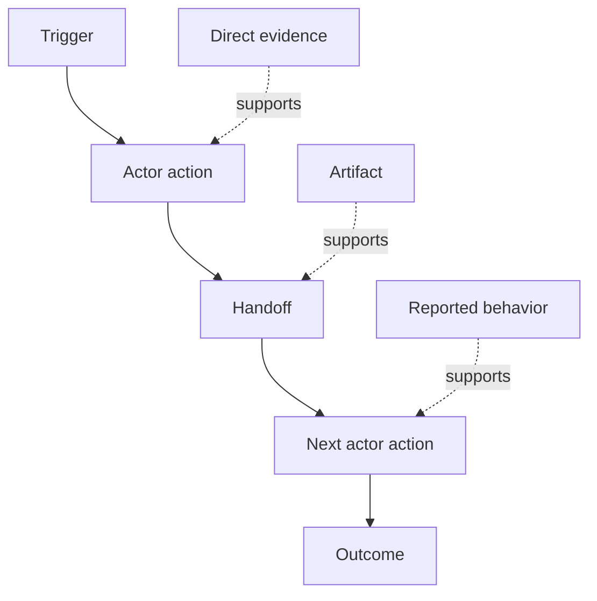

# Discover Workflow People Actually Perform

> Requirements adalah tidak waiting di sebuah meeting ke menjadi collected. Mereka adalah scattered lintas aksi, jalan pintass, records, dan disagreements.

**Type:** Learn + Build
**Languages:** Python (stdlib)
**Prerequisites:** Phase 14 lesson 47
**Time:** ~70 minutes

## Tujuan Pembelajaran

- Model current workflow sebagai ordered aksi dengan bukti.
- Terpisah direct observasi dari reported atau inferred perilaku.
- Locate friction, handoffs, authority, dan hidden state.
- Keep uncertain claims visible alih-alih turning mereka menjadi requirements.

## Mulai dengan Current Sistem

Lakukan tidak begin oleh asking apa features people inginkan. Begin oleh reconstructing apa happens now.

Untuk setiap langkah, record:

| Field | Example |
|---|---|
| Actor | On-call engineer |
| Trigger | Production alert arrives |
| Action | Opens alert, then searches dashboards |
| Input | Alert payload and deployment record |
| Output | Candidate service and owner |
| Friction | Context switching across three tools |
| Authority | Incident commander approves a write |
| Evidence | Screen recording, incident log, runbook |

 workflow adalah larger than screen. Itu mencakup waiting, copy-paste, side channels, approval, error recovery, dan langkah people memiliki stopped noticing.

## Bukti Memiliki Strength

Pakai sebuah sederhana bukti ladder:

1. **Direct behavior:** observasi, trace, recording, atau sistem event.
2. **Artifact:** ticket, runbook, log, form, atau completed output.
3. **Reported behavior:** sebuah person describes apa mereka lakukan.
4. **Inference:**  tim concludes apa probably happens.

Semua empat bisa menjadi useful. Hanya pertama dua prove current perilaku directly. Label rest so confidence melakukan tidak silently inflate.



## Pencarian untuk Empat Hal

- **Friction:** repeated effort, delay, re-entry, atau recovery.
- **Hidden state:** facts carried di memori, chat, atau personal notes.
- **Authority:**  person atau sistem allowed ke buat sebuah consequential change.
- **Exceptions:**  case di mana normal workflow berhenti being normal.

AI features sering gagal pada handoffs dan exceptions karena happy path adalah hanya path shaped.

## Lakukan Tidak Average Away Disagreement

Dua users bisa perform berbeda workflow untuk baik reasons. Preserve variants sampai kamu pahami whether mereka represent:

- berbeda roles;
- berbeda risiko levels;
- legacy dan current process;
- expertise differences;
- sebuah genuine kebijakan disagreement.

Sebuah averaged workflow bisa deskripsikan nobody.

## Bangun Sendiri

 lab stores bukti pada setiap workflow langkah, validates ordering dan confidence, calculates direct-bukti ratio, dan menulis `outputs/workflow-evidence.json`.

```bash
python3 code/main.py
python3 -m unittest discover code/tests -v
```

Tambahkan sebuahn exception path di yang deployment record adalah missing. Keep utama order intact dan record di mana branch begins.

## Latihan

1. Reconstruct satu workflow dari sebuah log tanpa interviewing anyone.
2. Interview sebuah user dan mark setiap claim itu tetap lacks direct bukti.
3. Add satu authority boundary dan satu kegagalan-recovery langkah.
4. Model dua workflow variants tanpa merging mereka.
5. Identifikasi sebuah proposed feature itu removes sebuah visible langkah but leaves hidden kerja untouched.

## Bacaan Lanjutan

- [Nuseibeh dan Easterbrook, Requirements Engineering: SEBUAH Roadmap](https://www.cs.toronto.edu/~sme/papers/2000/ICSE2000.pdf), especially miliknya treatment dari elicitation sebagai interpretation, modelling, dan validation rather than sederhana capture.
- [Gotel dan Finkelstein, Sebuah Analysis dari Requirements Traceability Masalah](https://doi.org/10.1109/ICRE.1994.292398), untuk difficulty dari preserving relationship antara requirements dan mereka sources.

## Apa Kamu Keep

Keep `outputs/workflow-evidence.json`. Itu giliran observed friction dan uncertainty menjadi sebuah asumsi map di berikut pelajaran.
