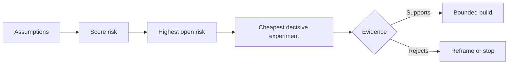

# Map Asumsi dan Resolve Riskiest Satu Pertama

> SEBUAH roadmap hides uncertainty di dalam features. Sebuah asumsi map exposes apa harus menjadi true sebelum itu features deserve ke exist.

**Type:** Learn + Build
**Languages:** Python (stdlib)
**Prerequisites:** Phase 14 lesson 48
**Time:** ~65 minutes

## Tujuan Pembelajaran

- Convert proposed kerja menjadi eksplisit asumsi.
- Score impact, uncertainty, dan irreversibility separately.
- Choose berikut experiment oleh risiko, tidak enthusiasm.
- Ganti tested asumsi dengan bukti dan decisions.

## Setiap Build Berisi Bets

Sebuah incident tool dapat depend pada semua dari ini being true:

- alert context berisi enough information ke identifikasi sebuah service;
- engineers trust sebuah recommendation mereka melakukan tidak derive themselves;
-  desired response time matters operationally;
- required data bisa menjadi accessed tanpa unsafe authority;
-  workflow happens sering enough ke justify maintenance.

Ini adalah tidak implementasi tugas. Mereka adalah conditions untuk build ke menjadi valuable, usable, feasible, dan safe.

## Asumsi Classes

| Class | Question |
|---|---|
| Value | Will the outcome matter enough? |
| Usability | Can the user understand and act on it? |
| Feasibility | Can the system produce it with available data and constraints? |
| Viability | Can the organization sustain cost, ownership, and operation? |
| Safety | Can it fail without unacceptable consequence? |

Tulis asumsi sebagai falsifiable statements. “ feature adalah useful” cannot menjadi tested. “Eight dari ten pada-panggil engineers identifikasi benar service faster dengan baca-hanya hasil” bisa.

## Risiko Adalah Tidak Satu Number

 lab memakai tiga dimensions dari satu ke lima:

- **Impact:** damage jika asumsi adalah false.
- **Uncertainty:** weakness dari current bukti.
- **Irreversibility:** cost dari pembelajaran setelah commitment.

 contoh score multiplies impact dan uncertainty, maka adds irreversibility. formula adalah tidak universal. Miliknya purpose adalah ke force tim ke state mengapa satu unknown sebaiknya menjadi resolved sebelum another.



## Design sebuah Experiment, Tidak sebuah Confirmation Ritual

SEBUAH useful tes memiliki:

- sebuah claim itu bisa menjadi false;
- sebuah population atau realistic sample;
- sebuah observable hasil;
- sebuah threshold decided sebelum hasil;
- sebuah berikut decision untuk pass, gagal, dan ambiguous bukti.

Avoid tes itu hanya demonstrasikan itu tim bisa build ide.

## Reversibility Changes Order

High-consequence, irreversible choices butuhkan earlier bukti. SEBUAH baca-hanya replay bisa precede sebuah produksi integration. SEBUAH temporary adapter bisa precede sebuah data migration. SEBUAH manusia-approved recommendation bisa precede automatic aksi.

 bentuk dari build sebaiknya follow bentuk dari uncertainty.

## Bangun Sendiri

 lab ranks asumsi, distinguishes tested dari buka claims, selects highest buka risiko, dan menulis `outputs/assumption-map.json`.

```bash
python3 code/main.py
python3 -m unittest discover code/tests -v
```

Change bukti pada highest-risiko asumsi dan observasi bagaimana berikut experiment changes.

## Latihan

1. Tulis lima asumsi untuk sebuah feature kamu inginkan ke build.
2. Add satu keamanan asumsi itu kamu feature list omitted.
3. Definisikan sebuah threshold itu akan cause kamu ke berhenti build.
4. Ganti satu besar experiment dengan sebuah cheaper decisive tes.
5. Bandingkan risiko ranking dengan roadmap priority dan jelaskan mismatch.

## Bacaan Lanjutan

- [Barry Boehm, SEBUAH Spiral Model dari Software Development dan Enhancement](https://dl.acm.org/doi/10.1145/12944.12948), untuk sebuah risiko-driven development cycle itu resolves uncertainty sebelum deeper commitment.
- [Dardenne, van Lamsweerde, dan Fickas, Tujuan-Directed Requirements Acquisition](https://doi.org/10.1016/0167-6423(93)90021-G), untuk refining goals sementara surfacing obstacles dan constraints.

## Apa Kamu Keep

Keep `outputs/assumption-map.json`. berikut pelajaran memakai itu ke choose terkecil slice itu bisa produce decisive bukti.
