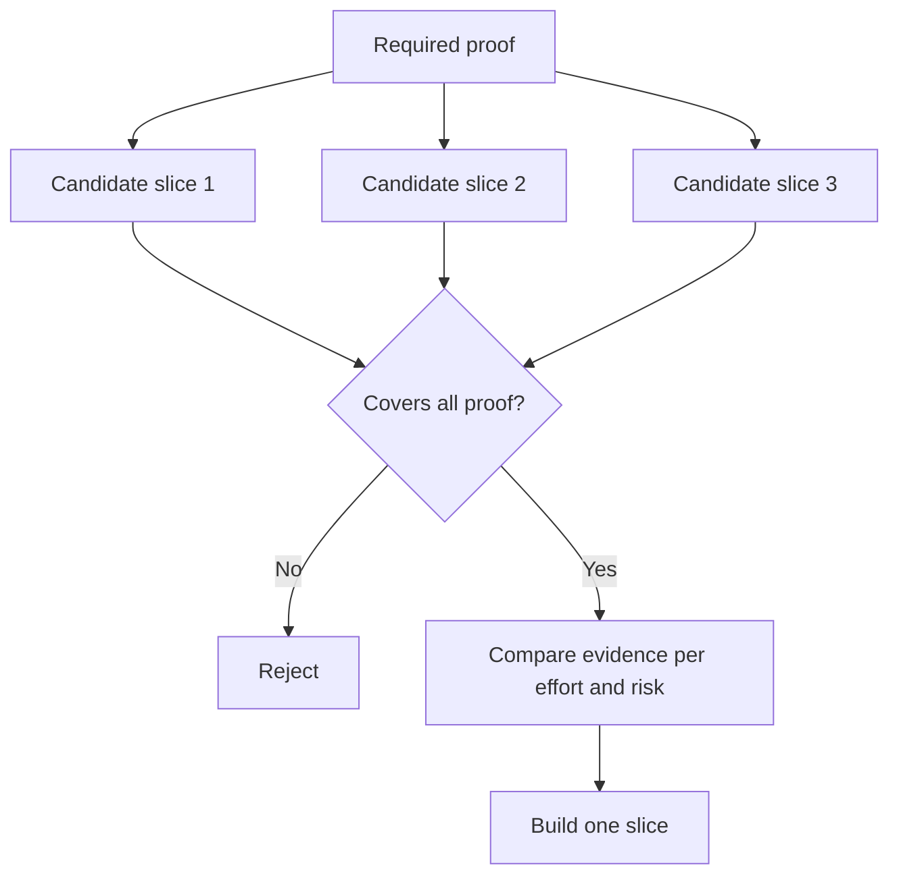

# Choose Terkecil Slice Itu Bisa Change Decision

> Kecil adalah useful hanya ketika itu proves something penting. SEBUAH tiny build itu cannot change berikut decision adalah merely incomplete.

**Type:** Learn + Build
**Languages:** Python (stdlib)
**Prerequisites:** Phase 14 lesson 49
**Time:** ~65 minutes

## Tujuan Pembelajaran

- Definisikan sebuah slice oleh asumsi itu proves.
- Balance outcome value, uncertainty reduction, effort, dan consequence.
- Prefer reversible bukti atas premature produksi commitment.
- Reject slices itu omit risky bagian dari workflow.

## Vertical Means Bukti Ujung ke ujung

SEBUAH useful slice crosses minimum nyata workflow needed ke observasi sebuah outcome. Itu bisa menjadi narrow di users, data, duration, dan kapabilitas. Itu sebaiknya tidak menjadi narrow oleh removing exact uncertainty kamu perlu tes.

Contoh:

- SEBUAH baca-hanya replay lintas ten nyata incidents tes service identification dan operator trust.
- SEBUAH polished dashboard pada synthetic data dapat tes comprehension but tidak data feasibility.
- SEBUAH produksi auto-remediator tes everything pada once dengan unacceptable consequence.

## Definisikan Required Proof Pertama

Ambil highest-risiko buka asumsi dan giliran mereka menjadi sebuah required proof set. SEBUAH candidate slice adalah eligible hanya jika itu covers itu set.

Maka bandingkan eligible slices pada:

| Dimension | Direction |
|---|---|
| Outcome value | More is better |
| Uncertainty reduced | More is better |
| Effort | Less is better |
| Consequence | Less is better |
| Reversibility | More is better |

 lab’s score adalah intentionally sederhana. eligibility gate matters more than arithmetic.



## Umum False Minimums

- **The UI-only minimum:** removes data dan operasional uncertainty.
- **The infrastructure-only minimum:** proves technical possibility tanpa user value.
- **The happy-path minimum:** omits exception itu membuat sebagian besar risiko.
- **The demo minimum:** produces sebuah persuasive artefak but tidak repeatable measurement.
- **The platform minimum:** builds reusable machinery sebelum satu workflow earns itu.

## Tambahkan sebuah Berhenti Aturan

Sebelum implementasi, tulis apa happens jika slice gagal:

- abandon outcome;
- change target user atau situation;
- tes sebuah berbeda mechanism;
- collect better bukti;
- narrow authority further.

Jika setiap hasil leads ke “keep building,” slice adalah tidak sebuah experiment.

## Bangun Sendiri

 lab filters candidates oleh required proof, scores eligible slices, dan menulis `outputs/slice-decision.json`.

```bash
python3 code/main.py
python3 -m unittest discover code/tests -v
```

Tambahkan sebuah cheaper candidate itu proves hanya satu required asumsi. Itu sebaiknya remain ineligible even jika miliknya numerical score adalah high.

## Latihan

1. Design tiga slices untuk sama outcome pada berbeda consequence levels.
2. State required proof set sebelum scoring mereka.
3. Remove satu kapabilitas sementara preserving decisive bukti.
4. Tambahkan sebuah berhenti aturan untuk sebuah failed pilot.
5. Identifikasi sebuah reusable platform component itu sebaiknya wait sampai setelah slice.

## Bacaan Lanjutan

- [Barry Boehm, SEBUAH Spiral Model dari Software Development dan Enhancement](https://dl.acm.org/doi/10.1145/12944.12948), untuk matching setiap development cycle ke risiko itu harus resolve.
- [Lenarduzzi dan Taibi, MVP Explained: SEBUAH Systematic Mapping Study pada Definitions dari Minimal Viable Product](https://arxiv.org/abs/1609.07592), untuk ambiguity di sekitar “minimum” dan “viable” di software product practice.

## Apa Kamu Keep

Keep `outputs/slice-decision.json`. Itu records mengapa ini slice adalah terkecil satu itu bisa change decision.
