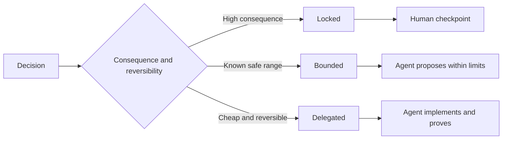

# Tulis Spesifikasi Itu Preserve Judgment

> SEBUAH useful spesifikasi fixes invariants dan bukti sementara leaving reversible implementasi choices buka. Itu adalah sebuah decision boundary, tidak sebuah screenplay.

**Type:** Learn + Build
**Languages:** Python (stdlib)
**Prerequisites:** Phase 14 lesson 50
**Time:** ~75 minutes

## Tujuan Pembelajaran

- Terpisah outcome, invariants, contoh, non-goals, dan proof.
- Mark decisions sebagai locked, bounded, atau delegated.
- Preserve agen judgment di mana choices adalah cheap dan reversible.
- Butuhkan manusia checkpoints di mana consequence atau public perilaku changes.

## Dua Buruk Extremes

Sebuah underspecified tugas bertanya sebuah agen ke guess sistem. Sebuah overspecified tugas bertanya itu ke transcribe sebuah design itu dapat sudah menjadi salah.

 useful middle adalah sebuah executable kontrak:

| Surface | Purpose |
|---|---|
| Outcome | The observable result |
| Invariants | Conditions that must always remain true |
| Examples | Concrete cases that reveal intent |
| Non-goals | Adjacent behavior intentionally excluded |
| Decision policy | Which choices are locked, bounded, or delegated |
| Proof | Evidence required before completion |

## Tiga Decision Modes

- **Locked:** agen itu harus tidak choose. Pakai untuk public compatibility, authority, keamanan, irreversible cost, atau sebuah product commitment.
- **Bounded:** agen itu dapat choose di dalam eksplisit limits. Pakai untuk pencarian budgets, retry counts, allowed dependencies, atau sebuah known interface family.
- **Delegated:** agen itu owns choice dan harus jelaskan itu. Pakai untuk lokal structure, names, reversible refactors, dan implementasi details.



## Specify Perilaku Melalui Contoh

Contoh compress intent better than adjectives. “Helpful,” “robust,” dan “produksi-ready” adalah tidak executable. SEBUAH kecil set dari normal, edge, kegagalan, dan forbidden contoh memberi keduanya builder dan verifier something concrete.

Contoh lakukan tidak Ganti invariants. Satu passing case cannot prove sebuah universal keamanan aturan.

## Proof Harus Match Claim

- SEBUAH unit tes proves sebuah lokal function kontrak.
- SEBUAH wire tes proves serialization dan transport perilaku.
- SEBUAH browser journey proves sebuah interface path.
- SEBUAH replay set proves perilaku atas representative cases.
- Sebuah audit log proves itu authority boundaries held.

Lakukan tidak accept sebuah lower layer sebagai proof dari sebuah higher-layer claim.

## Preserve Unknowns Deliberately

SEBUAH spesifikasi bisa nyatakan “ implementasi dapat choose apa pun baca-hanya source itu mengembalikan di dalam time budget.” Itu adalah tidak vagueness. Itu adalah sebuah intentional delegated decision dengan sebuah boundary dan proof.

Spesifikasi sebaiknya evolve ketika bukti changes. Preserve reason di balik locked dan bounded choices so later teams bisa revise mereka tanpa archaeology.

## Bangun Sendiri

 lab validates setiap kontrak surface, checks decision modes, dan menulis `outputs/executable-specification.json`.

```bash
python3 code/main.py
python3 -m unittest discover code/tests -v
```

Move produksi-tulis decision dari locked ke delegated. Jelaskan mengapa schema accepts value but product risiko melakukan tidak.

## Latihan

1. Convert sebuah backlog ticket menjadi six spesifikasi surfaces.
2. Ganti tiga implementasi instructions dengan satu invariant dan dua contoh.
3. Mark setiap decision dan justify setiap locked atau bounded choice.
4. Tambahkan sebuah proof receipt untuk setiap invariant.
5. Remove sebuah constraint itu memiliki tidak bukti atau risiko rationale.

## Bacaan Lanjutan

- [Nuseibeh dan Easterbrook, Requirements Engineering: SEBUAH Roadmap](https://www.cs.toronto.edu/~sme/papers/2000/ICSE2000.pdf), untuk relationship di antara goals, precise spesifikasi, validation, agreement, dan evolution.
- [Zave dan Jackson, Empat Dark Corners dari Requirements Engineering](https://doi.org/10.1145/237432.237434), untuk separating environmental asumsi, requirements, dan spesifikasi.
- [Gotel dan Finkelstein, Sebuah Analysis dari Requirements Traceability Masalah](https://doi.org/10.1109/ICRE.1994.292398), untuk preserving mengapa sebuah requirement exists dan di mana itu came dari.

## Apa Kamu Keep

Keep `outputs/executable-specification.json`. Itu becomes kontrak itu coding agen dan manusia reviewers share.
