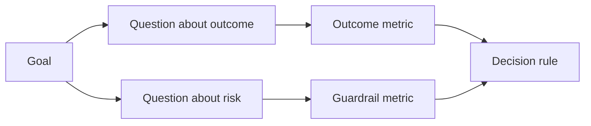

# Design Keberhasilan Metrik Sebelum Hasil Exists

> Measurement sebaiknya jawaban sebuah decision, tidak decorate sebuah dashboard. Mulai dengan tujuan, derive questions, maka choose terkecil metrik itu jawaban mereka.

**Type:** Learn + Build
**Languages:** Python (stdlib)
**Prerequisites:** Phase 14 lessons 47 and 51
**Time:** ~70 minutes

## Tujuan Pembelajaran

- Derive questions dan metrik dari sebuah outcome tujuan.
- Definisikan thresholds, windows, sources, dan directions sebelum observing hasil.
- Pair outcome metrik dengan guardrail dan counter-metrik.
- Match evaluasi bukti ke decision build harus dukung.

## Tujuan, Pertanyaan, Metrik

Mulai dengan sebuah tujuan:

> Kurangi time ke identifikasi affected service tanpa increasing unsafe aksi.

Derive questions:

- Bagaimana quickly adalah benar service identified?
- Bagaimana sering adalah identified service benar?
- Melakukan diagnosis remain baca-hanya?
- Melakukan workflow tingkatkan alert dismissal atau operator workload?

Maka choose metrik itu operationalize itu questions.



## SEBUAH Metrik Membutuhkan sebuah Kontrak

Setiap metrik membutuhkan:

| Field | Example |
|---|---|
| Name | `median_identification_seconds` |
| Direction | at most |
| Threshold | 120 |
| Window | ten incident replays |
| Source | replay event log |
| Population | on-call engineers in the pilot |
| Kind | outcome or guardrail |

Tanpa source dan window, sebuah number cannot menjadi reproduced. Tanpa sebuah threshold, itu cannot drive sebuah decision.

## Outcome, Guardrail, dan Counter-Metrik

- **Outcome metric:** melakukan desired state tingkatkan?
- **Guardrail:** melakukan sebuah fixed constraint remain true?
- **Counter-metric:** melakukan lokal improvement shift cost atau harm elsewhere?

Untuk sebuah incident workflow, speed adalah tidak enough. Correctness, produksi menulis, operator workload, dan missed alerts protect terhadap sebuah cepat but unsafe hasil.

## Offline dan Online Bukti

Offline replay adalah useful untuk repeatability dan edge coverage. SEBUAH bounded pilot adalah useful untuk nyata perilaku, trust, dan workflow effects. Neither substitutes untuk other.

Pakai cheapest bukti itu bisa jawaban current decision. Lakukan tidak expose nyata users merely karena implementasi adalah ready.

## Putuskan Sebelum Kamu Measure

Tulis pass, gagal, dan ambiguous paths sebelum seeing hasil. Otherwise tim akan move threshold ke protect build.

Contoh:

- pass: benar service rate pada least 0.9 dan median time pada sebagian besar 120 seconds;
- gagal: apa pun produksi tulis atau benar rate di bawah 0.75;
- ambiguous: kecil improvement dengan wide variance, requiring sebuah larger replay set.

## Bangun Sendiri

 lab validates sebuah measurement rencana, evaluates inclusive thresholds, records missing values, dan menulis `outputs/measurement-report.json`.

```bash
python3 code/main.py
python3 -m unittest discover code/tests -v
```

Remove guardrail metrik dan observasi mengapa rencana becomes invalid even ketika outcome metrik remain.

## Latihan

1. Derive tiga questions dari satu outcome tujuan.
2. Tambahkan sebuah counter-metrik itu catches cost shifted ke another peran.
3. Definisikan source, population, dan window untuk setiap metrik.
4. Tulis pass, gagal, dan ambiguous decisions sebelum generating values.
5. Identifikasi satu metrik itu adalah easy ke collect but cannot change decision. Remove itu.

## Bacaan Lanjutan

- [Basili, Software Modeling dan Measurement: Tujuan/Pertanyaan/Metrik Paradigm](https://drum.lib.umd.edu/items/8119803a-362b-42ec-b6ce-2311713e7236), untuk deriving operasional measurements dari eksplisit goals.
- [Basili, Caldiera, dan Rombach, Tujuan Pertanyaan Metrik Pendekatan](https://www.cs.toronto.edu/~sme/CSC444F/handouts/GQM-paper.pdf), untuk applying metode sebagai sebuah feedback dan improvement sistem.

## Apa Kamu Keep

Keep `outputs/measurement-report.json`. Itu defines bukti gate untuk prototype, pilot, atau produksi stage.
