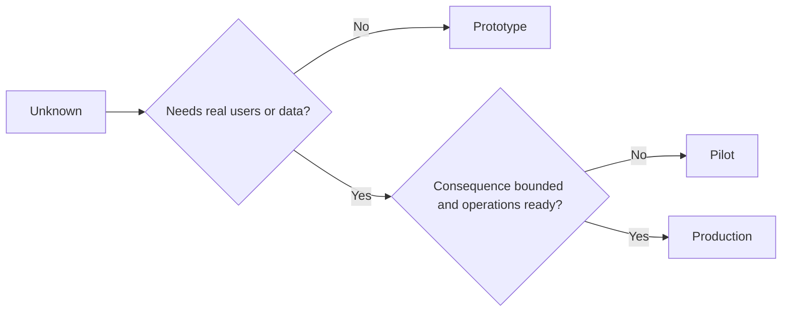

# Choose Prototype, Pilot, atau Produksi Deliberately

> Ini adalah berbeda pembelajaran environments, tidak levels dari polish. Choose stage itu menjawab current unknown dengan least unnecessary consequence.

**Type:** Learn + Build
**Languages:** Python (stdlib)
**Prerequisites:** Phase 14 lessons 50 to 52
**Time:** ~70 minutes

## Tujuan Pembelajaran

- Choose sebuah build stage dari unknown, audience, data, consequence, dan readiness.
- Definisikan stage-specific mengontrol dan exit criteria.
- Prevent prototypes dari quietly becoming produksi sistem.
- Delay nyata authority sampai bukti dan operations justify itu.

## Tiga Berbeda Questions

| Stage | Primary question |
|---|---|
| Prototype | Can this mechanism produce the evidence at all? |
| Pilot | Does it work safely with a bounded real audience and real conditions? |
| Production | Can we own it continuously at the promised reliability and risk level? |

SEBUAH prototype bisa menjadi technically complete dan tetap menjadi disposable. SEBUAH pilot bisa pakai produksi data sementara remaining limited di audience dan authority. Produksi begins ketika organization accepts ongoing responsibility.

## Prototype

Pakai sebuah prototype ketika unknown melakukan tidak butuhkan nyata users atau nyata data. Keep itu:

- discardable;
- isolated;
- narrow di perilaku;
- eksplisit tentang pembelajaran pertanyaan;
- free dari false operasional guarantees.

Lakukan tidak optimize architecture sebelum mechanism earns another stage.

## Pilot

Pakai sebuah pilot ketika unknown membutuhkan nyata perilaku, realistic data, atau sebuah nyata workflow, but consequence atau readiness adalah tidak yet compatible dengan broad release.

SEBUAH pilot membutuhkan:

- sebuah named audience;
- sebuah manusia owner;
- bounded duration dan authority;
- audit dan rollback;
- outcome dan guardrail thresholds;
- exit criteria untuk expand, revise, atau berhenti.

## Produksi

Produksi membutuhkan more than deployment:

- service level tujuan;
- pada-panggil dan incident ownership;
- keamanan dan privacy review;
- cost dan capacity mengontrol;
- rollback dan recovery;
- continuous monitoring;
- sebuah retirement path.



## Stage Drift

Prototype kode becomes dangerous ketika itu acquires users, data, atau authority tanpa acquiring ownership. Mark prototype dan pilot boundaries di configuration, access kontrol, telemetry, dan dokumentasi. SEBUAH warning banner adalah tidak enough.

 stage sebaiknya menjadi observable dari sistem itself.

## Bangun Sendiri

 lab chooses sebuah stage dari decision context, mengembalikan required mengontrol, dan menulis `outputs/stage-decisions.json`.

```bash
python3 code/main.py
python3 -m unittest discover code/tests -v
```

Change pilot contoh ke low consequence dengan operasional readiness. Jelaskan apa additional bukti akan justify produksi.

## Latihan

1. Classify tiga current projects oleh pembelajaran stage, tidak deployment status.
2. Tulis pilot exit criteria itu sertakan sebuah berhenti decision.
3. Tambahkan sebuah technical kontrol itu prevents sebuah prototype dari reaching produksi data.
4. Identifikasi pertama operasional responsibility itu membuat build produksi.
5. Design sebuah rollback receipt untuk bounded pilot.

## Bacaan Lanjutan

- [Barry Boehm, SEBUAH Spiral Model dari Software Development dan Enhancement](https://dl.acm.org/doi/10.1145/12944.12948), untuk matching setiap iteration’s commitment ke resolved risiko.
- [Fagerholm et al., Building Blocks untuk Continuous Experimentation](https://doi.org/10.1145/2601248.2601276), untuk organizational dan technical conditions required ke jalankan experiments continuously.

## Apa Kamu Keep

Keep `outputs/stage-decisions.json`. Itu records mengapa setiap stage adalah justified dan yang mengontrol harus exist sebelum berikut satu.
