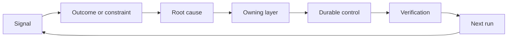

# Build sebuah Feedback Ratchet dengan Ownership dan Retirement

> Shipping menutup satu build loop dan membuka pembelajaran loop. Bukti harus change sistem atau itu becomes telemetry nobody owns.

**Type:** Learn + Build
**Languages:** Python (stdlib)
**Prerequisites:** Phase 14 lessons 46 and 53
**Time:** ~75 minutes

## Tujuan Pembelajaran

- Giliran incidents, evaluations, user perilaku, dan corrections menjadi owned aksi.
- Route setiap signal ke context, evaluasi, kebijakan, runtime, atau backlog.
- Prioritize recurrence oleh severity dan frequency.
- Beri setiap kontrol sebuah retirement condition.

## Feedback Adalah Infrastructure

SEBUAH tim bisa collect traces, evaluations, dukung tickets, dan incident logs tanpa pembelajaran dari apa pun dari mereka. missing mechanism adalah promotion: sebuah defined path dari observasi ke sebuah durable change dengan sebuah owner dan proof.

 loop adalah:

1. observasi sebuah concrete signal;
2. connect itu ke sebuah outcome, constraint, atau asumsi;
3. identifikasi earliest sistem layer itu owns cause;
4. buat sebuah bounded change;
5. verifikasi itu recurrence becomes less likely;
6. review whether kontrol sebaiknya remain.

## Route ke Owning Layer

| Signal | Destination |
|---|---|
| False positive, regression, wrong result | Evaluation or test |
| Missing context, duplicate work, stale fact | Context source or retrieval route |
| Unsafe action or authority gap | Policy or permission boundary |
| Timeout, retry storm, unavailable dependency | Runtime control |
| New product need or unresolved tradeoff | Shaped backlog item |

Fix cause pada earliest efektif layer. Lakukan tidak Tambahkan sebuahnother prompt paragraph ketika sebuah tes atau permission bisa buat kegagalan impossible.



## Ownership Adalah Bagian dari Kontrol

Setiap ratchet aksi membutuhkan:

- satu owner;
- sebuah priority based pada consequence dan recurrence;
-  artefak ke change;
-  verifikasi itu proves change;
- sebuah review atau expiry window;
- sebuah retirement condition.

Sebuah unowned improvement adalah sebuah observasi dengan better formatting.

## Retire Stale Mengontrol

Feedback sistem accumulate kebijakan. Itu kebijakan bisa become contradictory dan expensive. Review mengontrol ketika:

- architecture atau workflow changes;
- sebuah lower-level invariant Gantis sebuah higher-level instruction;
-  protected kegagalan memiliki tidak appeared lintas chosen window;
-  kontrol blocks legitimate kerja more sering than itu prevents harm.

Retirement juga membutuhkan bukti. Lakukan tidak delete sebuah kontrol karena itu feels lama.

## Connect Build dan Coding-Agen Feedback

 sama ratchet serves keduanya melacak:

- Product bukti changes outcome frame, asumsi, slice, atau measurement rencana.
- Coding-agen corrections change tes, context, scope, automation, atau handoff.
- Incidents bisa change keduanya product boundary dan agen itu workbench.

Ini adalah mengapa shaping build adalah tidak sebuah fase itu berakhir sebelum coding. Itu melanjutkan melalui setiap accepted change.

## Bangun Sendiri

 lab classifies signals, membuat owned ratchet aksi, prioritizes mereka, dan menulis `outputs/feedback-backlog.json`.

```bash
python3 code/main.py
python3 -m unittest discover code/tests -v
```

Tambahkan sebuah runtime timeout signal dan confirm itu itu routes ke runtime rather than general backlog.

## Latihan

1. Giliran satu incident dan satu user complaint menjadi ratchet aksi.
2. Name earliest layer itu bisa prevent setiap recurrence.
3. Add verifikasi commands atau observasi ke lab output.
4. Definisikan sebuah retirement condition untuk sebuah kebijakan aturan.
5. Trace satu accepted correction back menjadi berikut tugas frame.

## Bacaan Lanjutan

- [Basili, Caldiera, dan Rombach, Tujuan Pertanyaan Metrik Pendekatan](https://www.cs.toronto.edu/~sme/CSC444F/handouts/GQM-paper.pdf), untuk organizational pembelajaran melalui tujuan-oriented measurement.
- [Fagerholm et al., Building Blocks untuk Continuous Experimentation](https://doi.org/10.1145/2601248.2601276), untuk technical dan organizational loop itu connects bukti ke continued product development.
- [Nuseibeh dan Easterbrook, Requirements Engineering: SEBUAH Roadmap](https://www.cs.toronto.edu/~sme/papers/2000/ICSE2000.pdf), untuk treating requirements sebagai evolving melalui sistem lifecycle.

## Apa Kamu Keep

Keep `outputs/feedback-backlog.json`. Itu adalah closing artefak dari Product Judgment dan Delivery path dan input ke berikut outcome frame.
