# Protokol Komunikasi

> Agent yang tidak bisa berbicara bahasa yang sama bukan sebuah tim. Mereka asing yang berteriak ke ruang hampa.

**Type:** Build
**Languages:** TypeScript
**Prerequisites:** Phase 14 (Agent Engineering), Lesson 16.01 (Why Multi-Agent)
**Time:** ~120 minutes

## Tujuan Pembelajaran

- Implementasikan tool discovery dan invocation MCP agar agent bisa menggunakan tool yang diekspos oleh server eksternal
- Bangun agent card dan task endpoint A2A yang memungkinkan satu agent mendelegasikan pekerjaan ke agent lain melalui HTTP
- Bandingkan MCP (akses tool), A2A (agent-to-agent), ACP (audit enterprise), dan ANP (kepercayaan terdesentralisasi) dan jelaskan protokol mana yang memecahkan masalah mana
- Sambungkan beberapa protokol bersama dalam satu sistem di mana agent menemukan tool melalui MCP dan mendelegasikan tugas melalui A2A

## Masalahnya

Kamu memecah sistemmu menjadi banyak agent. Seorang researcher, seorang coder, seorang reviewer. Mereka hebat dalam pekerjaan masing-masing. Tetapi sekarang kamu ingin mereka benar-benar berbicara satu sama lain.

Percobaan pertamamu jelas:operasikan string. Researcher mengembalikan gumpalan teks, coder menguraikannya dengan cara apa pun yang bisa. Ini berfungsi sampai coder salah menafsirkan ringkasan riset, atau dua agent deadlock saling menunggu, atau kamu butuh agent yang dibangun oleh tim berbeda untuk berkolaborasi. Tiba-tiba "operasikan string saja" berantakan.

Ini adalah masalah protokol komunikasi. Tanpa kontrak bersama tentang bagaimana agent bertukar informasi, sistem multi-agent rapuh, tidak dapat diaudit, dan mustahil diskalakan melampaui segelintir agent yang kamu tulis sendiri.

Ekosistem AI telah merespons dengan empat protokol, masing-masing memecahkan irisan masalah yang berbeda:

- **MCP** untuk akses tool
- **A2A** untuk kolaborasi agent-to-agent
- **ACP** untuk keterauditabilitas enterprise
- **ANP** untuk identitas dan kepercayaan terdesentralisasi

Pelajaran ini masuk mendalam. Kamu akan membaca format wire nyata dari setiap spesifikasi, membangun implementasi yang berfungsi, dan menyambungkan keempatnya menjadi sistem terpadu.

## Konsepnya

### Lanskap Protokol

Bayangkan empat protokol ini sebagai lapisan, masing-masing mengatasi pertanyaan berbeda:

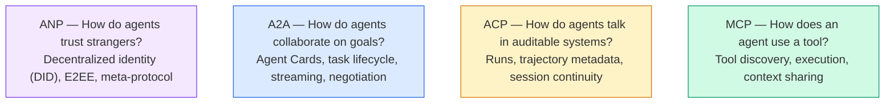

Mereka bukan pesaing. Mereka memecahkan masalah berbeda di level berbeda.

### MCP (Ringkasan)

MCP dibahas mendalam di Phase 13. Ringkasan cepat: MCP menstandarkan cara sebuah LLM terhubung ke tool dan sumber data eksternal. Ini adalah protokol **client-server** di mana agent (client) menemukan dan memanggil tool yang diekspos oleh server.

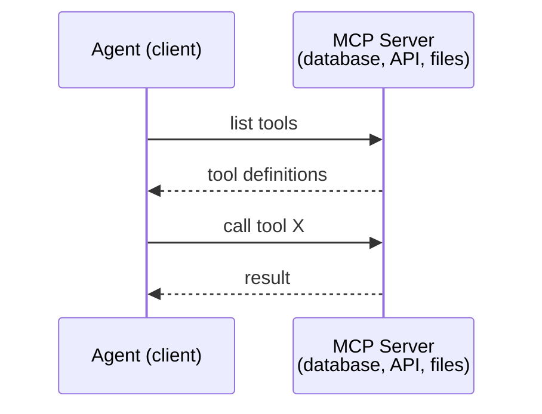

MCP adalah komunikasi **agent-to-tool**. Ia tidak membantu agent berbicara satu sama lain.

### A2A (Agent2Agent Protocol)

**Dibuat oleh:** Google (sekarang di bawah Linux Foundation sebagai `lf.a2a.v1`)
**Versi spesifikasi:** 1.0.0
**Masalah:** Bagaimana agent otonom berkolaborasi, bernegosiasi, dan mendelegasikan tugas satu sama lain?

A2A adalah protokol untuk **kolaborasi agent peer-to-peer**. Di mana MCP menghubungkan agent ke tool, A2A menghubungkan agent ke agent lain. Setiap agent memublikasikan sebuah **Agent Card** di URL yang diketahui umum, dan agent lain menemukan, bernegosiasi, dan mendelegasikan tugas kepadanya.

#### Cara A2A Bekerja

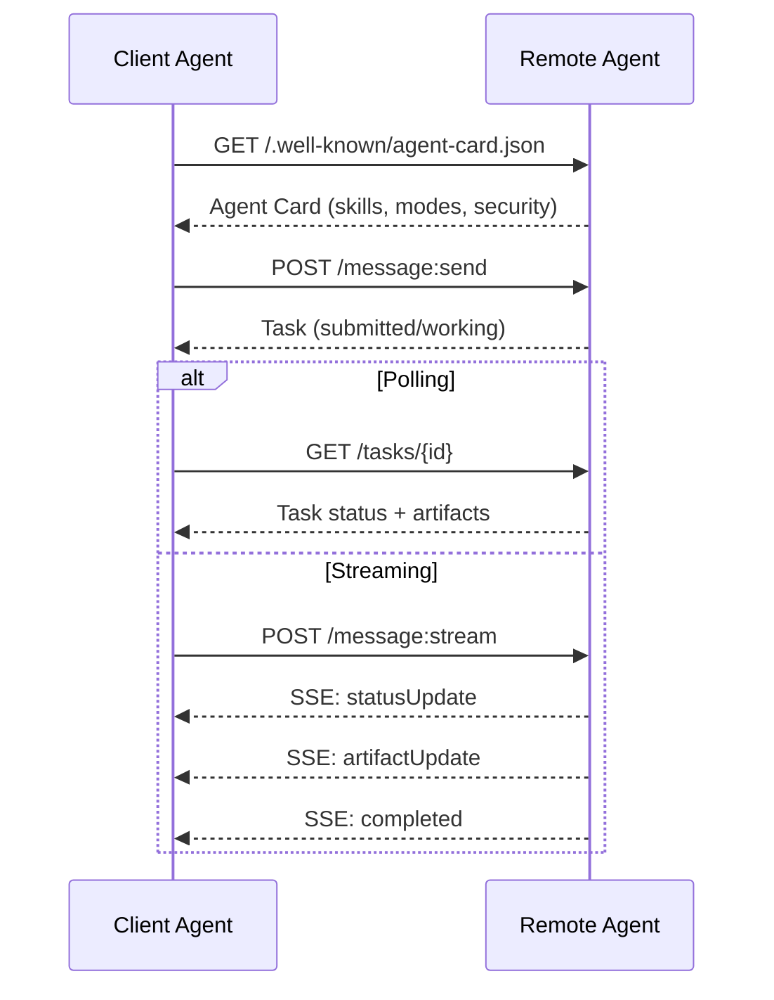

#### Agent Card yang Sebenarnya

Inilah tampilan Agent Card A2A yang sesungguhnya di lapangan. Dilayani di `GET /.well-known/agent-card.json`:

```json
{
  "name": "Research Agent",
  "description": "Searches documentation and summarizes findings",
  "version": "1.0.0",
  "supportedInterfaces": [
    {
      "url": "https://research-agent.example.com/a2a/v1",
      "protocolBinding": "JSONRPC",
      "protocolVersion": "1.0"
    },
    {
      "url": "https://research-agent.example.com/a2a/rest",
      "protocolBinding": "HTTP+JSON",
      "protocolVersion": "1.0"
    }
  ],
  "provider": {
    "organization": "Your Company",
    "url": "https://example.com"
  },
  "capabilities": {
    "streaming": true,
    "pushNotifications": false
  },
  "defaultInputModes": ["text/plain", "application/json"],
  "defaultOutputModes": ["text/plain", "application/json"],
  "skills": [
    {
      "id": "web-research",
      "name": "Web Research",
      "description": "Searches the web and synthesizes findings",
      "tags": ["research", "search", "summarization"],
      "examples": ["Research the latest changes in React 19"]
    },
    {
      "id": "doc-analysis",
      "name": "Documentation Analysis",
      "description": "Reads and analyzes technical documentation",
      "tags": ["docs", "analysis"],
      "inputModes": ["text/plain", "application/pdf"],
      "outputModes": ["application/json"]
    }
  ],
  "securitySchemes": {
    "bearer": {
      "httpAuthSecurityScheme": {
        "scheme": "Bearer",
        "bearerFormat": "JWT"
      }
    }
  },
  "security": [{ "bearer": [] }]
}
```

Hal-hal penting untuk diperhatikan:
- **Skills** adalah apa yang bisa dilakukan agent. Masing-masing punya ID, tag, dan tipe MIME input/output yang didukung. Inilah cara client agent memutuskan apakah remote agent ini bisa menangani permintaannya.
- **supportedInterfaces** mendaftarkan beberapa binding protokol. Satu agent bisa berbicara JSON-RPC, REST, dan gRPC secara bersamaan.
- **Security** dibangun ke dalam kartu. Client mengetahui auth apa yang ia butuhkan sebelum mengirim satu permintaan pun.

#### Lifecycle Tugas

Tugas adalah unit kerja inti di A2A. Mereka bergerak melalui state yang terdefinisi:

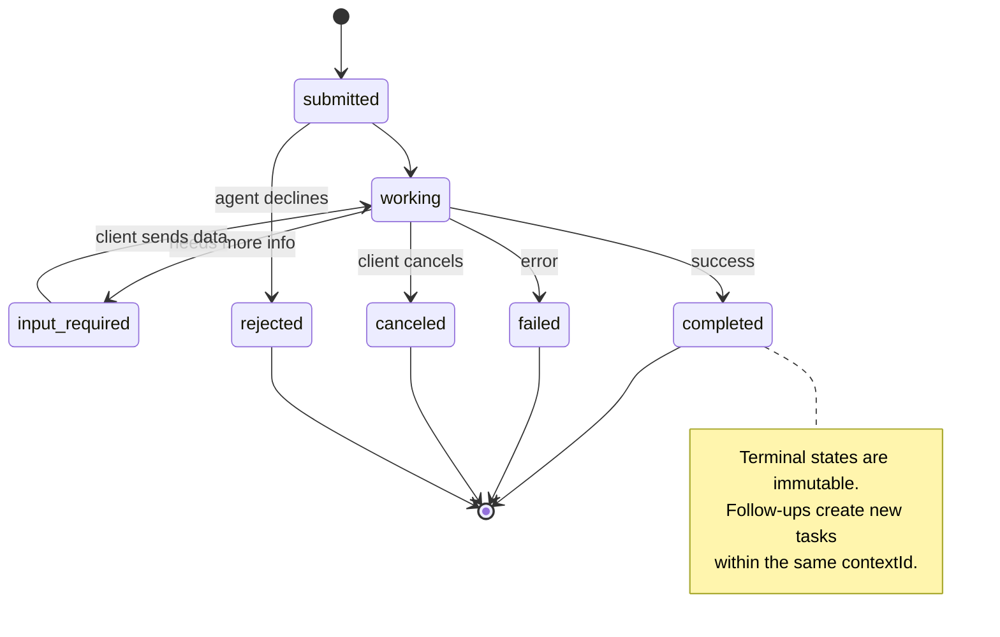

Semua 8 state (spesifikasi juga mendefinisikan `UNSPECIFIED` sebagai sentinel, dihilangkan di sini):

| State | Terminal? | Meaning |
|---|---|---|
| `TASK_STATE_SUBMITTED` | No | Acknowledged, not yet processing |
| `TASK_STATE_WORKING` | No | Actively being processed |
| `TASK_STATE_INPUT_REQUIRED` | No | Agent needs more info from client |
| `TASK_STATE_AUTH_REQUIRED` | No | Authentication needed |
| `TASK_STATE_COMPLETED` | Yes | Finished successfully |
| `TASK_STATE_FAILED` | Yes | Finished with error |
| `TASK_STATE_CANCELED` | Yes | Canceled before completion |
| `TASK_STATE_REJECTED` | Yes | Agent declined the task |

Setelah sebuah tugas mencapai state terminal, ia menjadi immutable. Tidak ada pesan lanjutan. Tindak lanjut membuat tugas baru di dalam `contextId` yang sama.

#### Format Wire

A2A menggunakan JSON-RPC 2.0. Berikut tampilan pertukaran pesan nyata:

**Client mengirim sebuah tugas:**
```json
{
  "jsonrpc": "2.0",
  "id": 1,
  "method": "SendMessage",
  "params": {
    "message": {
      "messageId": "msg-001",
      "role": "ROLE_USER",
      "parts": [{ "text": "Research React 19 compiler features" }]
    },
    "configuration": {
      "acceptedOutputModes": ["text/plain", "application/json"],
      "historyLength": 10
    }
  }
}
```

**Agent merespons dengan sebuah tugas:**
```json
{
  "jsonrpc": "2.0",
  "id": 1,
  "result": {
    "task": {
      "id": "task-abc-123",
      "contextId": "ctx-xyz-789",
      "status": {
        "state": "TASK_STATE_COMPLETED",
        "timestamp": "2026-03-27T10:30:00Z"
      },
      "artifacts": [
        {
          "artifactId": "art-001",
          "name": "research-results",
          "parts": [{
            "data": {
              "findings": [
                "React 19 compiler auto-memoizes components",
                "No more manual useMemo/useCallback needed",
                "Compiler runs at build time, not runtime"
              ]
            },
            "mediaType": "application/json"
          }]
        }
      ]
    }
  }
}
```

**Streaming via SSE:**
```text
POST /message:stream HTTP/1.1
Content-Type: application/json
A2A-Version: 1.0

data: {"task":{"id":"task-123","status":{"state":"TASK_STATE_WORKING"}}}

data: {"statusUpdate":{"taskId":"task-123","status":{"state":"TASK_STATE_WORKING","message":{"role":"ROLE_AGENT","parts":[{"text":"Searching documentation..."}]}}}}

data: {"artifactUpdate":{"taskId":"task-123","artifact":{"artifactId":"art-1","parts":[{"text":"partial findings..."}]},"append":true,"lastChunk":false}}

data: {"statusUpdate":{"taskId":"task-123","status":{"state":"TASK_STATE_COMPLETED"}}}
```

### ACP (Agent Communication Protocol)

**Dibuat oleh:** IBM / BeeAI
**Versi spesifikasi:** 0.2.0 (OpenAPI 3.1.1)
**Status:** Merging ke dalam A2A di bawah Linux Foundation
**Masalah:** Bagaimana agent berkomunikasi dengan keterauditabilitas penuh, kontinuitas sesi, dan pelacakan trajectory?

ACP adalah **protokol enterprise**. Berbeda dengan yang diklaim banyak ringkasan, ACP **tidak** menggunakan JSON-LD. Ini adalah API REST/JSON lurus yang didefinisikan via OpenAPI. Yang membuatnya istimewa adalah **TrajectoryMetadata**: setiap respons agent bisa membawa log rinci dari langkah-langkah penalaran dan panggilan tool yang menghasilkannya.

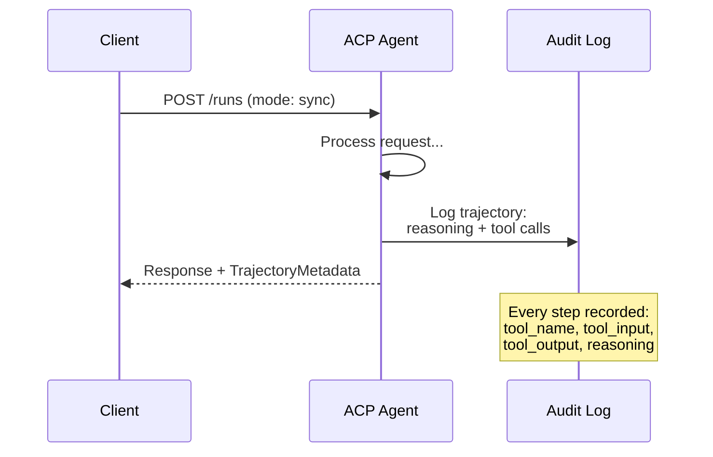

#### Agent Discovery di ACP

ACP mendefinisikan empat metode discovery:

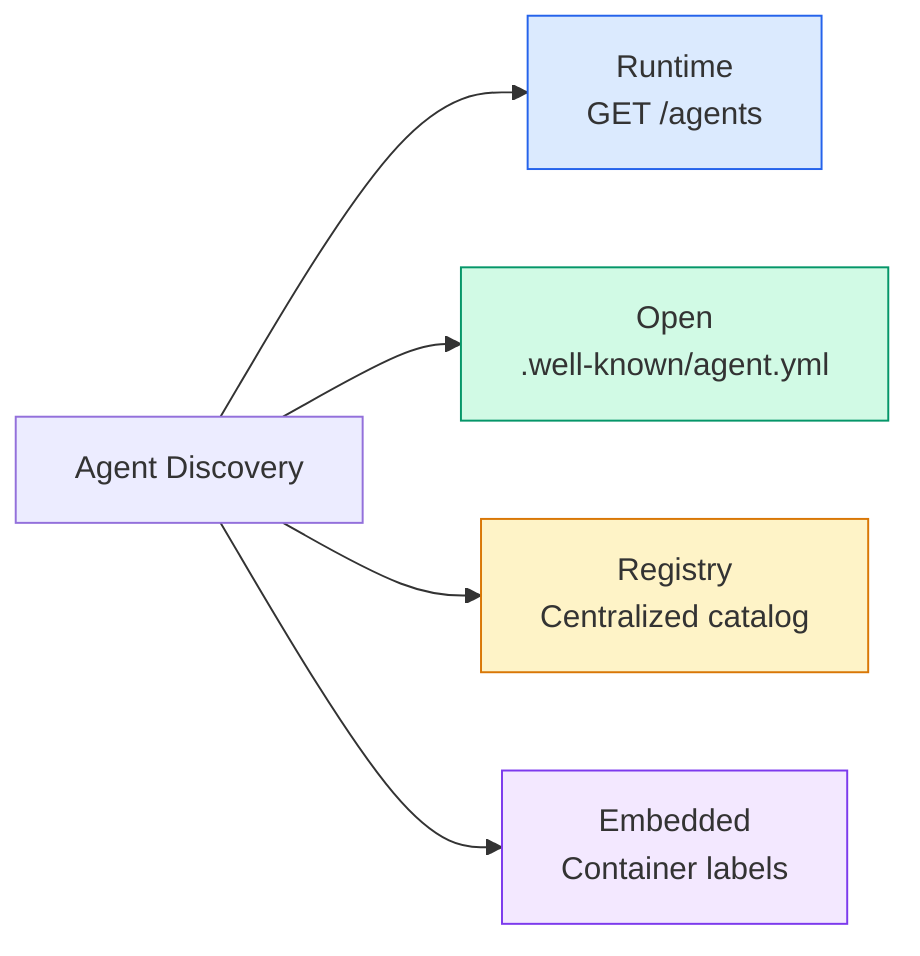

**AgentManifest** lebih sederhana daripada Agent Card A2A:

```json
{
  "name": "summarizer",
  "description": "Summarizes documents with source citations",
  "input_content_types": ["text/plain", "application/pdf"],
  "output_content_types": ["text/plain", "application/json"],
  "metadata": {
    "tags": ["summarization", "RAG"],
    "framework": "BeeAI",
    "capabilities": [
      {
        "name": "Document Summarization",
        "description": "Condenses long documents into key points"
      }
    ],
    "recommended_models": ["llama3.3:70b-instruct-fp16"],
    "license": "Apache-2.0",
    "programming_language": "Python"
  }
}
```

#### Lifecycle Run

ACP menggunakan "Runs" alih-alih "Tasks". Sebuah Run adalah eksekusi agent dengan tiga mode:

| Mode | Behavior |
|---|---|
| `sync` | Blocking. Response contains the complete result. |
| `async` | Returns 202 immediately. Poll `GET /runs/{id}` for status. |
| `stream` | SSE stream. Events fire as the agent works. |

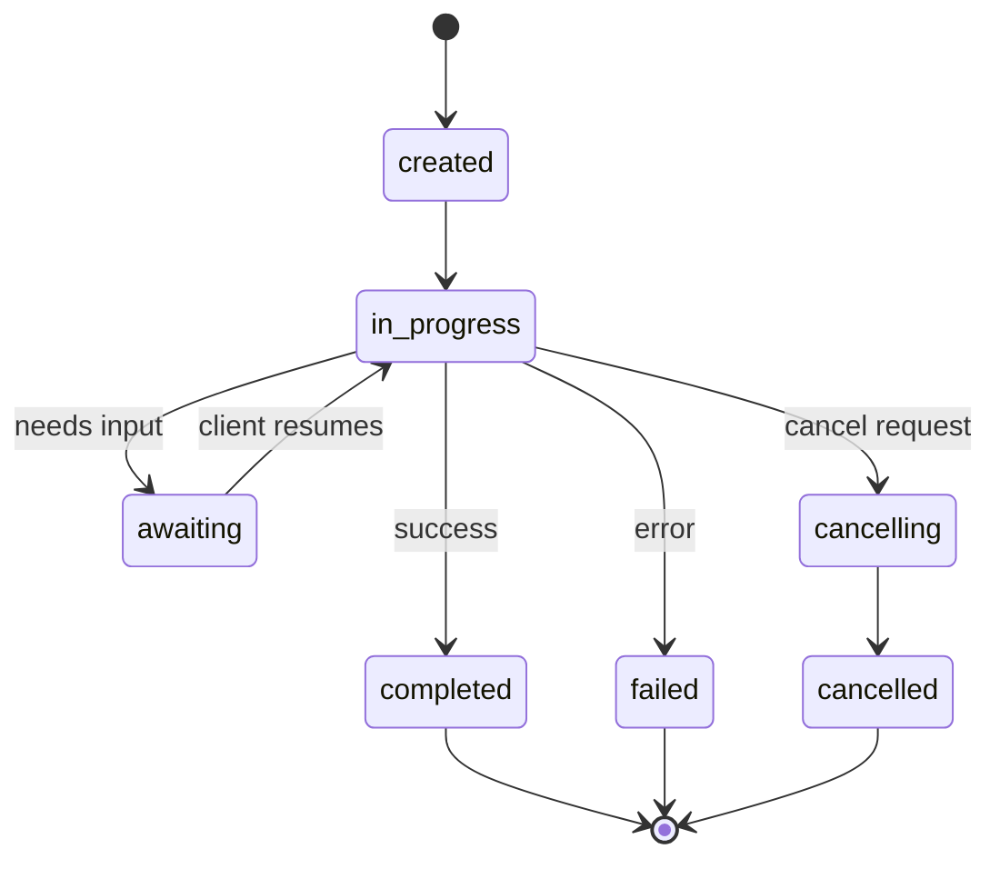

#### TrajectoryMetadata (Jejak Audit)

Ini adalah pembeda utama ACP. Setiap bagian pesan bisa menyertakan metadata yang menunjukkan persis apa yang dilakukan agent:

```json
{
  "role": "agent/researcher",
  "parts": [
    {
      "content_type": "text/plain",
      "content": "The weather in San Francisco is 72F and sunny.",
      "metadata": {
        "kind": "trajectory",
        "message": "I need to check the weather for this location",
        "tool_name": "weather_api",
        "tool_input": { "location": "San Francisco, CA" },
        "tool_output": { "temperature": 72, "condition": "sunny" }
      }
    }
  ]
}
```

Bagi industri yang diatur, ini emas. Setiap jawaban datang dengan rantai penalaran yang dapat dibuktikan: tool mana yang dipanggil, input apa yang digunakan, output apa yang diterima. Tanpa kotak hitam.

ACP juga mendukung **CitationMetadata** untuk atribusi sumber:

```json
{
  "kind": "citation",
  "start_index": 0,
  "end_index": 47,
  "url": "https://weather.gov/sf",
  "title": "NWS San Francisco Forecast"
}
```

### ANP (Agent Network Protocol)

**Dibuat oleh:** Komunitas open-source (didirikan oleh GaoWei Chang)
**Repo:** [github.com/agent-network-protocol/AgentNetworkProtocol](https://github.com/agent-network-protocol/AgentNetworkProtocol)
**Masalah:** Bagaimana agent dari organisasi berbeda saling mempercayai tanpa otoritas sentral?

ANP adalah **protokol identitas terdesentralisasi**. Ia membangun kepercayaan menggunakan W3C Decentralized Identifiers (DIDs) dan enkripsi end-to-end. Berbeda dengan A2A di mana kamu menemukan agent melalui endpoint yang diketahui, ANP memungkinkan agent membuktikan identitasnya secara kriptografis.

ANP punya tiga lapisan:

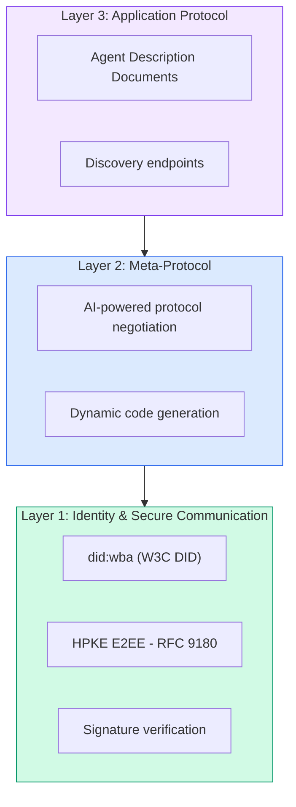

#### Dokumen DID (Struktur Nyata)

ANP menggunakan metode DID khusus bernama `did:wba` (Web-Based Agent). DID `did:wba:example.com:user:alice` diresolusi ke `https://example.com/user/alice/did.json`:

```json
{
  "@context": [
    "https://www.w3.org/ns/did/v1",
    "https://w3id.org/security/suites/jws-2020/v1",
    "https://w3id.org/security/suites/secp256k1-2019/v1"
  ],
  "id": "did:wba:example.com:user:alice",
  "verificationMethod": [
    {
      "id": "did:wba:example.com:user:alice#key-1",
      "type": "EcdsaSecp256k1VerificationKey2019",
      "controller": "did:wba:example.com:user:alice",
      "publicKeyJwk": {
        "crv": "secp256k1",
        "x": "NtngWpJUr-rlNNbs0u-Aa8e16OwSJu6UiFf0Rdo1oJ4",
        "y": "qN1jKupJlFsPFc1UkWinqljv4YE0mq_Ickwnjgasvmo",
        "kty": "EC"
      }
    },
    {
      "id": "did:wba:example.com:user:alice#key-x25519-1",
      "type": "X25519KeyAgreementKey2019",
      "controller": "did:wba:example.com:user:alice",
      "publicKeyMultibase": "z9hFgmPVfmBZwRvFEyniQDBkz9LmV7gDEqytWyGZLmDXE"
    }
  ],
  "authentication": [
    "did:wba:example.com:user:alice#key-1"
  ],
  "keyAgreement": [
    "did:wba:example.com:user:alice#key-x25519-1"
  ],
  "humanAuthorization": [
    "did:wba:example.com:user:alice#key-1"
  ],
  "service": [
    {
      "id": "did:wba:example.com:user:alice#agent-description",
      "type": "AgentDescription",
      "serviceEndpoint": "https://example.com/agents/alice/ad.json"
    }
  ]
}
```

Hal-hal penting untuk diperhatikan:
- **Pemisahan kunci** ditegakkan. Kunci penandatanganan (secp256k1) terpisah dari kunci enkripsi (X25519).
- **`humanAuthorization`** unik untuk ANP. Kunci-kunci ini memerlukan persetujuan manusia yang eksplisit (biometrik, kata sandi, HSM) sebelum digunakan. Operasi berisiko tinggi seperti transfer dana melewati jalur ini.
- Kunci **`keyAgreement`** digunakan untuk enkripsi end-to-end HPKE (RFC 9180).
- Bagian **service** menautkan ke dokumen Agent Description.

#### Cara Kepercayaan Bekerja di ANP

ANP **tidak** menggunakan web-of-trust atau graf endorsement. Kepercayaan bersifat bilateral dan diverifikasi per-interaksi:

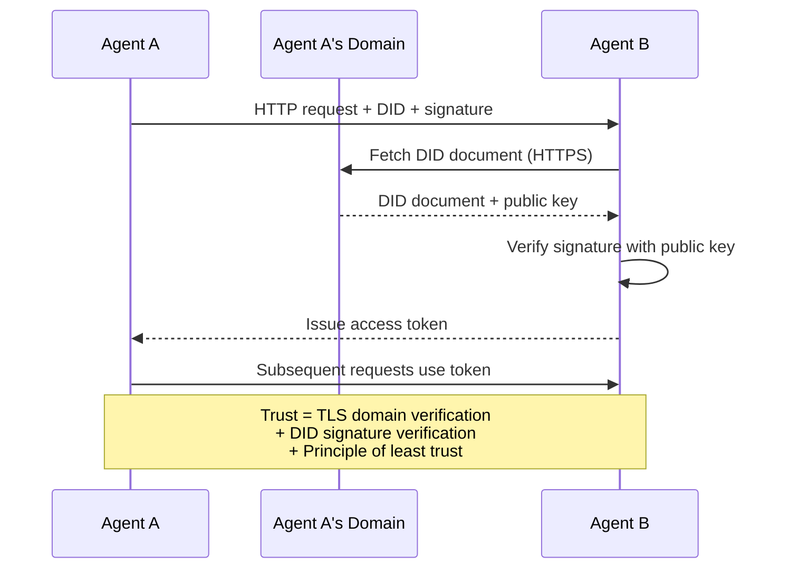

Kepercayaan datang dari tiga sumber:
1. **TLS tingkat domain** memverifikasi host dokumen DID
2. **Tanda tangan kriptografis DID** memverifikasi identitas agent
3. **Prinsip kepercayaan minimal** memberikan hanya izin minimum

Tidak ada propagasi kepercayaan berbasis gosip atau skor PageRank. Kamu memverifikasi setiap agent secara langsung melalui DID-nya.

#### Negosiasi Meta-Protocol

Ini adalah fitur paling baru dari ANP. Saat dua agent dari ekosistem berbeda bertemu, mereka tidak butuh format data yang sudah disepakati sebelumnya. Mereka bernegosiasi dalam bahasa alami:

```json
{
  "action": "protocolNegotiation",
  "sequenceId": 0,
  "candidateProtocols": "I can communicate using:\n1. JSON-RPC with hotel booking schema\n2. REST with OpenAPI 3.1 spec\n3. Natural language over HTTP",
  "modificationSummary": "Initial proposal",
  "status": "negotiating"
}
```

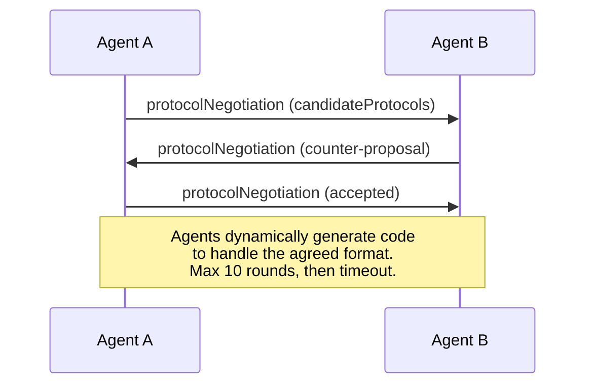

Agent bolak-balik (maksimal 10 putaran) sampai mereka menyepakati sebuah format, lalu secara dinamis menghasilkan kode untuk menanganinya. Nilai status: `negotiating`, `rejected`, `accepted`, `timeout`.

Ini berarti dua agent yang belum pernah saling melihat sebelumnya bisa menemukan cara untuk berkomunikasi tanpa ada yang mendefinisikan sebelumnya schema bersama.

### Perbandingan (Diperbaiki)

| | MCP | A2A | ACP | ANP |
|---|---|---|---|---|
| **Created by** | Anthropic | Google / Linux Foundation | IBM / BeeAI | Community |
| **Spec format** | JSON-RPC | JSON-RPC / REST / gRPC | OpenAPI 3.1 (REST) | JSON-RPC |
| **Primary use** | Agent to Tool | Agent to Agent | Agent to Agent | Agent to Agent |
| **Discovery** | Tool listing | `/.well-known/agent-card.json` | `GET /agents`, `/.well-known/agent.yml` | `/.well-known/agent-descriptions`, DID service endpoints |
| **Identity** | Implicit (local) | Security schemes (OAuth, mTLS) | Server-level | W3C DID (`did:wba`) with E2EE |
| **Audit trail** | N/A | Basic (task history) | TrajectoryMetadata (tool calls, reasoning) | Not formally specified |
| **State machine** | N/A | 9 task states | 7 run states | N/A |
| **Streaming** | N/A | SSE | SSE | Transport-agnostic |
| **Unique feature** | Tool schemas | Agent Cards + Skills | Trajectory audit trail | Meta-protocol negotiation |
| **Best for** | Tools & data | Dynamic collaboration | Regulated industries | Cross-org trust |
| **Status** | Stable | Stable (v1.0) | Merging into A2A | Active development |

### Cara Mereka Bekerja Sama

Protokol-protokol ini tidak saling eksklusif. Sistem enterprise realistis menggunakan beberapa sekaligus:

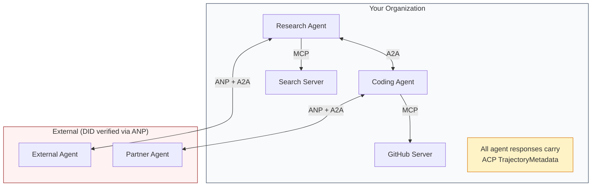

- **MCP** menghubungkan setiap agent ke tool-nya
- **A2A** menangani kolaborasi antar agent (internal dan eksternal)
- **ACP** membungkus respons dalam metadata trajectory untuk keterauditabilitan
- **ANP** menyediakan verifikasi identitas untuk agent yang tidak kamu kendalikan

```figure
swarm-message-bus
```

## Bangun

### Langkah 1: Tipe Pesan Inti

Setiap sistem multi-agent dimulai dengan format pesan. Kami mendefinisikan tipe-tipe yang dipetakan ke apa yang digunakan protokol nyata:

```typescript
import crypto from "node:crypto";

type MessageRole = "user" | "agent";

type MessagePart =
  | { kind: "text"; text: string }
  | { kind: "data"; data: unknown; mediaType: string }
  | { kind: "file"; name: string; url: string; mediaType: string };

type TrajectoryEntry = {
  reasoning: string;
  toolName?: string;
  toolInput?: unknown;
  toolOutput?: unknown;
  timestamp: number;
};

type AgentMessage = {
  id: string;
  role: MessageRole;
  parts: MessagePart[];
  trajectory?: TrajectoryEntry[];
  replyTo?: string;
  timestamp: number;
};

function createMessage(
  role: MessageRole,
  parts: MessagePart[],
  replyTo?: string
): AgentMessage {
  return {
    id: crypto.randomUUID(),
    role,
    parts,
    replyTo,
    timestamp: Date.now(),
  };
}

function textMessage(role: MessageRole, text: string): AgentMessage {
  return createMessage(role, [{ kind: "text", text }]);
}
```

Perhatikan: `MessagePart` bersifat multimodal (teks, data terstruktur, file) persis seperti spesifikasi A2A dan ACP yang nyata. `TrajectoryEntry` menangkap rantai penalaran, cocok dengan TrajectoryMetadata milik ACP.

### Langkah 2: Agent Card dan Registry A2A

Bangun discovery agent yang cocok dengan spesifikasi A2A yang nyata:

```typescript
type Skill = {
  id: string;
  name: string;
  description: string;
  tags: string[];
  inputModes: string[];
  outputModes: string[];
};

type AgentCard = {
  name: string;
  description: string;
  version: string;
  url: string;
  capabilities: {
    streaming: boolean;
    pushNotifications: boolean;
  };
  defaultInputModes: string[];
  defaultOutputModes: string[];
  skills: Skill[];
};

class AgentRegistry {
  private cards: Map<string, AgentCard> = new Map();

  register(card: AgentCard) {
    this.cards.set(card.name, card);
  }

  discoverBySkillTag(tag: string): AgentCard[] {
    return [...this.cards.values()].filter((card) =>
      card.skills.some((skill) => skill.tags.includes(tag))
    );
  }

  discoverByInputMode(mimeType: string): AgentCard[] {
    return [...this.cards.values()].filter(
      (card) =>
        card.defaultInputModes.includes(mimeType) ||
        card.skills.some((skill) => skill.inputModes.includes(mimeType))
    );
  }

  resolve(name: string): AgentCard | undefined {
    return this.cards.get(name);
  }

  listAll(): AgentCard[] {
    return [...this.cards.values()];
  }
}
```

Ini jauh lebih kaya daripada peta nama-ke-kemampuan sederhana. Kamu bisa menemukan agent berdasarkan tag keahlian, berdasarkan tipe MIME input, atau berdasarkan nama, persis seperti yang didukung spesifikasi A2A yang nyata.

### Langkah 3: Lifecycle Tugas A2A

Bangun state machine tugas lengkap:

```typescript
type TaskState =
  | "submitted"
  | "working"
  | "input-required"
  | "auth-required"
  | "completed"
  | "failed"
  | "canceled"
  | "rejected";

const TERMINAL_STATES: TaskState[] = [
  "completed",
  "failed",
  "canceled",
  "rejected",
];

type TaskStatus = {
  state: TaskState;
  message?: AgentMessage;
  timestamp: number;
};

type Artifact = {
  id: string;
  name: string;
  parts: MessagePart[];
};

type Task = {
  id: string;
  contextId: string;
  status: TaskStatus;
  artifacts: Artifact[];
  history: AgentMessage[];
};

type TaskEvent =
  | { kind: "statusUpdate"; taskId: string; status: TaskStatus }
  | {
      kind: "artifactUpdate";
      taskId: string;
      artifact: Artifact;
      append: boolean;
      lastChunk: boolean;
    };

type TaskHandler = (
  task: Task,
  message: AgentMessage
) => AsyncGenerator<TaskEvent>;

class TaskManager {
  private tasks: Map<string, Task> = new Map();
  private handlers: Map<string, TaskHandler> = new Map();
  private listeners: Map<string, ((event: TaskEvent) => void)[]> = new Map();

  registerHandler(agentName: string, handler: TaskHandler) {
    this.handlers.set(agentName, handler);
  }

  subscribe(taskId: string, listener: (event: TaskEvent) => void) {
    const existing = this.listeners.get(taskId) ?? [];
    existing.push(listener);
    this.listeners.set(taskId, existing);
  }

  async sendMessage(
    agentName: string,
    message: AgentMessage,
    contextId?: string
  ): Promise<Task> {
    const handler = this.handlers.get(agentName);
    if (!handler) {
      const task = this.createTask(contextId);
      task.status = {
        state: "rejected",
        timestamp: Date.now(),
        message: textMessage("agent", `No handler for ${agentName}`),
      };
      return task;
    }

    const task = this.createTask(contextId);
    task.history.push(message);
    task.status = { state: "submitted", timestamp: Date.now() };

    this.processTask(task, handler, message).catch((err) => {
      task.status = {
        state: "failed",
        timestamp: Date.now(),
        message: textMessage("agent", String(err)),
      };
    });
    return task;
  }

  getTask(taskId: string): Task | undefined {
    return this.tasks.get(taskId);
  }

  cancelTask(taskId: string): boolean {
    const task = this.tasks.get(taskId);
    if (!task || TERMINAL_STATES.includes(task.status.state)) return false;
    task.status = { state: "canceled", timestamp: Date.now() };
    this.emit(taskId, {
      kind: "statusUpdate",
      taskId,
      status: task.status,
    });
    return true;
  }

  private createTask(contextId?: string): Task {
    const task: Task = {
      id: crypto.randomUUID(),
      contextId: contextId ?? crypto.randomUUID(),
      status: { state: "submitted", timestamp: Date.now() },
      artifacts: [],
      history: [],
    };
    this.tasks.set(task.id, task);
    return task;
  }

  private async processTask(
    task: Task,
    handler: TaskHandler,
    message: AgentMessage
  ) {
    task.status = { state: "working", timestamp: Date.now() };
    this.emit(task.id, {
      kind: "statusUpdate",
      taskId: task.id,
      status: task.status,
    });

    try {
      for await (const event of handler(task, message)) {
        if (TERMINAL_STATES.includes(task.status.state)) break;

        if (event.kind === "statusUpdate") {
          task.status = event.status;
        }
        if (event.kind === "artifactUpdate") {
          const existing = task.artifacts.find(
            (a) => a.id === event.artifact.id
          );
          if (existing && event.append) {
            existing.parts.push(...event.artifact.parts);
          } else {
            task.artifacts.push(event.artifact);
          }
        }
        this.emit(task.id, event);
      }
    } catch (err) {
      task.status = {
        state: "failed",
        timestamp: Date.now(),
        message: textMessage("agent", String(err)),
      };
      this.emit(task.id, {
        kind: "statusUpdate",
        taskId: task.id,
        status: task.status,
      });
    }
  }

  private emit(taskId: string, event: TaskEvent) {
    for (const listener of this.listeners.get(taskId) ?? []) {
      listener(event);
    }
  }
}
```

Ini mengimplementasikan lifecycle tugas A2A yang nyata: submitted, working, input-required, state terminal. Handler adalah async generator yang menghasilkan event (pembaruan status dan potongan artefak) yang cocok dengan model streaming SSE.

### Langkah 4: Jejak Audit Gaya ACP

Bungkus komunikasi dengan pelacakan trajectory:

```typescript
type AuditEntry = {
  runId: string;
  agentName: string;
  input: AgentMessage[];
  output: AgentMessage[];
  trajectory: TrajectoryEntry[];
  status: "created" | "in-progress" | "completed" | "failed" | "awaiting";
  startedAt: number;
  completedAt?: number;
  sessionId?: string;
};

class AuditableRunner {
  private log: AuditEntry[] = [];
  private handlers: Map<
    string,
    (input: AgentMessage[]) => Promise<{
      output: AgentMessage[];
      trajectory: TrajectoryEntry[];
    }>
  > = new Map();

  registerAgent(
    name: string,
    handler: (input: AgentMessage[]) => Promise<{
      output: AgentMessage[];
      trajectory: TrajectoryEntry[];
    }>
  ) {
    this.handlers.set(name, handler);
  }

  async run(
    agentName: string,
    input: AgentMessage[],
    sessionId?: string
  ): Promise<AuditEntry> {
    const entry: AuditEntry = {
      runId: crypto.randomUUID(),
      agentName,
      input: structuredClone(input),
      output: [],
      trajectory: [],
      status: "created",
      startedAt: Date.now(),
      sessionId,
    };
    this.log.push(entry);

    const handler = this.handlers.get(agentName);
    if (!handler) {
      entry.status = "failed";
      return entry;
    }

    entry.status = "in-progress";
    try {
      const result = await handler(input);
      entry.output = structuredClone(result.output);
      entry.trajectory = structuredClone(result.trajectory);
      entry.status = "completed";
      entry.completedAt = Date.now();
    } catch (err) {
      entry.status = "failed";
      entry.trajectory.push({
        reasoning: `Error: ${String(err)}`,
        timestamp: Date.now(),
      });
      entry.completedAt = Date.now();
    }
    return entry;
  }

  getFullAuditLog(): AuditEntry[] {
    return structuredClone(this.log);
  }

  getAuditLogForAgent(agentName: string): AuditEntry[] {
    return structuredClone(
      this.log.filter((e) => e.agentName === agentName)
    );
  }

  getAuditLogForSession(sessionId: string): AuditEntry[] {
    return structuredClone(
      this.log.filter((e) => e.sessionId === sessionId)
    );
  }

  getTrajectoryForRun(runId: string): TrajectoryEntry[] {
    const entry = this.log.find((e) => e.runId === runId);
    return entry ? structuredClone(entry.trajectory) : [];
  }
}
```

Setiap eksekusi agent menghasilkan entri audit lengkap: apa yang masuk, apa yang keluar, dan trajectory lengkap dari panggilan tool serta langkah penalaran di antaranya. Kamu bisa mencari berdasarkan agent, berdasarkan sesi, atau berdasarkan run individual.

### Langkah 5: Verifikasi Identitas Gaya ANP

Bangun identitas dan verifikasi berbasis DID:

```typescript
type VerificationMethod = {
  id: string;
  type: string;
  controller: string;
  publicKeyDer: string;
};

type DIDDocument = {
  id: string;
  verificationMethod: VerificationMethod[];
  authentication: string[];
  keyAgreement: string[];
  humanAuthorization: string[];
  service: { id: string; type: string; serviceEndpoint: string }[];
};

type AgentIdentity = {
  did: string;
  document: DIDDocument;
  privateKey: crypto.KeyObject;
  publicKey: crypto.KeyObject;
};

class IdentityRegistry {
  private documents: Map<string, DIDDocument> = new Map();

  publish(doc: DIDDocument) {
    this.documents.set(doc.id, doc);
  }

  resolve(did: string): DIDDocument | undefined {
    return this.documents.get(did);
  }

  verify(did: string, signature: string, payload: string): boolean {
    const doc = this.documents.get(did);
    if (!doc) return false;

    const authKeyIds = doc.authentication;
    const authKeys = doc.verificationMethod.filter((vm) =>
      authKeyIds.includes(vm.id)
    );

    for (const key of authKeys) {
      const publicKey = crypto.createPublicKey({
        key: Buffer.from(key.publicKeyDer, "base64"),
        format: "der",
        type: "spki",
      });
      const isValid = crypto.verify(
        null,
        Buffer.from(payload),
        publicKey,
        Buffer.from(signature, "hex")
      );
      if (isValid) return true;
    }
    return false;
  }

  requiresHumanAuth(did: string, operationKeyId: string): boolean {
    const doc = this.documents.get(did);
    if (!doc) return false;
    return doc.humanAuthorization.includes(operationKeyId);
  }
}

function createIdentity(domain: string, agentName: string): AgentIdentity {
  const did = `did:wba:${domain}:agent:${agentName}`;
  const { publicKey, privateKey } = crypto.generateKeyPairSync("ed25519");

  const publicKeyDer = publicKey
    .export({ format: "der", type: "spki" })
    .toString("base64");

  const keyId = `${did}#key-1`;
  const encKeyId = `${did}#key-x25519-1`;

  const document: DIDDocument = {
    id: did,
    verificationMethod: [
      {
        id: keyId,
        type: "Ed25519VerificationKey2020",
        controller: did,
        publicKeyDer,
      },
      {
        id: encKeyId,
        type: "X25519KeyAgreementKey2019",
        controller: did,
        publicKeyDer,
      },
    ],
    authentication: [keyId],
    keyAgreement: [encKeyId],
    humanAuthorization: [],
    service: [
      {
        id: `${did}#agent-description`,
        type: "AgentDescription",
        serviceEndpoint: `https://${domain}/agents/${agentName}/ad.json`,
      },
    ],
  };

  return { did, document, privateKey, publicKey };
}

function signPayload(identity: AgentIdentity, payload: string): string {
  return crypto
    .sign(null, Buffer.from(payload), identity.privateKey)
    .toString("hex");
}
```

Ini mencerminkan model identitas ANP yang nyata: agent memiliki dokumen DID dengan kunci autentikasi, key agreement, dan otorisasi manusia yang terpisah. `IdentityRegistry` mensimulasikan resolusi DID (dalam produksi ini akan berupa fetch HTTP ke domain agent).

### Langkah 6: Gateway Protokol

Sambungkan keempat protokol menjadi sistem terpadu:

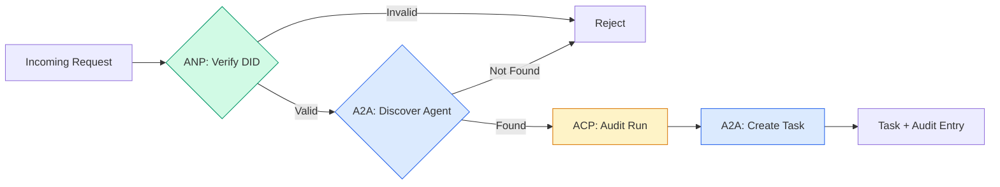

```typescript
class ProtocolGateway {
  private registry: AgentRegistry;
  private taskManager: TaskManager;
  private auditRunner: AuditableRunner;
  private identityRegistry: IdentityRegistry;

  constructor(
    registry: AgentRegistry,
    taskManager: TaskManager,
    auditRunner: AuditableRunner,
    identityRegistry: IdentityRegistry
  ) {
    this.registry = registry;
    this.taskManager = taskManager;
    this.auditRunner = auditRunner;
    this.identityRegistry = identityRegistry;
  }

  async delegateTask(
    fromDid: string,
    signature: string,
    targetAgent: string,
    message: AgentMessage,
    sessionId?: string
  ): Promise<{ task: Task; audit: AuditEntry } | { error: string }> {
    if (!this.identityRegistry.verify(fromDid, signature, message.id)) {
      return { error: "Identity verification failed" };
    }

    const card = this.registry.resolve(targetAgent);
    if (!card) {
      return { error: `Agent ${targetAgent} not found in registry` };
    }

    const audit = await this.auditRunner.run(
      targetAgent,
      [message],
      sessionId
    );
    const task = await this.taskManager.sendMessage(targetAgent, message);

    return { task, audit };
  }

  discoverAndDelegate(
    fromDid: string,
    signature: string,
    skillTag: string,
    message: AgentMessage
  ): Promise<{ task: Task; audit: AuditEntry } | { error: string }> {
    const candidates = this.registry.discoverBySkillTag(skillTag);
    if (candidates.length === 0) {
      return Promise.resolve({
        error: `No agents found with skill tag: ${skillTag}`,
      });
    }
    return this.delegateTask(
      fromDid,
      signature,
      candidates[0].name,
      message
    );
  }
}
```

Gateway melakukan empat hal dalam satu panggilan:
1. **ANP**: Memverifikasi identitas pemanggil via tanda tangan DID
2. **A2A**: Menemukan target agent dan memeriksa capabilities
3. **ACP**: Membungkus eksekusi dalam jejak audit dengan trajectory
4. **A2A**: Membuat tugas dengan pelacakan lifecycle lengkap

### Langkah 7: Sambungkan Semuanya

```typescript
async function protocolDemo() {
  const registry = new AgentRegistry();
  registry.register({
    name: "researcher",
    description: "Searches and summarizes findings",
    version: "1.0.0",
    url: "https://researcher.local/a2a/v1",
    capabilities: { streaming: true, pushNotifications: false },
    defaultInputModes: ["text/plain"],
    defaultOutputModes: ["text/plain", "application/json"],
    skills: [
      {
        id: "web-research",
        name: "Web Research",
        description: "Searches the web",
        tags: ["research", "search", "summarization"],
        inputModes: ["text/plain"],
        outputModes: ["application/json"],
      },
    ],
  });
  registry.register({
    name: "coder",
    description: "Writes code from specs",
    version: "1.0.0",
    url: "https://coder.local/a2a/v1",
    capabilities: { streaming: false, pushNotifications: false },
    defaultInputModes: ["text/plain", "application/json"],
    defaultOutputModes: ["text/plain"],
    skills: [
      {
        id: "code-gen",
        name: "Code Generation",
        description: "Generates code",
        tags: ["coding", "generation"],
        inputModes: ["text/plain", "application/json"],
        outputModes: ["text/plain"],
      },
    ],
  });

  const taskManager = new TaskManager();
  const auditRunner = new AuditableRunner();

  const researchTrajectory: TrajectoryEntry[] = [];

  taskManager.registerHandler(
    "researcher",
    async function* (task, message) {
      yield {
        kind: "statusUpdate" as const,
        taskId: task.id,
        status: { state: "working" as const, timestamp: Date.now() },
      };

      researchTrajectory.push({
        reasoning: "Searching for React 19 documentation",
        toolName: "web_search",
        toolInput: { query: "React 19 compiler features" },
        toolOutput: {
          results: ["react.dev/blog/react-19", "github.com/react/react"],
        },
        timestamp: Date.now(),
      });

      researchTrajectory.push({
        reasoning: "Extracting key findings from search results",
        toolName: "doc_analysis",
        toolInput: { url: "react.dev/blog/react-19" },
        toolOutput: {
          summary:
            "React 19 compiler auto-memoizes, no manual useMemo needed",
        },
        timestamp: Date.now(),
      });

      yield {
        kind: "artifactUpdate" as const,
        taskId: task.id,
        artifact: {
          id: crypto.randomUUID(),
          name: "research-results",
          parts: [
            {
              kind: "data" as const,
              data: {
                findings: [
                  "React 19 compiler auto-memoizes components",
                  "No more manual useMemo/useCallback needed",
                  "Compiler runs at build time, not runtime",
                ],
                sources: ["react.dev/blog/react-19"],
              },
              mediaType: "application/json",
            },
          ],
        },
        append: false,
        lastChunk: true,
      };

      yield {
        kind: "statusUpdate" as const,
        taskId: task.id,
        status: { state: "completed" as const, timestamp: Date.now() },
      };
    }
  );

  auditRunner.registerAgent("researcher", async () => ({
    output: [
      textMessage("agent", "React 19 compiler auto-memoizes components"),
    ],
    trajectory: researchTrajectory,
  }));

  const identityRegistry = new IdentityRegistry();

  const coderIdentity = createIdentity("coder.local", "coder");
  const researcherIdentity = createIdentity("researcher.local", "researcher");

  identityRegistry.publish(coderIdentity.document);
  identityRegistry.publish(researcherIdentity.document);

  const gateway = new ProtocolGateway(
    registry,
    taskManager,
    auditRunner,
    identityRegistry
  );

  console.log("=== Protocol Demo ===\n");

  console.log("1. Agent Discovery (A2A)");
  const researchAgents = registry.discoverBySkillTag("research");
  console.log(
    `   Found ${researchAgents.length} agent(s):`,
    researchAgents.map((a) => a.name)
  );

  console.log("\n2. Identity Verification (ANP)");
  const message = textMessage("user", "Research React 19 compiler features");
  const signature = signPayload(coderIdentity, message.id);
  const verified = identityRegistry.verify(
    coderIdentity.did,
    signature,
    message.id
  );
  console.log(`   Coder DID: ${coderIdentity.did}`);
  console.log(`   Signature verified: ${verified}`);

  console.log("\n3. Task Delegation (A2A + ACP + ANP)");
  const result = await gateway.delegateTask(
    coderIdentity.did,
    signature,
    "researcher",
    message,
    "session-001"
  );

  if ("error" in result) {
    console.log(`   Error: ${result.error}`);
    return;
  }

  console.log(`   Task ID: ${result.task.id}`);
  console.log(`   Task state: ${result.task.status.state}`);
  console.log(`   Artifacts: ${result.task.artifacts.length}`);

  console.log("\n4. Audit Trail (ACP)");
  console.log(`   Run ID: ${result.audit.runId}`);
  console.log(`   Status: ${result.audit.status}`);
  console.log(`   Trajectory steps: ${result.audit.trajectory.length}`);
  for (const step of result.audit.trajectory) {
    console.log(`     - ${step.reasoning}`);
    if (step.toolName) {
      console.log(`       Tool: ${step.toolName}`);
    }
  }

  console.log("\n5. Full Audit Log");
  const fullLog = auditRunner.getFullAuditLog();
  console.log(`   Total runs: ${fullLog.length}`);
  for (const entry of fullLog) {
    const duration = entry.completedAt
      ? `${entry.completedAt - entry.startedAt}ms`
      : "in-progress";
    console.log(`   ${entry.agentName}: ${entry.status} (${duration})`);
  }
}

protocolDemo().catch((err) => {
  console.error("Protocol demo failed:", err);
  process.exitCode = 1;
});
```

## Apa yang Salah

Protokol memecahkan jalur yang lancar. Berikut yang rusak di produksi:

**Drift schema.** Agent A memublikasikan Agent Card yang mengiklankan output `application/json`. Tetapi schema JSON berubah di antara versi. Agent B menguraikan format lama dan mendapat sampah. Perbaikan: versikan skill dan schema output-mu. Spesifikasi A2A mendukung `version` pada Agent Card untuk alasan ini.

**Pelanggaran state machine.** Sebuah handler agent menghasilkan event `completed`, lalu mencoba menghasilkan lebih banyak artefak. Tugasnya immutable. Kode-mu diam-diam membuang pembaruan itu atau melempar error. Perbaikan: periksa state terminal sebelum menghasilkan. `TaskManager` di atas menerapkan ini dengan `break` setelah state terminal.

**Kegagalan resolusi kepercayaan.** Agent A mencoba memverifikasi DID Agent B, tetapi domain Agent B sedang down. Dokumen DID tidak bisa diambil. Apakah kamu gagal terbuka (terima agent yang belum diverifikasi) atau gagal tertutup (tolak semua)? ANP merekomendasikan gagal tertutup dengan prinsip kepercayaan minimal.

**Pembengkakan trajectory.** Logging trajectory ACP kuat tetapi mahal. Agent kompleks yang melakukan 200 panggilan tool per run menghasilkan entri audit masif. Perbaikan: log trajectory di level verbosity yang dapat dikonfigurasi. Rekam nama tool dan IO untuk kepatuhan, lewati langkah penalaran untuk beban kerja yang tidak diatur.

**Discovery thundering herd.** 50 agent semuanya mengueri `GET /agents` secara bersamaan saat startup. Perbaikan: cache Agent Card dengan TTL, selang-seling interval discovery, atau gunakan registrasi berbasis push alih-alih polling.

## Gunakan

### Implementasi Nyata

**A2A** adalah yang paling matang. [Spesifikasi resmi](https://github.com/google/A2A) Google open-source di bawah Linux Foundation. SDK untuk Python dan TypeScript. Jika agent-mu butuh discovery dan kolaborasi dinamis, mulai di sini.

**ACP** sedang merging ke dalam A2A. [Proyek BeeAI](https://github.com/i-am-bee/acp) IBM membuat ACP sebagai alternatif REST-first, tetapi konsep metadata trajectory sedang diserap ke dalam ekosistem A2A. Gunakan pola ACP (logging trajectory, lifecycle run) bahkan jika kamu menggunakan A2A sebagai transport.

**ANP** adalah yang paling eksperimental. [Repo komunitas](https://github.com/agent-network-protocol/AgentNetworkProtocol) punya Python SDK (AgentConnect). Konsep negosiasi meta-protocol benar-benar baru. Layak dipantau untuk deployment agent lintas-organisasi.

**MCP** sudah dibahas di Phase 13. Jika kamu ingin agent menggunakan tool, MCP adalah standarnya.

### Memilih Protokol yang Tepat

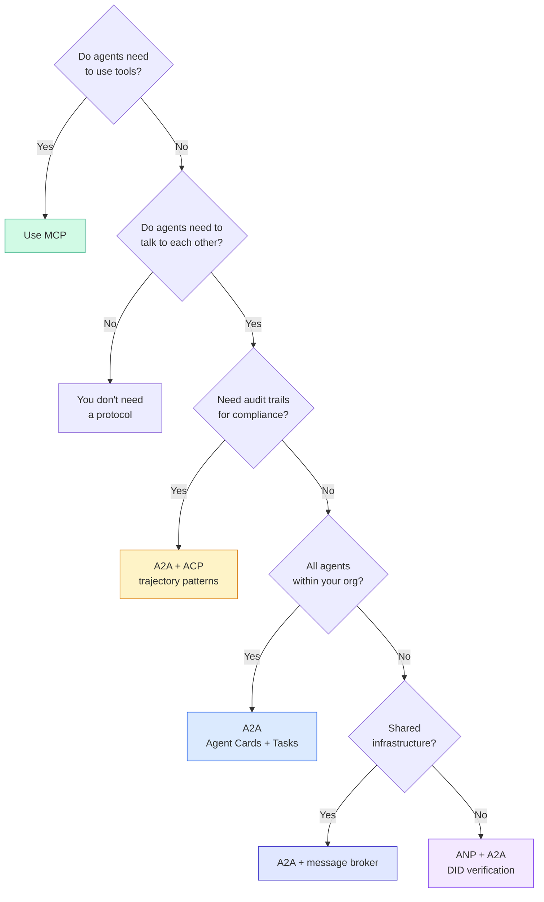

## Rilis

Pelajaran ini menghasilkan:
- `code/main.ts` -- implementasi lengkap keempat pola protokol
- `outputs/prompt-protocol-selector.md` -- prompt yang membantu kamu memilih protokol untuk sistem-mu

## Latihan

1. **Delegasi tugas multi-hop.** Perluas `TaskManager` agar handler agent bisa mendelegasikan subtugas ke agent lain. Researcher menerima sebuah tugas, mendelegasikan subtugas "search" dan "summarize" ke dua agent spesialis, menunggu keduanya selesai, lalu menggabungkan hasilnya ke artefaknya sendiri.

2. **Jejak audit streaming.** Modifikasi `AuditableRunner` untuk mendukung mode streaming. Alih-alih menunggu hasil penuh, hasilkan pembaruan `AuditEntry` secara real-time saat entri trajectory ditambahkan. Gunakan async generator yang menghasilkan snapshot audit.

3. **Rotasi DID.** Tambahkan rotasi kunci ke `IdentityRegistry`. Sebuah agent harus bisa memublikasikan dokumen DID baru dengan kunci yang diperbarui sambil mempertahankan referensi `previousDid`. Verifier harus menerima tanda tangan dari kunci saat ini dan sebelumnya selama masa tenggang.

4. **Negosiasi protokol.** Implementasikan konsep meta-protocol ANP. Dua agent bertukar pesan `protocolNegotiation` dengan format kandidat (misalnya, "Saya bisa berbicara JSON-RPC" vs "Saya lebih suka REST"). Setelah maksimal 3 putaran, mereka menyepakati sebuah format atau timeout. Format yang disepakati menentukan `TaskManager` atau `AuditableRunner` mana yang mereka gunakan.

5. **Discovery berbatas rate.** Tambahkan pembungkus `RateLimitedRegistry` yang meng-cache lookup Agent Card dengan TTL yang dapat dikonfigurasi dan membatasi query discovery per agent per detik. Simulasikan thundering herd dari 100 agent yang saling menemukan saat startup dan ukur perbedaannya.

## Istilah Kunci

| Term | What people say | What it actually means |
|------|----------------|----------------------|
| MCP | "The protocol for AI tools" | A client-server protocol for agents to discover and use tools. Agent-to-tool, not agent-to-agent. |
| A2A | "Google's agent protocol" | A peer-to-peer protocol for agent collaboration under the Linux Foundation. Discovery via Agent Cards, 9-state task lifecycle, streaming via SSE. Supports JSON-RPC, REST, and gRPC bindings. |
| ACP | "Enterprise agent messaging" | IBM/BeeAI's REST API for agent runs with TrajectoryMetadata: every response carries the full chain of reasoning and tool calls. Merging into A2A. |
| ANP | "Decentralized agent identity" | A community protocol using `did:wba` (DID) for cryptographic identity, HPKE for E2EE, and AI-powered meta-protocol negotiation for agents that have never seen each other. |
| Agent Card | "An agent's business card" | A JSON document at `/.well-known/agent-card.json` describing skills, supported MIME types, security schemes, and protocol bindings. |
| DID | "Decentralized ID" | W3C standard for cryptographically verifiable identities hosted on the agent's own domain. ANP uses `did:wba` method. |
| TrajectoryMetadata | "The audit receipt" | ACP's mechanism for attaching reasoning steps, tool calls, and their inputs/outputs to every agent response. |
| Meta-protocol | "Agents negotiating how to talk" | ANP's approach where agents use natural language to dynamically agree on data formats, then generate code to handle them. |
| Task | "A unit of work" | A2A's stateful object tracking work from submission through completion. Immutable once terminal. |

## Bacaan Lanjutan

- [Google A2A specification](https://github.com/google/A2A) -- official spec and SDKs (v1.0.0, Linux Foundation)
- [IBM/BeeAI ACP specification](https://github.com/i-am-bee/acp) -- OpenAPI 3.1 spec for agent runs and trajectory metadata
- [Agent Network Protocol](https://github.com/agent-network-protocol/AgentNetworkProtocol) -- DID-based identity, E2EE, meta-protocol negotiation
- [Model Context Protocol docs](https://modelcontextprotocol.io/) -- Anthropic's MCP specification (covered in Phase 13)
- [W3C Decentralized Identifiers](https://www.w3.org/TR/did-core/) -- the identity standard underpinning ANP
- [RFC 9180 (HPKE)](https://www.rfc-editor.org/rfc/rfc9180) -- the encryption scheme ANP uses for E2EE
- [FIPA Agent Communication Language](http://www.fipa.org/specs/fipa00061/SC00061G.html) -- the academic precursor to modern agent protocols
