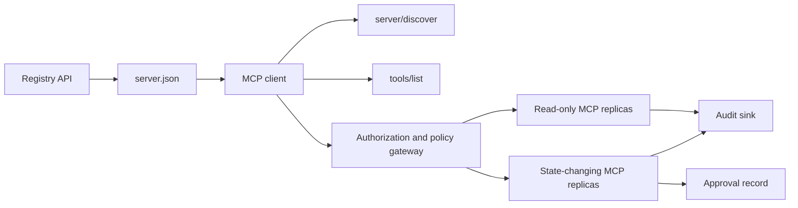

# Capstone 13: MCP Server Stateless dengan Registry dan Governance

> MCP produksi bukan satu proses server. Ia adalah rantai kontrak: metadata yang dapat dipublikasikan, live discovery, envelope request stateless, otorisasi, kebijakan, audit, dan bukti deployment.

**Type:** Capstone
**Languages:** Python and TypeScript reference models; any production language
**Prerequisites:** Phase 11, Phase 13, Phase 14, Phase 17, and Phase 18
**Required MCP deep dives:** [Lesson 28: Tool Contracts](../../../13-tools-and-protocols/28-mcp-tool-contracts-and-content/docs/en.md), [Lesson 29: Reliability](../../../13-tools-and-protocols/29-mcp-reliability-cancellation-and-flow-control/docs/en.md), [Lesson 30: Registry Supply Chain](../../../13-tools-and-protocols/30-mcp-registry-supply-chain-and-drift/docs/en.md), and [Lesson 31: Conformance Operations](../../../13-tools-and-protocols/31-mcp-conformance-versioning-and-operations/docs/en.md)
**Protocol target:** MCP `2026-07-28`
**Time:** ~25 hours

## Tujuan Pembelajaran

- Implementasikan envelope request dan result MCP yang stateless.
- Jauhkan metadata Registry dari live discovery protokol.
- Bangun discovery tool yang deterministik dan sadar-cache.
- Terapkan kebijakan issuer, audience, scope, dan approval pada setiap pemanggilan tool.
- Deploy Streamable HTTP tanpa session affinity.
- Buktikan perilakunya di batas wire, otorisasi, kebijakan, registry, dan audit.

## Jalur Prasyarat MCP yang Diperlukan

Selesaikan empat pelajaran Phase 13 yang tertaut berikut secara berurutan sebelum menganggap capstone ini siap produksi:

1. [Lesson 28](../../../13-tools-and-protocols/28-mcp-tool-contracts-and-content/docs/en.md) menetapkan kontrak tool, schema, konten, pagination, completion, routing, dan error yang harus diekspos server ini.
2. [Lesson 29](../../../13-tools-and-protocols/29-mcp-reliability-cancellation-and-flow-control/docs/en.md) menetapkan race pembatalan, deadline, idempotency, backpressure, retry, dan perilaku reconnect.
3. [Lesson 30](../../../13-tools-and-protocols/30-mcp-registry-supply-chain-and-drift/docs/en.md) menetapkan namespace, provenance, admission pin, status Registry, drift, ledger, dan bukti rollback.
4. [Lesson 31](../../../13-tools-and-protocols/31-mcp-conformance-versioning-and-operations/docs/en.md) menetapkan transkrip golden dan negatif, era versi ketat, pemeriksaan diferensial SDK, bukti proxy, redaction, health, dan gating rilis.

Capstone ini mengintegrasikan artefak-artefak itu. Ia tidak menggantinya dengan satu test SDK yang hanya melewati jalur happy-path.

## Masalahnya

Sebuah platform internal membutuhkan tool data read-only dan sekumpulan kecil tool yang mengubah state. Pengembang harus bisa menemukan server itu, memahami cara menyambung, memeriksa kemampuan live-nya, dan hanya memanggil operasi yang mereka izinkan untuk dipakai.

Bagian sulitnya bukan mendaftarkan sebuah fungsi. Bagian sulitnya adalah menjaga enam kebenaran berikut tetap selaras:

1. `server.json` menyatakan di mana server dapat dipasang atau dijangkau.
2. `server/discover` menyatakan apa yang didukung proses live saat ini.
3. Setiap request menyatakan revisi protokol dan kemampuan client apa yang dipakainya.
4. Otorisasi mengikat pemanggil ke issuer, resource, dan scope yang benar.
5. Kebijakan memutuskan apakah aksi spesifik ini boleh berjalan.
6. Bukti audit mencatat apa yang melintasi batas tanpa membocorkan secret atau payload sensitif.

Jika salah satu dari ini drift, platform dapat mendaftarkan server yang tidak dapat dijangkau, mengarahkan client yang tidak kompatibel, menerima token yang dibuat untuk resource lain, atau mengekspos aksi destruktif tanpa review yang diharapkan.

## Dua Lapisan Discovery

Registry dan MCP server live menjawab pertanyaan yang berbeda.

| Layer | Contract | Question it answers |
|---|---|---|
| Publication | `server.json` and Registry API | What is this server, where is its package or remote endpoint, and how is it configured? |
| Runtime | `server/discover` | Which protocol versions, capabilities, extensions, and server identity does this process support? |

Registry resmi memakai skema `server.json` yang berversi. Sebuah entri remote dapat menamai sebuah URL Streamable HTTP:

```json
{
  "$schema": "https://static.modelcontextprotocol.io/schemas/2025-12-11/server.schema.json",
  "name": "com.example/internal-readonly",
  "title": "Internal Read-Only Tools",
  "description": "Read-only incident and data lookup tools.",
  "version": "1.0.0",
  "remotes": [
    {
      "type": "streamable-http",
      "url": "https://mcp.internal.example.com/readonly"
    }
  ]
}
```

Versi skema Registry dan revisi protokol MCP adalah dua hal yang independen. Jangan menulis ulang satu tanggal agar cocok dengan yang lain. Validasi setiap dokumen terhadap kontraknya masing-masing.

Validitas skema tidak membuktikan kepemilikan namespace. Penerbit yang terverifikasi untuk `example.com` memakai namespace reverse-DNS `com.example/*` atau salah satu child namespace-nya. Alur autentikasi Registry membuktikan kepemilikan itu. Mempertahankan label domain dalam urutan biasanya justru menamai namespace yang berbeda.

Fungsi `validate_registry_document` pada model stdlib sengaja adalah validator remote-profile sebagian. Ia memeriksa field `name`, `description`, dan `version` yang wajib menurut skema resmi; `title` yang opsional; nama terbit dan batasan panjangnya; bentuk versi konkret; serta bentuk URL HTTP(S) setiap remote `streamable-http` atau `sse`. Selain itu ia mensyaratkan daftar `remotes` yang tidak kosong karena capstone ini selalu melakukan live-probe terhadap remote. `validate_publisher_namespace` secara terpisah memeriksa nama terhadap domain penerbit yang terverifikasi, sementara `validate_runtime_alignment` membandingkan nama dan versi publikasi dengan `serverInfo` live. Skema resmi juga mendukung record berbasis-paket saja dan lebih banyak field remote. Sebelum publikasi, validasi seluruh dokumen dengan JSON Schema resmi yang di-pin atau `mcp-publisher`; jangan menyajikan subset bebas-dependensi ini sebagai validasi skema penuh.

Server harus mengimplementasikan `server/discover`; client boleh memanggilnya sebelum metode lain. Client capstone ini melakukannya setelah endpoint diselesaikan, dan menerima revisi protokol serta kemampuan live saat ini:

```json
{
  "resultType": "complete",
  "supportedVersions": ["2026-07-28"],
  "capabilities": {
    "tools": {
      "listChanged": false
    }
  },
  "_meta": {
    "io.modelcontextprotocol/serverInfo": {
      "name": "com.example/internal-readonly",
      "version": "1.0.0"
    }
  },
  "ttlMs": 3600000,
  "cacheScope": "public"
}
```

Katalog privat boleh mengindeks data kepemilikan, review, atau lifecycle tambahan, tetapi ia tidak boleh mengarang data itu sebagai field wire MCP atau field `server.json` akar. Simpan kebijakan organisasi di samping record yang dipublikasikan. Ketika metadata kustom publik diperlukan, gunakan ekstensi `_meta.io.modelcontextprotocol.registry/publisher-provided` dari Registry dan tetap di dalam batas 4 KB-nya.

## Inti MCP Stateless

Revisi MCP `2026-07-28` menghapus sesi protokol dan handshake `initialize` / `notifications/initialized`. Ia juga menghapus `Mcp-Session-Id`.

Setiap request membawa konteks protokol di dalam `params._meta`:

```json
{
  "io.modelcontextprotocol/protocolVersion": "2026-07-28",
  "io.modelcontextprotocol/clientCapabilities": {},
  "io.modelcontextprotocol/clientInfo": {
    "name": "internal-platform-client",
    "version": "1.0.0"
  }
}
```

Versi dan kemampuan adalah fakta request, bukan fakta koneksi. Sebuah load balancer boleh mengirim request berurutan ke replica sehat yang berbeda karena replica mana pun dapat memvalidasi request dari pesan itu sendiri.

Result biasa menyertakan `resultType: "complete"`. Server sebaiknya menaruh identitasnya di `_meta.io.modelcontextprotocol/serverInfo` pada setiap result. Versi protokol yang hilang atau bukan string adalah invalid params `-32602`. Error `-32022` hanya untuk string yang diberikan tetapi tidak didukung, dengan tepat `{"supported": ["2026-07-28"], "requested": "..."}` sebagai data-nya.

### Discovery yang dapat di-cache

`tools/list` harus deterministik untuk himpunan tool efektif yang sama. Hasilnya mencakup:

- `ttlMs`, petunjuk kesegaran bagi client;
- `cacheScope`, entah `public` atau `private`;
- urutan tool yang stabil sehingga daftar identik dapat memakai ulang prompt cache;
- `resultType: "complete"` dan metadata identitas server.

Otorisasi per-pengguna biasanya harus menghasilkan `cacheScope: "private"`. Jangan menaruh visibilitas tool spesifik-pengguna di balik cache publik bersama.

## Streamable HTTP

Server jaringan mengekspos satu endpoint MCP yang menerima POST. Setiap request atau notifikasi JSON-RPC mendapat POST-nya sendiri.

Untuk sebuah request, server mengembalikan entah satu objek JSON entah sebuah SSE stream yang ber-scope terhadap request itu. Sebuah request `subscriptions/listen` yang hidup lama membawa notifikasi perubahan yang di-opt-in. Tidak ada GET stream mandiri, DELETE sesi, header sesi, atau replay `Last-Event-ID` dalam transport saat ini.

Setiap request mencakup:

- `MCP-Protocol-Version`, cocok dengan metadata body;
- `Mcp-Method`, cocok dengan metode JSON-RPC;
- `Mcp-Name` untuk `tools/call`, `resources/read`, dan `prompts/get`;
- `Accept: application/json, text/event-stream`.

Tolak header cermin yang tidak cocok dengan error `-32020` yang ditentukan. Validasi `Origin`, ikat server development lokal ke loopback, autentikasi client remote, dan perlakukan SSE response yang ber-scope request dan tertutup sebagai pembatalan.



```figure
cf-mcp-gate
```

## Otorisasi dan Kebijakan

Metadata transport bukan otorisasi. Validasi otorisasi pada setiap panggilan.

Untuk server remote:

1. Temukan metadata protected-resource.
2. Pilih authorization server untuk resource itu.
3. Utamakan Client ID Metadata Documents untuk registrasi client. Perlakukan Dynamic Client Registration sebagai dukungan kompatibilitas.
4. Kirim resource indicator selama otorisasi.
5. Validasi nilai `iss` yang dikembalikan terhadap authorization server yang tercatat untuk flow itu.
6. Kunci kredensial client berdasarkan issuer. Jangan pernah memakai ulang data registrasi antar issuer.
7. Validasi issuer token, audience atau resource, expiry, dan scope di MCP server.
8. Terapkan keputusan kebijakan kedua pada tool konkret dan argumennya.

Anotasi tool seperti `readOnlyHint` dan `destructiveHint` membantu client menyajikan risiko. Ini bukan kontrol otorisasi yang dipercaya.

### Approval adalah rekaman, bukan scope ajaib

Sebuah pemanggilan yang mengubah state membutuhkan rekaman approval yang terikat pada aktor, tool, argumen ternormalisasi atau digest, environment target, expiry, dan kebijakan pakai-sekali atau pakai-ulang. Pesan chat saja bukan bukti approval.

Model Python men-hash JSON kanonikal dengan kunci terurut, lalu mengikat digest itu dengan subjek token, nama tool, URL server, dan expiry. Memutar ulang rekaman itu setelah mengubah satu argumen pun akan gagal sebelum handler dijalankan. Approval adalah bukti terpisah, bukan scope yang ditambahkan ke access token.

Simpan tool berisiko tinggi pada permukaan yang bisa direview terpisah ketika hal itu secara material mengurangi blast radius. Pemisahan hanya berguna jika kredensial, kebijakan, identitas deployment, dan kontrol audit juga terpisah.

## Bangun Sendiri

### 1. Model metadata publikasi

Buat `server.json` dan validasi terhadap skemanya. Sertakan nama yang stabil di dalam namespace yang diautentikasi untuk penerbit, plus versi, deskripsi, metadata `repository` atau `packages` resmi bila berlaku, dan transport remote atau stdio. Simpan secret sebagai input environment-variable yang dideklarasikan, bukan nilai literal.

### 2. Implementasikan live discovery

Implementasikan `server/discover` sebelum RPC fitur apa pun. Iklankan versi protokol yang didukung, kemampuan, ekstensi, dan identitas server. Tambahkan sebuah kasus penolakan versi memakai `-32022`.

### 3. Implementasikan envelope stateless

Wajibkan versi protokol dan kemampuan client pada setiap request. Kembalikan `resultType` dan identitas server pada setiap result. Hapus state inisialisasi, cache kemampuan yang ber-scope koneksi, dan pengenal sesi.

### 4. Bangun permukaan tool

Mulai dengan dua tool read-only dan satu tool yang mengubah state. Berikan masing-masing sebuah JSON Schema yang terbatas, deskripsi yang presisi, bentuk result yang deterministik, dan anotasi yang jujur. Tambahkan output schema ketika client bergantung pada result terstruktur.

### 5. Tambahkan listing sadar-cache

Kembalikan tool dalam urutan stabil beserta `ttlMs` dan `cacheScope`. Uji kedaluwarsa cache dan perilaku notifikasi perubahan daftar secara terpisah.

### 6. Tambahkan otorisasi dan kebijakan

Validasi issuer, audience, expiry, dan scope. Jalankan keputusan kebijakan untuk setiap pemanggilan tool. Ikat approval pada aksi berisiko tinggi yang persis. Tolak approval yang hilang atau kedaluwarsa sebelum mengeksekusi handler.

### 7. Pisahkan validasi registry dan runtime

Validasi record `server.json` statis, lalu probe endpoint remote dengan `server/discover`. Laporkan drift ketika remote, identitas, versi, atau kemampuan yang dipublikasikan tidak sesuai dengan proses live.

### 8. Tambahkan bukti audit

Rekam aktor, issuer, resource, tool, keputusan kebijakan, pengenal request, konteks trace, latensi, dan hasil. Redact atau hash argumen dan result yang sensitif sebelum persistensi. Jauhkan audit sink dari konteks yang terlihat model.

### 9. Uji penskalaan horizontal

Tempatkan dua replica stateless di belakang sebuah load balancer. Kirim setidaknya 100 request bersamaan. Buktikan bahwa kebenaran tidak bergantung pada affinity. Jika sebuah tool membutuhkan state antar-panggilan, buat sebuah handle opaque yang eksplisit dan simpan di sistem durable bersama.

### 10. Lintasi wire sungguhan

Jalankan pemeriksaan konformitas terhadap binary server yang sebenarnya. Tangkap header request dan body JSON, bukan hanya objek SDK. Uji versi yang salah, ketidakcocokan header, scope yang hilang, audience yang salah, argumen yang cacat, kegagalan handler, pembatalan, dan kedaluwarsa cache.

## Paket Bukti yang Diperlukan

Sebuah submission belum lengkap sampai memuat kelima kelas bukti berikut:

| Evidence | Minimum proof | Source lesson |
|---|---|---|
| Wire | Redacted raw headers and JSON-RPC bodies for golden and negative cases, including metadata type failure, header mismatch, unsupported version, missing or unknown `resultType`, notification no-response, and response ID matching | [Lesson 31](../../../13-tools-and-protocols/31-mcp-conformance-versioning-and-operations/docs/en.md) |
| Proxy | The same stable case run directly and through the deployed intermediary, with ingress, origin, and egress status and body digests; prove protocol errors are not collapsed into generic 500 responses and streaming is not buffered | [Lessons 29](../../../13-tools-and-protocols/29-mcp-reliability-cancellation-and-flow-control/docs/en.md) and [31](../../../13-tools-and-protocols/31-mcp-conformance-versioning-and-operations/docs/en.md) |
| Admission | Verified publisher namespace, immutable Registry record digest, artifact or remote provenance, live `server/discover` identity and capability observation, descriptor pin, current Registry status, and admission-ledger event | [Lesson 30](../../../13-tools-and-protocols/30-mcp-registry-supply-chain-and-drift/docs/en.md) |
| Retry | A cancellation-versus-completion race, explicit timeout, safe read retry, mutation idempotency key, reconnect refetch, and proof that request cancellation cannot silently become durable task cancellation | [Lesson 29](../../../13-tools-and-protocols/29-mcp-reliability-cancellation-and-flow-control/docs/en.md) |
| Rollback | Exact previous version, admission and artifact digests, descriptor pin, active Registry status, current health window, route restoration result, and redacted decision evidence | [Lessons 30](../../../13-tools-and-protocols/30-mcp-registry-supply-chain-and-drift/docs/en.md) and [31](../../../13-tools-and-protocols/31-mcp-conformance-versioning-and-operations/docs/en.md) |

Simpan digest paket yang di-redact bersama rilisnya. Jika ada satu kelas yang hilang, tahan rilisnya. Jangan menyimpulkan perilaku proxy dari dispatcher in-proses, admission dari keberadaan Registry, keamanan retry dari id JSON-RPC yang baru, atau kesiapan rollback dari "deployment sebelumnya".

## Model Referensi Lokal

Model Python mendemonstrasikan metadata registry, validasi namespace penerbit reverse-DNS, pemeriksaan identitas publikasi-ke-runtime, live discovery, listing tool deterministik, metadata per-request, pemeriksaan trusted-issuer, audience, expiry, dan scope, approval yang terikat aksi, sebuah validator Registry parsial yang terdokumentasi, kebijakan, dan audit — semuanya tanpa membuka socket jaringan:

```bash
cd phases/19-capstone-projects/13-mcp-server-with-registry
python3 code/main.py
python3 -m unittest discover -s code/tests -v
```

Proyek TypeScript mengekspos bentuk JSON-RPC stateless lewat stdio tanpa SDK MCP. Jalur `tools/call`-nya menerapkan input schema terbatas yang sama seperti yang diiklankan `tools/list`; argumen yang tidak valid untuk tool yang dikenal mengembalikan result lengkap dengan `isError: true` tanpa memanggil executor:

```bash
cd phases/19-capstone-projects/13-mcp-server-with-registry/code/ts
npm install
npm run typecheck
npm test
npm run demo
```

Model-model ini membuktikan logika kontrak lokal. Mereka tidak membuktikan header HTTP, pertukaran OAuth, publikasi Registry, integrasi OPA, load balancing, atau penerimaan collector.

## Contoh Wire

```http
POST /mcp HTTP/1.1
Host: mcp.internal.example.com
Content-Type: application/json
Accept: application/json, text/event-stream
MCP-Protocol-Version: 2026-07-28
Mcp-Method: tools/call
Mcp-Name: postgres.readonly
Authorization: Bearer REDACTED

{
  "jsonrpc": "2.0",
  "id": 42,
  "method": "tools/call",
  "params": {
    "name": "postgres.readonly",
    "arguments": {"sql": "SELECT 1"},
    "_meta": {
      "io.modelcontextprotocol/protocolVersion": "2026-07-28",
      "io.modelcontextprotocol/clientCapabilities": {},
      "io.modelcontextprotocol/clientInfo": {
        "name": "internal-platform-client",
        "version": "1.0.0"
      }
    }
  }
}
```

## Rilis

Rilis sebuah repositori yang memuat:

- `server.json` yang valid terhadap skema;
- permukaan server read-only dan yang mengubah state;
- `server/discover`, `tools/list` yang deterministik, dan `tools/call` yang di-gate kebijakan;
- sebuah deployment Streamable HTTP dengan dua replica yang dapat saling menukar;
- integrasi otorisasi dan approval;
- sebuah publisher Registry atau adapter API Registry privat;
- definisi kebijakan dan rekaman approval yang terikat aksi;
- output audit yang di-redact dan propagasi trace;
- bukti kegagalan wire dan proxy;
- bukti admission, retry, health, dan rollback beserta digest paket yang di-redact.

| Weight | Criterion | Evidence |
|---:|---|---|
| 25 | Protocol correctness | Stateless request metadata, discovery, results, headers, and negative cases |
| 20 | Authorization | Issuer, audience, expiry, scope, and action-bound approval cases |
| 15 | Registry integrity | Valid `server.json`, publication record, live discovery probe, and drift report |
| 15 | Policy and safety | Allow, deny, malformed, stale approval, and sensitive-data cases |
| 15 | Scale and reliability | Two replicas, no affinity dependency, cancellation, timeout, and recovery |
| 10 | Auditability | Redacted receiver-side audit and trace evidence |

## Latihan

1. Ubah URL remote yang dipublikasikan tanpa mengubah server live-nya. Buat validasi registry melaporkan drift yang tepat.

2. Kirim `tools/list` dua kali dengan input identik dan buktikan urutan tool yang stabil per byte. Lalu kedaluwarsakan `ttlMs` dan refresh.

3. Kirim body yang valid dengan header `MCP-Protocol-Version` berbeda. Kembalikan `-32020` dan jangan memanggil kebijakan maupun tool-nya.

4. Buat sebuah token untuk server read-only dan hadirkan ke server yang mengubah state. Buktikan validasi audience gagal sebelum handler dijalankan.

5. Ikat sebuah approval ke satu digest argumen ternormalisasi. Ubah satu field dan buktikan approval itu tidak dapat diputar ulang.

6. Arahkan panggilan berurutan ke replica yang bergantian. Ganti memori proses tersembunyi dengan sebuah handle bersama yang eksplisit di mana pun alur kerja membutuhkan persistensi.

7. Putuskan koneksi SSE yang ber-scope request lalu coba ulang dengan request ID JSON-RPC baru. Verifikasi bahwa tidak ada jalur pemulihan `Last-Event-ID` yang dipakai.

## Istilah Kunci

| Term | What people say | What it actually means |
|---|---|---|
| Stateless MCP | "No state anywhere" | No protocol session; cross-call state is explicit and server-managed |
| `server.json` | "The tool manifest" | Registry metadata for naming, packaging, configuration, and transports |
| `server/discover` | "The handshake" | A normal mandatory RPC for live versions and capabilities, not a session initializer |
| Cache scope | "Can I cache it?" | Whether a cacheable result is safe for shared or private reuse |
| Policy decision | "The token allows it" | A separate decision over actor, tool, target, arguments, and context |
| Approval record | "A human clicked yes" | Evidence bound to one actor and consequential action under an expiry policy |
| Explicit handle | "A session ID" | Ordinary application data for named server-managed state, not protocol connection state |

## Bacaan Lanjutan

- [MCP 2026-07-28 key changes](https://modelcontextprotocol.io/specification/2026-07-28/changelog)
- [Streamable HTTP](https://modelcontextprotocol.io/specification/2026-07-28/basic/transports/streamable-http)
- [Server discovery](https://modelcontextprotocol.io/specification/2026-07-28/server/discover)
- [MCP authorization](https://modelcontextprotocol.io/specification/2026-07-28/basic/authorization)
- [Official Registry server.json requirements](https://github.com/modelcontextprotocol/registry/blob/main/docs/reference/server-json/official-registry-requirements.md)
- [Official Registry OpenAPI contract](https://registry.modelcontextprotocol.io/openapi.yaml)
