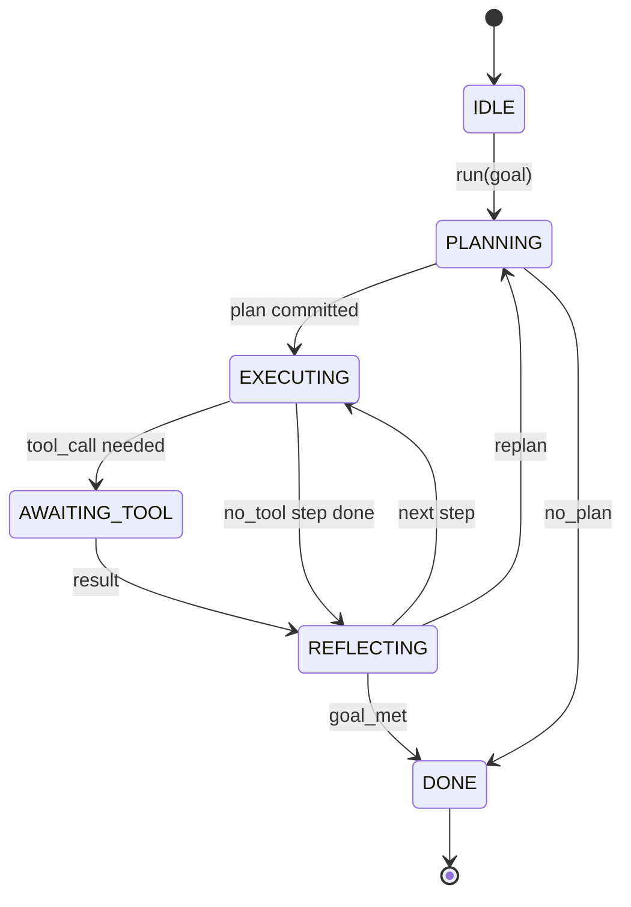

# Agen Harness Loop Contract

> Harness adalah agen. Model ini adalah seorang koprosesor. Pelajaran ini menetapkan kontrak loop kamu dapat kawat model apapun ke dalam.

**Type:** Build
**Languages:** Python
**Prerequisites:** Phase 13 lessons 01-07, Phase 14 lesson 01
**Time:** ~90 minutes

## Tujuan Pembelajaran
- Spesifikasikan sebuah loop agen harness sebagai deterministik mesin state dengan transisi eksplisit.
- Implement 10 lifecycle hook topics that operators wire policy, telemetry, and guardrails into.
- Tentukan dua titik tarik di mana loop menghasilkan kontrol kembali ke penelepon dan resume pada masukan segar.
- Memaksa anggaran persesi (putar, panggilan alat, wall-clock) tanpa merusak keadaan parsial secara berlebihan.
- Keluarkan aliran bertipe sebelas jenis event sehingga hilir UIs dan pelacak dapat berlangganan tanpa memeriksa loop secara langsung.

```figure
cf-loop-contract
```

## Kerangka

Seorang agen kode yang berjalan tanpa pengawasan untuk empat puluh putaran bukan sebuah loop obrolan. Ini adalah mesin state yang node operator dapat mencegat dan yang tepi operator dapat audit. Setelah kamu menulis kontrak ke bawah, bertukar model, alat, atau kebijakan berhenti menjadi refactor. Ini menjadi panggilan pendaftaran.

Pelajaran ini membangun kontrak itu. Kami menyebutkan enam negara bagian, sepuluh topik hook, dua titik tarik, sebelas jenis event, dan amplop anggaran. Segala sesuatu yang lain dalam harness (alat registry, transportasi JSON-RPC, operator, perencana) colokan ke dalam bentuk ini.

## State

Loop memiliki enam negara. Lima aktif. Salah satunya adalah terminal.



`IDLE` adalah satu-satunya titik masuk hukum. ` DONE` adalah satu-satunya jalan keluar hukum. ` AWAITING_TOOL` adalah satu-satunya state yang menghasilkan titik tarik. Setiap transisi lain adalah internal.

Mesin state adalah deterministik. Mengingat catatan kejadian yang sama, harness kembali memasuki state yang sama. Properti itu adalah apa yang memungkinkan kamu memutar ulang sesi untuk debug tanpa memanggil kembali model.

## Topik Hook

Hooks adalah posisi operator dalam loop. Harness api sepuluh topik. Setiap topik menerima sejumlah pelanggan. Para pelanggan menembak dalam urutan pendaftaran. Seorang pelanggan mungkin bermutasi payload, meningkatkan untuk membatalkan gilirannya, atau kembali sentinel untuk melewatkan langkah berikutnya.

```text
before_plan         after_plan
before_tool_call    after_tool_call
before_step         after_step
on_error
on_pause
on_budget_exceeded
on_complete
```

Bentuk cermin apa Claude Code, Cursor, dan OpenCode semua berkumpul oleh pertengahan-2025. Nama-nama yang fungsional, tidak bermerek. A hook that blocks `rm -rf` tinggal di `before_tool_call` Sebuah hook yang ship Span OpenTelemetri hidup di `after_step` Sebuah hook yang melanjutkan pada sesi jeda tinggal di `on_pause `.

## Titik Pull

Loop menghasilkan kontrol dua kali. Pertama pada `AWAITING_TOOL` ketika tidak dapat membuat kemajuan tanpa hasil alat. Kedua pada ` on_pause` ketika anggaran habis atau hook secara eksplisit meminta ulasan manusia.

Titik tarik bukanlah pengecualian. Ini adalah kembali. Penelepon memeriksa keadaan harness, mengambil apa pun harness yang diminta, dan memanggil `resume(payload)`. Harness mengambil di mana berhenti. Ini adalah bentuk yang sama seperti generator Python. Transportasi di atas titik tarik adalah pilihan kamu. Dalam TUI itu adalah keypress. Lebih dari MCP itu adalah ` tools/call `. Selama antrian itu adalah jajak pendapat pekerjaan.

## Stream Event

Loop menambahkan kejadian ke stream bertipe pada titik tertentu dalam kontrak. Stream adalah tambahan - hanya dan pelanggan dapat replay dari ofset apapun. 11 tipe event yang diimplementasikan adalah:

- `session.start` - dikeluarkan sekali ketika ` run(goal)` disebut
- `plan.draft` - dikeluarkan ketika perencana kembali rencana draft
- `plan.commit` - dikeluarkan setelah rancangan berkomitmen sebagai rencana aktif
- `step.start` - dikeluarkan pada awal setiap langkah eksekusi
- `step.end` - dikeluarkan pada akhir setiap langkah eksekusi
- `tool.call` - dikeluarkan ketika alat - langkah menghasilkan kontrol kepada penelepon
- `tool.result` - dikeluarkan pada resume dengan hasil alat
- `tool.error` - dikeluarkan pada resume dengan kesalahan atau ketika sebuah hook mengabaikan panggilan
- `budget.warn` - dikeluarkan ketika batas anggaran dicapai
- `session.pause` - dikeluarkan ketika loop menghasilkan jeda (anggaran atau hook)
- `session.complete` - dikeluarkan sekali ketika loop mencapai ` DONE`

Peristiwa tidak menduplikasi payloads hook. Hooks imperatif (bermutasi, batalkan). Events are observasional (record, ship). Perlakukan mereka sebagai ortogonal.

## Amplop anggaran

Sebuah sesi memiliki tiga batasan. Turn count, tool call count, wall-clock seconds. Setiap putaran berubah menjadi satu. Setiap alat panggilan incremments alat panggilan oleh satu. Wall-clock diperiksa pada setiap transisi state. Ketika batas apapun dicapai, loop kebakaran `on_budget_exceeded `, memancarkan ` budget.warn `, kemudian transisi ke ` IDLE` dengan anggaran-melampaui alasan pada titik tarik berikutnya.

Anggaran bukan tombol membunuh. Ini adalah hasil. Penelepon memutuskan apakah akan memperpanjang anggaran dan melanjutkan, atau untuk menutup sesi.

## Apa pelajaran ini tidak melakukan

Itu tidak disebut model. Ini tidak mendaftar alat nyata. Ini tidak menerapkan transportasi. Itu adalah empat pelajaran berikutnya. Pelajaran ini kuku kontrak sehingga empat berikutnya dapat plug ke dalamnya tanpa menulis ulang.

Perencana deterministik di `main.py` adalah stand-in. Ini kembali rencana hardcode tiga langkah, dua di antaranya membutuhkan hasil alat. Intinya adalah loop, bukan rencana.

## Bagaimana membaca kode

`HarnessLoop` adalah kelas utama. Ia memegang state, kebakaran kait, memancarkan event. ` Budget` trek batas. ` Event` adalah amplop yang bertipe di stream. ` HookRegistry` adalah tabel pengiriman. `_transition` adalah satu-satunya fungsi yang mengubah keadaan, sehingga invarian mesin state tinggal di satu tempat.

Baca `main.py` atas ke bawah. Lalu baca ` code/tests/test_loop.py `. Tes pin setiap transisi dan setiap perintah menembak hook.

## Pergi lebih jauh

Bagian tersulit dari membangun harness dalam produksi bukanlah mesin state. Hal ini membuat kontrak dilaksanakan. Kontraknya harus bertahan dari reload panas perencana. Ini harus bertahan hidup alat yang kembali salah bentuk JSON. Ini harus bertahan hidup hook yang menimbulkan di `before_tool_call` dua-pertiga dari jalan melalui sesi pergantian empat puluh. Tes dalam pelajaran ini latihan mereka mode kegagalan. Jalankan mereka. Hancurkan mereka. Tambahkan kasus.

Pelajaran berikutnya menambahkan daftar alat. Setelah itu, transportasi JSON-RPC. Setelah itu, operator. Dengan pelajaran dua puluh-empat, loop dalam file ini akan menjalankan rencana nyata terhadap alat nyata dengan anggaran nyata dipaksa.
