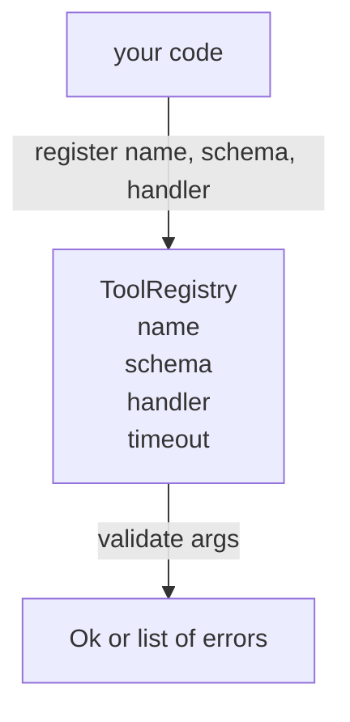

# Tool Registry dengan Schema Validation

> Alat yang tidak bisa divalidasi oleh agent adalah alat yang tidak bisa dipanggil oleh agent. Bangun registry dan pemeriksa schema-nya dulu sebelum kamu membangun alat-alatnya.

**Type:** Build
**Languages:** Python
**Prerequisites:** Phase 13 lessons 01-07, Phase 14 lesson 01
**Time:** ~90 minutes

## Tujuan Pembelajaran
- Menyimpan registry bertipe dari nama tool → schema → handler yang bisa ditanya dispatcher satu kali lalu dipercaya selanjutnya.
- Mengimplementasikan subset JSON Schema 2020-12 yang mencakup keyword yang dipakai oleh sembilan puluh persen panggilan tool secara nyata.
- Mengembalikan path error yang presisi berbentuk json-pointer supaya model bisa mengoreksi diri dalam satu round trip.
- Menolak pendaftaran ulang tanpa override eksplisit, karena penimpaan diam-diam adalah cara katalog tool produksi menyimpang.
- Menjaga validator tetap murni (tanpa I/O, tanpa waktu, tanpa global) supaya bisa dijalankan ulang pada log replay.

```figure
cf-registry-validate
```

## Mengapa registry datang sebelum tool

Coding agent pada 2026 punya tool terdaftar lebih banyak daripada yang bisa muat model dalam satu context window. Harness yang tidak sederhana akan mendaftarkan dua ratus tool dan menampilkan sepuluh sampai empaty puluh pada giliran mana pun. Registry adalah sumber kebenaran untuk "tool apa yang ada," "seperti apa bentuk argumen mereka," dan "handler mana yang saya panggil." Begitu ketiga jawaban itu dikunci, bagian harness yang lain bisa berhenti menebak.

Kesalahan yang sedang kita hindari adalah mengirim handler tanpa schema, atau mengirim schema tanpa validasi. Keduanya umum. Keduanya mengubah lapisan berikutnya (dispatcher di pelajaran dua puluh tiga) menjadi permainan tebakan di mana satu-satunya mode kegagalan adalah stack trace dari handler.

## Seperti apa rekaman tool

```text
ToolRecord
  name        : str          (unique, lowercase alphanumeric and underscore segments separated by dots, e.g., snake_case.segment.case)
  description : str          (one line, shown to the model)
  schema      : dict         (JSON Schema 2020-12 subset)
  handler     : Callable     (async or sync, returns Any)
  idempotent  : bool         (dispatcher uses this for retry decisions)
  timeout_ms  : int          (override per-tool dispatcher default)
```

Schema adalah satu-satunya field yang disentuh validator. Handler bersifat opak baginya. Kami memisahkannya secara sengaja. Schema adalah data. Handler adalah kode. Mencampurkannya membujuk kamu untuk menaruh logika validasi di dalam handler, dan itulah bug yang sedang kita cegah.

## Subset JSON Schema 2020-12

Spesifikasi penuh 2020-12 adalah sebuah makalah. Kita butuh delapan keyword.

```text
type           string / number / integer / boolean / object / array / null
properties     map of property name -> schema
required       list of property names
enum           list of allowed primitive values
minLength      integer, applies to strings
maxLength      integer, applies to strings
pattern        ECMA-262-compatible regex, applies to strings
items          schema applied to every array element
```

Itu sudah cukup untuk menutupi apa yang benar-benar dibutuhkan API sebuah tool. Keyword yang tidak kita tambahkan (oneOf, anyOf, allOf, $ref, conditionals) valid dalam schema produksi tetapi mengubah validator menjadi pemindah pohon dengan siklus. Kita sedang membangun registry, bukan mesin JSON Schema.

## Path error json pointer

Saat validasi gagal, validator mengembalikan daftar error. Setiap error membawa path json-pointer ke dalam input. Pointer adalah urutan berawalan slash dari nama properti dan indeks array.

```text
{"a": {"b": [1, 2, "x"]}}
                    ^
                    /a/b/2
```

Model membaca path error lebih baik daripada membaca kalimat. Jika sebuah schema mewajibkan `args.user.email` dan model mengirimkan integer, error-nya seharusnya `/user/email` dengan `expected_type: string`. Model memperbaikinya pada panggilan berikutnya tanpa satu putaran bahasa alami.

## Pendaftaran dan override

`register(name, schema, handler, **opts)` menolak pendaftaran ulang secara default. Pemanggil harus mengirim `override=True` untuk mengganti. Ini kebersihan operasional. Dua bagian codebase yang mendaftarkan nama tool yang sama secara diam-diam adalah jenis bug yang butuh seminggu untuk ditemukan di produksi.

Registry mengekspos tiga metode baca. `get(name)` mengembalikan record atau melempar error. `validate(name, args)` mengembalikan `Ok` atau daftar error. `names()` mengembalikan nama tool sesuai urutan pendaftaran.

## Apa yang validator itu dan bukan

Itu adalah satu lintasan tunggal di atas pohon schema, secara rekursif. Itu murni. Itu tidak memanggil handler. Itu tidak mengonversi tipe (string `"42"` tidak lolos schema number). Itu tidak memotong diam-diam.

Itu bukan batas keamanan. Handler yang berbahaya tetap bisa berbuat nakal setelah validasi lolos. Dispatcher di pelajaran dua puluh tiga menambahkan lapisan timeout dan sandbox. Registry menambahkan bentuk.

## Bentuk



## Cara membaca kodenya

`code/main.py` mendefinisikan `ToolRegistry`, `ToolRecord`, `ValidationError`, dan delapan fungsi validator. Validator mendispatch berdasarkan `schema["type"]` (atau memperlakukan schema yang punya `enum` sebagai pengecekan enum tanpa tipe). Setiap validator tipe mengembalikan daftar kosong atau daftar `ValidationError`. Pemindah tingkat atas menggabungkan error dan menempelkan segmen path saat turun.

`code/tests/test_registry.py` mencakup pendaftaran, override, validasi berhasil, validasi gagal dengan path, dan setiap keyword dalam subset.

## Melangkah lebih jauh

Dua ekstensi yang kamu inginkan setelah pelajaran ini mendarat adalah resolusi `$ref` terhadap blok definisi lokal, dan `additionalProperties: false` untuk bentuk yang ketat. Keduanya kecil. Keduanya lazim ditambahkan saat katalog tool melewati lima puluh tool. Kami mengeluarkannya dari pelajaran supaya filenya tetap dalam satu kali baca.

Pelajaran berikutnya (dua puluh dua) membangun transport stdio JSON-RPC yang menampilkan registry ini ke klien model. Pelajaran setelahnya (dua puluh tiga) membungkus keduanya di balik dispatcher dengan timeout dan retry.
