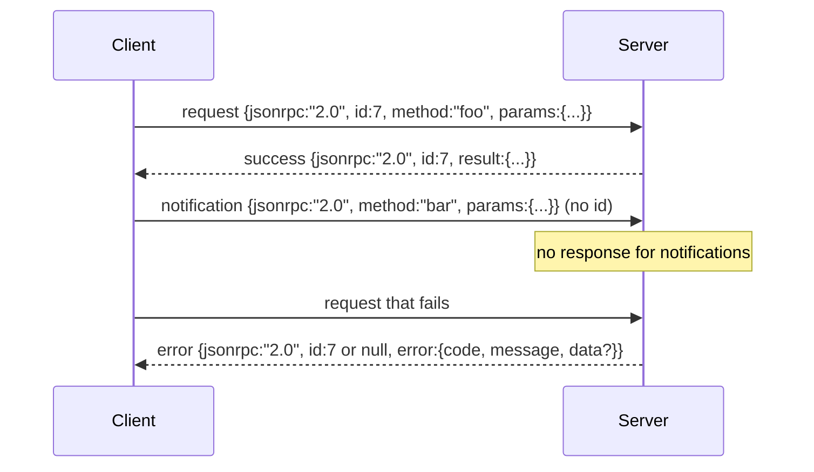

# JSON-RPC 2.0 di Atas Stdio yang Dipisah Baris Baru

> Transport antara klien model dan server tool adalah JSON-RPC di atas stdio. Membuatnya sendiri sekali mengajarkanmu apa yang dibayar oleh setiap lapisan framing.

**Type:** Build
**Languages:** Python
**Prerequisites:** Phase 13 lessons 01-07, Phase 14 lesson 01
**Time:** ~90 minutes

## Tujuan Pembelajaran
- Berbicara JSON-RPC 2.0 yang difram sebagai JSON dipisah baris baru di atas stdin dan stdout.
- Memetakan lima kode error standar (-32700, -32600, -32601, -32602, -32603) dan menampilkannya dengan semantik yang tepat.
- Membedakan request, response, notification, dan batch tanpa mengarang kunci amplop baru.
- Menangani satu error parse per baris tanpa meracuni sisa stream.
- Membangun demo yang berhenti sendiri memakai `io.BytesIO` supaya pelajaran ini berjalan tanpa melahirkan proses anak.

```figure
cf-jsonrpc-frames
```

## Mengapa JSON-RPC tetap menjadi lingua franca

Coding agent pada 2026 berbicara dengan sekitar dua belas server tool dalam satu sesi. Setiap server adalah proses terpisah atau endpoint jarak jauh. Format wire-nya sama sejak 2013. JSON-RPC 2.0 adalah spesifikasi dua halaman. Ia bertahan karena alternatifnya (gRPC, HTTP per panggilan, biner kustom) semuanya memaksakan tradeoff yang tidak dimiliki JSON-RPC: mereka memilih antara streaming atau batching atau keterikatan transport. JSON-RPC simetris di sepanjang stdio, socket, websockets, dan HTTP, dan sebuah klien bisa menjalankan server yang belum pernah ia lihat jika keduanya menghormati spesifikasi.

Pelajaran ini membangun variannya. JSON dipisah baris baru. Setiap request satu baris. Setiap response satu baris. Batas transportnya adalah `\n`.

## Bentuk wire

Ada empat bentuk amplop. Dua diucapkan oleh klien. Dua diucapkan oleh server.



Sebuah notification tidak punya `id`. Server tidak boleh meresponsnya. Jika sebuah server mengembalikan response untuk sebuah notification, klien tidak punya cara menempelkannya ke lokasi pemanggilan. Satu aturan itu menjaga matematika framing tetap sederhana.

Batch adalah array JSON berisi request atau notification. Server membalas dengan array response, dalam urutan apa pun, satu per entri yang bukan notification. Jika setiap entri dalam batch adalah notification, server tidak mengirim apa pun kembali.

## Lima kode error

```text
-32700  Parse error      JSON could not be parsed
-32600  Invalid Request  Envelope shape is wrong
-32601  Method not found
-32602  Invalid params
-32603  Internal error
```

Kode di antara -32000 dan -32099 disediakan untuk error yang didefinisikan server. Sisanya didefinisikan aplikasi. Pelajaran ini hanya memakai lima itu. Jika handler kamu melempar error, transport membungkusnya sebagai -32603 dengan nama kelas exception di `data.exception`.

Error parse punya aturan khusus. `id` di response adalah `null`, karena request belum pernah cukup berhasil di-parse untuk mengekstrak sebuah id.

## Framing baris baru dan demo BytesIO

Transport membaca satu baris dalam satu waktu. Sebuah baris adalah byte sampai dan termasuk `\n`. Jika sebuah baris tidak bisa di-parse, transport menulis response -32700 dengan `id: null` dan melanjutkan. Stream tidak tercemar. Baris berikutnya di-parse dari awal.

Untuk pelajaran ini kita membungkus sepasang `io.BytesIO` sebagai stdin dan stdout. Server membaca request sampai EOF, menulis response untuk masing-masing, lalu mengembalikan. Klien membaca response-nya kembali. Tanpa spawn proses. Tanpa timeout. Perilaku transport identik dengan pipe subprocess sungguhan karena antarmuka `io` Python menyajikan kontrak `.readline()` dan `.write()` yang sama.

## Dispatch method

Transport tidak tahu method apa yang ada. Ia menyerahkan ke callable `handler(method, params)` yang disediakan harness. Handler mengembalikan hasil atau melempar error. Tiga kelas exception memunculkan kode spesifik.

```text
MethodNotFound -> -32601
InvalidParams  -> -32602
Anything else  -> -32603 with exception name in data
```

Transport tidak pernah melihat registry tool. Registry berada di balik handler. Inilah layering yang kita inginkan. Transport berbicara JSON-RPC. Registry berbicara bentuk tool. Dispatcher (pelajaran dua puluh tiga) menyatukan keduanya.

## Perilaku stream saat error

```text
client writes              server reads             server writes
---------------            -----------              -------------
{...valid request...}      parses ok                {...response, id matches...}
{...broken json...         parse fails              {id:null, error: -32700}
{...valid request...}      parses ok                {...response, id matches...}
{...missing method...}     invalid envelope         {id:X, error: -32600}
```

Baris JSON yang rusak tidak menghentikan loop. Field `method` yang hilang tidak menghentikan loop. Exception handler tidak menghentikan loop. Transport terus membaca sampai EOF.

## Notification dan aliran asimetris

Sebuah notification bersifat fire-and-forget. Harness memakai notification untuk event progres, sinyal pembatalan, dan baris log. Notification adalah cara sebuah tool yang lama berjalan men-stream update status tanpa round-trip untuk setiap satunya.

Pelajaran ini mengimplementasikan satu helper notification keluar, `write_notification`. Server memakainya untuk memancarkan progres selama sebuah request sedang berjalan. Demo menampilkan polanya: sebuah request masuk, handler memancarkan dua notification progres, lalu menulis response final.

## Cara membaca kodenya

`code/main.py` mendefinisikan `StdioTransport`, helper parse (`parse_request`), tiga helper tulis (`write_response`, `write_error`, `write_notification`), dan loop dispatch `serve`. Konstanta kode error berada di cakupan modul.

`code/tests/test_transport.py` mencakup lima kode error, notification (tidak ada response yang ditulis), batch (array masuk, array keluar, notification dilewati), JSON rusak (error parse lalu lanjut), dan aliran asimetris di mana sebuah handler menulis notification di tengah panggilan.

## Melangkah lebih jauh

Transport ini cukup untuk pelajaran-pelajaran berikutnya. Transport produksi menambahkan tiga hal. Field korelasi id yang bertahan saat diteruskan (`id` kamu sudah begini, tetapi di dalam mesh kamu juga butuh trace id luar). Kanal pembatalan (sebuah notification seperti `$/cancelRequest` dengan id dari panggilan yang sedang berjalan). Dan jabat-tangan negosiasi content-type supaya socket yang sama bisa berbicara JSON-RPC dan Streamable HTTP. Tidak ada yang mengubah wire. Mereka menambahkan metadata.
