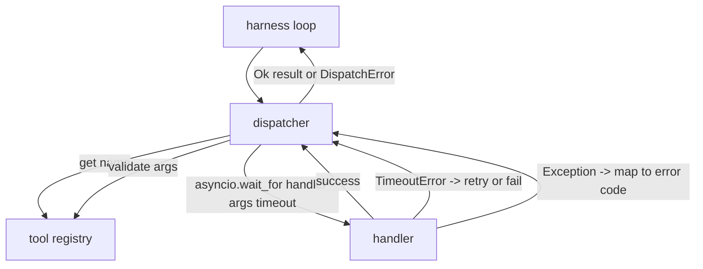
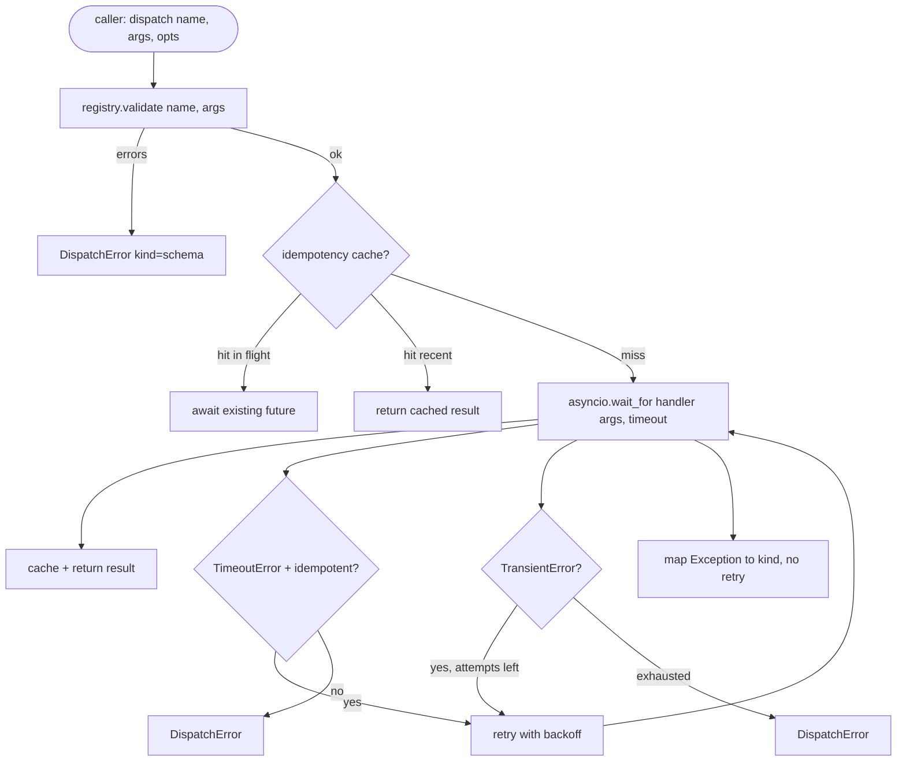

# Dispatcher Function Call

> Dispatcher adalah tempat harness membayar setiap janji yang dibuat schema. Timeout, retry, dedupe, pemetaan error. Semuanya di satu sambungan.

**Type:** Build
**Languages:** Python
**Prerequisites:** Phase 13 lessons 01-07, Phase 14 lesson 01
**Time:** ~90 minutes

## Tujuan Pembelajaran
- Membungkus handler tool dengan timeout per-panggilan yang mengembalikan error bertipe alih-alih menggantungkan loop.
- Menerapkan retry exponential backoff dengan jitter dan jumlah percobaan maksimum.
- Mendeduplikasi retry berdasarkan kunci idempotency supaya retry yang balapan dengan original yang lambat tidak dijalankan dua kali.
- Memetakan exception handler dan gangguan transport ke satu amplop error yang sudah dipahami loop harness.
- Membatasi dispatch paralel dengan batas konkurensi supaya fan-out dari empaty puluh panggilan tool tidak menghabiskan event loop.

```figure
cf-dispatch-retry
```

## Di mana dispatcher berada

Di antara loop harness (pelajaran dua puluh) dan registry tool (pelajaran dua puluh satu). Transport (pelajaran dua puluh dua) memberi makan loop. Loop menyerahkan sebuah panggilan tool ke dispatcher. Dispatcher memanggil registry, menjalankan handler, dan mengembalikan baik hasil maupun amplop error berbentuk JSON-RPC.



Dispatcher adalah satu-satunya lapisan yang tahu soal timer, retry, dan idempotency. Loop tidak tahu. Registry tidak tahu. Handler tidak tahu. Isolasi itulah intinya.

## Timeout

Setiap tool punya timeout default. Record registry membawa `timeout_ms`. Dispatcher menimpanya dari override per-panggilan saat harness mengirimkannya. Kami memakai `asyncio.wait_for`. Saat timeout, tugas handler dibatalkan dan dispatcher mengembalikan `DispatchError(kind="timeout")`.

Timeout secara default bukan error yang bisa di-retry untuk tool non-idempotent. Sebuah `db.write` yang timeout mungkin sudah mungkin belum commit. Retry menduplikasi tulisan itu. Dispatcher menghormati flag `idempotent` dari record registry. Tool idempotent di-retry. Tool non-idempotent tidak.

## Retry dengan exponential backoff

Kebijakan retry maksimal tiga percobaan. Backoff eksponensial dengan jitter.

```text
attempt 1  -> delay 0
attempt 2  -> delay 0.1s * (1 + random[0..0.5])
attempt 3  -> delay 0.4s * (1 + random[0..0.5])
```

Hanya error `timeout` dan `transient` yang di-retry. Error `schema`, `not_found`, atau `internal` tidak di-retry. Error schema bersifat deterministik. Retry tidak mengubah hasil dan justru membakar anggaran.

Loop retry menghormati anggaran dari harness. Jika anggaran pemanggil sisa nol panggilan tool, dispatcher gagal cepat pada percobaan pertama dan mengembalikan `kind="budget_exceeded"`.

## Dedupe kunci idempotency

Sebuah retry yang menyala saat original masih berjalan adalah bug produksi nyata. Panggilan pertama menggantung pada empat koma sembilan detik (sedikit di bawah timeout). Retry menyala pada lima detik. Kini dua request balapan ke backend yang sama. Jika tool-nya `payments.charge`, kamu menagih dua kali.

Dispatcher menerima `idempotency_key` opsional. Jika kunci yang sama sedang berjalan saat sebuah panggilan datang, dispatcher menunggu pada future yang sedang berjalan dan mengembalikan hasilnya. Cache menyimpan kunci selama enam puluh detik setelah selesai untuk menyerap retry yang terlambat.

Kunci adalah tanggung jawab pemanggil. Harness menurunkannya dari planner: `f"{step_id}:{tool_name}:{hash(args)}"`. Dispatcher tidak mengarang kunci, karena menurunkan kunci hanya dari argumen membuat dua panggilan yang bermakna berbeda tampak sama.

## Amplop error

Dispatch yang gagal mengembalikan satu bentuk.

```text
DispatchError
  kind        : "timeout" | "transient" | "schema" | "not_found" | "internal" | "budget_exceeded"
  message     : str
  attempts    : int
  jsonrpc_code: int   (one of -32601, -32602, -32603)
```

Loop harness memetakan `kind` ke status berikutnya. `schema` dan `not_found` pergi ke `on_error` dan memicu replan. `timeout` dan `transient` pergi ke `on_error` dan mungkin mungkin tidak replan tergantung jumlah percobaan. `budget_exceeded` memicu `on_budget_exceeded`.

## Batas konkurensi pada fan-out

`gather(*calls)` menjalankan semua coroutine secara bersamaan. Dengan empaty puluh panggilan tool, itu berarti empaty puluh socket terbuka atau empaty puluh pipe subprocess. Kebanyakan backend tidak suka empaty puluh koneksi paralel dari satu klien.

Dispatcher membungkus `gather` dengan sebuah semaphore. Batas konkurensi default adalah delapan. Setiap panggilan mengambil semaphore sebelum dispatch dan melepasnya saat selesai. Pemanggil melihat output berbentuk `gather` tetapi penjadwalan sesungguhnya dibatasi.

## Alur untuk satu panggilan



## Cara membaca kodenya

`code/main.py` mendefinisikan `Dispatcher`, `DispatchError`, dan `TransientError`. Dispatcher menerima registry saat konstruksi. `dispatch(name, args, ...)` async adalah satu-satunya titik masuk. Timeout per-percobaan diterapkan inline di dalam `_run_with_retries` memakai `asyncio.wait_for`. `gather_bounded(calls)` menjalankan banyak dispatch dengan batas konkurensi.

`code/tests/test_dispatcher.py` mencakup timeout yang menyala, retry pada transient, tidak-retry pada error schema, dedupe idempotency (dua panggilan konkuren dengan kunci yang sama menyusut menjadi satu pemanggilan handler), dan pembatasan konkurensi (sedang beraksi).

Tes memakai `asyncio.sleep(0)` dan handler deterministik berbasis `Counter`, sehingga selesai dalam milidetik dan tidak bergantung pada waktu wall-clock.

## Melangkah lebih jauh

Dua ekstensi yang ditambahkan dispatcher produksi. Pertama, logging terstruktur di setiap transisi (yang sudah diberikan event stream loop, tetapi dispatcher juga harus memancarkan event `dispatch.attempt` dan `dispatch.retry`). Kedua, circuit breaker: setelah N kegagalan dalam satu jendela, sebuah tool mendapat periode pendingin di mana dispatch langsung mengembalikan `kind="circuit_open"` alih-alih mencoba handler. Keduanya muat di atas dispatcher ini tanpa mengubah kontraknya.

Pelajaran dua puluh empat menempelkan dispatcher ke agent plan-and-execute supaya kamu melihat keempat bagian bergerak bersama.
