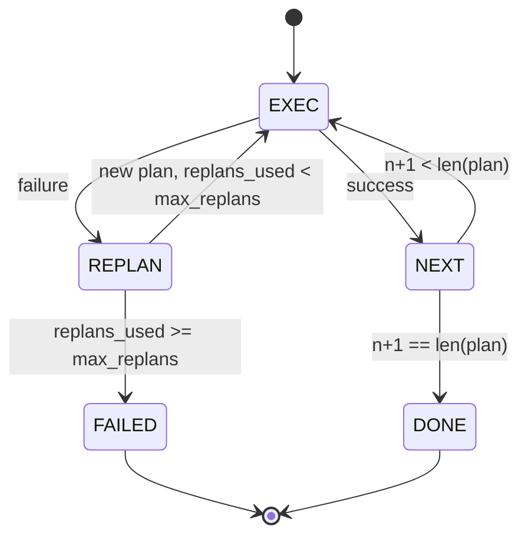

# Alur Kontrol Plan-Execute

> Sebuah rencana yang tidak bisa bertahan dari kegagalan adalah sebuah skrip. Sebuah skrip yang bisa replan adalah sebuah agent. Bangun replanner-nya dulu.

**Type:** Build
**Languages:** Python
**Prerequisites:** Phase 13 lessons 01-07, Phase 14 lesson 01
**Time:** ~90 minutes

## Tujuan Pembelajaran
- Merepresentasikan rencana sebagai daftar berurutan dari langkah bertipe supaya executor bisa menalar soal progres dan hasil.
- Menjalankan langkah secara sekuensial dengan serah-terima kegagalan yang terkendali kembali ke planner.
- Replan dari kursor saat ini dengan error sebelumnya di dalam konteks supaya rencana berikutnya lebih terinformasi.
- Memancarkan diff rencana pada setiap revisi supaya tracer atau UI hulu bisa menampilkan mengapa rencana berubah.
- Menegakkan dua anggaran: batas langkah keras dan batas replan keras.

```figure
cg-plan-replan
```

## Plan and execute, bukan chain-of-thought

Agent chain-of-thought memancarkan token dan membiarkan loop menebak di mana panggilan tool berakhir. Agent plan-and-execute memancarkan rencana terstruktur lebih dulu, lalu menjalankan setiap langkah secara deterministik. Rencana adalah data yang bisa diintrospeksi harness. Pelaksanaannya adalah harness menjalankan data itu lewat dispatcher.

Dua bagian. Sebuah planner yang menghasilkan rencana. Sebuah executor yang menjalankan rencana. Pekerjaan menariknya adalah apa yang terjadi saat executor menemui kegagalan. Tiga pilihan:

```text
1. Abort         (return failed, surface the error)
2. Skip          (mark step failed, continue with the rest)
3. Replan        (hand the error to the planner, get a new plan from the cursor)
```

Replan adalah yang mengubah skrip menjadi agent.

## Bentuk Step

```text
Step
  id              : int           (monotonic within a plan revision)
  tool_name       : str
  args            : dict
  expected_outcome: str           (planner's stated success condition)
  result          : Any | None
  error           : str | None
```

`expected_outcome` adalah kalimat pendek yang dipancarkan planner bersama langkah itu. Ia tidak ditegakkan oleh executor. Ia dipakai untuk dua hal: replanner membacanya saat merevisi rencana; event stream memancarkannya supaya tracer bisa menampilkan "langkah ini seharusnya melakukan X."

## Bentuk planner

```python
def planner(goal: str, history: list[Step], last_error: str | None) -> list[Step]:
    ...
```

Sebuah fungsi murni. `goal` adalah tujuan pengguna. `history` adalah langkah yang sudah dijalankan (dengan hasil dan error terisi). `last_error` adalah None pada panggilan pertama dan pesan kegagalan terbaru pada setiap panggilan berikutnya. Planner mengembalikan rencana berikutnya yang dimulai dari kursor.

Planner tidak tahu soal executor. Ia tidak tahu soal retry. Ia tidak tahu soal timeout. Ia menghasilkan rencana. Itu saja.

## Executor-nya

Executor adalah sebuah mesin state kecil. Setiap langkah berjalan lewat dispatcher. Hasilnya adalah salah satu dari tiga: sukses, gagal-bisa-replan, gagal-fatal. Kegagalan yang bisa direplan diserahkan kembali ke planner. Kegagalan fatal (anggaran terlampaui, batas replan tercapai) mengembalikan hasil sesi `FAILED`.



## Diff rencana saat revisi

Saat planner mengembalikan rencana baru setelah kegagalan, executor memancarkan event `plan.diff` dengan tiga field.

```text
removed: list of step ids that were in the old plan and are not in the new
added  : list of step ids in the new plan that were not in the old
revised: list of step ids whose tool_name or args changed
```

Sebuah tracer atau UI bisa merender ini sebagai coretan pada langkah yang dihapus dan sorotan pada yang ditambahkan. Intinya bukan format diff-nya. Intinya adalah bahwa revisi adalah event yang terlihat, bukan penulisan-ulang diam-diam.

## Dua anggaran, keduanya keras

`max_steps` membatasi total eksekusi langkah di sepanjang sesi, termasuk replan. Defaultnya dua belas. Sebuah rencana linier lima langkah yang direplan dua kali dan menambah tiga langkah setiap kali mencapai enam belas eksekusi dan akan melampaui anggaran. Executor akan menolak replan itu dan mengembalikan FAILED.

`max_replans` membatasi berapa kali planner dipanggil setelah rencana pertama. Defaultnya lima. Ini batasan yang lebih penting. Sebuah planner yang mengembalikan rencana rusak yang sama lima kali berturut-turut jika tidak akan loop sampai anggaran langkah menangkapnya. Membatasi replan membuat kegagalannya lebih cepat dan alasannya lebih jelas.

## Planner deterministik dalam pelajaran ini

Kami tidak memanggil model dalam pelajaran ini. Pelajaran ini mengirim planner deterministik yang memilih rencana berdasarkan `last_error`.

```text
last_error is None    -> emit a four-step plan
last_error matches X  -> emit a three-step plan that routes around X
last_error matches Y  -> emit a two-step plan that gives up gracefully
otherwise             -> return [] (signals nothing to replan)
```

Ini cukup untuk menguji perilaku executor pada setiap jalur transisi: sukses, replan-sekali, replan-dua-kali, kehabisan replan, dan kehabisan anggaran langkah.

## Bentuk hasil

```text
SessionResult
  status      : "completed" | "failed"
  reason      : str     ("goal_met" | "step_budget" | "replan_budget" | "no_plan")
  history     : list[Step]
  revisions   : list[PlanDiff]
  events      : list[Event]
```

Loop harness dari pelajaran dua puluh bisa membaca ini secara langsung. Dispatcher dari pelajaran dua puluh tiga adalah yang menjalankan setiap langkah. Registry dari pelajaran dua puluh satu memvalidasi argumen setiap langkah. Transport dari pelajaran dua puluh dua akan menampilkan seluruh alur ini lewat JSON-RPC ke klien model.

## Cara membaca kodenya

`code/main.py` mendefinisikan `PlanExecuteAgent`, `Step`, `PlanDiff`, `SessionResult`, dan planner deterministik. Executor adalah satu metode `run(goal)` yang mengembalikan `SessionResult`. Diff rencana dihitung dengan membandingkan id langkah dan tuple `(tool_name, args)`.

`code/tests/test_agent.py` mencakup keberhasilan linier, kegagalan di tengah rencana yang direplan sekali, kehabisan replan yang mengembalikan `failed:replan_budget`, kehabisan anggaran langkah, dan format event diff rencana.

## Melangkah lebih jauh

Dua ekstensi yang kamu inginkan setelah kamu menyambungkannya ke model sungguhan. Pertama, cache rencana parsial: saat sebuah rencana berhasil untuk tiga langkah pertama dari enam lalu gagal, kamu tidak ingin menjalankan ulang tiga yang pertama. Executor sudah menyimpan history; planner hanya perlu membacanya. Kedua, cabang paralel: executor saat ini sepenuhnya sekuensial. Sebuah planner yang memancarkan cabang independen (`gather_step` alih-alih `next_step`) bisa menjalankan dua panggilan tool secara konkuren lewat dispatcher.

Keduanya menambah kerumitan nyata. Keduanya lebih mudah ditambahkan setelah executor linier dikunci. Itulah yang dilakukan pelajaran ini.
