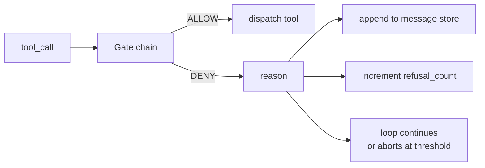
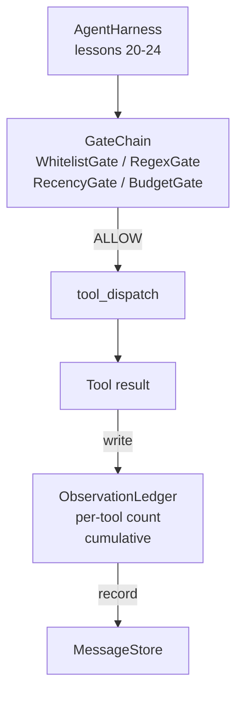

# Capstone Lesson 25: Verification Gate dan Anggaran Observasi

> Harness agent tanpa lapisan verifikasi adalah harapan yang berbalut jas hujan. Pelajaran ini membangun rantai gate deterministik yang memutuskan apakah sebuah panggilan tool boleh dinyalakan, berapa banyak output-nya yang boleh dilihat agent, dan kapan loop harus berhenti karena agent sudah terlalu banyak membaca. Rantai itu adalah fungsi dari gate-gate kecil yang bernama plus sebuah buku besar observasi yang melacak setiap token yang ditampilkan ke model.

**Type:** Build
**Languages:** Python (stdlib)
**Prerequisites:** Phase 19 · 20-24 (Track A1: agent loop, tool registry, message store, prompt builder, model router), Phase 14 · 33 (instructions as constraints), Phase 14 · 36 (scope contracts), Phase 14 · 38 (verification gates)
**Time:** ~90 minutes

## Tujuan Pembelajaran

- Membangun protokol `VerificationGate` dengan metode deterministik `evaluate(call)`.
- Menggabungkan gate budget, recency, whitelist, dan regex menjadi rantai dengan semantik short-circuit.
- Melacak setiap observasi lewat `ObservationLedger` yang dikunci oleh tool dan giliran.
- Menolak sebuah panggilan tool saat anggaran observasi kumulatif akan terlampaui.
- Menampilkkan record `GateDecision` terstruktur yang bisa dikonsumsi observability hulu.

## Masalahnya

Saat sebuah harness agent membiarkan model memanggil tool dengan bebas, tiga kelas bug muncul dalam jam pertama pemakaian nyata.

Pertama, observasi tanpa batas. Sebuah grep di repo 200 ribu baris memuntahkan setengah juta token output ke giliran berikutnya. Model melihat satu kecocokan per kilobyte dan sisa konteksnya terbuang. Tagihan token-nya besar dan agent kini lebih buruk, bukan lebih baik, dalam tugasnya.

Kedua, recency yang basi. Sebuah tugas jangka panjang mengumpulkan lima puluh panggilan tool. Membaca ulang `read_file` pertama dari giliran tiga seolah-ia adalah state yang hidup. Edit yang dibuat pada giliran empat puluh tujuh tidak pernah muncul karena prompt builder mengurai observasi paling awal lebih dulu.

Ketiga, privilege creep. Sebuah tugas riset dimulai dengan memanggil `web_search`, lalu entah bagaimana berakhir menjalankan `shell` karena model mengarang nama tool dan harness default-nya permisif. Pada saat seseorang membaca trace-nya, sebuah file sampah tergeletak di /tmp dan sebuah curl berjalan terhadap API privat.

Verification gate adalah komponen harness yang berkata tidak. Ia bukan model. Ia bukan hakim. Ia adalah fungsi deterministik dari `(call, history, ledger)` yang mengembalikan ALLOW atau DENY beserta alasan. Alasannya dicatat. Model diberi tahu. Loop melanjutkan atau membatalkan.

## Konsepnya



Sebuah gate adalah apa pun yang punya metode `evaluate(call, ctx) -> GateDecision`. Rantai itu adalah daftar berurutan. Evaluasi berhenti di deny pertama. Urutan penting: gate struktural yang murah berjalan sebelum gate penghitungan token yang mahal.

Pelajaran ini mengirim empat gate:

- `WhitelistGate`. Nama tool yang diizinkan adalah himpunan eksplisit. Apa pun di luar itu ditolak. Ini gate termurah dan berjalan pertama.
- `RegexGate`. Argumen tool dicocokkan terhadap sebuah regex. Berguna untuk menolak panggilan shell yang berisi `rm -rf`, atau panggilan HTTP ke IP internal. Murni pada payload panggilan.
- `RecencyGate`. Model hanya melihat observasi dari N giliran terakhir. Observasi yang lebih tua dimask. Gate menolak sebuah panggilan tool yang hasilnya akan memperluas jendela observasi yang sudah lewat umurnya.
- `BudgetGate`. Total token yang sudah dibaca model di sepanjang sesi punya batas. Saat buku besar menyatakan batas itu tercapai, setiap panggilan tool berikutnya ditolak.

Buku besar observasi adalah catatannya. Setiap panggilan tool yang berhasil menulis satu baris: nama tool, giliran, token yang dipancarkan, kumulatif. Buku besar menjawab dua pertanyaan: berapa total yang sudah dilihat model, dan berapa yang sudah dilihatnya dari tool X. Gate budget membaca yang pertama. Gate budget per-tool, yang akan kamu tulis sebagai latihan, membaca yang kedua.

```figure
cg-gate-chain
```

## Arsitektur



Harness bertanya ke rantai. Rantai mengangguk atau menolak. Jika mengangguk, tool berjalan, buku besar bertambah, dan hasilnya ditambahkan ke message store. Jika menolak, model menerima penolakan itu sebagai pesan system dan loop memutuskan apakah mencoba lagi atau membatalkan.

## Yang akan kamu bangun

Implementasinya adalah satu `main.py` plus tes.

1. Dataclass `Observation` dan `ToolCall` mendefinisikan bentuk wire-nya.
2. `ObservationLedger` mencatat baris `(turn, tool, tokens)` dan menjawab `cumulative()` dan `per_tool(name)`.
3. `GateDecision` membawa `(allow, reason, gate_name)`.
4. `VerificationGate` adalah protokolnya. Setiap gate mengimplementasikan `evaluate(call, ctx)`.
5. `GateChain` membungkus daftar berurutan. Ia memanggil setiap gate, mengembalikan deny pertama, atau mengembalikan allow jika semua gate lolos.
6. Demo menjalankan loop agent sintetis kecil. Tiga giliran. Giliran ketiga memicu gate budget dan loop melaporkan penolakan yang bersih dengan jumlah penolakan bukan-nol.

Penghitung token sengaja adalah heuristik bodoh `len(text) // 4`. Inti pelajaran ini adalah perpipaan gate-nya, bukan tokenizernya. Pasang tokenizer sungguhan di produksi.

## Mengapa urutan rantai penting

Sebuah deny lebih murah daripada sebuah allow. `WhitelistGate` berjalan dalam lookup hash O(1). `RegexGate` berjalan dalam O(pattern * argv). `RecencyGate` membaca irisan kecil dari message store. `BudgetGate` membaca seluruh buku besar. Kamu mengurutkannya menurut biaya menaik supaya panggilan yang ditolak berhenti sebelum mengerjakan pekerjaan mahal.

Kamu juga mengurutkannya menurut radius ledakan. Whitelist adalah klaim terkuat: tool ini tidak ada dalam kontrak. Gate regex berikutnya: argumen ini tidak ada dalam kontrak. Recency datang setelahnya: harness masih peduli tetapi panggilan itu secara struktural legal. Budget terakhir karena, berdasarkan definisi, ia hanya menyala saat semua yang lain lolos.

## Bagaimana ini menyatu dengan sisa Track A

Pelajaran sebelumnya memberimu loop, registry tool, message store, prompt builder, dan model router. Pelajaran ini menambahkan lapisan di antara model dan tool. Lesson 26 mengirim sandbox yang diserahkan dispatcher ke panggilan tool setelah rantai gate berkata ALLOW. Lesson 27 mengirim eval harness yang mencatat jumlah penolakan sebagai sinyal kualitas. Lesson 28 menyambungkan keputusan gate ke span OpenTelemetry. Lesson 29 menyatukan semuanya menjadi coding agent yang berjalan.

## Menjalankannya

```bash
cd phases/19-capstone-projects/25-verification-gates-observation-budget
python3 code/main.py
python3 -m pytest code/tests/ -v
```

Demo mencetak trace per-giliran yang mencakup setiap keputusan gate dan keluar dengan kode nol. Tes mencakup buku besar, setiap gate secara terisolasi, short-circuit rantai, dan loop sintetis secara end-to-end.
