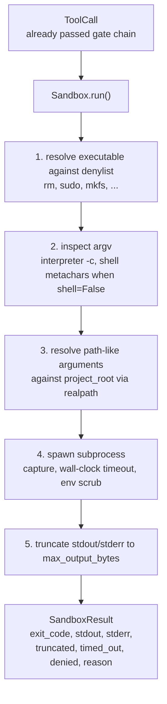
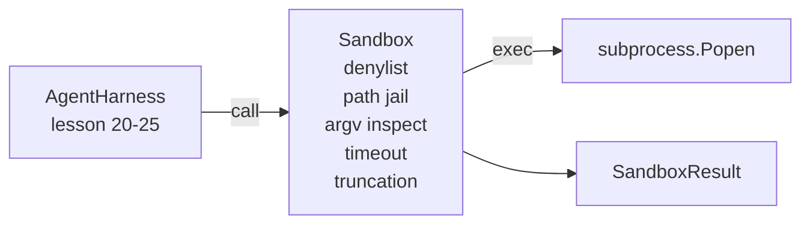

# Capstone Lesson 26: Sandbox Runner dengan Denylist dan Path Jail

> Verification gate memutuskan apakah sebuah panggilan tool seharusnya berjalan. Sandbox memutuskan apa yang terjadi saat ia berjalan. Pelajaran ini mengirim runner subprocess yang menolak executable berbahaya, menolak bentuk argv berbahaya, menjeblokkan setiap path file ke project root, memotong output yang terlalu besar, dan membunuh proses liar pada timeout wall-clock. Ini lapisan kedua dari dua lapisan yang berada di antara model dan sistem operasi.

**Type:** Build
**Languages:** Python (stdlib)
**Prerequisites:** Phase 19 · 25 (verification gates and observation budget), Phase 14 · 33 (instructions as constraints), Phase 14 · 38 (verification gates)
**Time:** ~90 minutes

## Tujuan Pembelajaran

- Membangun kelas `Sandbox` yang membungkus `subprocess.run` dengan timeout, capture, dan truncation.
- Menolak sebuah perintah berdasarkan nama terhadap denylist dan berdasarkan struktur terhadap pemeriksa argv.
- Menolak setiap argumen path yang resolve-nya di luar project root yang dideklarasikan.
- Menolak metakarakter shell saat shell mode mati.
- Mengembalikan `SandboxResult` terstruktur yang bisa dikonsumsi observability hulu dan eval harness.

## Masalahnya

Coding agent yang bisa keluar ke shell bisa memasang backdoor, membocorkan kunci, merusak laptop developer, dan membengkakkan tagihan cloud dalam satu giliran. Pertahanan termurah adalah tidak memberinya shell. Pertahanan kedua termurah adalah sandbox yang berkata tidak terhadap daftar pola yang presisi.

Tiga kelas kegagalan berulang di trace agent.

Pertama, executable berbahaya. Model yang tertekan untuk memperbaiki masalah path akan mencoba `sudo`, `chmod -R 777`, `rm -rf`, `mkfs`, `dd`. Tidak ada yang pantas ada dalam sebuah agent run. Denylist menangkapnya berdasarkan nama dan aliasnya.

Kedua, trik argv. Model yang sudah diberi tahu tanpa shell akan menyalurkan serangan lewat sebuah interpreter: `python3 -c "import os; os.system('rm -rf /')"`, `bash -c '...'`, `node -e '...'`, `perl -e '...'`. Sandbox perlu tahu bahwa interpreter mana pun yang dijalankan dengan flag mirip `-c` hanyalah panggilan shell dengan langkah ekstra.

Ketiga, pelarian path. Model diperintahkan membaca `./src/main.py` tetapi malah membaca `../../etc/passwd`. Sandbox menjeblokkan setiap argumen path dengan me-resolve-nya lewat `os.path.realpath` dan memastikan prefiksnya.

Sandbox bukan batas keamanan dalam arti sistem operasi. Penyerang yang bertekad dengan eksekusi kode tetap bisa keluar. Sandbox adalah guardrail waktu-pengembangan: ia membuat mode kegagalan yang umum menjadi keras dan menghentikan agent melakukan kerusakan semata-mata karena kebodohan.

## Konsepnya



Sandbox punya empat sumbu penolakan: nama, argv, path, struktur. Setiap sumbu adalah fungsi murni dari panggilan, belum ada subprocess. Subprocess baru dilahirkan setelah setiap sumbu lolos.

Kode keluar `SandboxResult` adalah yang konvensional: 0 sukses, bukan-nol gagal, plus tiga kode sentinel untuk denied (-100), timed_out (-101), dan truncated (kode keluarnya yang asli, dengan sebuah flag diset). Pelajaran hulu membaca hasil terstruktur ini alih-alih mengurai stderr.

```figure
cg-path-jail
```

## Arsitektur



Denylist adalah frozenset dari basename executable. Alias (`/bin/rm`, `/usr/bin/rm`) semuanya resolve ke basename yang sama. Pemeriksa argv tahu bentuk interpreter: argv mana pun tempat argv[0] adalah sebuah interpreter dan argumen berikutnya diawali `-c` atau `-e` ditolak. Metakarakter shell (`;`, `|`, `&`, `>`, `<`, backtick, `$()`) menyebabkan penolakan saat panggilan tidak secara eksplisit meminta shell.

Path jail adalah bagian yang paling halus. Sandbox menerima `project_root` saat konstruksi. Argumen mana pun yang tampak seperti path (berisi `/` atau cocok dengan file yang ada) dinormalisasi lewat `os.path.realpath`, lalu diperiksa terhadap realpath dari project root. Jika target hasil resolve tidak berada di bawah root, penolakan. Upaya pelarian symlink (sebuah symlink di dalam project root yang menunjuk ke luar) diblokir dengan memeriksa realpath, bukan path literalnya.

## Yang akan kamu bangun

Implementasinya adalah `main.py` plus direktori tests.

1. Dataclass `SandboxResult`: exit_code, stdout, stderr, truncated, timed_out, denied, reason, duration_ms.
2. Dataclass `SandboxConfig`: project_root, max_output_bytes, timeout_seconds, denylist, interpreter_block.
3. Kelas `Sandbox`: `run(argv, *, shell=False, cwd=None)` mengembalikan sebuah `SandboxResult`.
4. Helper penolakan internal: `_check_executable_denylist`, `_check_argv_interpreter`, `_check_shell_metachars`, `_check_path_jail`.
5. Truncation output dengan flag `truncated` yang jelas dan sebuah baris penanda di stream yang ditangkap.
6. Demo di bagian bawah: urutan panggilan yang sah dan yang adversarial. Masing-masing ditampilkan beserta hasilnya.

Sandbox memakai `subprocess.run` dengan `shell=False` secara default dan `capture_output=True`. Timeout wall-clock memakai argumen `timeout`; pada `TimeoutExpired`, sandbox membunuh grup proses dan mensintesis sebuah SandboxResult.

## Mengapa ini bukan sandbox sungguhan

Sandbox pelajaran ini tidak memakai namespace, cgroups, seccomp, gVisor, Firecracker, atau isolasi level kernel apa pun. Apa pun yang bisa dilakukan subprocess, bisa dilakukan sandbox. Perlindungannya bersifat struktural: agent ditolak dari invokasi berbahaya yang paling umum, dan penolakan yang keras itu masuk ke observability alih-alih berjalan diam-diam.

Untuk agent produksi kamu melapisinya dari atas: jalankan di dalam kontainer Docker tanpa privilese, jalankan di dalam microVM, jatuhkan capabilities, mount project root secara read-only dan direktori scratch secara read-write, set ulimit pada memori dan CPU, bersihkan environment ke whitelist yang sudah diketahui aman. Lesson 29 melakukan sebagian dari ini. Isolasi sistem operasi di luar cakupan pelajaran ini.

## Menjalankannya

```bash
cd phases/19-capstone-projects/26-sandbox-runner-denylist
python3 code/main.py
python3 -m pytest code/tests/ -v
```

Demo membuat direktori sementara, menaruh satu file bersih ke dalamnya, lalu menjalankan baterai panggilan. Panggilan yang sah berhasil. Panggilan yang ditolak mengembalikan SandboxResult dengan `denied=True` beserta alasannya. Timeout mengembalikan `timed_out=True`. Truncation menyetel `truncated=True`. Demo mencetak tabel JSON berisi hasil-hasil dan keluar dengan kode nol.

## Bagaimana ini menyatu dengan sisa Track A

Lesson 25 menghasilkan rantai gate. Lesson 26 adalah executor yang berjalan setelah sebuah gate ALLOW. Eval harness dari Lesson 27 membandingkan hasil sandbox terhadap kode keluar yang diharapkan per tugas. Lesson 28 memancarkan span `gen_ai.tool.execution` di sekeliling setiap invokasi `Sandbox.run`. Demo end-to-end dari Lesson 29 menyambungkan coding agent sungguhan lewat kedua lapisan.
