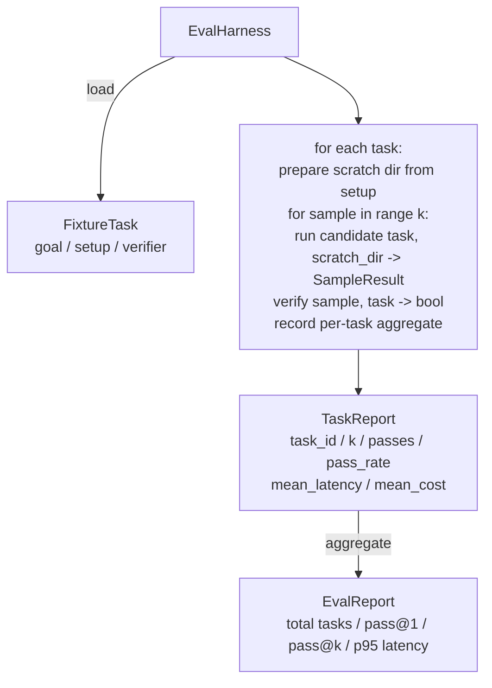

# Capstone Lesson 27: Eval Harness dengan Fixture Task

> Coding agent hanya sebaik suite tugas yang kamu pakai untuk mengukurnya. Pelajaran ini membangun evaluation harness yang mengambil folder berisi fixture task, menjalankan masing-masing lewat sebuah agent kandidat, menilai lulus atau gagal melalui verifier deterministik, dan mengagregasi hasil menjadi pass@1, pass@k, latensi rata-rata, dan biaya rata-rata. Harness adalah sumber kebenaran yang memungkinkan kamu membedakan regresi dari refaktor.

**Type:** Build
**Languages:** Python (stdlib)
**Prerequisites:** Phase 19 · 25 (verification gates), Phase 19 · 26 (sandbox runner), Phase 14 · 30 (eval-driven agent development), Phase 14 · 19 (SWE-bench and GAIA benchmarks)
**Time:** ~90 minutes

## Tujuan Pembelajaran

- Mendefinisikan fixture task sebagai triplet dari goal, setup, dan verifier.
- Menilai beberapa run sampel per tugas dan menghitung pass@1 serta pass@k.
- Mengagregasi latensi dan biaya menjadi metrik rata-rata dan persentil ke-95.
- Menyambungkan verifier deterministik (diff file, kode keluar, kecocokan regex) menjadi fungsi yang bisa dipakai ulang.
- Memancarkan laporan JSON terstruktur yang bisa dikonsumsi script pelacak regresi.

## Masalahnya

Tiga mode kegagalan meresahkan benchmark agent yang dibangun tanpa eval harness.

Pertama, lulus tanpa verifikasi. Agent berkata ia sudah memperbaiki bug, manusia melirik diff-nya, suite ditandai hijau, dan tiga minggu kemudian tes regresi memunculkan bug yang sama. Agent telah menalar dengan masuk akal tanpa benar-benar memperbaiki apa pun.

Kedua, regresi yang tidak terdeteksi. Sebuah perubahan pada template prompt membuat agent 4% lebih baik pada tugas yang ramai dan 14% lebih buruk pada tugas yang sunyi. Tanpa goldset dan skor per-tugas, regresi itu menumpang ke main dan baru muncul saat seorang pelanggan mengeluh.

Ketiga, drift per-tugas. Eval dijalankan pada hari Senin dengan 100 tugas dan pada hari Jumat dengan 95 di antaranya, karena seseorang mengganti nama lima fixture. Tingkat kelulusan tampak seperti peningkatan 5%. Bukan.

Harness adalah program yang mengubah kegagalan-kegagalan ini menjadi fakta. Ia menjalankan setiap fixture, setiap kali, dalam urutan yang bisa direproduksi, terhadap verifier yang mengembalikan true atau false pada sebuah pemeriksaan deterministik.

## Konsepnya

```mermaid
flowchart LR
  F1[fixtures/task_001/<br/>task.json + expected/] --> Harness
  F2[fixtures/task_002/<br/>...] --> Harness
  Harness[Harness<br/>for each task:<br/>setup / run agent k samples /<br/>verify each sample /<br/>record latency, cost]
  Harness --> Report[EvalReport<br/>pass@1 / pass@k<br/>mean ms / p95 ms<br/>mean cost]
```

Sebuah `FixtureTask` adalah file JSON kecil plus direktori `expected/` opsional. JSON-nya mendeklarasikan sebuah `id`, sebuah `goal` (prompt yang diberikan ke agent), sebuah blok `setup` (file yang ditaruh ke direktori scratch), dan sebuah blok `verifier`. Blok verifier menamai sebuah fungsi di registri verifier harness dan menyediakan argumennya.

Tiga bentuk verifier menutupi mayoritas tugas yang berguna.

Pertama adalah `file_equals`. Setelah agent berjalan, bandingkan sebuah file yang dinamai terhadap konten yang diharapkan. Ini menangkap tugas "perbaiki bug ini dengan cara yang persis ini."

Kedua adalah `regex_match`. Isi file yang dinamai dicocokkan terhadap sebuah regex. Ini menangkap tugas "fungsi harus ada dan mengembalikan X" di mana ada banyak solusi yang bisa diterima.

Ketiga adalah `shell_exit_zero`. Harness menjalankan sebuah perintah shell (lewat sandbox dari lesson 26) dan hanya meloloskan tugas jika perintah itu keluar dengan nol. Ini menangkap tugas "tes harus lulus."

Harness menjalankan setiap tugas `k` kali. Pass@k adalah `1 - (1 - p)^k` di mana p adalah tingkat kelulusan empiris; harness juga melaporkan hitungan mentah supaya kamu bisa melihat varians. Latensi adalah wall-clock per sampel. Biaya adalah apa pun yang dilaporkan sendiri oleh agent (jumlah token, USD, atau keduanya); harness menjumlahkannya di sepanjang sampel dan menyajikan angka per-tugas serta agregat.

```figure
pass-at-k
```

## Arsitektur



Kandidat adalah sebuah callable: `Callable[[FixtureTask, str], SampleResult]`. Harness membuat direktori scratch lewat `tempfile.mkdtemp()` dan meneruskan path-nya sebagai string biasa. Harness tidak peduli bagaimana kandidat bekerja. Kandidat bisa berupa penerap patch deterministik (berguna untuk self-test harness), agent LLM sungguhan, atau fuzzer. Kontraknya adalah SampleResult.

## Yang akan kamu bangun

`main.py` mengirim:

1. Dataclass `FixtureTask`.
2. Dataclass `SampleResult`: success_self_reported, latency_ms, cost_units, edits.
3. Dataclass `TaskReport`, `EvalReport` dengan `to_dict()`.
4. `VerifierRegistry` yang memetakan nama verifier ke fungsi. Verifier bawaan: file_equals, regex_match, shell_exit_zero.
5. Kelas `EvalHarness`. Menjalankan direktori tugas terhadap sebuah kandidat. Mengembalikan EvalReport.
6. Lima fixture task yang dibundel di `tasks/`:
   - off-by-one di `fizzbuzz`
   - return yang hilang di `factorial`
   - typo di pesan error
   - badan fungsi kosong
   - off-by-one dalam traversasi linked-list
7. Sebuah kandidat referensi deterministik (`apply_known_fixes`) yang dipakai harness untuk mendemonstrasikan pass@1 yang bersih sebesar 1.0.
8. Demo mencetak EvalReport JSON dan keluar dengan kode nol.

Fixture task dibundel sebagai file JSON di `tasks/` plus file sumber yang berpasangan di `tasks/<id>/buggy/` dan `tasks/<id>/expected/`. Harness menyalin buggy ke direktori scratch, menyerahkannya ke kandidat, dan memverifikasi terhadap expected.

## Mengapa pass@k dan bukan hanya pass@1

Agent LLM sungguhan bersifat stokastik. Sebuah pass@1 sebesar 0.6 tampak seperti kegagalan. Sebuah pass@5 sebesar 0.95 menyatakan agent mendapat jawaban yang benar sebagian besar waktu tetapi memilih yang salah pada sampel awal. Perbaikannya adalah sampling dan peringkat, bukan selalu lebih banyak training. Pass@k membuatnya terlihat.

Pass@k dilaporkan bersama pass@1 karena pass@k menutupi sebuah kegagalan nyata: jika model mendapat jawaban benar sekali dalam dua puluh percobaan, kamu tidak punya agent yang berguna. Harness menampilkan keduanya.

## Bagaimana ini menyatu dengan sisa Track A

Lesson 25 menghasilkan rantai gate. Lesson 26 menghasilkan sandbox. Harness memakai sandbox untuk verifier `shell_exit_zero` apa pun. Lesson 28 membungkus setiap run harness dalam trace OTel. Lesson 29 menjalankan demo end-to-end terhadap salah satu fixture yang dibundel dan meng-assert pass@1 = 1.0 untuk kandidat referensi.

## Menjalankannya

```bash
cd phases/19-capstone-projects/27-eval-harness-fixture-tasks
python3 code/main.py
python3 -m pytest code/tests/ -v
```

Demo mencetak EvalReport dalam JSON, termasuk pass@1, pass@5, latensi rata-rata, dan rincian per-tugas. Kode keluarnya nol. Tes mencakup fungsi verifier, matematika pass@k, pemuatan fixture, dan harness secara end-to-end terhadap kandidat referensi yang dibundel.
