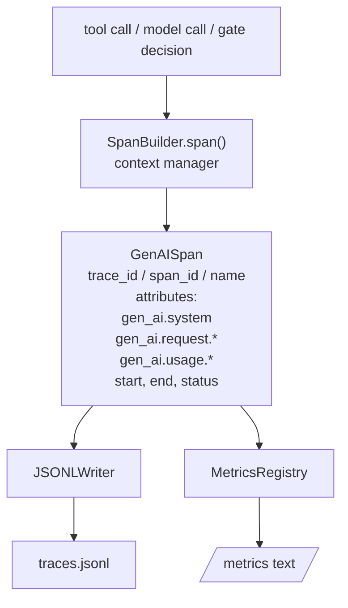
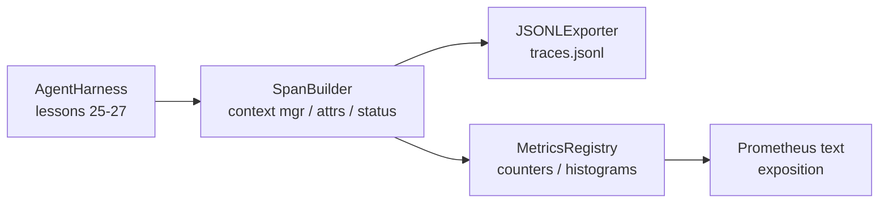

# Capstone Lesson 28: Observability dengan OTel GenAI Spans dan Prometheus Metrics

> Harness agent tanpa observability adalah kotak hitam yang menghabiskan uang. Pelajaran ini membuat sendiri sebuah span builder yang memancarkan record yang patuh pada konvensi semantik OpenTelemetry GenAI, menulisnya ke file JSON-Lines satu span per baris, dan mengekspos counter serta histogram dalam format teks Prometheus. Semuanya Python stdlib dan berjalan offline.

**Type:** Build
**Languages:** Python (stdlib)
**Prerequisites:** Phase 19 · 25 (verification gates), Phase 19 · 26 (sandbox), Phase 19 · 27 (eval harness), Phase 13 · 20 (OpenTelemetry GenAI), Phase 14 · 23 (OTel GenAI conventions)
**Time:** ~90 minutes

## Tujuan Pembelajaran

- Membangun kelas data span yang dibentuk menurut konvensi semantik OpenTelemetry GenAI.
- Mengimplementasikan exporter JSONL yang menulis satu span yang berdiri sendiri per baris.
- Membangun counter dan histogram dengan label serta eksposisi format teks Prometheus.
- Membungkus callable apa pun dalam context manager span yang mencatat durasi, status, dan exception.
- Memverifikasi bahwa span yang dipancarkan roundtrip lewat `json.loads` dan cocok dengan bentuk spesifikasinya.

## Masalahnya

Coding agent produksi menghasilkan tiga kelas artifact setiap giliran: panggilan model, eksekusi tool, dan keputusan verification gate. Tidak ada yang berguna tanpa telemetry terstruktur.

Mode kegagalan pertama adalah trace yang hilang. Ada sesuatu yang salah pada hari Selasa tetapi satu-satunya catatan adalah log percakapan 500 baris. Tidak ada catatan tool mana yang berjalan, berapa lama waktunya, berapa banyak token yang masuk ke prompt, atau apakah gate menolak apa pun. Penulis agent harus menebak.

Mode kegagalan kedua adalah trace yang tidak bisa di-parse. Harness menulis span tetapi memakai nama field buatan sendiri. Tidak ada yang di Grafana, Honeycomb, Jaeger, atau CLI lokal bisa membacanya. Tooling apa pun yang ada di stack tim terbuang karena span-nya non-standar.

Mode kegagalan ketiga adalah metric yang tidak teragregasi. Kamu bisa melihat satu panggilan tool yang lambat di trace, tetapi kamu tidak bisa menjawab "berapa latensi p95 dari panggilan read_file dalam satu jam terakhir?" karena tidak ada metric, hanya trace.

Konvensi semantik OpenTelemetry GenAI ada persis untuk ini. Mereka mendefinisikan sekumpulan kecil atribut standar yang dipakai bersama oleh pembangkit span di seluruh framework LLM. Jika harness kamu menulis atribut-atribut itu, setiap backend yang kompatibel OTel bisa membacanya.

## Konsepnya



Setiap operasi dalam harness menghasilkan sebuah span. Sebuah span punya trace id (seluruh invokasi agent), span id (operasi ini), sebuah nama (mis. `gen_ai.chat`, `gen_ai.tool.execution`), atribut yang mengikuti konvensi GenAI, waktu mulai dan selesai, serta sebuah status.

Konvensi GenAI menstandarkan kunci atribut ini: `gen_ai.system` (provider mana, mis. `anthropic`, `openai`), `gen_ai.request.model` (id model), `gen_ai.request.max_tokens`, `gen_ai.usage.input_tokens`, `gen_ai.usage.output_tokens`, `gen_ai.response.model`, `gen_ai.response.id`, `gen_ai.operation.name`, plus kunci spesifik tool `gen_ai.tool.name` dan `gen_ai.tool.call.id`.

Exporter menulis JSONL. Satu objek JSON per baris. Ini format paling sederhana yang bisa di-stream, di-grep, dan diimpor oleh tooling hulu. Exporter OTel sungguhan akan berbicara OTLP gRPC; exporter JSONL milik pelajaran ini adalah padanan offline-nya dan keluar dengan nol di setiap workstation.

Metric bersebelahan dengan trace. Sebuah counter bertambah pada setiap panggilan tool: `tools_called_total{tool="read_file"}`. Sebuah histogram mencatat latensi yang teramati: `tool_latency_ms{tool="read_file"}`. Keduanya diserialisasi ke format eksposisi teks Prometheus, yang merupakan standar de-facto untuk metric berbasis pull.

```figure
trace-spans
```

## Arsitektur



Span builder adalah kelas kecil dengan metode `span(name, attrs)` yang mengembalikan sebuah context manager. Context manager mencatat waktu mulai saat masuk, mencatat waktu selesai saat keluar, menyematkan exception jika ada yang dilempar, dan mendorong span yang sudah selesai ke exporter.

Registry metric adalah dua dict. Counter berbentuk `{(name, frozen_labels): int}`. Histogram menyimpan sampel mentah dalam sebuah daftar dan diserialisasi ke bucket histogram Prometheus saat eksposisi.

## Yang akan kamu bangun

`main.py` mengirim:

1. Dataclass `GenAISpan`: trace_id, span_id, parent_span_id, name, attributes, start_unix_nano, end_unix_nano, status, status_message, events.
2. Kelas `SpanBuilder` dengan context manager `span(name, attrs, parent=None)`.
3. Kelas `JSONLExporter` dengan `export(span)` yang menambahkan satu baris.
4. Kelas `Counter` dan `Histogram` plus `MetricsRegistry`.
5. `prometheus_exposition(registry)` yang menghasilkan output format teks.
6. Dekorator `wrap_tool_call(name)` yang memancarkan sebuah span dan memperbarui metric.
7. Demo: mensintesis sebuah invokasi agent lengkap (span gen_ai.chat mengelilingi span tool), menulis traces.jsonl, mencetak eksposisi Prometheus, keluar dengan kode nol.

Span id dan trace id adalah string hex 16 byte, dihasilkan dari `os.urandom`. Itu cocok dengan trace context W3C milik OTel. Exporter tidak pernah melempar error; kesalahan IO ditampilkan tetapi harness tetap berjalan.

Histogram punya set bucket tetap (default OTel untuk latensi dalam milidetik: 5, 10, 25, 50, 100, 250, 500, 1000, 2500, 5000, 10000, +Inf). Sampel disimpan sebagai daftar; eksposisi menghitung hitungan per-bucket sesuai permintaan.

## Mengapa dibuat sendiri, bukan opentelemetry-sdk

OTel Python SDK adalah dependensi nyata. Ia juga berupa beberapa ribu baris kode, beberapa proses untuk exporter OTLP, dan biaya runtime yang menenggelamkan anggaran pelajaran. Versi buatan-sendiri mengajarkan format wire-nya. Di produksi kamu menyambungkan atribut yang sama ke SDK sungguhan dan mendapatkan exporter OTLP, batching, dan deteksi resource secara gratis.

Konvensinya stabil. Format wire yang dipancarkan pelajaran ini akan tetap bisa di-parse pada 2030 karena OTel tidak pernah merusak nama atribut GenAI; mereka hanya menambah yang baru.

## Bagaimana ini menyatu dengan sisa Track A

Lesson 25 menghasilkan rantai gate. Lesson 26 menghasilkan sandbox. Lesson 27 menghasilkan eval harness. Lesson 28 membuat ketiganya bisa diamati. Lesson 29 membungkus setiap langkah demo end-to-end dalam span dan mencetak teks Prometheus di akhir.

## Menjalankannya

```bash
cd phases/19-capstone-projects/28-observability-otel-traces
python3 code/main.py
python3 -m pytest code/tests/ -v
```

Demo memancarkan `traces.jsonl` di direktori kerja pelajaran (dibersihkan di akhir), lalu mencetak contoh tiga span, lalu mencetak eksposisi Prometheus untuk counter dan histogram. Tes memverifikasi bahwa span diserialisasi round-trip, bahwa atribut GenAI kanonis ada, bahwa counter bertambah dengan benar, dan bahwa eksposisi histogram berisi hitungan bucket yang diharapkan.
