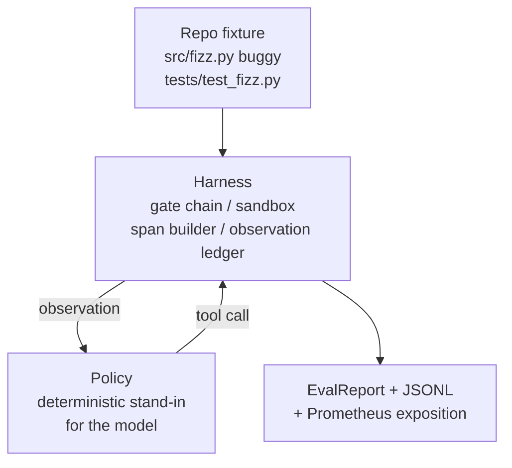
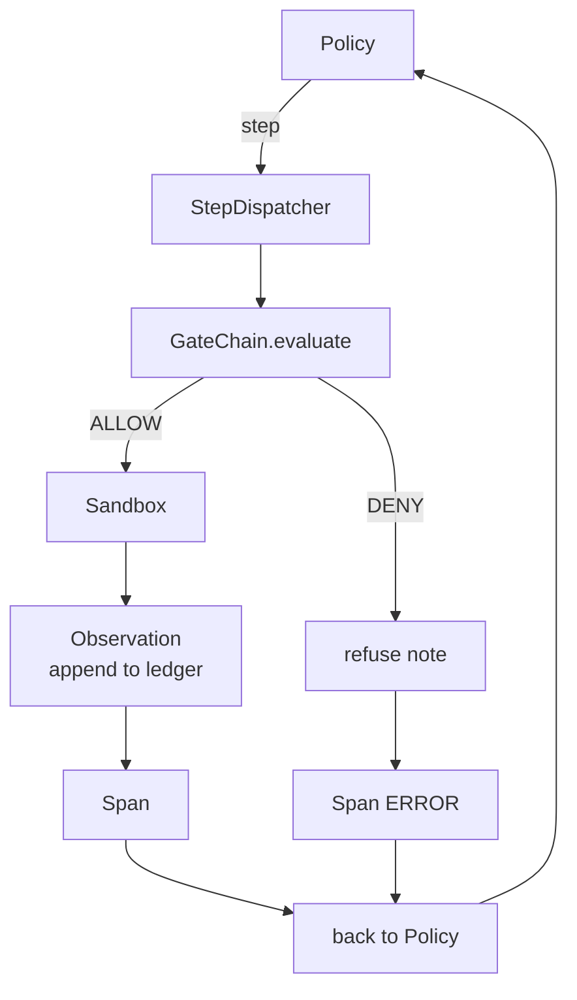

# Capstone Lesson 29: Coding Agent End-to-End di Harness

> Imbalan dari Track A. Pelajaran ini menyatukan rantai gate, sandbox, eval harness, dan span OTel menjadi satu coding agent yang bekerja dan memperbaiki bug nyata (kecil, skala fixture) pada proyek Python multi-file. Agent-nya adalah kebijakan deterministik, bukan LLM; substitusi ini membuat pelajaran dapat direproduksi dan menunjukkan bahwa harness-lah bagian yang menarik sepanjang masa. Kontraknya identik: model sungguhan tinggal dicolok di seam kebijakan.

**Type:** Build
**Languages:** Python (stdlib)
**Prerequisites:** Phase 19 · 25 (verification gates), Phase 19 · 26 (sandbox), Phase 19 · 27 (eval harness), Phase 19 · 28 (observability), Phase 14 · 38 (verification gates), Phase 14 · 41 (workbench for real repos), Phase 14 · 42 (agent workbench capstone)
**Time:** ~90 minutes

## Learning Objectives

- Menyusun rantai gate, sandbox, eval harness, dan span builder menjadi satu agent loop tunggal.
- Mengimplementasikan kebijakan deterministik yang memakai read_file, run_tests, dan write_file untuk memperbaiki sebuah bug fixture.
- Menegakkan anggaran langkah global plus anggaran token observasi di sepanjang satu run end-to-end.
- Menghasilkan trace GenAI OTel dan metrik Prometheus yang lengkap untuk seluruh run.
- Memverifikasi bahwa agent menyelesaikan fixture dalam kurang dari 12 langkah dengan nol gate trip pada tool yang legal.

## Masalahnya

Kebanyakan demo agent bekerja secara terisolasi: sandbox sendirian, eval harness sendirian, span emitter sendirian. Semuanya tampak baik. Begitu disusun bersama, seam-nya langsung kelihatan.

Rantai gate mengatakan ALLOW tetapi sandbox menolak dengan alasan yang tidak pernah dirantai antisipasi. Eval harness mencatat pass tetapi span OTel mengatakan gate menolak tool yang klaim agent pernah dipakai. Counter Prometheus di-increment dua kali padahal seharusnya sekali. Anggaran observasi terlampaui tetapi agent terus jalan karena anggaran itu dilacak di rantai dan sandbox tidak tahu.

Pelajaran ini adalah integration test untuk seluruh track. Agent harus melakukan empat hal secara berurutan: membaca proyek, menjalankan test, mengidentifikasi bug dari kegagalan test, menulis perbaikan, menjalankan ulang test, dan berhenti. Setiap operasi melewati rantai gate. Setiap eksekusi tool melewati sandbox. Setiap langkah dibungkus sebuah span. Eval harness menilai semuanya di akhir.

## Konsepnya



Kebijakan agent-nya adalah sebuah state machine. Lima state.

`SURVEY`: agent membaca daftar isi proyek. State berikutnya adalah RUN_TESTS.

`RUN_TESTS`: agent menjalankan perintah test. Jika test lulus, state machine berhenti dengan sukses. Jika tidak, state berikutnya adalah INSPECT.

`INSPECT`: agent membaca file sumber yang gagal. State berikutnya adalah FIX.

`FIX`: agent menulis file yang sudah diperbaiki. State berikutnya adalah VERIFY.

`VERIFY`: agent menjalankan perintah test sekali lagi. Jika test lulus, berhenti dengan sukses. Jika tidak, berhenti dengan kegagalan.

Setiap state berpadanan dengan satu panggilan tool. Setiap panggilan tool melewati rantai gate. Jika sebuah panggilan tool ditolak, agent melaporkan penolakan itu di dalam trace dan berhenti.

Bug fixture-nya adalah off-by-one di `fizz.py`. Kebijakan deterministik mendeteksi bug itu dari pesan kegagalan test lewat sebuah regex dan menghasilkan file yang sudah diperbaiki. Mengganti kebijakan dengan LLM tidak mengubah kontrak harness.

```figure
cg-harness-weave
```

## Arsitektur



Pelajaran ini mandiri. Setiap primitif dari pelajaran sebelumnya diimplementasikan ulang dalam skala minimal di `main.py` (gate, sandbox, ledger, span) supaya pelajaran berjalan tanpa mengimpor saudara se-fase. Namanya persis sama dengan pelajaran 25-28 sehingga pemetaan konsepnya tidak ambigu.

## Yang akan kamu bangun

`main.py` memuat:

1. Primitif harness minimal, disalin dengan nama yang sama seperti pelajaran 25-28: `GateChain`, `Sandbox`, `ObservationLedger`, `SpanBuilder`, `MetricsRegistry`.
2. Kelas `CodingAgentPolicy`: state machine dengan lima state.
3. Helper `Repo`: menyiapkan direktori scratch berisi fixture buggy yang dibundel.
4. Kelas `AgentRun`: menjalankan kebijakan, mendispatch lewat harness, dan mengembalikan sebuah `AgentRunReport`.
5. Fixture yang dibundel (`fixture_repo/`) berisi src/fizz.py, tests/test_fizz.py, dan pohon expected/ untuk eval harness.
6. Demo: menjalankan kebijakan end-to-end, mencetak trace langkah-demi-langkah, meng-assert pass, dan mencetak metrik.

Fixture yang dibundel berbentuk sama seperti struktur tugas di pelajaran 27: sebuah file buggy dan sebuah file tests. Pesan kegagalan test memuat informasi yang cukup bagi kebijakan deterministik untuk mengidentifikasi perbaikannya. LLM sungguhan akan melakukan pekerjaan yang sama, lebih lambat dan dengan recall lebih luas, tetapi itu tidak mengubah ekspektasi harness.

## Mengapa kebijakannya bukan LLM

LLM sungguhan membutuhkan API key, panggilan jaringan, dan stochasticitas yang tidak bisa diverifikasi. Harness-lah bagian yang jadi fokus pelajaran. Memasang kebijakan deterministik memungkinkan pelajaran berjalan di laptop developer mana pun dengan nol dependensi eksternal dan memungkinkan suite test meng-assert jumlah langkah yang tepat.

Kebijakan dalam pelajaran ini adalah subset ketat dari apa yang dilakukan agent LLM. Kebijakan membaca repo, melihat test yang gagal, mengidentifikasi barisnya, dan menghasilkan perbaikan. LLM melewati loop yang sama dengan kontrak harness yang sama; pencatatannya identik.

## Apa yang di-assert demo

Demo end-to-end meng-assert lima hal pada waktu keluar, dan suite test meng-assert ulang keduanya secara programatis.

Kebijakan menyelesaikan fixture dalam kurang dari 12 langkah.

Anggaran observasi tidak pernah terlampaui.

Nol penolakan gate yang terpicu pada tool yang legal. (Agent tidak pernah mengarang nama tool yang ditolak.)

Setiap langkah punya span yang berpadanan di traces.jsonl.

Exposition Prometheus memuat entri `tools_called_total{tool="read_file"}` dan sebuah histogram `tool_latency_ms`.

## Bagaimana ini menyatu dengan sisa Track A

Pelajaran ini adalah integrasinya. Pelajaran 25 menulis rantai gate. Pelajaran 26 menulis sandbox. Pelajaran 27 menulis eval harness. Pelajaran 28 menulis observability. Pelajaran 29 membuktikan semuanya bekerja sebagai satu sistem. Harness agent sungguhan melanjutkan dari sini: tukar kebijakan deterministik dengan sebuah model, tukar fixture yang dibundel dengan tugas repo-sungguhan, tukar exporter JSONL dengan OTLP.

## Menjalankannya

```bash
cd phases/19-capstone-projects/29-end-to-end-coding-task-demo
python3 code/main.py
python3 -m pytest code/tests/ -v
```

Demo mencetak trace per langkah, laporan eval akhir, dan exposition Prometheus. Kode keluarannya nol. Test mencakup transisi state kebijakan, penolakan gate pada panggilan tool sintetis, run end-to-end pada fixture yang dibundel, dan invarian anggaran-langkah.
