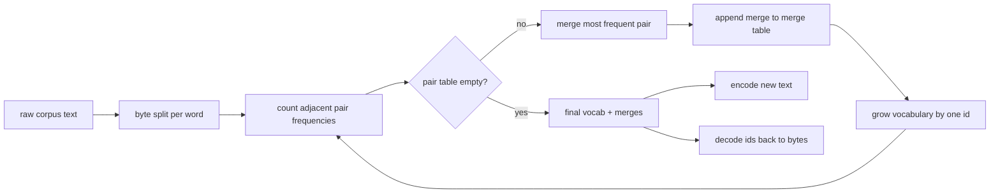
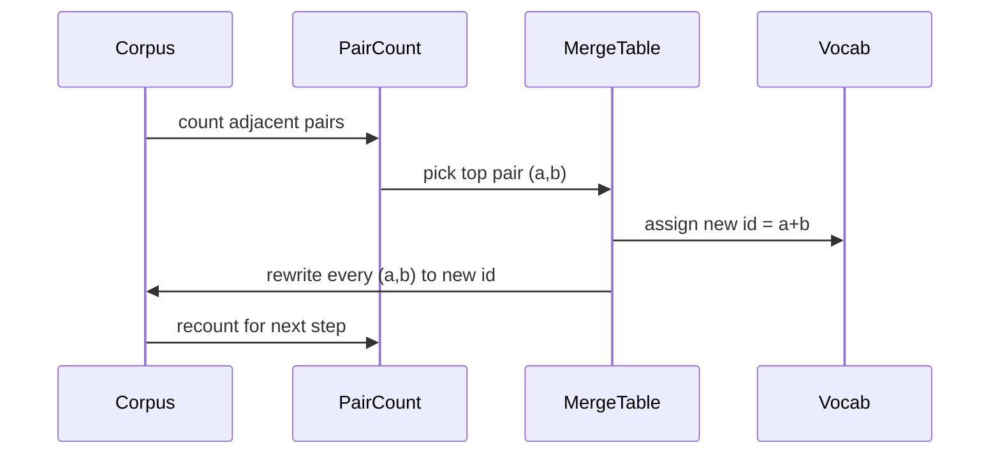

# BPE Tokenizer From Scratch

> Byte masuk, id keluar, id kembali ke byte yang sama. Bangun tokenizer yang masih menjadi titik awal setiap model teks modern.

**Type:** Build
**Languages:** Python
**Prerequisites:** Phase 04 lessons, Phase 07 transformer lessons
**Time:** ~90 minutes

## Learning Objectives
- Melatih vocabulary Byte-Pair Encoding dari korpus teks mentah dengan cara terus menggabungkan pasangan simbol bersebelahan yang paling sering muncul.
- Mengimplementasikan tabel merge deterministik dan menerapkannya pada teks baru untuk menghasilkan aliran id subword.
- Melakukan round-trip input UTF-8 apa pun ke id dan kembali tanpa kehilangan informasi.
- Melakukan reservasi dan melindungi token khusus (`<|endoftext|>`, `<|pad|>`) supaya selamat dari training dan decoding.
- Menalar mengapa alfabet level-byte adalah lantai yang tepat untuk tokenizer serbaguna.

```figure
cap-bpe-merge
```

## Kerangkanya

Model bahasa tidak pernah melihat teks. Ia melihat bilangan bulat. Pemetaan dari sebuah string ke daftar bilangan bulat dan kembali itulah tokenizer. Salah lapisan ini dan setiap kurva loss dalam run training mengukur hal yang salah.

Keluarga dominan tokenizer subword untuk model teks serbaguna adalah Byte-Pair Encoding. Idenya kecil. Mulai dari alfabet yang sudah diketahui. Cari pasangan simbol bersebelahan yang paling sering muncul di korpus training. Gabungkan menjadi simbol baru. Ulangi sampai vocabulary mencapai ukuran target. Encoding teks baru memakai kembali daftar merge yang sama dengan urutan yang sama.

Kita akan membangun varian level-byte. Alfabetnya adalah 256 byte mentah, bukan code point Unicode. Pilihan itulah yang membuat tokenizer bisa menangani input UTF-8 apa pun tanpa jatuh ke token unknown.

## Pipenya



Sisi training dan sisi inference berbagi tabel merge. Berbagi itulah kontraknya. Kalau kamu mengubah urutan merge saat inference, kamu mendecode aliran id yang berbeda.

## Alfabet byte

256 id pertama diperuntukkan bagi byte mentah 0x00 sampai 0xFF. Itu menjamin setiap string input bisa dinyatakan dalam vocabulary sebelum ada merge apa pun terjadi. Setelah blok byte, kita menyediakan rentang kecil untuk token khusus. Loop training tidak pernah mengusulkan id-id itu sebagai target merge karena kita menjauhkannya sepenuhnya dari aliran pretokenized.

Pretokenizer memecah korpus pada batas whitespace dan tanda baca sebelum training melihatnya. Tanpa pemecahan itu, langkah merge BPE dengan senang hati akan mempelajari merge yang melintasi batas kata sehingga vocabulary penuh oleh frasa umum yang utuh. Dengan pemecahan itu, merge tetap berada di dalam satu kata dan hasilnya bisa digeneralisasi.

## Loop training

Pada setiap langkah training, loop melakukan tiga hal. Ia menelusuri setiap kata dalam korpus dan menghitung berapa kali setiap pasangan simbol saat ini bersebelahan muncul, dibobot dengan seberapa sering kata itu sendiri muncul. Ia memilih pasangan dengan hitungan tertinggi. Ia menulis ulang setiap kemunculan pasangan itu menjadi satu simbol baru yang id-nya adalah slot bebas berikutnya dalam vocabulary. Lalu ia mencatat merge-nya.



Biaya setiap langkah sebanding linear dengan ukuran korpus yang dinyatakan sebagai daftar sekuens simbol. Untuk sejuta kata dengan target vocabulary sepuluh ribu id, loop selesai dalam hitungan detik karena sekuens simbol menyusut seiring merge mendarat.

## Encoding teks baru

Inference tidak memanggil penghitung pasangan. Ia menerapkan tabel merge dengan urutan yang sama persis seperti saat dipelajari. Untuk sebuah kata baru, encoder mulai dari split byte. Ia memindai sekuens saat ini untuk merge berperingkat terendah (yang paling awal yang berlaku). Ia melakukan merge itu. Ia memindai lagi. Loop berakhir ketika tidak ada merge dalam tabel yang berlaku untuk sekuens saat ini.

Pengurutan berdasarkan peringkat adalah sifat yang membuat encoding deterministik dan cocok dengan perilaku training pada input yang sama. Sebuah merge yang dipelajari pertama duduk di puncak tabel dan diterapkan lebih dulu. Jika dua merge bisa berlaku pada posisi yang sama, yang berperingkat lebih rendah menang.

## Token khusus

Token khusus adalah id yang tidak pernah bisa dihasilkan oleh aliran byte. Kita menyediakannya secara manual. Dua sudah cukup untuk pelajaran ini.

- `<|endoftext|>` memisahkan dokumen selama pretraining. Ia memberi tahu model "dokumen baru mulai di sini, jangan biarkan konteks dokumen sebelumnya merembet masuk."
- `<|pad|>` mengisi sekuens pendek supaya sebuah batch bisa berbentuk tensor persegi panjang. Loss mask menyembunyikannya selama training.

Encoder menerima sebuah flag untuk mengizinkan token khusus di input. Dengan flag mati, string `<|endoftext|>` dan `<|pad|>` di-tokenisasi sebagai byte yang mengejanya. Dengan flag nyala, string literal itu dipetakan ke id reservasinya dan tidak tunduk pada merge apa pun.

## Jaminan round-trip

Encoding lalu decoding harus mengembalikan byte input persis. Decoder menggabungkan ekspansi byte dari setiap id secara berurutan. Karena setiap id entah byte mentah entah gabungan dari dua id yang sudah diketahui sebelumnya, ekspansi rekursif selalu berakhir di byte mentah. Decoding lalu mengembalikan string UTF-8 yang dieja oleh byte-byte itu.

Suite test dalam pelajaran ini memeriksa sifat itu pada kalimat yang belum pernah terlihat, pada kalimat berisi emoji Unicode, dan pada kalimat yang memuat token `<|endoftext|>` literal.

## Yang tidak dilakukan pelajaran ini

Ia tidak membangun pretokenizer berbasis regex dengan gaya tokenizer produksi terbesar. Pretokenizer di sini adalah pemecahan whitespace dan tanda baca sederhana. Itu sudah cukup untuk menghasilkan merge yang masuk akal pada korpus training kecil, dan kontrak dengan sisa rantai pelajaran tetap sama. Pelajaran berikutnya memperlakukan tokenizer sebagai kotak hitam dan membangun dataset sliding-window di atasnya.

Ia tidak mem-paralelkan penghitung pasangan. Sebuah loop Python di atas korpus beberapa ribu kata selesai jauh di bawah satu detik. Untuk korpus yang lebih besar, langkah yang jelas adalah menghitung pasangan per kata secara paralel lalu mereduksinya.

## Cara membaca kodenya

`main.py` mendefinisikan empat objek. `BPETokenizer` menyimpan vocabulary, tabel merge, dan tabel token khusus. `train` adalah loop training. `encode` adalah jalur inference. `decode` adalah penggabungan byte. Demo di bawah melatih tokenizer kecil pada korpus bawaan, meng-encode kalimat held-out, men-decode id-nya kembali, dan mencetak keduanya. Test di `code/tests/test_bpe.py` menetapkan sifat round-trip, reservasi token khusus, dan urutan merge.

Jalankan demonya. Lalu ubah target ukuran vocabulary di demo dari 300 ke 600 dan amati bagaimana panjang encoded dari kalimat held-out itu turun. Kurva itulah kurva kompresi BPE.
