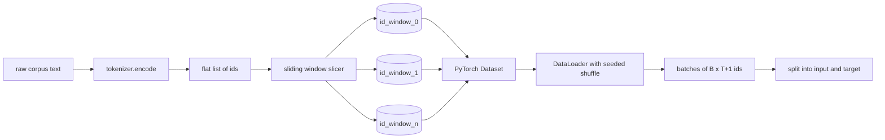
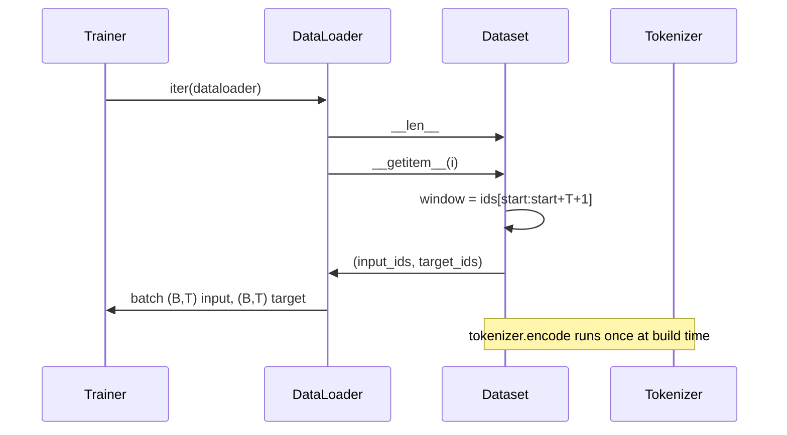

# Tokenized Dataset with Sliding Window

> Sebuah run pretraining adalah fungsi dari token id ke gradient. Pelajaran ini membangun konveyor yang menyuplai id-id itu.

**Type:** Build
**Languages:** Python
**Prerequisites:** Phase 04 lessons, Phase 07 transformer lessons, Lesson 30 of this phase
**Time:** ~90 minutes

## Learning Objectives
- Mengubah korpus mentah menjadi aliran token id dengan memanggil tokenizer sekali kali.
- Memotong aliran id menjadi jendela berpanjang tetap dengan stride tumpang-tindih yang bisa dikonfigurasi.
- Membangun PyTorch Dataset yang mengembalikan tensor input dan target untuk prediksi token berikutnya.
- Membungkus dataset dalam DataLoader dengan shuffle deterministik yang di-seed per epoch.
- Menalar tentang trade-off antara stride, redundansi, dan ukuran dataset efektif.

```figure
cap-sliding-window
```

## Kerangkanya

Sebuah run pretraining membaca satu batch token id dalam satu waktu dan memperbarui model. Bentuk setiap batch ditetapkan oleh kontrak training. Untuk causal language model, batch memuat input id `(B, T)` dan target id `(B, T)` di mana target adalah input yang digeser ke kiri satu posisi. Tugas pipeline data adalah menghasilkan kontrak itu sesuai permintaan, secara deterministik dan dapat direproduksi, dari korpus yang bisa berupa beberapa gigabyte teks mentah.

Pelajaran ini membangun pipenya. Tokenizer dari pelajaran sebelumnya mengubah teks menjadi daftar id panjang yang datar. Sebuah sliding window memotong daftar itu menjadi contoh-contoh training. Sebuah Dataset khusus mengekspos contoh-contoh itu sebagai tensor. Sebuah DataLoader membatching-nya dan mengacak-nya dengan seed yang diketahui.

## Kontrak bentuk

Sebuah causal LM mengonsumsi id berbentuk `(B, T)` di mana `B` adalah batch size dan `T` adalah panjang konteks. Target pada posisi `t` adalah input pada posisi `t+1`. Artinya setiap contoh training menutupi `T+1` id mentah. Stride jendela mengontrol seberapa besar tumpang-tindih antara contoh-contoh berurutan.



Slicer tidak pernah menumpang-tindih dengan batas korpus. Jika jendela terakhir tidak punya id yang cukup untuk mengisi `T+1` posisi, slicer menjatuhkannya. Mengisi ekor dengan `<|pad|>` juga pilihan yang valid tetapi membuat loss mask jadi rumit. Untuk pelajaran ini kita menjatuhkannya.

## Mengapa sliding window

Korpus pretraining adalah satu aliran id panjang. Kalau model hanya melihat jendela yang tidak saling menumpang-tindih, setiap contoh training akan mengajarkan batas `T` yang sama. Menggeser stride memindahkan batas-batas itu sehingga model melihat tugas prediksi-token-berikutnya yang lebih beragam.

Stride sebesar `T` menghasilkan jendela tanpa tumpang-tindih. Stride sebesar `T // 2` menghasilkan tumpang-tindih lima persen dan melipatgandakan dataset efektif. Stride `1` menghasilkan tumpang-tindih maksimum dan menambah dataset sebesar faktor `T`. Biayanya adalah lebih banyak komputasi per epoch. Manfaatnya adalah lebih banyak keragaman batas. Kebanyakan run pretraining memakai stride sama dengan panjang konteks karena korpus sudah jauh lebih besar daripada yang bisa diselesaikan model dalam satu epoch, sehingga argumen keragaman batas jadi lebih lemah.

## Kelas Dataset

Sebuah PyTorch Dataset punya dua metode wajib. `__len__` mengembalikan jumlah contoh. `__getitem__` mengembalikan satu contoh sebagai pasangan tensor. Dataset kita menyimpan aliran id yang sudah di-encode dan stridenya. Pengindeksan ke dalamnya menghitung awal jendela secara on the fly sehingga biaya memori adalah satu salinan aliran id berapa pun banyaknya contoh yang dihasilkan stride.



Geser-satu terjadi di dalam `__getitem__`. Dataset mengembalikan `(input, target)` di mana `input = window[:-1]` dan `target = window[1:]`. Keduanya adalah tensor long PyTorch. Loop training memperlakukannya sebagai ground truth.

## Shuffle deterministik

Sebuah DataLoader dengan `shuffle=True` membaca dari generator acak PyTorch. Dengan meneruskan sebuah `torch.Generator` eksplisit yang di-seed per epoch, kita mendapat acakan yang sama setiap kali run diulang. Sifat itu penting ketika kamu ingin membandingkan dua run yang berbeda hanya pada satu hyperparameter. Tanpa seed, dua run melihat data dengan urutan berbeda dan kurva loss berdivergensi karena alasan yang tidak berhubungan dengan perubahannya.

Kontrak seed dalam pelajaran ini sederhana. `epoch_seed = base_seed + epoch_index`. Base seed diberikan saat konstruksi. Epoch index dinaikkan oleh trainer di awal setiap epoch. Sebuah re-run dengan base seed yang sama selalu melihat urutan yang sama di setiap epoch.

## Batch sampler

Sampler bawaan di PyTorch memilih indeks secara acak seragam tanpa replacement. Itu yang kita inginkan untuk pretraining. Untuk finetuning pada dataset kecil, kontraknya sama. DataLoader menyusun sebuah batch dengan memanggil `__getitem__` sebanyak `B` kali dan menumpuk hasilnya. Karena setiap contoh berpanjang sama menurut desain, tidak diperlukan logika padding.

Pelajaran ini mempertahankan `num_workers=0` demi kesederhanaan. Pada run produksi, worker mem-paralelkan panggilan `__getitem__`. Dengan pipeline kita itu umumnya no-op karena kerjanya hanyalah potongan dari sebuah tensor in-memory, tetapi API Dataset yang sama mendukung worker dengan bersih.

## Menghitung contoh

Untuk aliran id berpanjang `N`, panjang konteks `T`, dan stride `S`, jumlah contohnya adalah `max(0, 1 + (N - (T + 1)) // S)`. Pelajaran mengekspos perhitungan itu sebagai metode statis pada Dataset sehingga trainer dapat menghitung total langkah per epoch tanpa beriterasi.

## Yang tidak dilakukan pelajaran ini

Ia tidak melakukan streaming dari disk. Korpus di-encode sepenuhnya di memori dan disimpan sebagai satu tensor. Untuk korpus beberapa juta id, itu jauh di bawah seratus megabyte dan merupakan bentuk yang tepat untuk pelajaran ini. Streaming disk adalah concern terpisah yang dicolokkan dengan mengganti penyimpanan tetapi tetap mempertahankan kontrak Dataset.

Ia tidak menangani banyak dokumen. Korpus diperlakukan sebagai satu aliran id yang berkelanjutan. Batas dokumen-berikutnya di-encode dengan menyisipkan id `<|endoftext|>` ketika korpus dibangun dari banyak dokumen. Model belajar memprediksi di sekitar batas itu.

## Cara membaca kodenya

`main.py` mendefinisikan dua kelas dan satu helper. `SlidingWindowDataset` adalah PyTorch Dataset-nya. `make_dataloader` mengembalikan DataLoader yang sudah dikonfigurasi dengan generator ber-seed. `_encode_corpus_to_ids` adalah panggilan tokenizer sekali-jalan. Demo di bawah membangun tokenizer kecil di dalam proses, meng-encode korpus bawaan, menyusun dataset dan dataloader, mencetak satu batch, dan meng-assert kontrak bentuk. Test di `code/tests/test_dataset.py` menetapkan rumus jumlah jendela, sifat geser-satu, shuffle deterministik, dan trade-off stride.

Jalankan demonya. Lalu ubah panjang konteks dari 16 ke 32 dan amati bagaimana jumlah contoh per epoch turun. Angka itulah anggaran langkah-per-epoch-mu.
