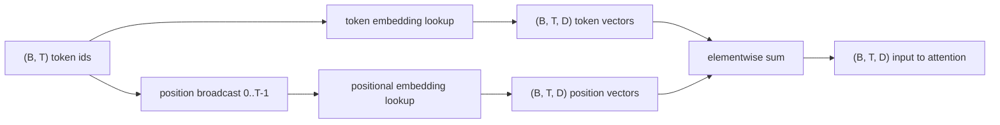
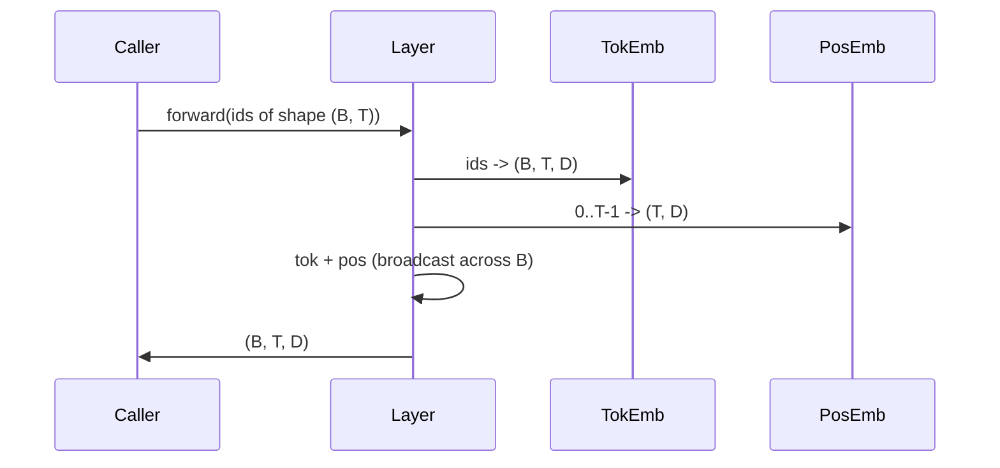

# Token and Positional Embeddings

> Id adalah bilangan bulat. Model menginginkan vektor. Dua tabel lookup berada di antaranya, dan pilihan untuk yang posisional membentuk apa yang bisa dipelajari model.

**Type:** Build
**Languages:** Python
**Prerequisites:** Phase 04 lessons, Phase 07 transformer lessons, Lessons 30 and 31 of this phase
**Time:** ~90 minutes

## Learning Objectives
- Membangun tabel lookup token-embedding yang memetakan id vocabulary ke vektor dense.
- Membangun tabel lookup positional-embedding yang dipelajari dan diindeks berdasarkan posisi.
- Membangun positional embedding sinusoidal tetap yang diindeks berdasarkan posisi tanpa parameter.
- Menyusun token embedding dan positional embedding menjadi satu input untuk sebuah transformer block.
- Membandingkan embedding yang dipelajari dan sinusoidal pada generalisasi panjang dan jumlah parameter.

```figure
cc-embedding-lookup
```

## Kerangkanya

Kontak pertama model dengan sebuah token id adalah lookup baris pada matriks token embedding. Matriks itu punya satu baris per id vocabulary dan satu kolom per dimensi model. Lookup mengembalikan sebuah vektor yang diperlakukan oleh sisa model sebagai makna dari id itu. Backprop memperbarui baris-baris yang dipakai di forward pass. Selama training, geometri baris-baris itu belajar mengkodekan kemiripan dalam bentuk arah.

Token id saja tidak punya urutan. Model membutuhkan sinyal kedua yang memberitahunya bahwa posisi satu berbeda dari posisi tujuh belas. Dua pilihan dominan untuk sinyal itu adalah positional embedding yang dipelajari (tabel lookup kedua, satu baris per posisi) dan positional embedding sinusoidal tetap (rumus matematika tanpa parameter). Pilihannya punya konsekuensi. Sebuah tabel yang dipelajari adalah parameter dan dibatasi oleh panjang konteks maksimum yang dilatih model. Sebuah tabel sinusoidal bebas parameter secara teori dan rumusnya meluas ke posisi mana pun, tetapi `SinusoidalPositionalEmbedding` di pelajaran ini menghitung terlebih dahulu sebuah tabel tetap pada `max_context_length` dan `forward`-nya melempar error melewati batas itu; keduanya karena itu menegakkan panjang konteks maksimum di sini. Model tetap bisa kesulitan melewati panjang training-nya bahkan ketika tabelnya cukup besar untuk diindeks.

Pelajaran ini membangun keduanya dan menyusunnya bersama token embedding menjadi satu input untuk attention block di pelajaran berikutnya.

## Kontrak bentuk

Input ke tahap embedding adalah sebuah batch token id berbentuk `(B, T)`. Output-nya adalah tensor berbentuk `(B, T, D)` di mana `D` adalah dimensi model. Setiap elemen batch punya panjang konteks `T` yang sama. Setiap posisi punya dimensi vektor `D` yang sama.



Penyusunannya berupa jumlah, bukan konkatenasi. Menjumlahkan menjaga `D` tetap konstan di sepanjang jaringan dan membiarkan model memutuskan per fitur apakah makna token atau posisi yang mendominasi di setiap layer.

## Matriks token embedding

Token embedding adalah tensor parameter berbentuk `(V, D)` di mana `V` adalah ukuran vocabulary. PyTorch mengeksposnya sebagai `nn.Embedding(V, D)`. Saat init, entri-entri ini ditarik dari Gaussian kecil, secara tradisional dengan mean nol dan simpangan baku sekitar `0.02` untuk model skala transformer. Init yang persis tidak sepenting konsistensinya lintas run.

Forward pass hanyalah satu operasi pengindeksan. PyTorch memetakan id int64 `(B, T)` ke float `(B, T, D)` dengan mengumpulkan baris-baris. Backward pass hanya mengakumulasi gradient ke baris-baris yang tersentuh di forward pass. Dua baris yang tidak pernah muncul dalam batch menerima gradient nol pada langkah itu.

Sebuah detail halus. Token embedding dan output projection di ujung model sering berbagi bobot (weight tying). Ketika itu terjadi, setiap backward pass menyentuh setiap baris embedding lewat sisi output. Di pelajaran ini keduanya diekspos sebagai modul terpisah, tetapi matriks yang sama bisa memainkan kedua peran dalam model penuh.

## Positional embedding yang dipelajari

Positional embedding yang dipelajari adalah `nn.Embedding` kedua berbentuk `(max_context_length, D)`. Lookup-nya di-key dengan posisi id `0, 1, 2, ..., T-1`. Forward pass menyiarkan vektor posisi itu di sepanjang dimensi batch.

Sisi buruk dari tabel yang dipelajari adalah bahwa ia tidak bisa ditanyakan pada posisi `T` jika model hanya dilatih sampai posisi `T-1`. Barisnya tidak ada. Model decoder-only produksi yang memakai skema ini menanam panjang konteks maksimum ke dalam arsitektur dan menolak memproses input yang lebih panjang.

## Positional embedding sinusoidal

Positional embedding sinusoidal adalah fungsi dari posisi ke vektor. Posisi `p` dan fitur `i` menghasilkan

```python
angle = p / (10000 ** (2 * (i // 2) / D))
emb[p, 2k]     = sin(angle)
emb[p, 2k + 1] = cos(angle)
```

Fungsi itu tidak punya parameter. Setiap posisi punya vektor unik. Panjang gelombang bervariasi secara geometris di sepanjang dimensi fitur, sehingga dimensi-dimensi bawah mengkodekan posisi kasar dan dimensi-dimensi atas mengkodekan posisi halus.

Sifat yang mengikuti dari pemilihan `sin` dan `cos` bersama adalah bahwa vektor pada posisi `p + k` adalah fungsi linear dari vektor pada posisi `p`. Itu memberi attention layer jalur mudah untuk mempelajari offset posisi-relatif. Model tidak membutuhkan parameter terpisah untuk mengekspresikan "lihat lima token ke belakang."

Pelajaran ini menghitung tabel sinusoidal penuh sekali saat konstruksi dan mengindeksnya pada waktu forward.

## Penyusunannya

Pipeline input melakukan tiga hal secara berurutan. Membaca token id. Melookup vektor token. Menambahkan vektor posisional. Mengembalikan jumlahnya.



Broadcasting pada langkah penjumlahan mereplikasi tensor posisional `(T, D)` di sepanjang dimensi batch. PyTorch menanganinya secara otomatis karena tensor posisional berbentuk `(1, T, D)` setelah unsqueeze.

## Analisis kontras

Pelajaran menjalankan kedua varian pada input yang sama dan mencetak dua diagnostik.

Yang pertama adalah jumlah parameter. Varian yang dipelajari menambah `max_context_length * D` parameter di atas token embedding. Varian sinusoidal menambah nol.

Yang kedua adalah kemiripan cosine antar embedding pada posisi-posisi bersebelahan. Varian sinusoidal punya dekasi yang halus dan dapat diprediksi karena fungsinya kontinu. Varian yang dipelajari pada inisialisasi punya kemiripan yang hampir acak karena baris-barisnya ditarik secara independen. Setelah training, varian yang dipelajari umumnya mengembangkan struktur halus yang serupa, tetapi ia harus menemukan struktur itu dari data.

## Yang tidak dilakukan pelajaran ini

Ia tidak membangun rotary positional encoding (RoPE) atau AliBi. Itu adalah pilihan modern di transformer produksi. Keduanya mengikuti kontrak bentuk yang sama dengan embedding di sini (menerapkan transformasi yang bergantung-posisi pada vektor berbentuk `(B, T, D)`) tetapi diterapkan pada langkah attention-projection, bukan pada input. Pelajaran berikutnya membangun attention block, dan salah satu ekstensi opsional adalah melipat rotary ke dalam proyeksi query-key di sana.

Ia tidak melatih embedding. Training membutuhkan loss, yang membutuhkan output model, yang membutuhkan attention dan sebuah LM head. Itu adalah pelajaran berikutnya dan yang sesudahnya.

## Cara membaca kodenya

`main.py` mendefinisikan tiga modul. `TokenEmbedding` membungkus `nn.Embedding(V, D)`. `LearnedPositionalEmbedding` membungkus `nn.Embedding(L, D)`. `SinusoidalPositionalEmbedding` menghitung tabel terlebih dahulu dan mengeksposnya sebagai buffer. `EmbeddingComposer` mengikat sebuah token embedding dan sebuah positional embedding bersama. Demo di bawah mencetak bentuk, jumlah parameter, dan diagnostik kemiripan posisi-tetangga. Test di `code/tests/test_embeddings.py` menetapkan bentuk, perilaku broadcast, jumlah parameter, dan rumus sinusoidal.

Jalankan demonya. Lalu ubah dimensi model `D` dari 64 ke 32 dan amati bagaimana pita panjang gelombang sinusoidal berubah.
