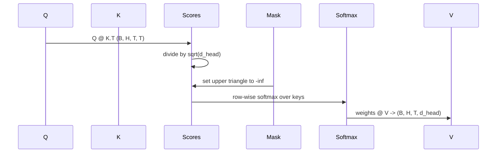

# Multi-Head Self-Attention

> Satu proyeksi linear, tiga tampilan, H kepala paralel, satu mask. Attention block sebagaimana model benar-benar memakainya.

**Type:** Build
**Languages:** Python
**Prerequisites:** Phase 04 lessons, Phase 07 transformer lessons, Lessons 30 through 32 of this phase
**Time:** ~90 minutes

## Learning Objectives
- Mengimplementasikan proyeksi Query/Key/Value yang dibatch sebagai satu layer linear yang dipecah menjadi H kepala.
- Menghitung scaled dot-product attention dengan normalisasi dan penanganan dtype yang benar.
- Menerapkan causal mask yang mencegah sebuah posisi attending ke posisi masa depan.
- Menginspeksi bobot attention per kepala pada input tetap dan menalar apa yang dilihat setiap kepala.
- Melatih sebuah attention block kecil pada tugas main-main dan mengamati loss turun seiring kepala-kepala terspesialisasi.

```figure
cap-multihead-attention
```

## Kerangkanya

Attention adalah fungsi yang memungkinkan representasi sebuah token menarik informasi dari token lain dalam sekuens yang sama. Self-attention berarti query, key, dan value semuanya diturunkan dari input yang sama. Multi-head berarti proyeksinya dipecah menjadi H masalah attention paralel yang output-nya dikonkatenasikan dan diproyeksikan kembali.

Pola implementasi yang efisien adalah satu layer linear yang memproyeksikan dari `D` ke `3 * D` lalu dipotong menjadi tiga tampilan, kemudian di-reshape menjadi H kepala berukuran `D // H` masing-masing. Matmul, softmax, dan weighted sum terjadi sebagai operasi tensor yang dibatch sehingga kepala-kepala berjalan paralel di akselerator.

Pelajaran ini membangun block itu. Ia juga menambahkan causal mask supaya kode yang sama bekerja sebagai attention layer dalam sebuah decoder-only language model. Pelajaran berikutnya menumpuk block-nya menjadi transformer penuh dan pelajaran sesudahnya melatihnya.

## Kontrak bentuk

Input-nya `(B, T, D)`. Output-nya `(B, T, D)`. Mask-nya `(T, T)` atau dapat di-broadcast ke sana. Di dalam block, tensor antara berbentuk `(B, H, T, d_head)` di mana `d_head = D // H`. Kendalanya adalah `D % H == 0`.

```mermaid
flowchart LR
    A["(B, T, D) input"] --> B[Linear D -> 3D]
    B --> C["split into Q, K, V"]
    C --> D["reshape to (B, H, T, d_head)"]
    D --> E["scores = Q @ K.T / sqrt(d_head)"]
    E --> F[apply causal mask]
    F --> G[softmax over keys]
    G --> H["context = weights @ V"]
    H --> I["reshape to (B, T, D)"]
    I --> J[output Linear D -> D]
    J --> K["(B, T, D) output"]
```



Dua layer linear (proyeksi QKV dan proyeksi output) adalah satu-satunya parameter dalam block. Mask, softmax, matmul, dan reshape semuanya bebas parameter.

## Pemecahan QKV

Implementasi naif punya tiga layer linear terpisah, satu untuk Q, satu untuk K, dan satu untuk V. Versi efisien punya satu layer yang menghasilkan `3 * D` fitur dan memecah hasilnya. Keduanya secara matematika ekuivalen karena tiga perkalian matriks terpisah dengan bobot `(D, D)` persis sama dengan satu perkalian matriks dengan bobot `(3D, D)` yang ditumpuk dari ketiganya.

Versi efisien lebih cepat karena akselerator meluncurkan satu matmul alih-alih tiga. Ia juga lebih mudah diinisialisasi karena tiga sub-matriks hidup dalam tensor parameter yang sama dan bisa diinisialisasi bersamaan.

## Reshape kepala

Setelah pemecahan, masing-masing Q, K, V berbentuk `(B, T, D)`. Untuk mengubahnya menjadi H masalah attention paralel, kita reshape ke `(B, T, H, d_head)` lalu transpose ke `(B, H, T, d_head)`. Dimensi kepala kini berada di samping dimensi batch sehingga PyTorch memperlakukan attention per kepala sebagai operasi terbatch di atas `B * H` instance independen.

Dimensi d_head tetap terakhir supaya matmul skor `Q @ K.transpose(-2, -1)` mengontraksinya. Hasilnya adalah skor attention per kepala `(B, H, T, T)`.

## Penskalaan

Skor dibagi dengan `sqrt(d_head)` sebelum softmax. Tanpa penskalaan itu, dot product tumbuh seiring `d_head` membesar dan mendorong softmax ke rezim di mana satu entri memiliki hampir seluruh massa dan yang lain menyusut sampai hampir nol. Gradient di rezim itu sangat kecil dan pembelajaran macet. Membagi dengan `sqrt(d_head)` menjaga varians skor tetap kira-kira konstan di berbagai ukuran kepala.

## Causal mask

Sebuah decoder-only language model hanya bisa berkondisi pada masa lalu saat memprediksi token berikutnya. Mask menegakkan itu. Secara konkret, sebelum softmax, setiap entri di atas diagonal matriks skor `(T, T)` diganti dengan negative infinity. Setelah softmax, posisi-posisi itu mendapat bobot nol.



Kita mendaftarkan mask sebagai buffer saat konstruksi supaya ia hidup di perangkat yang sama dengan model dan tidak menjadi bagian dari graf gradient. Mask menutupi panjang konteks maksimum yang pernah dilihat block. Pada waktu forward kita memotong sudut kiri-atas `(T, T)`.

## Proyeksi output

Setelah vektor konteks per kepala `(B, H, T, d_head)`, kita transpose kembali ke `(B, T, H, d_head)`, reshape ke `(B, T, D)`, dan menerapkan proyeksi linear `(D, D)` terakhir. Proyeksi output memungkinkan model mencampur kepala-kepala. Tanpanya, H kepala hanya akan pernah mengombinasikan diri lewat layer-layer kemudian dan block akan terbatas secara artifisial.

## Inspeksi bobot attention

Pelajaran mengekspos sebuah flag `return_weights=True` pada forward pass. Saat diset, block mengembalikan bobot attention per kepala berbentuk `(B, H, T, T)` di samping output. Demo mencetak heatmap bobot sebuah kepala pada input pendek supaya kamu bisa melihat struktur segitiga-kausal dan fokus per posisi.

Pada model yang sudah dilatih, kepala-kepala yang berbeda mempelajari pola yang berbeda. Beberapa kepala attending ke token sebelumnya yang langsung. Beberapa kepala attending ke awal sekuens. Beberapa kepala menyebar attention hampir secara seragam. Hook inspeksi adalah titik masuk untuk pekerjaan interpretabilitas itu.

## Demo training

Demo di bawah `main.py` menyambungkan attention block ke sebuah LM head kecil dan melatih semuanya pada tugas repeat. Setiap baris input adalah satu id acak yang direplikasi di sepanjang konteks. Target-nya adalah input yang digeser satu, sehingga model harus belajar bahwa token berikutnya sama dengan token sebelumnya. Loss-nya cross-entropy. Dengan H=4, D=32, T=12, dan vocabulary 64, loss turun dari keadaan acak (sekitar `log(64) ~ 4.16`) menjadi jauh di bawah `1.0` selama tiga epoch di CPU.

Tujuan demo bukanlah melatih model yang berguna. Tujuannya adalah memastikan gradient mengalir melalui setiap bagian block dan kepala-kepala mempelajari sesuatu pada masalah di mana jawabannya jelas.

## Yang tidak dilakukan pelajaran ini

Ia tidak menambahkan feed-forward block. Layer transformer dalam model sungguhan adalah attention diikuti sebuah MLP dua-layer dengan koneksi residual dan layer norm di sekeliling keduanya. Pelajaran berikutnya menambahkannya.

Ia tidak mengimplementasikan rotary atau positional encoding AliBi. Keduanya diterapkan pada langkah proyeksi QKV dalam block yang sama, tetapi keduanya adalah unit pengajaran terpisah. Block sebagaimana dibangun di sini kompatibel dengan keduanya dengan mentransformasi Q dan K sebelum matmul.

Ia tidak mengimplementasikan KV cache untuk inference. Meng-cache key dan value di antara forward pass adalah optimisasi yang membuat decoding autoregressive cepat. Itu mengubah kontrak bentuk pada tensor K dan V tetapi tidak pada Q. Itu masuk ke pelajaran inference.

## Cara membaca kodenya

`main.py` mendefinisikan `MultiHeadSelfAttention`. Kelas itu menyimpan dua layer linear dan sebuah buffer mask yang terdaftar. Forward pass memproyeksikan, me-reshape, menghitung skor, menerapkan mask, menjalankan softmax, menghitung bobot, me-reshape lagi, dan memproyeksikan kembali. Demo di bawah membangun model kecil yang membungkus attention dengan token embedding dan positional embedding serta sebuah LM head, melatihnya pada tugas copy selama tiga epoch, dan mencetak kurva loss serta heatmap attention per kepala. Test di `code/tests/test_attention.py` menetapkan kontrak bentuk, sifat kausalitas, sifat softmax, sifat pemecahan-kepala, dan aliran gradient.

Jalankan demonya. Lalu naikkan `n_heads` dari 4 ke 8 (menjaga `d_model=32`, sehingga `d_head=4`) dan amati heatmap-nya berubah.
