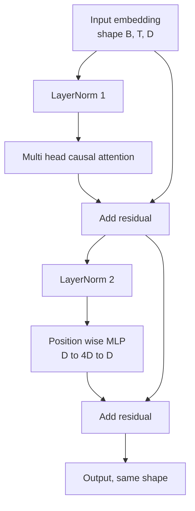
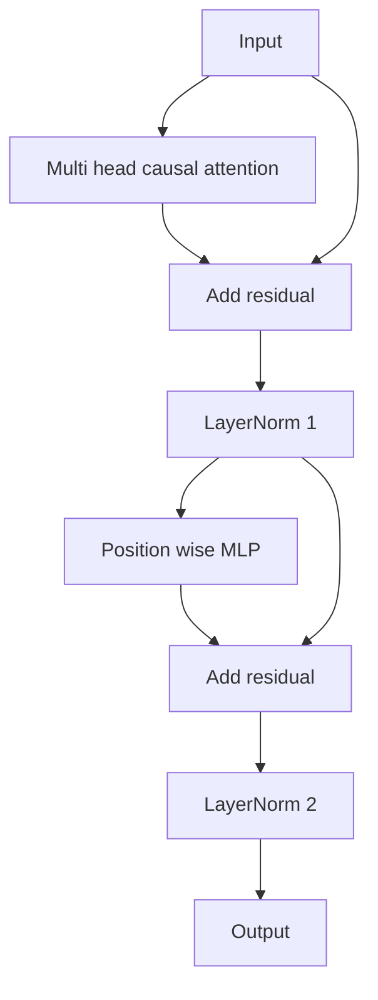

# Transformer Block from Scratch

> Satu block adalah unit dari setiap decoder LLM modern. Layer norm, multi head attention, residual, MLP, residual. Varian pre-LN melatih secara stabil tanpa warmup. Varian post-LN adalah yang dikirim paper aslinya. Pelajaran ini membangun keduanya, berdampingan, dan menunjukkan mana yang bertahan pada tumpukan 12 layer dengan learning rate yang lazim.

**Type:** Build
**Languages:** Python
**Prerequisites:** Phase 19 lessons 30 to 33 (tokenizer, embeddings, attention math, batched data loader)
**Time:** ~90 minutes

## Learning Objectives

- Membangun sebuah transformer block di PyTorch dari empat bagian yang bergerak: LayerNorm, multi head causal attention, koneksi residual, dan position wise MLP.
- Menempatkan LayerNorm dalam dua konfigurasi (pre-LN dan post-LN) dan menjelaskan mengapa satu melatih secara stabil tanpa warmup.
- Mengimplementasikan causal masking di dalam multi head attention supaya token `i` tidak bisa melihat token `j > i`.
- Melacak aliran gradient melalui kedua varian pada tumpukan 12 layer dan membaca hasilnya tanpa hand waving.
- Memakai ulang block sebagai unit drop-in ketika pelajaran berikutnya merakit sebuah GPT 124 juta parameter.

## Masalahnya

Sebuah transformer adalah satu block yang diulang. Salah block-nya sekali, ulangi dua belas kali, dan kamu menghasilkan model yang divergen di epoch pertama atau yang membutuhkan hack warmup selama sisa perjalanannya. Dua mode kegagalan yang akan kamu lihat di pelajaran ini bukan hal yang eksotis. Keduanya muncul untuk pertama kalinya ketika seorang pelajar menumpuk block secara naif. Yang satu adalah attention layer yang attending ke masa depan. Yang lain adalah LayerNorm yang ditempatkan di tempat yang tidak bisa menjinakkan sinyal residual pada kedalaman.

Perbaikannya bersifat mekanis begitu kamu melihatnya. Block punya tepat dua jalur residual dan tepat dua posisi normalisasi. Pilih posisinya dengan benar dan sisa tumpukannya hanyalah pencatatan.

## Konsepnya

Setiap block transformer decoder-only adalah fungsi yang menerima tensor berbentuk `(batch, sequence, embedding)` dan mengembalikan tensor berbentuk yang sama. Di dalamnya, dua sublayer melakukan pekerjaannya.



Ini adalah varian pre-LN. LayerNorm berada di dalam cabang residual, sebelum sublayer. Koneksi residual membawa sinyal yang belum dinormalisasi ke depan.

Varian post-LN memindahkan LayerNorm ke setelah penambahan residual.



Bentuknya identik. Perilaku training-nya tidak. Dengan post-LN, gradient yang mengalir kembali melalui jalur residual harus melewati LayerNorm. Pada kedalaman dua belas dan learning rate `3e-4`, gradient itu menyusut cukup cepat hingga membutuhkan jadwal warmup. Pre-LN membiarkan jalur residual tanpa normalisasi sehingga gradient merambat bersih ke layer embedding. Pre-LN adalah konfigurasi yang dipakai GPT-2 dan seterusnya karena alasan itu.

### Causal multi head attention

Sublayer attention memproyeksikan input ke tiga arah menjadi tensor query, key, value. Masing-masing di-reshape dari `(B, T, D)` ke `(B, H, T, D/H)` di mana `H` adalah jumlah kepala. Scaled dot product attention menghitung `softmax(Q K^T / sqrt(d_k))` per kepala, memask segitiga atas ke negative infinity, menerapkan mask lewat softmax, lalu mengalikan dengan `V`. Kepala-kepala dikonkatenasikan kembali menjadi satu tensor `(B, T, D)` dan diproyeksikan sekali lagi. Mask-lah satu-satunya bagian yang membuat model menjadi causal. Lupakan mask dan kamu melatih model yang curang.

### MLP-nya

MLP position wise menerapkan jaringan dua-layer yang sama ke setiap token secara independen. Lebar tersembunyinya empat kali lebar embedding, aktivasinya GELU, dan sebuah dropout mengikuti linear kedua. Tidak ada token yang bicara satu sama lain di dalam MLP. Semua pencampuran token terjadi di attention.

### Koneksi residual melakukan dua hal

Keduanya membuat jalur gradient menjadi aditif di sepanjang kedalaman, yang menjaga norm gradient tetap dalam skala melalui dua belas layer. Keduanya juga membiarkan setiap block mempelajari sebuah pembaruan aditif terhadap representasi yang berjalan, alih-alih penggantian penuh. Keduanya adalah alasan block ini bisa diskalakan.

```figure
cc-transformer-block
```

## Bangun Sendiri

`code/main.py` mengimplementasikan:

- `class LayerNorm` dengan scale dan shift yang bisa dipelajari, eps yang di-bias, diterapkan per vektor token.
- `class MultiHeadAttention` dengan `num_heads`, `head_dim = d_model // num_heads`, proyeksi QKV terfusi, causal mask yang terdaftar, dan dropout attention serta residual.
- `class FeedForward` dengan dua layer linear, aktivasi GELU, dan dropout.
- `class TransformerBlock` dengan sebuah flag `pre_ln` yang mengalihkan antara kedua varian.
- Sebuah demo yang membangun tumpukan pre-LN 6 layer dan tumpukan post-LN 6 layer dengan input identik dan mencetak (a) bentuk output, (b) norm gradient pada embedding setelah satu backward pass.

Jalankan:

```bash
python3 code/main.py
```

Output: pemeriksaan bentuk pada kedua tumpukan, norm gradient berdampingan. Gradient embedding tumpukan pre-LN satu order of magnitude lebih besar daripada tumpukan post-LN pada learning rate yang sama, dan itulah sinyal empiris bahwa pre-LN melatih tanpa warmup.

## Stack

- `torch` untuk matematika tensor, autograd, dan plumbing `nn.Module`.
- Tanpa `transformers`, tanpa bobot pretrained. Block diimplementasikan dari primitif.

## Pola produksi di lapangan

Tiga pola mengubah block ala buku teks menjadi sesuatu yang bisa kamu rilis.

**Proyeksi QKV terfusi.** Tiga layer linear terpisah berbiaya tiga peluncuran kernel dan tiga matmul. Satu layer linear berlebar `3 * d_model` mengerjakan hal yang sama dalam satu peluncuran, lalu memecah output di sepanjang sumbu terakhir. Jalur terfusi lebih cepat di setiap akselerator dan cocok dengan apa yang dikirim implementasi referensi GPT-2, LLaMA, dan Mistral semuanya.

**Buffer causal mask terdaftar.** Mask hanya bergantung pada panjang konteks maksimum. Alokasikan sekali saat konstruksi dengan `register_buffer`, potong jendela aktif per forward pass, dan lewati alokasi per-panggilan. Melupakan ini mengubah mask menjadi titik panas allocator pada konteks panjang.

**Dropout di dua tempat, bukan tiga.** Dropout berada setelah attention softmax (attention dropout) dan setelah linear kedua MLP (residual dropout). Dropout pada residual-nya sendiri merusak identitas aditif yang membuat gradient mengalir pada kedalaman. Beberapa implementasi awal salah soal ini dan membayarnya dengan training yang rapuh.

## Gunakan

- Block di pelajaran ini langsung cocok dengan perakitan GPT di pelajaran 35 tanpa modifikasi.
- Varian pre-LN adalah yang dipakai setiap LLM open weights modern. Varian post-LN adalah yang dipakai paper attention asli tahun 2017. Mengetahui keduanya cukup untuk membaca arsitektur decoder mana pun yang kamu temui.
- Tukar GELU dengan SiLU dan kamu mendapat aktivasi keluarga LLaMA. Tukar LayerNorm dengan RMSNorm dan kamu mendapat normalisasi keluarga LLaMA. Kerangkanya sama.

## Latihan

1. Tambahkan sebuah flag `bias=False` ke setiap linear di block. LLM open weights modern dirilis tanpa bias pada layer linear-nya. Ukur berapa banyak parameter yang kamu hemat pada model 12 layer berdimensi 768.
2. Ganti `nn.LayerNorm` dengan RMSNorm buatan tangan dan verifikasi bentuk output tidak berubah.
3. Tambahkan flag yang mengembalikan bobot attention untuk kepala pertama sebagai tensor `(B, T, T)`. Plot segitiga atas untuk memastikan bahwa ia nol setelah softmax.
4. Buat sebuah sanity check yang memberi tensor `(2, 16, 384)` dengan `H=6` ke kedua varian dan meng-assert bahwa output forward-nya berbeda (misalnya `not torch.allclose`) ketika bobot diinisialisasi secara identik dan dropout diset ke nol.

## Istilah Kunci

| Term | What people say | What it actually means |
|------|-----------------|------------------------|
| Pre-LN | "Pre norm" | LayerNorm inside the residual branch, before each sublayer; the residual carries the unnormalized signal |
| Post-LN | "Post norm" | LayerNorm after the residual add; what the 2017 paper shipped and what needs warmup |
| Causal mask | "Triangle mask" | The upper triangle of the attention logits set to negative infinity so token i cannot read token j when j is greater than i |
| Fused QKV | "Combined projection" | One linear of width 3D instead of three linears of width D; one kernel, one matmul |
| Residual stream | "Skip connection" | The unnormalized tensor that flows top to bottom through every block; what each block adds to |

## Bacaan Lanjutan

- Phase 7 lesson 02 (self attention from scratch) untuk matematika attention di bawah block ini.
- Phase 7 lesson 05 (full transformer) untuk versi encoder decoder dari kerangka yang sama.
- Phase 10 lesson 04 (pre training mini GPT) untuk prosedur training yang disambungkan block ini.
- Phase 19 lesson 35 (track ini) yang menumpuk dua belas block ini menjadi sebuah model GPT.
