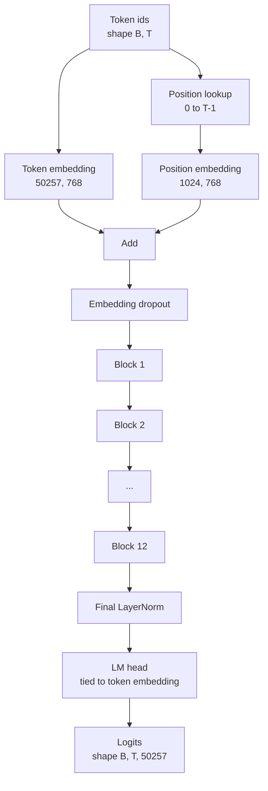
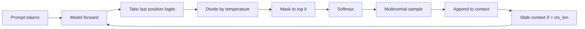

# Perakitan Model GPT

> Dua belas blok ditumpuk, sebuah token embedding, sebuah position embedding yang dipelajari, sebuah LayerNorm akhir, dan sebuah language model head yang terikat. Itulah seluruh model GPT 124 juta parameter. Pelajaran ini merakit bagian-bagian itu menjadi sebuah kelas yang berfungsi, menghitung parameternya untuk mengonfirmasi model cocok dengan bentuk referensi 124M, dan menghasilkan teks dengan sampling multinomial, temperature, dan top-k.

**Type:** Build
**Languages:** Python
**Prerequisites:** Phase 19 lessons 30 to 34
**Time:** ~90 minutes

## Tujuan Pembelajaran

- Merakit transformer block dari pelajaran 34 menjadi model GPT lengkap: token embedding, position embedding, N blok, LayerNorm akhir, dan language model head.
- Mereproduksi konfigurasi 124 juta parameter: vocab 50257, context 1024, embedding 768, dua belas head, dua belas layer.
- Mengikat bobot language model head ke token embedding dan menjelaskan mengapa itu menghemat ~38 juta parameter pada skala ini.
- Menghasilkan teks dari prompt dengan sampling multinomial, temperature scaling, dan top-k truncation, mempertahankan panjang context dengan sliding window.
- Mengukur jumlah parameter dan biaya forward pass terhadap target 124M.

## Masalahnya

Sebuah transformer block tidak berbuat apa-apa dengan sendirinya. Kamu perlu mengubah token id menjadi vektor, mencampurkan informasi posisi, menjalankannya melalui tumpukan itu, dan memproyeksikan kembali ke logits vocabulary. Lupa salah satu dari empat langkah itu dan model gagal forward, bergeser informasi posisinya, atau tidak bisa bicara.

Bentuk modelnya juga penting. GPT-2 small referensi adalah 124 juta parameter dengan persis konfigurasi di atas. Angka-angkanya bukan sihir. Vocab 50257 dikali embedding 768 adalah tabel token. Posisi 1024 dikali 768 adalah tabel posisi. Dua belas blok dengan masing-masing sekitar 7 juta parameter adalah 84 juta. Head akhir memanfaatkan kembali tabel token lewat weight tying. Jumlahkan bagiannya dan kamu mendapat 124 juta. Membangun model yang jumlah parameternya tidak cocok dengan referensi adalah tanda kamu menyambung sesuatu dengan salah.

## Konsepnya



Token id menjadi token vector. Position id menjadi position vector. Keduanya dijumlahkan dan dikirim melalui stack. LayerNorm akhir adalah satu-satunya bagian di luar blok yang bertahan di setiap varian modern. LM head memanfaatkan kembali matriks token embedding, dan itulah arti weight tying.

### Weight tying

Token embedding punya bentuk `(vocab, d_model)`. Language model head perlu memproyeksikan dari `d_model` kembali ke `vocab`. Keduanya adalah transpose satu sama lain. Mengikat keduanya berarti secara harfiah tensor parameter yang sama, dipakai dua kali. Pada vocab 50257 dan d_model 768, matriks itu 38 juta parameter. Tanpa ikatan, kamu membayarnya dua kali. Dengan ikatan, kamu membayarnya sekali dan kamu juga mendapat sinyal gradient yang sedikit lebih bersih karena embedding dan head diperbarui bersama.

### Position embedding dipelajari, bukan sinusoidal

GPT-2 mengirim position embedding yang dipelajari. Tabel posisi adalah satu tensor parameter berbentuk `(1024, 768)`. Model melookup posisi 0 hingga T-1 di setiap forward dan menambahkan hasil lookup ke token embedding. Ini adalah skema posisi yang paling sederhana (RoPE, ALiBi, T5 relative bias adalah alternatifnya) dan inilah yang dipakai referensi 124M.

### Generasi: temperature, top-k, multinomial

Generasi bersifat autoregressive. Di setiap langkah, model mengembalikan logits atas seluruh vocabulary di setiap posisi. Kamu mengambil posisi terakhir saja, membagi dengan temperature, opsional men-mask semua logit kecuali top k menjadi negative infinity, softmax untuk mendapat probabilitas, dan sampel satu token dari distribusi hasil.



Tiga knob, tiga perilaku berbeda. Temperature mendekati nol runtuh menjadi greedy. Temperature satu cocok dengan distribusi alami model. Top-k satu adalah greedy. Top-k empat puluh memfilter ekor panjang. Kombinasinya penting; pelajaran berikutnya tentang training memakai generasi sebagai sinyal evaluasi kualitatif.

```figure
cc-gpt-assembly
```

## Bangun Sendiri

`code/main.py` mengimplementasikan:

- `class GPTConfig` dataclass dengan default 124M: `vocab_size=50257`, `context_length=1024`, `d_model=768`, `num_heads=12`, `num_layers=12`, `mlp_expansion=4`, `dropout=0.1`, `use_bias=True`, `weight_tying=True`.
- `class GPTModel` dengan token embedding, position embedding, embedding dropout, dua belas `TransformerBlock`, LayerNorm akhir, dan sebuah `lm_head` yang mengikat ke token embedding saat flag disetel.
- Sebuah helper `count_parameters` yang mengembalikan jumlah parameter unik (sehingga weight tying dihormati dalam penghitungan).
- Sebuah fungsi `generate` yang melakukan temperature, top-k, multinomial, dan sliding window context.
- Sebuah demo yang membangun model, mencetak jumlah parameter di samping 124M referensi, dan menghasilkan urutan pendek dari prompt tetap untuk menunjukkan pipeline end to end.

Jalankan:

```bash
python3 code/main.py
```

Output: jumlah parameter di samping referensi 124M, token id yang dihasilkan dari prompt acak, dan konfirmasi bahwa LM head dan token embedding berbagi penyimpanan saat tying aktif.

Untuk menjaga demo tetap cepat, skrip ini juga menjalankan konfigurasi kecil (`d_model=64`, `num_layers=2`) end to end dan mencetak urutan token hasil secara inline. Konfigurasi 124M dibangun tetapi hanya jumlah parameter dan satu forward pass yang dieksekusi.

## Stack

- `torch` untuk tensor math, autograd, dan plumbing modul.
- `code/main.py` mengimplementasikan kembali pola blok yang sama dari pelajaran 34 secara lokal.

## Pola produksi di lapangan

Tiga pola membuat perbedaan antara model yang jalan dan model yang dikirim.

**Inisialisasi proyeksi residual kecil.** Proyeksi output attention dan linear kedua dari MLP sama-sama masuk ke residual add. Menginisialisasi keduanya dengan standar deviasi yang sama seperti linear lainnya menghasilkan residual stream yang tumbuh dengan kedalaman dan mendorong LayerNorm akhir ke kondisi yang panas. Skalakan std dengan `1 / sqrt(2 * num_layers)` untuk kedua proyeksi itu; residual stream tetap di rentang yang wajar melalui dua belas layer.

**Cache tensor position id, jangan hitung ulang.** `torch.arange(T)` mengalokasikan memori baru di setiap forward. Alokasikan sekali di `__init__` untuk context maksimum, slice T entri pertama di setiap panggilan, dan lewati round trip allocator.

**Ikat bobot di level parameter, bukan hanya dengan menyalin.** Menyetel `lm_head.weight = token_embedding.weight` berbagi tensor; menyalin tidak. Optimizer perlu memperbarui satu parameter dan graph autograd perlu satu akumulasi. Jika kamu menyalin, head menjauh dari embedding dan weight tying tidak memberimu apa-apa.

## Gunakan

- Kelas model di pelajaran ini punya bentuk yang sama dengan yang dilatih pelajaran berikutnya.
- Mengganti position embedding yang dipelajari dengan RoPE memberimu keluarga LLaMA tanpa menyentuh blok atau head.
- Mengganti GELU dengan SiLU dan LayerNorm dengan RMSNorm memberimu sisa perubahan keluarga LLaMA.
- Fungsi generasi bekerja dengan sumber logits apa pun, tidak hanya model ini. Kamu bisa menarik logits dari file GPT-2 yang sudah di-pretrain di pelajaran 37 dan memakai kembali loop generasi yang sama.

## Latihan

1. Lepaskan ikatan LM head dari token embedding dan hitung ulang parameter. Verifikasi delta-nya adalah 50257 dikali 768 = 38 juta.
2. Ganti position embedding yang dipelajari dengan tabel sinusoidal yang dihitung saat konstruksi. Konfirmasi model tetap melakukan forward dan jumlah parameter turun sebesar 786.432.
3. Tambahkan flag `greedy=True` ke generasi yang melewati sampling dan memilih argmax. Konfirmasi urutan deterministik antar-run.
4. Tambahkan knob `repetition_penalty` yang membagi logit dari token mana pun dalam prompt atau history yang dihasilkan dengan sebuah konstanta sebelum softmax. Tunjukkan pada prompt tetap bahwa nilai di atas satu mengurangi jumlah pengulangan di output.
5. Tambahkan sampling `top_p` (nucleus) di samping `top_k`. Pemeriksaan dua baris bahwa jumlah probabilitas token yang dipertahankan melebihi `top_p`.

## Istilah Kunci

| Term | What people say | What it actually means |
|------|-----------------|------------------------|
| Weight tying | "Tied embeddings" | The LM head and the token embedding share the same parameter tensor; saves vocab times d_model parameters and matches the GPT-2 reference |
| Position embedding | "Learned positions" | A separate table of shape (context length, d_model) added to token vectors; learned end to end |
| Sliding window context | "Context cap" | When the prompt plus generated tokens exceed the context length, drop the oldest tokens so the active window fits |
| Top-k sampling | "K truncation" | Keep the K logits with the highest values, mask the rest to negative infinity, softmax over the remainder |
| Temperature | "Sampling temperature" | Divide logits by T before softmax; T less than 1 sharpens, T equal to 1 keeps the natural distribution, T greater than 1 flattens |

## Bacaan Lanjutan

- Phase 19 lesson 34 for the block this model stacks.
- Phase 19 lesson 36 for the training loop that drives this model with cross entropy loss.
- Phase 19 lesson 37 for loading pretrained GPT-2 weights into this exact architecture.
- Phase 7 lesson 07 (GPT causal language modeling) for the math of next token prediction.
- Phase 10 lesson 04 (pre training mini GPT) for the original training procedure on the same architecture.
