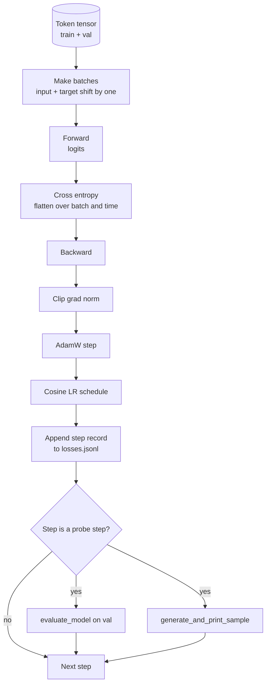

# Training Loop dan Evaluasi

> Sebuah loop yang tidak mengukur adalah sebuah loop yang berbohong. Pelajaran ini membangun training loop yang menggerakkan model GPT: AdamW dengan pembagian weight decay, jadwal learning rate warmup plus cosine, helper `calc_loss_batch`, satu pass `evaluate_model` pada data held out, probe kualitatif `generate_and_print_sample` setiap K langkah, dan log JSONL dari loss yang bisa kamu plot setelahnya. Skeleton yang sama melatih setiap decoder LLM yang pernah kamu bangun.

**Type:** Build
**Languages:** Python
**Prerequisites:** Phase 19 lessons 30 to 35
**Time:** ~90 minutes

## Tujuan Pembelajaran

- Membangun training loop yang menghitung cross entropy loss dengan alignment input dan target yang benar untuk prediksi token berikutnya.
- Mengonfigurasi AdamW dengan weight decay yang diterapkan pada tensor weight dan tidak pada tensor LayerNorm atau bias.
- Mengimplementasikan jadwal learning rate dengan linear warmup dan cosine decay, dan membaca LR hasil dari waktu ke waktu.
- Mengevaluasi pada split held out dengan `evaluate_model` sehingga eval loss dapat dibandingkan antar-run.
- Menghasilkan sampel kualitatif setiap K langkah dengan `generate_and_print_sample` untuk menangkap divergensi sebelum kurva loss melakukannya.
- Menyimpan loss per langkah ke JSONL sehingga kamu bisa memuat ulang, memplot, dan mengirim training log sebagai deliverable.

## Masalahnya

Skrip training yang mencetak loss tetapi tidak melakukan apa pun lagi gagal dengan tiga cara. Ia tidak bisa memberitahumu apakah loss turun karena alasan yang benar (model bisa overfit pada training set dan tidak pernah belajar). Ia tidak bisa memberitahumu apakah sebuah divergensi sedang dimulai (loss bisa melonjak satu langkah dan pulih, atau satu langkah dan crash). Ia tidak bisa memberitahumu apa yang telah dipelajari model (loss adalah skalar; sampel yang dihasilkan adalah sebuah paragraf). Ketiga kegagalan itu tersembunyi kecuali loop mengukurnya.

Loop di pelajaran ini mengukur dengan tiga cara. Loss pada training batch di setiap langkah. Loss pada held out batch setiap K langkah. Kelanjutan yang dihasilkan dari prompt tetap setiap K langkah. Training log mendarat di JSONL sehingga artifact-nya adalah kesaksian loop.

## Konsepnya



Dua bagian yang tidak jelas adalah alignment loss dan pembagian decay AdamW.

### Alignment loss

Model memprediksi token berikutnya di setiap posisi. Jika input batch adalah token `[t0, t1, t2, t3]`, target batch harus `[t1, t2, t3, t4]`. Cross entropy dihitung pada bentuk flat `(batch * seq, vocab)` terhadap target flat `(batch * seq,)`. Lupakan shift-nya dan kamu melatih model untuk memprediksi dirinya sendiri, yang konvergen ke loss nol tanpa mempelajari apa pun yang berguna.

### Pembagian decay AdamW

Weight decay mengregularisasi tensor weight tetapi bukan skala normalisasi atau bias. Menaruh decay pada skala LayerNorm perlahan mendorong skala ke nol dan merusak normalisasi. Menaruh decay pada bias secara matematis tidak berbahaya tetapi membuang cycle. Pembagian standarnya: tensor berbentuk matriks (bobot linear, tabel embedding) mendapat decay, apa pun yang tampak seperti skala atau shift tidak.

### Jadwal warmup plus cosine

Warmup menaikkan learning rate dari nol ke target selama beberapa ratus langkah sehingga state optimizer punya waktu terisi. Cosine decay menurunkan learning rate kembali ke nol selama sisa langkah sehingga fase akhir fine tune bobot dengan ukuran langkah kecil. Kombinasi ini adalah jadwal paling umum dalam training LLM open weights karena menghapus sebagian besar momen rapuh di seribu langkah pertama dan seribu langkah terakhir.

### Evaluasi held out

`evaluate_model` menjalankan sejumlah batch tetap dari split validasi, mengakumulasi loss, membagi dengan jumlah batch, dan mengembalikan. Tanpa gradient. Tanpa dropout. Angkanya reproducible antar-run dengan seed dan split yang sama. Melaporkan held out loss di samping training loss adalah cara kamu menangkap overfitting.

### Sampling kualitatif sebagai sinyal dini

Sebuah model yang training loss-nya turun dengan baik tetapi sampel hasilnya semua token yang sama adalah rusak. Sebuah model yang kurva loss-nya tampak datar tetapi sampel hasilnya mempertajam menjadi kata-kata yang kohesif sedang belajar. Probe kualitatif berjalan lebih cepat daripada membaca kurva penuh dan menangkap mode yang terlewat oleh skalar.

```figure
cap-training-loop
```

## Bangun Sendiri

`code/main.py` mengimplementasikan:

- `make_batches(token_ids, batch_size, context_length)` yang men-slice tensor token panjang menjadi pasangan input dan target.
- `calc_loss_batch(model, inputs, targets)` yang melakukan forward, flatten, dan mengembalikan cross entropy skalar.
- `evaluate_model(model, val_loader, max_batches)` yang mengiterasi sejumlah batch validasi tetap tanpa grad dan mengembalikan loss rata-rata.
- `generate_and_print_sample(model, prompt, max_new_tokens)` yang menjalankan fungsi generasi pelajaran 35 pada prompt tetap dan mencetak hasilnya.
- `build_param_groups(model, weight_decay)` yang menghasilkan daftar parameter AdamW dua grup.
- `cosine_with_warmup(step, warmup_steps, total_steps, max_lr, min_lr)` yang mengembalikan LR pada langkah tertentu.
- `train(...)` yang menjalankan loop, menyimpan `outputs/losses.jsonl`, dan mencetak eval loss serta sampel setiap `eval_every` langkah.
- Sebuah demo yang melatih model kecil pada data sintetis selama sedikit langkah, menulis log JSONL, dan mencetak eval loss serta sampel di titik-titik probe. Demo berjalan jauh di bawah satu menit di CPU.

Jalankan:

```bash
python3 code/main.py
```

Output: baris loss per langkah, eval loss di setiap probe step, sampel yang dihasilkan di setiap probe step, dan sebuah `outputs/losses.jsonl` akhir yang bisa kamu muat dengan `json.loads` per baris.

## Stack

- `torch` untuk autograd, optimizer, dan modul.
- `main.py` mengimplementasikan kembali `GPTModel` pelajaran 35 dan modul pendukungnya secara lokal.

## Pola produksi di lapangan

Tiga pola mengubah loop buku teks menjadi sesuatu yang bisa kamu tinggalkan berjalan semalaman.

**Gradient norm clipping bukan pilihan.** Batch yang buruk (data anomali, spike LR, kasus tepi numeris) menghasilkan gradient besar yang menghapus berjam-jam training. `torch.nn.utils.clip_grad_norm_(params, max_norm=1.0)` setelah `backward` dan sebelum `step` menjaga optimizer di rentang yang aman. Nilai clipping adalah parameter bebas; satu adalah default yang bertahan di sebagian besar setup.

**Logging JSONL yang bisa di-resume, bukan state pickled.** Rekaman loss per langkah sebagai baris `{"step": int, "train_loss": float, "lr": float}` di JSONL tahan lama: crash apa pun meninggalkan artifact yang bisa dibaca, kamu bisa grep, kamu bisa plot dengan tiga puluh baris Python, dan kamu bisa melanjutkan training dengan membaca langkah terakhir. State pickled mengikatmu ke tata letak modul persis yang menghasilkan file, yang rapuh di seluruh refactor.

**Batch eval diambil dari slice tetap.** Token validasi di-slice menjadi batch di awal skrip, bukan secara on the fly. Reproducibilitas bergantung pada batch eval yang identik dari run ke run; kalau tidak, membandingkan eval loss antara dua run mengukur shuffle batch sama banyaknya dengan model.

## Gunakan

- Loop di pelajaran ini adalah skeleton yang sama yang melatih model 124M pada data nyata. Tukar tensor token sintetis dengan loader bergaya `datasets` dan loop berjalan tanpa perubahan.
- Log JSONL adalah deliverable yang mengubah training run menjadi bukti. Pelajaran berikutnya memakai satu untuk membandingkan checkpoint yang baru dilatih dengan yang sudah di-pretrain.
- Probe sampel kualitatif adalah pegangan serba guna yang tidak bisa digantikan oleh loss skalar.

## Latihan

1. Tambahkan unit test `weight_decay_groups()` yang mengonfirmasi parameter skala dan bobot linear serta embedding masing-masing masuk ke grup no decay dan grup decay.
2. Ganti token acak sintetis dengan byte dari file teks kecil agar demo melatih pada sesuatu yang terbaca. Verifikasi sampel yang dihasilkan memakai karakter yang ada di file.
3. Tambahkan lantai `min_lr` sebesar 10 persen dari `max_lr` ke jadwal cosine dan plot ulang.
4. Simpan checkpoint setiap `eval_every` langkah sebagai tambahan terhadap log JSONL. Tambahkan flag `resume_from` yang memuat ulang model state dan optimizer state.
5. Catat throughput per langkah (token per detik) di samping loss dan konfirmasi tetap di pita yang stabil.

## Istilah Kunci

| Term | What people say | What it actually means |
|------|-----------------|------------------------|
| Loss alignment | "Shift by one" | Input tokens at positions 0..T-1, target tokens at positions 1..T; cross entropy is computed on flattened shapes |
| Decay split | "Two groups" | AdamW receives matrix shaped tensors with weight decay and scale or bias tensors with none |
| Warmup | "Ramp" | The learning rate climbs from zero to its target over a fixed number of steps so the optimizer state can populate |
| Eval batches | "Held out batches" | A fixed slice of the validation token tensor, sliced once at script start, used identically every probe |
| Qualitative probe | "Sample print" | A short generation from a fixed prompt printed every K steps to catch failure modes loss alone hides |

## Bacaan Lanjutan

- Phase 19 lesson 35 for the model the loop drives.
- Phase 19 lesson 37 for loading pretrained weights into the same model.
- Phase 10 lesson 04 (pre training mini GPT) for the procedure on real data.
- Phase 10 lesson 10 (evaluation) for the broader eval surface beyond cross entropy loss.
