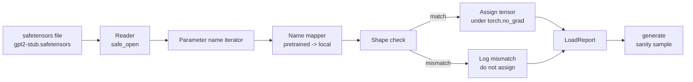

# Memuat Bobot yang Sudah Di-pretrain

> Melatih model 124 juta parameter dari nol adalah keputusan anggaran; memuat checkpoint yang dipublikasikan adalah pekerjaan hari Selasa. Pelajaran ini memuat bobot gaya GPT-2 yang sudah di-pretrain dari file safetensors ke arsitektur persis dari pelajaran 35, menelusuri pemetaan nama parameter bagian demi bagian, dan melakukan sanity generation kelanjutan untuk membuktikan pemuatan berhasil. Tanpa jaringan, tanpa loader pihak ketiga, tanpa sihir yang buram.

**Type:** Build
**Languages:** Python
**Prerequisites:** Phase 19 lessons 30 to 36
**Time:** ~90 minutes

## Tujuan Pembelajaran

- Membaca file safetensors dengan library Python `safetensors` dan memeriksa nama serta bentuk tensor.
- Memetakan setiap nama parameter yang sudah di-pretrain ke parameter di dalam model GPT pelajaran 35.
- Menangani dua konvensi penamaan yang berbeda antara bobot GPT-2 yang dipublikasikan dan model di track ini: `wte/wpe/h.N.attn.c_attn/c_proj` dan `mlp.c_fc/c_proj` versus penamaan lokal `tok_embed/pos_embed/blocks.N.attn.qkv/out_proj` dan `mlp.fc1/fc2`.
- Mendeteksi dan menolak ketidakcocokan bentuk dengan error yang jelas sebelum penugasan bobot apa pun terjadi.
- Menghasilkan kelanjutan pendek dengan bobot yang dimuat dan mengonfirmasi tokennya berasal dari distribusi hasil muat, bukan dari distribusi inisialisasi acak.

## Masalahnya

Bobot yang dipublikasikan tidak dikemas untuk arsitekturmu. Membawa nama-nama yang dipakai implementasi asli. File yang sudah di-pretrain memiliki `transformer.h.0.attn.c_attn.weight` berbentuk `(2304, 768)`; modelmu mengharapkan `blocks.0.attn.qkv.weight` berbentuk `(2304, 768)` (yang merupakan matriks yang sama dalam konvensi tata letak berbeda) atau modelmu memakai `nn.Linear` yang menyimpan matriks secara ter-transpose. Parameter yang sama muncul dengan tiga identitas yang berbeda secara halus (nama, bentuk, tata letak byte), dan loader harus merekonsiliasi ketiganya.

Loader yang menyalin secara buta menempatkan tensor yang benar di tempat yang salah dan kamu mendapat model yang menghasilkan omong kosong. Loader yang menolak menyalin ketika bentuk berbeda tetapi tidak mencatat apa pun membuatmu menebak tensor mana yang gagal mendarat. Loader di pelajaran ini eksplisit: setiap penugasan dicatat, setiap bentuk diperiksa, dan sebuah `LoadReport` meringkas hit, miss, dan ketidakcocokan bentuk sehingga kamu bisa membaca apa yang terjadi.

## Konsepnya



Name mapper hanyalah sebuah fungsi dari string ke string. Pemeriksaan bentuk adalah satu if. Penugasan terjadi di dalam `torch.no_grad()` sehingga autograd tidak melacak muatan itu. Report memuat hasil dari setiap nama.

### Konvensi penamaan GPT-2

Bobot GPT-2 yang dipublikasikan hidup di bawah nama seperti:

| Pretrained name | Shape | Meaning |
|-----------------|-------|---------|
| `wte.weight` | (50257, 768) | Token embedding |
| `wpe.weight` | (1024, 768) | Position embedding |
| `h.N.ln_1.weight` | (768,) | LayerNorm 1 scale at block N |
| `h.N.ln_1.bias` | (768,) | LayerNorm 1 shift at block N |
| `h.N.attn.c_attn.weight` | (768, 2304) | Fused QKV linear weight |
| `h.N.attn.c_attn.bias` | (2304,) | Fused QKV linear bias |
| `h.N.attn.c_proj.weight` | (768, 768) | Attention output projection |
| `h.N.attn.c_proj.bias` | (768,) | Attention output projection bias |
| `h.N.ln_2.weight` | (768,) | LayerNorm 2 scale |
| `h.N.ln_2.bias` | (768,) | LayerNorm 2 shift |
| `h.N.mlp.c_fc.weight` | (768, 3072) | MLP fc1 weight |
| `h.N.mlp.c_fc.bias` | (3072,) | MLP fc1 bias |
| `h.N.mlp.c_proj.weight` | (3072, 768) | MLP fc2 weight |
| `h.N.mlp.c_proj.bias` | (768,) | MLP fc2 bias |
| `ln_f.weight` | (768,) | Final LayerNorm scale |
| `ln_f.bias` | (768,) | Final LayerNorm shift |

Dua kejutan yang perlu direncanakan. Linear `c_attn`, `c_proj`, `c_fc` disimpan dengan matriks yang di-transpose relatif terhadap yang diharapkan `nn.Linear.weight`. Loader men-transpose selama penugasan. LM head sama sekali tidak ada di file; model mengandalkan weight tying dengan `wte`, jadi head ditetapkan dengan pengaliasan begitu `wte` mendarat.

### Konvensi penamaan lokal

Model di track ini memakai nama deskriptif:

| Local name | Meaning |
|------------|---------|
| `tok_embed.weight` | Token embedding |
| `pos_embed.weight` | Position embedding |
| `blocks.N.ln1.scale` | LayerNorm 1 scale at block N |
| `blocks.N.ln1.shift` | LayerNorm 1 shift |
| `blocks.N.attn.qkv.weight` | Fused QKV |
| `blocks.N.attn.qkv.bias` | Fused QKV bias |
| `blocks.N.attn.out_proj.weight` | Attention output projection |
| `blocks.N.attn.out_proj.bias` | Output projection bias |
| `blocks.N.ln2.scale` | LayerNorm 2 scale |
| `blocks.N.ln2.shift` | LayerNorm 2 shift |
| `blocks.N.mlp.fc1.weight` | MLP fc1 |
| `blocks.N.mlp.fc1.bias` | MLP fc1 bias |
| `blocks.N.mlp.fc2.weight` | MLP fc2 |
| `blocks.N.mlp.fc2.bias` | MLP fc2 bias |
| `final_ln.scale` | Final LayerNorm scale |
| `final_ln.shift` | Final LayerNorm shift |

Pemetaannya adalah fungsi tetap. Pelajaran mengirimkannya sebagai dict yang diiterasi loader.

### Fixture stub

Bobot GPT-2 yang sebenarnya berukuran 0,5 GB. Demo tidak mengunduhnya; ia menghasilkan fixture safetensors kecil pada run pertama, dengan konvensi penamaan GPT-2 persis dan bentuk yang sesuai untuk model 12-blok di d_model 192 alih-alih 768. Fixture memiliki struktur yang benar untuk mengeksekusi setiap jalur kode di loader. Tukar fixture dengan file yang sebenarnya dan loader bekerja tanpa modifikasi.

```figure
cc-weight-remap
```

## Bangun Sendiri

`code/main.py` mengimplementasikan:

- Sebuah replika kecil dari `GPTModel` pelajaran 35 sehingga pelajaran ini mandiri.
- `make_pretrained_to_local(num_layers)` yang mengembangkan entri per-layer.
- `load_safetensors(model, path)` yang mengiterasi nama, memetakannya, memeriksa bentuk, men-transpose bobot gaya conv1d, dan menugaskan di bawah `torch.no_grad()`. Mengembalikan sebuah `LoadReport`.
- `make_stub_safetensors(path, cfg)` yang menghasilkan file fixture dengan konvensi penamaan yang sudah di-pretrain persis.
- Sebuah demo yang membuat `outputs/gpt2-stub.safetensors` pada run pertama, membangun model baru, menangkap satu kelanjutan yang dihasilkan dari inisialisasi acak, memuat stub, menangkap kelanjutan lain, mencetak keduanya, dan memverifikasi keduanya berbeda (muatan itu benar-benar mengubah model).

Jalankan:

```bash
python3 code/main.py
```

Output: path fixture, log muatan per-nama, ringkasan `LoadReport`, kelanjutan sebelum muatan, kelanjutan setelah muatan, dan ketidakcocokan bentuk pada satu tensor yang sengaja dibuat buruk yang disuntikkan ke fixture sehingga jalur kegagalan dieksekusi.

## Stack

- `safetensors` untuk format di disk dan streaming reader.
- `torch` untuk model dan matematika penugasan.
- Tanpa `transformers`, tanpa `huggingface_hub`, tanpa panggilan jaringan.

## Pola produksi di lapangan

Tiga pola membuat loader bertahan saat berhadapan dengan bobot yang tidak kamu buat.

**Selalu validasi file sebelum penugasan apa pun.** Buka file, daftarkan setiap nama tensor dengan dtype dan bentuknya, jalankan pemetaan penuh dengan pemeriksaan bentuk, dan hanya pada keberhasilan mulai menugaskan. Model yang setengah termuat adalah mesin kegagalan diam.

**Catat setiap penugasan dengan nama sumber dan nama tujuan.** Saat sesuatu tampak salah, log memberitahumu tensor mana yang mendarat di mana; alternatifnya adalah membaca hexdump. Dataclass `LoadReport` di pelajaran ini melacak daftar `loaded`, `missing`, `unexpected`, dan `shape_mismatch` serta mencetak ringkasan di akhir.

**LM head adalah alias weight tying, bukan salinan terpisah.** Menyetel `model.lm_head.weight = model.tok_embed.weight` setelah memuat `tok_embed` adalah pola kanonis. Menyalin matriks embedding ke parameter `lm_head.weight` yang baru memutus ikatan dan diam-diam menggandakan jumlah parametermu.

## Gunakan

- Loader bekerja untuk file safetensors mana pun yang memakai konvensi penamaan yang sudah di-pretrain. File GPT-2 yang sebenarnya (small / medium / large / xl) bekerja tanpa perubahan kode; hanya config model yang berbeda.
- Pola yang sama meluas ke bobot LLaMA, Mistral, Qwen setelah kamu memperbarui peta nama. Pemeriksaan bentuk dan report-nya tetap identik.
- Sanity generation setelah muatan adalah gerbang cepat: jika sampel pasca-muat tampak seperti sampel pra-muat, muatan tidak mengubah model, yang berarti pemetaan diam-diam melewatkan setiap tensor.

## Latihan

1. Tambahkan argumen `dtype` ke loader yang melempar setiap tensor ke dtype target (`bfloat16`, `float16`, `float32`) selama penugasan. Konfirmasi model `float32` bisa diturunkan ke `bfloat16` dan tetap menghasilkan.
2. Tambahkan argumen `expected_layers` yang menolak memuat checkpoint yang indeks `h.N`-nya tidak cocok dengan `num_layers` model.
3. Colokkan loader ke fungsi generasi pelajaran 35 dan hasilkan dua sampel berdampingan: satu dari inisialisasi acak, satu dari fixture yang dimuat.
4. Tambahkan jalur ekspor: tulis model state saat ini ke file safetensors baru memakai konvensi penamaan yang sudah di-pretrain. Round trip loader-nya dan konfirmasi report memiliki nol ketidakcocokan bentuk.
5. Perluas `NAME_MAP` untuk menangani konvensi penamaan LLaMA (tanpa bias, RMSNorm, tata letak qkv fused) dan jalankan ulang loader pada fixture LLaMA stub yang kamu hasilkan.

## Istilah Kunci

| Term | What people say | What it actually means |
|------|-----------------|------------------------|
| Name map | "Key remapping" | The function from pretrained tensor names to local parameter names; usually a literal dict with one entry per layer index expanded over a loop |
| Shape mismatch | "Bad shape" | The pretrained tensor exists under the mapped name but its dimensions disagree with the local parameter; the loader refuses to assign and logs the pair |
| Transpose-on-load | "Conv1d layout" | Published GPT-2 stores attention and MLP projections in the transpose of what nn.Linear expects; the loader transposes during assignment |
| Weight tying alias | "Shared LM head" | Setting model.lm_head.weight = model.tok_embed.weight so the head and embedding share storage; the head is not in the file because of this |
| Load report | "Coverage summary" | A small dataclass that tracks loaded, missing, unexpected, and shape_mismatch lists; printing it is how you tell whether the load succeeded |

## Bacaan Lanjutan

- Phase 19 lesson 35 for the architecture that receives the weights.
- Phase 19 lesson 36 for the training loop that produces a checkpoint of the same shape.
- Phase 10 lesson 11 (quantization) for what to do with the loaded weights when memory is tight.
- Phase 10 lesson 13 (building a complete LLM pipeline) for the full lifecycle around load and inference.
