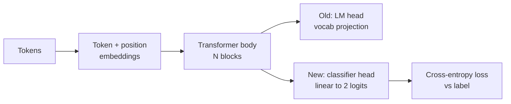
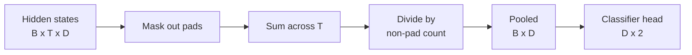
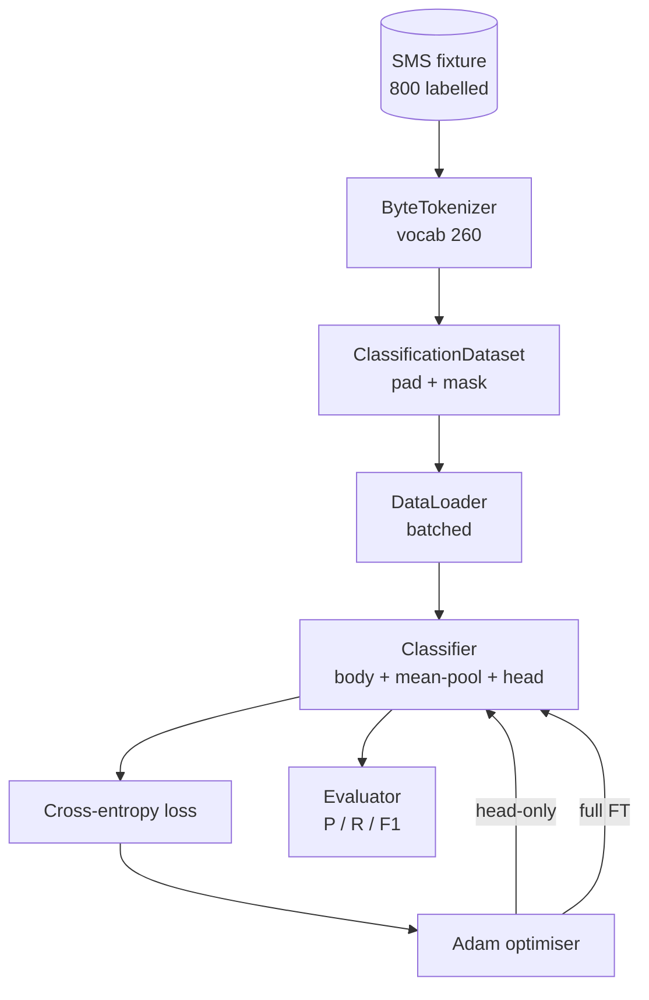

# Pelajaran Capstone 38: Fine-Tuning Klasifikasi lewat Head Swap

> Capstone pertama Track B. Sebuah bahasa model yang sudah di-pretrain adalah tumpukan blok self-attention yang diakhiri sebuah token-prediction head. Saat kamu ingin spam vs ham, head-nya salah tetapi badannya sebagian besar benar. Pelajaran ini melepaskan head-nya, menempelkan lapisan linear dua kelas ke representasi yang di-pool, dan melatih klasifier dengan dua cara berbeda: hanya layer akhir, dan full fine-tuning. Eval-nya adalah precision, recall, dan F1 pada split held-out. Kamu belajar apa yang dibeli setiap strategi itu dan berapa harganya.

**Type:** Build
**Languages:** Python (torch, numpy)
**Prerequisites:** Phase 19 lessons 30-37 (NLP LLM track: tokenizer, embedding table, attention block, transformer body, pre-training loop, checkpointing, generation, perplexity)
**Time:** ~90 minutes

## Tujuan Pembelajaran

- Mengganti language-model head dengan classification head tanpa menginisialisasi ulang badan.
- Mengimplementasikan dua rezim training: badan beku (hanya-head) dan full fine-tuning, berbagi satu training loop.
- Membangun pipeline data yang sadar tokeniser yang men-padding, men-mask padding, dan meng-pool output attention.
- Menghitung precision, recall, F1, dan confusion matrix dari logits mentah.
- Menalar tentang trade-off antara jumlah parameter, waktu training, dan head-room.

## Masalahnya

Kamu telah meng-pretrain transformer kecil pada korpus generik. Head output memproyeksikan hidden state terakhir ke vocabulary 1000 token. Sekarang kamu punya 800 pesan SMS berlabel spam atau ham dan kamu menginginkan klasifier biner. Ada tiga pilihan.

Pilihan yang salah adalah melatih klasifier baru dari nol pada 800 contoh. Badan model yang sudah di-pretrain sudah mengkodekan struktur yang berguna: identitas kata, posisi, ko-occurrence sederhana. Membuangnya membuang compute yang membangunnya.

Dua pilihan yang benar adalah head swap dengan badan dibekukan, dan head swap dengan badan bisa dilatih. Training hanya-head cepat, nyaris gratis di memori, dan jarang overfit dengan data sesedikit ini. Full fine-tuning lebih lambat, bisa overfit pada data kecil, tetapi mencapai akurasi lebih tinggi saat domain downstream bergeser dari korpus pretraining.

Pelajaran ini membangun keduanya, sehingga kamu bisa membandingkannya pada fixture yang sama.

## Konsepnya



Model adalah fungsi `f_theta(tokens) -> hidden_states`. Head adalah fungsi `g_phi(hidden) -> logits`. Menukar head berarti mempertahankan `theta` dan mengganti `g_phi`. Parameter badan adalah bagian yang mahal. Head adalah satu lapisan linear.

Dua set parameter yang bisa dilatih penting:

- `theta` (badan): puluhan ribu bobot per attention block.
- `phi` (head): bobot `hidden_dim * num_classes` ditambah sebuah bias.

Dalam training hanya-head kamu menghitung gradient terhadap `phi` dan menol gradient terhadap `theta`. PyTorch membiarkanmu melakukan ini dengan menyetel `requires_grad=False` pada parameter badan. Optimizer kemudian hanya melihat head dan badan tetap beku.

Dalam full fine-tuning kamu membiarkan gradient mengalir kembali melalui seluruh stack. Bobot badan bergeser untuk menyesuaikan objective klasifikasi. Risikonya adalah catastrophic forgetting pada data kecil: pretraining badan terhapus oleh noise overfitting.

## Pertanyaan Pooling

Sebuah klasifier membutuhkan satu vektor per sekuens, bukan satu vektor per token. Tiga pilihan umum:

- **Mean pool**: rata-rata hidden state di sepanjang sekuens, ditimbang oleh attention mask.
- **CLS pool**: tambahkan token khusus di depan dan gunakan hanya outputnya. Inilah yang dilakukan BERT.
- **Last-token pool**: gunakan token non-padding terakhir. Inilah yang dilakukan klasifier kelas GPT.

Pelajaran ini menggunakan mean pooling dengan penimbangan attention-mask eksplisit. Ini yang paling sederhana, memberi sinyal stabil di berbagai panjang sekuens, dan tidak memerlukan pretraining token CLS.



## Datanya

Delapan ratus pesan SMS, seimbang 400 spam dan 400 ham, dihasilkan secara deterministik di `code/main.py`. Generator memakai seed tetap, memilih template dan mensubstitusi pengisi slot, dan mengeluarkan pesan sepanjang 5 hingga 25 token. Dataset nyata punya noise yang tidak dimiliki fixture ini. Poin dari fixture adalah reproduksibilitas.

Data di-split 80/20: 640 train, 160 test. Split bersifat stratified sehingga test set mempertahankan keseimbangan 50/50. Held-out set dengan keseimbangan yang diketahui membuat precision dan recall terbaca sebagai angka yang jujur.

## Metrik

Klasifikasi biner dengan kelas 1 sebagai kelas positif (spam). Hitungannya:

- `TP`: diprediksi spam, memang spam.
- `FP`: diprediksi spam, ternyata ham.
- `FN`: diprediksi ham, ternyata spam.
- `TN`: diprediksi ham, memang ham.

Tiga metrik utama:

- `precision = TP / (TP + FP)`. Dari pesan yang ditandai spam, berapa persen yang benar-benar spam?
- `recall = TP / (TP + FN)`. Dari spam yang sebenarnya, berapa persen yang ditandai model?
- `F1 = 2 * P * R / (P + R)`. Rata-rata harmonik dari keduanya.

Confusion matrix mencetak keempat hitungan itu sebagai grid 2x2. Demo menulisnya ke stdout untuk kedua rezim training.

```figure
cap-classifier-head-swap
```

## Arsitektur



Badannya adalah transformer yang sengaja kecil: vocab 260, hidden 64, 4 head, 2 blok, maksimum sekuens 32. Ia cukup kecil untuk melatih kedua rezim hingga konvergen di dalam sembilan puluh detik di CPU. Ia tidak di-pretrain di pelajaran ini; sebaliknya, helper `pretrain_quick` melakukan lima epoch training LM pada teks fixture yang sama untuk memberi badan titik awal yang tidak trivial. Ini menjaga pelajaran tetap mandiri.

## Apa yang akan kamu bangun

Implementasinya adalah satu `main.py` ditambah satu modul test (`code/tests/test_main.py`).

1. `ByteTokenizer`: memetakan byte ke id, menyediakan sebuah pad id.
2. `Block`: transformer block dengan multi-head attention dan lapisan feed-forward. Pre-norm.
3. `LMBody`: token + position embeddings ditambah tumpukan blok. Mengembalikan hidden state.
4. `MeanPool`: rata-rata yang ditimbang mask di sumbu sekuens.
5. `Classifier`: badan, pool, head linear. Badan adalah instance yang sama di seluruh rezim.
6. `freeze_body` dan `unfreeze_body`: mengalihkan `requires_grad` pada parameter badan.
7. `train_classifier`: satu loop bersama. Menerima model dan optimizer yang dikonfigurasi untuk grup parameter mana pun yang bisa dilatih.
8. `evaluate`: menjalankan test set dan mengembalikan `Metrics(precision, recall, f1, confusion)`.
9. `run_demo`: meng-pretrain badan sebentar, lalu melatih dan mengevaluasi hanya-head, lalu full, mencetak kedua report, dan keluar dengan nol.

## Mengapa perbandingan ini penting

Rezim biasanya-head biasanya melatih lebih cepat dan underfit dengan lebih anggun. Pada fixture ini kamu umumnya melihat precision mendekati 0,9 dan recall mendekati 0,85 setelah dua puluh epoch training hanya-head. Full fine-tuning memakan waktu sekitar tiga kali lebih lama dan mendarat dalam beberapa poin ke arah mana pun, tergantung seed acak.

Pelajaran ini tidak memilih pemenang. Ia mengajarmu membaca angka dan biayanya. Pada 800 contoh dan badan kecil, hanya-head adalah keputusan yang tepat. Pada 80.000 contoh dan badan yang lebih besar, full fine-tuning mulai terbayar. Kontrak yang kamu ambil dari pelajaran ini adalah API-nya: fungsi `train_classifier` yang sama menangani keduanya, dan toggle-nya satu panggilan.

## Target lanjutan

- Tambahkan rezim ketiga yang hanya membuka blok terakhir. Ini kadang disebut partial fine-tuning. Biayanya lebih murah daripada full FT dan mempelajari lebih banyak daripada hanya-head.
- Tambahkan learning-rate scheduler. Jadwal cosine pada head ditambah laju konstan yang lebih kecil pada badan adalah setup produksi yang umum.
- Ganti mean pooling dengan attention pool yang dipelajari: lapisan attention kecil dengan satu query yang dipelajari. Ini sering mengalahkan mean pool pada sekuens yang lebih panjang.

Implementasimu memberimu hook-nya. Test mengunci kontraknya. Angka-angkanya terserah kamu untuk didorong.
