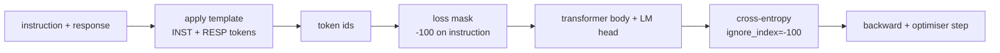
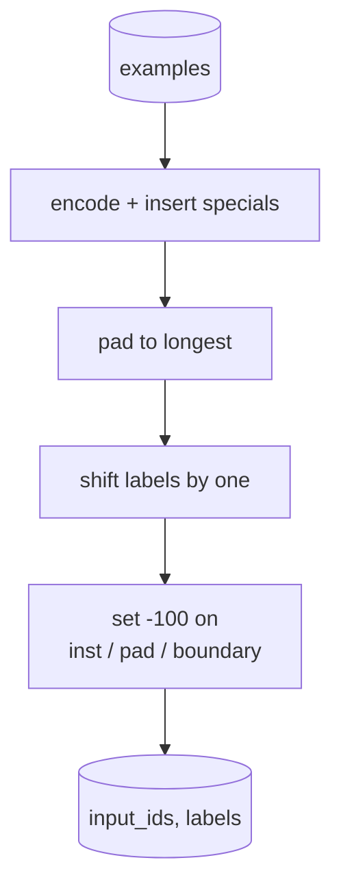
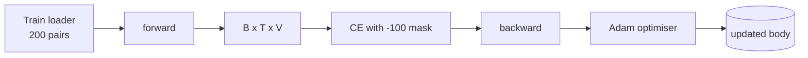

# Pelajaran Capstone 39: Instruction Tuning lewat Supervised Fine-Tuning

> Sebuah base model yang sudah di-pretrain bisa memperpanjang sebuah sekuens tetapi tidak bisa mengikuti instruksi. Supervised fine-tuning adalah perubahan terkecil yang memperbaiki ini: beri model contoh berpasangan dari sebuah instruksi dan respons yang diinginkan, dan latih badan untuk memprediksi token responsnya. Triknya adalah kamu hanya ingin loss menghitung respons, bukan instruksinya. Pelajaran ini membangun loop SFT bergaya Alpaca dengan fungsi collate kustom yang men-mask token instruksi dengan `ignore_index=-100`, melatih pada 200 pasangan instruksi-respons, dan mengevaluasi pada split held-out menggunakan exact-match.

**Type:** Build
**Languages:** Python (torch, numpy)
**Prerequisites:** Phase 19 lessons 30-37 (NLP LLM track: tokenizer, embedding table, attention block, transformer body, pre-training loop, checkpointing, generation, perplexity)
**Time:** ~90 minutes

## Tujuan Pembelajaran

- Memformat data instruksi-respons berpasangan menjadi satu sekuens kausal dengan token batas eksplisit.
- Membangun fungsi collate yang men-mask token instruksi sehingga cross entropy hanya menghitung token respons.
- Melatih transformer body kecil di bawah objective SFT dan mengamati metrik eval bergerak.
- Mengimplementasikan generasi greedy dan temperature-sampled yang menghormati batas awal-respons.
- Menghitung exact-match held-out pada kelanjutan yang dihasilkan.

## Masalahnya

Sebuah base model yang dilatih pada prediksi token berikutnya tidak tahu apa itu instruksi. Tunjukkan padanya string `"What is the capital of France?"` dan ia akan melanjutkan pertanyaan itu atau mengarang kalimat baru. Model punya bahasanya tetapi bukan kontrak formatnya.

Kontrak SFT adalah sebuah template string. Setiap contoh training menjadi satu sekuens dengan tiga wilayah:

```text
<INST> What is the capital of France? <RESP> The capital of France is Paris.
```

Token batas adalah token khusus yang dicadangkan saat training. Model belajar bahwa segala sesuatu setelah `<RESP>` adalah respons dan respons itulah yang dinilai. Objective next-token base model tetap berlaku; hanya saja dilatih pada korpus di mana setiap contoh punya bentuk ini.

Tetapi ada satu jebakan. Jika kamu memberi seluruh sekuens ke cross entropy vanilla, kamu melatih model untuk juga memprediksi token instruksi. Instruksinya sudah diberikan. Kamu menginginkan gradient nol di posisi-posisi itu. Perbaikannya adalah mask-nya.

## Konsepnya



`ignore_index` adalah fitur dari `torch.nn.functional.cross_entropy`. Posisi target mana pun yang sama dengan `ignore_index` menyumbang loss nol dan gradient nol. Konvensi di PyTorch adalah `-100`. Fungsi collate membangun dua tensor per contoh: `input_ids` (sekuens penuh) dan `labels` (salinan `input_ids` dengan posisi instruksi ditimpa oleh `-100`).

Model melihat seluruh sekuens selama pass forward; attention bisa attend ke instruksinya. Loss hanya menghitung token respons. Inilah persis yang kamu inginkan: memberi kondisi pada instruksi, memprediksi respons.

## Datanya

Dua ratus pasangan instruksi-respons dihasilkan secara deterministik di `main.py`. Mereka mencakup enam jenis tugas:

- factual single-shot (ibu kota X)
- aritmetika
- ekstraksi daftar
- ringkasan satu kalimat
- kode (print, sort)
- definisi

Setiap tugas memiliki instruksi ber-template dan respons deterministik. Ini sengaja dibuat sederhana. Exact-match rapuh, dan pelajaran memakai fixture di mana jawaban yang benar adalah satu string tertentu. Dataset SFT yang sebenarnya membutuhkan metrik fuzzy; prinsipnya identik.

Split-nya 160 train, 40 test. Test set mencakup semua enam jenis tugas sehingga exact-match per-kategori bisa dilaporkan.

## Tokenisasi dan Padding

Tokenisernya bersifat byte-level dengan tiga token khusus yang dicadangkan:

- `INST_ID = 256`: menandai awal wilayah instruksi.
- `RESP_ID = 257`: menandai batas antara instruksi dan respons.
- `PAD_ID = 258`: padding untuk batch berbagai panjang.

Sekuensnya `[INST] inst_bytes [RESP] resp_bytes [PAD]*`. Fungsi collate:

1. Tokenisasi setiap contoh.
2. Men-pad setiap contoh dalam batch ke sekuens terpanjang dalam batch.
3. Membangun `labels` = `input_ids` di-shift satu (target causal LM), dengan:
   - Wilayah instruksi diganti `-100`.
   - Wilayah padding diganti `-100`.
   - Posisi batas `RESP_ID` itu sendiri diganti `-100` (kamu tidak melatih model untuk memprediksi token batas; ia memprediksi apa yang mengikutinya).



Shift adalah trik causal standar: posisi `i` dari `input_ids` memprediksi posisi `i+1`, sehingga `labels[i] = input_ids[i+1]` (dengan posisi terakhir dibuang dari input dan yang pertama dibuang dari target). Mask diterapkan setelah shift untuk mendarat di posisi yang benar.

## Training



Loop-nya adalah loop SFT PyTorch standar. Adam, learning rate sekitar 3e-4 hingga 1e-3, sepuluh hingga dua puluh epoch pada fixture ini, tanpa scheduler. Modelnya cukup kecil (hidden 96, 2 blok, panjang maksimum 64) untuk dilatih hingga konvergen di CPU di dalam dua menit.

Setiap epoch kelima loop menjalankan pass eval kecil pada held-out set dan mencetak exact-match. Mengamati exact-match naik dari 0,0 di epoch satu menjadi sesuatu seperti 0,85 di epoch lima belas adalah payoff pelajaran ini: kamu bisa melihat model mempelajari format dan jawabannya pada saat yang sama.

## Generasi

Saat eval time model mendapat prefix instruksi `[INST] inst_bytes [RESP]` dan menghasilkan token hingga salah satu:

- sekuens mencapai `max_len`, atau
- model mengeluarkan heuristik stop khusus: dua byte penutup kalimat berturut-turut (`.`, `!`, `?`).

Pelajaran mengirimkan greedy decoding ditambah temperature sampler opsional. Exact-match memakai greedy karena temperature akan membuat metrik menjadi stokastik. Sistem yang sebenarnya sering melakukan sampling, lalu menilai secara fuzzy; pipeline itu adalah pelajaran 41.

## Evaluasi Exact-Match

Exact-match adalah metrik teks yang paling ketat. String respons yang diprediksi dinormalisasi (huruf kecil, strip whitespace, runspasi ganda dijadikan satu) dan dibandingkan dengan respons referensi, dinormalisasi dengan cara yang sama. Metrik ini entah 1 atau 0 per contoh. Agregatnya adalah rata-rata.

Pipeline SFT yang sebenarnya melengkapi exact-match dengan token-level F1 (pelajaran 41) dan judge model. Exact-match tetap berguna karena tidak ambigu; jika ia mengatakan 0,7, persis 70 persen instruksi tes menghasilkan respons emas karakter demi karakter.

```figure
cc-sft-loss-mask
```

## Apa yang akan kamu bangun

Implementasinya adalah satu `main.py` ditambah test.

1. `InstructionTokenizer`: encoder byte-level dengan token khusus yang dicadangkan. Meng-encode baik prefix instruksi maupun pasangan penuh.
2. `make_dataset`: menghasilkan 200 pasangan di enam jenis tugas dengan seed tetap.
3. `SFTDataset`: mengembalikan `(input_ids, labels)` per contoh, sudah disiapkan mask-nya.
4. `sft_collate`: padding dinamis, membangun tensor batch, menyetel `-100` pada posisi instruksi dan pad.
5. `TinyGPT`: transformer body ditambah LM head terikat atau lepas.
6. `train_sft`: loop SFT, dengan hook eval per-epoch.
7. `generate`: decode kausal dari prefix, greedy atau sampled, dengan heuristik stop.
8. `exact_match`: perbandingan string ternormalisasi, mengembalikan float di `[0, 1]`.
9. `run_demo`: membangun data, melatih selama dua puluh epoch, mengevaluasi, mencetak rincian per-kategori, keluar dengan nol pada keberhasilan.

## Mengapa mask ini penting

Tanpa mask, loss memperlakukan token instruksi sebagai target. Model belajar memprediksi instruksinya. Ini objective yang berbeda dan menghasilkan model yang lebih buruk dengan dua cara. Pertama, kapasitas model terbuang merekonstruksi input yang selalu disediakan pengguna. Kedua, loss respons lebih kecil dalam jumlah gradient karena token instruksi melampaui jumlah token respons di sebagian besar batch; learning rate efektif optimizer pada bagian yang kamu pedulikan lebih rendah dari yang kamu rencanakan. Mask bukan polesan; mask itu adalah objective-nya.

## Target lanjutan

- Tambahkan learning-rate warmup yang diikuti cosine decay. SFT lebih sensitif terhadap LR daripada pretraining.
- Tambahkan logging loss per-token dan plot kurva loss selama training. Perhatikan bahwa epoch awal didominasi token template (`<RESP>`, prefix umum) dan epoch akhir didominasi token jawaban yang sebenarnya.
- Perluas eval ke BLEU-1 atau chrF. Exact-match meremehkan model yang menghasilkan parafrase dengan jawaban yang sama.
- Tambahkan chat template dengan format multi-turn dan latih pada fixture yang mencakup follow-up.

Implementasimu memberimu kontrak format, mask, dan loop-nya. Perubahan objective dari base model menjadi pengikut instruksi adalah satu fungsi collate.
