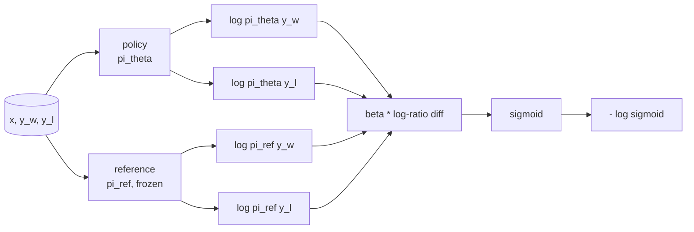
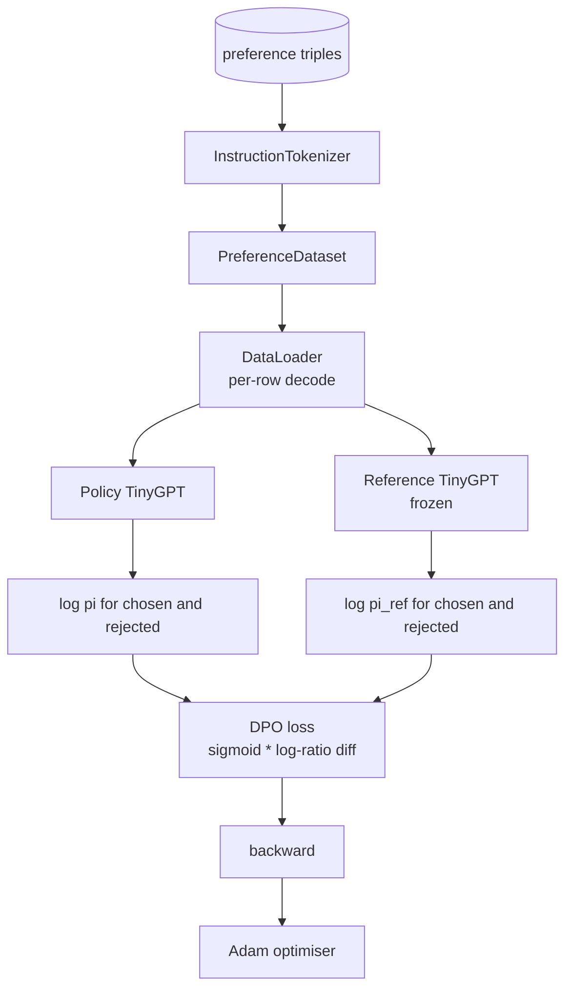

# Pelajaran Capstone 40: Direct Preference Optimization dari Nol

> Reward model dan PPO adalah stack RLHF klasik. DPO meruntuhkan stack itu menjadi satu loss tersupervisi yang menyesuaikan policy langsung terhadap pasangan preferensi. Pelajaran ini menurunkan DPO loss dari identitas selisih reward, mengirimkan reference model plus policy model yang berfungsi, menghitung log-probability per-token, dan melatih transformer kecil pada fixture preferensi dari kelanjutan chosen dan rejected. Test mengunci matematika loss dan arah gradient sehingga kamu tahu implementasinya cocok dengan makalahnya.

**Type:** Build
**Languages:** Python (torch, numpy)
**Prerequisites:** Phase 19 lessons 30-37 (NLP LLM track: tokenizer, embedding table, attention block, transformer body, pre-training loop, checkpointing, generation, perplexity)
**Time:** ~90 minutes

## Tujuan Pembelajaran

- Menurunkan DPO loss sebagai sigmoid atas selisih log-ratio berskala dan menghubungkannya dengan reward implisit.
- Membangun pasangan reference model + policy model dengan reference yang dibekukan dan policy yang bisa dilatih.
- Menghitung log-probability level-sekuens di bawah kedua model, men-mask token prompt.
- Melatih policy pada triple `(prompt, chosen, rejected)` dan mengamati log-prob chosen naik relatif terhadap rejected.
- Mengunci perilaku dengan test pada matematika loss, tanda gradient, dan invariansi reference.

## Masalahnya

Kamu punya sebuah model SFT. Ia mengikuti instruksi, tetapi output-nya tidak merata; beberapa kelanjutan jelas, beberapa bertele-tele atau salah. Kamu juga punya dataset kecil dari pasangan preferensi: untuk prompt yang sama, seorang manusia menandai satu kelanjutan sebagai chosen dan yang lain sebagai rejected.

Jawaban RLHF klasik adalah pipeline dua tahap. Melatih reward model pada preferensi. Mengoptimalkan policy terhadap reward dengan PPO. Ini bekerja tetapi mahal: dua model di memori selama PPO, kontrol KL untuk menjaga policy tetap dekat reference, reward hacking saat reward model rapuh.

DPO menggantikan kedua tahap dengan satu loss tersupervisi. Reward model tidak pernah ada secara eksplisit. Policy dilatih langsung pada pasangan preferensi, dengan penalti KL eksplisit ke arah reference SFT. Solusi optimal yang sama di bawah model preferensi Bradley-Terry, jauh lebih sedikit kode.

## Konsepnya

Mulai dari model Bradley-Terry. Diberikan prompt `x` dan dua kelanjutan `y_w` (chosen) dan `y_l` (rejected), probabilitas manusia memilih `y_w` adalah

```text
P(y_w > y_l | x) = sigmoid( r(x, y_w) - r(x, y_l) )
```

di mana `r` adalah fungsi reward laten tertentu. RLHF pertama menyesuaikan `r` dari preferensi, lalu melatih policy `pi` untuk memaksimalkan `r` dengan jangkar KL:

```text
max_pi   E_{x, y~pi} [ r(x, y) ] - beta * KL(pi || pi_ref)
```

Turunan DPO mengamati bahwa policy optimal `pi*` di bawah objective ini memiliki bentuk tertutup dalam istilah `r`:

```text
pi*(y | x) = (1/Z(x)) * pi_ref(y | x) * exp( r(x, y) / beta )
```

Susun ulang untuk `r`:

```text
r(x, y) = beta * ( log pi*(y | x) - log pi_ref(y | x) ) + beta * log Z(x)
```

Istilah `log Z(x)` sama untuk `y_w` dan `y_l` (ia bergantung pada `x`, bukan `y`), sehingga ia tereliminasi saat kamu menghitung selisih preferensi:

```text
r(x, y_w) - r(x, y_l) = beta * ( log pi_theta(y_w|x) - log pi_ref(y_w|x)
                                - log pi_theta(y_l|x) + log pi_ref(y_l|x) )
```

Substitusikan ke dalam sigmoid Bradley-Terry dan ambil negative log likelihood atas pasangan preferensi:

```text
L_DPO(theta) = - E_{(x, y_w, y_l)} [
  log sigmoid( beta * ( log pi_theta(y_w|x) - log pi_ref(y_w|x)
                       - log pi_theta(y_l|x) + log pi_ref(y_l|x) ) )
]
```

Inilah loss-nya. Ia adalah sigmoid atas satu skalar per contoh, dihitung dari empat log-probability. Tanpa reward model terpisah. Tanpa PPO. Tanpa istilah KL di dalam loss; kendala KL dibakar ke dalam turunan bentuk tertutup.



## Tanda Gradient

Pemeriksaan sanity yang berguna sebelum training run apa pun. Ambil gradient terhadap `log pi_theta(y_w | x)`:

```text
d L_DPO / d log pi_theta(y_w | x) = - beta * (1 - sigmoid(z))
```

di mana `z` adalah argumen sigmoid-nya. Ini negatif untuk semua `z`, yang berarti: menaikkan log-probability policy atas kelanjutan chosen menurunkan loss. Secara simetris, gradient terhadap `log pi_theta(y_l | x)` positif: menaikkan log-probability rejected menaikkan loss. Training mendorong chosen naik dan rejected turun. Reference dibekukan; ia tidak bergerak.

## Datanya

Dua belas triple preferensi dikirim bersama pelajaran. Masing-masing adalah `(prompt, chosen, rejected)`. Kelanjutan chosen pendek dan tepat sasaran. Rejected bertele-tele, di luar topik, atau salah. Pasangan-pasangan itu mencakup keluarga tugas yang sama dengan pelajaran 39 (ibu kota, aritmetika, daftar) sehingga policy yang berawal dari base SFT punya titik awal yang masuk akal.

Fixture-nya sengaja kecil. DPO bekerja pada puluhan ribu pasangan di produksi; di sini, poinnya adalah matematika loss dan loop berjalan end to end pada dataset kecil dan selisih log-prob chosen-versus-rejected terlihat tumbuh.

## Invariansi Reference

Implementasi DPO harus menangani reference model dengan hati-hati. Reference adalah model SFT yang dibekukan di tempatnya. Tiga properti harus terpenuhi:

- Parameter reference tidak pernah menerima gradient.
- Log-probability reference tidak pernah berubah antar-epoch.
- Policy berawal dari bobot yang sama dengan reference. (`theta` optimal adalah reference ditambah update yang dipelajari; menginisialisasi policy sebagai salinan reference adalah awal yang terdefinisi dengan baik.)

Implementasi menegakkan ini dengan:

- Membungkus reference dalam `torch.no_grad()` selama pass forward.
- Menyetel `requires_grad=False` pada setiap parameter reference.
- Membangun policy via `policy.load_state_dict(reference.state_dict())` setelah reference dibangun.

```figure
cap-dpo-preference
```

## Arsitektur



Modelnya adalah TinyGPT yang sama yang dipakai di pelajaran 39 (decoder-only, kausal, tokeniser byte). Reference dan policy berbagi arsitektur; bobot policy bergeser dari reference di bawah training sementara reference tetap tetap.

## Apa yang akan kamu bangun

Implementasinya adalah satu `main.py` ditambah test.

1. `InstructionTokenizer`: tokeniser byte dengan token khusus `INST` dan `RESP`. Bentuk sama dengan pelajaran 39.
2. `TinyGPT`: transformer decoder-only. Bentuk sama dengan pelajaran 39 sehingga pelajaran ini mandiri bahkan jika kamu melewati 39.
3. `make_preferences`: mengembalikan dua belas triple `(prompt, chosen, rejected)`.
4. `sequence_log_prob`: diberikan model, prefix prompt, dan sebuah kelanjutan, mengembalikan jumlah log-probability token berikutnya di sepanjang kelanjutan (tanpa kontribusi posisi prompt).
5. `dpo_loss`: menerima empat log-probability dan `beta`, mengembalikan tensor loss per-contoh dan delta reward implisit untuk logging.
6. `train_dpo`: loop per-epoch yang menghitung log-prob chosen dan rejected di bawah policy dan reference, menerapkan loss, dan melakukan step Adam.
7. `evaluate_margins`: mengembalikan margin log-probability chosen-rejected rata-rata di bawah policy pada titik mana pun.
8. `run_demo`: membangun reference dan policy dari pretrain warm-up kecil, menyalin bobot, melatih selama tiga puluh langkah, mencetak loss dan margin per-langkah, dan keluar dengan nol pada keberhasilan.

## Mengapa DPO bekerja

DPO secara matematis ekuivalen dengan RLHF di bawah model preferensi Bradley-Terry, sejauh parameterisasi reward. Reward implisit `r(x, y) = beta * (log pi(y|x) - log pi_ref(y|x))` teridentifikasi dari preferensi sejauh sebuah fungsi `x`, yang tereliminasi dalam selisihnya. Policy bentuk tertutup membiarkanmu melewati reward model secara eksplisit. Kendala KL ditegakkan secara struktural: penyimpangan `pi` dari `pi_ref` apa pun membuat log-ratio lebih besar, dan sigmoid jenuh, yang meredam gradient saat policy bergerak terlalu jauh. Reference adalah jaring pengamanmu.

## Target lanjutan

- Tambahkan normalisasi panjang ke jumlah log-probability: bagi dengan panjang kelanjutan. Bias panjang adalah mode kegagalan DPO yang dikenal di mana model memilih kelanjutan yang lebih pendek secara preferensial karena log-probability-nya lebih besar secara absolut.
- Tambahkan varian IPO dari loss: ganti sigmoid + log dengan `(z - 1)^2`. Bandingkan konvergensi pada fixture.
- Tambahkan parameter label smoothing yang menginterpolasi antara label chosen-rejected keras dan uniform 0,5.
- Ganti reference dengan model yang lebih kecil dan lebih murah (rasa knowledge distillation).

Implementasimu memberimu loss, invariansi reference, dan training loop. Matematikanya adalah pelajarannya. Kodenya membuat matematika itu konkret.
