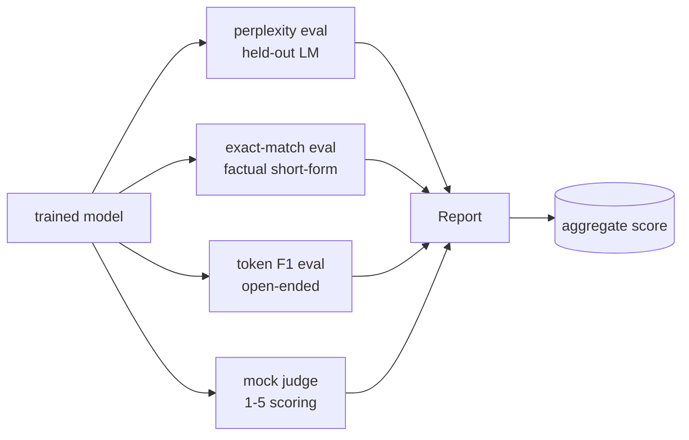
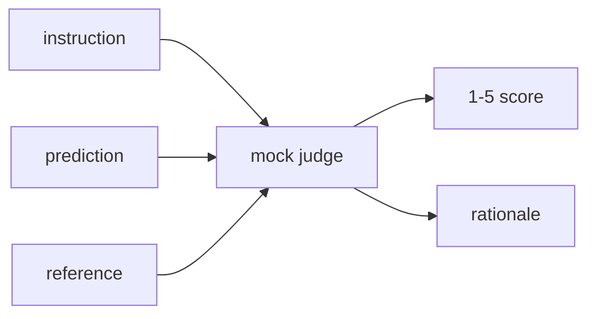
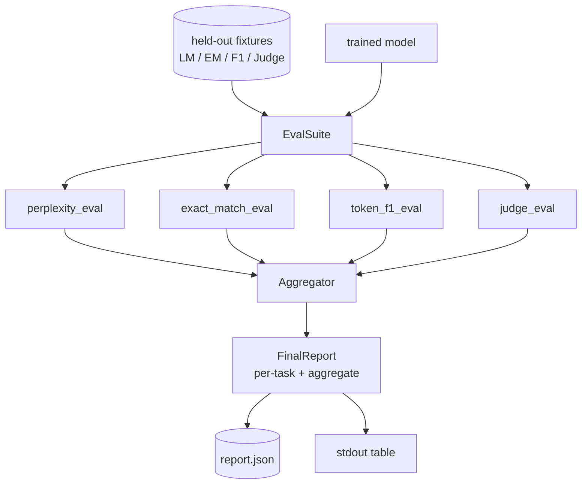

# Pelajaran Capstone 41: Pipeline Evaluasi Lengkap

> Training adalah bagian yang bisa kamu pantau dengan kurva loss. Evaluation adalah bagian yang harus kamu rancang. Pelajaran ini membangun pipeline eval terpadu yang menerima bahasa model mana pun yang sudah dilatih, menjalankan empat eval heterogen di atasnya, mengagregasi hasilnya menjadi report per-tugas, dan mengirimkan mock LLM-as-judge lokal sehingga loop berjalan tanpa jaringan. Keempat eval menutup dimensi yang dibutuhkan setiap model yang dikirim: language modelling (perplexity), korrectness bentuk pendek (exact-match), kemiripan bentuk terbuka (token F1), dan penilaian kualitatif (judge).

**Type:** Build
**Languages:** Python (torch, numpy)
**Prerequisites:** Phase 19 lessons 30-37 (NLP LLM track: tokenizer, embedding table, attention block, transformer body, pre-training loop, checkpointing, generation, perplexity)
**Time:** ~90 minutes

## Tujuan Pembelajaran

- Menghitung perplexity held-out dengan akuntansi token yang di-mask pada transformer kecil.
- Menjalankan eval exact-match pada prompt faktual bentuk pendek.
- Menghitung token-level F1 antara string prediksi dan referensi dengan normalisasi.
- Membangun mock LLM-as-judge lokal yang menilai output model pada skala 1-5.
- Mengagregasi keempat eval menjadi satu report berbobot dengan rincian per-tugas.

## Masalahnya

Satu metrik tidak pernah menggambarkan sebuah bahasa model. Perplexity mengatakan seberapa baik model cocok dengan distribusi bahasa tetapi tidak mengatakan apa pun tentang apakah ia menjawab pertanyaan. Exact-match mengatakan apakah model menghasilkan string emas tetapi menghukum parafrase yang benar. Token F1 memaafkan parafrase tetapi tertipu oleh tumpang tindih leksikal dengan konten yang salah. LLM-as-judge menangkap dimensi kualitatif tetapi mahal dan stokastik.

Pipeline yang benar-benar kamu inginkan memiliki keempatnya. Setiap eval menutupi satu dimensi yang terlewat oleh yang lain. Setiap berjalan pada subset data held-out yang berbeda, dibentuk untuk metrik itu. Report akhir menampilkan angka per-tugas berdampingan dan sebuah agregat, sehingga seorang reviewer bisa melihat sekilas trade-off apa yang diambil model itu.

Pelajaran ini membangun pipeline itu, end to end, dalam satu file.

## Konsepnya



Setiap eval adalah fungsi dari `(model, dataset) -> EvalResult`. Hasilnya membawa nilai metrik, detail per-contoh untuk inspeksi, dan sebuah nama untuk agregasi. Pipeline mengkomposisinya dengan config yang menyatakan eval mana yang dijalankan dan cara menimbangnya.

## Perplexity, dihitung dengan benar

Perplexity adalah `exp(mean negative log-likelihood per token)`. Implementasinya memiliki dua jebakan:

- Mean-nya harus dihitung atas posisi token yang sebenarnya, bukan atas batch * sekuens. Token padding harus dikecualikan dari penyebut atau perplexity akan tampak lebih baik daripada kenyataannya.
- Model memprediksi token berikutnya, sehingga logit di posisi `i` memprediksi token di posisi `i+1`. Kesalahan off-by-one di sini bersifat diam: loss tetap melatih, tetapi metrik menjadi tidak berarti.

Eval menghitung jumlah per-batch dari `-log p(token)` di atas posisi non-pad dan jumlah token per-batch, lalu membaginya di akhir. Ini secara numerik lebih aman daripada merata-ratakan perplexity per-batch (yang menunder-weight sekuens pendek) dan cocok dengan definisi buku teks.

## Exact-match, dengan normalisasi

Harness menormalisasi baik prediksi maupun referensi sebelum membandingkan:

- Huruf kecil.
- Strip whitespace di sekeliling.
- Menjadikan run whitespace internal sebagai satu spasi.
- Membuang tanda baca terminal di akhir (`.`, `!`, `?`) jika kedua pihak hanya berbeda oleh tanda baca.

Normalisasi membuat exact-match berguna dalam praktik. Sebuah model yang mengatakan `"Paris"` benar; yang mengatakan `"Paris."` juga benar; yang mengatakan `"  paris  "` juga benar. Metrik ini tetap mensyaratkan jawaban berupa string yang sama setelah normalisasi.

## Token F1, dengan cara yang benar

Token F1 adalah rata-rata harmonik dari precision dan recall yang dihitung di atas bag-of-tokens. Langkah-langkahnya:

1. Normalisasi prediksi dan referensi (aturan sama dengan exact-match).
2. Pecah masing-masing menjadi daftar token (tokenisasi whitespace).
3. Hitung irisan multiset.
4. Precision = `intersection_count / len(pred_tokens)`. Recall = `intersection_count / len(ref_tokens)`. F1 = rata-rata harmonik.

Jika prediksi dan referensi keduanya kosong, F1 adalah 1 (kecocokan kosong/vakum). Jika hanya satu yang kosong, F1 adalah 0. Pola ini cocok dengan referensi evaluasi SQuAD dan menghasilkan angka yang stabil di berbagai parafrase.

## Mock LLM-as-Judge Lokal

Sebuah judge yang sebenarnya adalah model frontier di balik sebuah API. Untuk pelajaran ini judge harus berjalan offline. Mock judge adalah scorer deterministik yang menerima sebuah instruksi, prediksi model, dan referensi, lalu mengembalikan skor di `{1, 2, 3, 4, 5}` ditambah rasional satu baris. Aturan penilaiannya eksplisit:

- 5 jika prediksi ternormalisasi sama dengan referensi ternormalisasi.
- 4 jika token F1 antara prediksi dan referensi setidaknya 0.8.
- 3 jika token F1 berada di `[0.5, 0.8)`.
- 2 jika token F1 berada di `[0.2, 0.5)`.
- 1 selain itu.

Ini bukan judge yang sebenarnya, tetapi ia memiliki antarmuka yang benar. Tukar dengan model sungguhan nanti dengan mengubah satu fungsi. Pipeline tidak peduli.



## Agregasi

Agregatnya adalah rata-rata berbobot dari skor eval ternormalisasi. Setiap eval melaporkan angkanya sendiri di `[0, 1]`:

- Perplexity: normalisasi sebagai `1 / (1 + log(perplexity))`. Perplexity 1 dipetakan ke 1, infinity dipetakan ke 0.
- Exact-match: sudah di `[0, 1]`.
- Token F1: sudah di `[0, 1]`.
- Judge: bagi dengan 5.

Bobot bisa dikonfigurasi. Campuran default adalah 0,2 perplexity, 0,3 exact-match, 0,3 token F1, 0,2 judge. Pilihan bobot adalah keputusan produk; pelajaran mengekspos knob-nya sehingga kamu bisa bereksperimen.

```figure
cg-eval-quadrant
```

## Arsitektur



`EvalSuite` adalah orkestrator tipis. Setiap eval individual adalah fungsi bebas yang menerima `(model, tokenizer, dataset, config)` dan mengembalikan sebuah `EvalResult`. `Aggregator` mengumpulkan hasil dan menghasilkan report akhir. Demo mencetak tabel dan menulis salinan JSON yang bisa diingest CI downstream.

## Apa yang akan kamu bangun

Implementasinya adalah satu `main.py` ditambah test.

1. `TinyGPT`: arsitektur decoder-only yang sama dengan yang dipakai di pelajaran 38-40, disertakan sehingga pelajaran berdiri sendiri.
2. `InstructionTokenizer`: tokeniser byte dengan token khusus INST / RESP / PAD.
3. Empat fixture: korpus LM, set EM, set F1, dan set judge. Dua puluh contoh masing-masing, deterministik.
4. `perplexity_eval`: mengembalikan `EvalResult` dengan nilai perplexity dan histogram loss per-token.
5. `exact_match_eval`: mengembalikan EM rata-rata dan catatan per-contoh.
6. `token_f1_eval`: mengembalikan token F1 rata-rata dan catatan per-contoh.
7. `mock_judge` dan `judge_eval`: skor dan rasional per-contoh, skor rata-rata di seluruh set.
8. `Aggregator.normalise`: aturan normalisasi per-eval.
9. `Aggregator.aggregate`: rata-rata berbobot dan report yang dirakit.
10. `run_demo`: melatih model kecil sebentar, menjalankan keempat eval, mencetak tabel report dan menulis JSON, keluar dengan nol pada keberhasilan.

## Membaca report

Report memiliki tiga lapisan. Puncaknya adalah skor agregat. Di bawahnya adalah keempat angka per-eval. Di bawah itu adalah rincian per-contoh untuk diagnostik. Run CI yang gagal biasanya menginginkan agregat, tetapi seorang reviewer yang mengejar regression menginginkan rincian per-contoh untuk melihat input mana yang salah diprediksi model.

Dump JSON memakai kunci yang stabil sehingga dashboard CI bisa memplot garis tren di seluruh versi. Tabel pretty-print ditujukan untuk manusia yang menatap terminal setelah training run.

## Target lanjutan

- Tambahkan eval kalibrasi: apakah probabilitas softmax model cocok dengan akurasinya? Bucket prediksi berdasarkan keyakinan dan laporkan akurasi empiris per bucket.
- Tambahkan eval keandalan: tag setiap contoh dengan sebuah gangguan (typo, parafrase, distractor) dan laporkan penurunan metrik per gangguan.
- Ganti mock judge dengan model sungguhan di balik panggilan HTTP. Tanda tangan fungsinya tidak berubah.
- Tambahkan pembelajaran bobot per-tugas: alih-alih bobot tetap, sesuaikan bobot ke urutan preferensi target atas model-model.

Implementasimu memberimu keempat eval, aggregator, dan report-nya. Pipeline evaluasi yang sebenarnya melapisi banyak dimensi lagi di atasnya; polanya tetap sama: satu fungsi per eval, satu aggregator, satu report.
