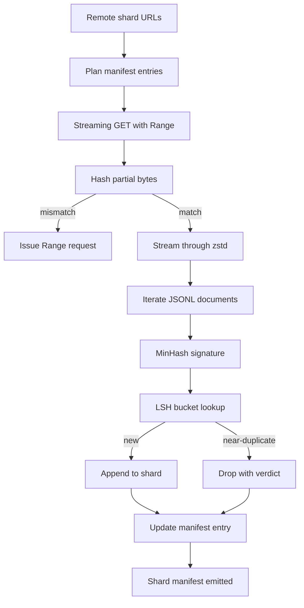

# Pengunduh Korpus Besar

> Melatih language model dimulai jauh sebelum forward pass pertama. Korpus harus mendarat di disk, terdekompresi, terdeduplikasi, dan bisa dialamatkan, dengan cerita resume yang sudah dirancang sebelum jaringan putus di persen 4. Pelajaran ini membangun downloader streaming yang menarik shard terkompresi, mendekompresi on the fly dengan Zstandard, mencari jari near-duplicate via MinHash plus locality-sensitive hashing, dan menulis shard manifest yang bisa dipercaya pipeline sisanya.

**Type:** Build
**Languages:** Python
**Prerequisites:** Phase 19 lessons 30-37
**Time:** ~90 minutes

## Tujuan Pembelajaran

- Stream shard remote dengan `urllib` dan dekompresi dengan `zstandard` tanpa men-buffer seluruh file di memori.
- Lanjutkan unduhan parsial dengan mengirim HTTP `Range` request terhadap offset byte yang sudah diverifikasi.
- Bangun signature MinHash per dokumen dan masukkan ke bucket dengan LSH supaya near-duplicate saling tabrakan.
- Keluarkan shard manifest berisi content hash, ukuran byte, jumlah dokumen, dan vonis dedup.

## Masalahnya

Pertama kali kamu melatih pada korpus 200 GB, jaringan putus di persen 41 dan skrip keluar dengan exception `urllib`. Kedua kali putusnya di persen 78. Menjelang persen 99 kamu sudah menulis ulang loop-nya tiga kali. Dua kegagalan yang harus kamu rancang sejak menit pertama adalah resume unduhan parsial dan penghapusan dokumen duplikat. Keduanya punya solusi yang sudah terkenal; keduanya sering dilewati karena pipeline dimulai dari panggilan `requests.get` satu baris yang lama-kelamaan jadi berbisa.

Resume adalah masalah HTTP. Server harus menghormati `Range`, klien harus melacak offset yang sudah diverifikasi terhadap record di disk, dan offset yang diverifikasi itu harus bertahan saat proses mati. Jika offset dan file berbeda bahkan satu byte, unduhan yang dilanjutkan menulis sampah dan korpus rusak dengan cara yang baru muncul saat tokenisasi.

Deduplikasi adalah masalah signature. Dedup hash persis melewatkan near-duplicate: artikel Wikipedia yang sama muncul dengan tiga footer boilerplate berbeda, file kode yang sama dengan header lisensi berbeda, postingan blog yang sama dengan parameter tracking di setiap tautannya. MinHash plus LSH menangkapnya dengan biaya sub-linear. Biayanya satu signature per dokumen dan satu lookup bucket per signature.

## Konsepnya



### Streaming dengan `urllib`

`urllib.request.urlopen` dari standard library mengembalikan object mirip file. Bungkus dengan `zstandard.ZstdDecompressor().stream_reader` dan byte-nya mengalir dari jaringan, melewati dekompresor, masuk ke iterator dokumen tanpa pernah mewujudkan shard terkompresi maupun shard hasil dekompresi di memori. Biaya memori yang tersisa hanya buffer baris, signature MinHash untuk dokumen saat ini, dan indeks LSH.

### Resume dengan `Range`

Downloader menulis dua file per shard: shard itu sendiri dan checkpoint `.partial.json`. Checkpoint mencatat `verified_bytes`, `expected_size`, `sha256_prefix` (dihitung di atas `verified_bytes` byte pertama), dan URL sumbernya. Saat startup, downloader membaca checkpoint, menghitung ulang `sha256_prefix` di atas byte yang ada di disk, dan hanya melanjutkan jika hasil hitung ulang cocok. Jika hash-nya salah, file parsial dibuang dan unduhan dimulai ulang dari byte nol. Korupsi diam-diam mustahil terjadi karena byte yang diverifikasi itu diperiksa, bukan diasumsikan.

### MinHash plus LSH

MinHash memperkirakan kemiripan Jaccard dari dua set dalam ruang yang tetap. Untuk sebuah dokumen, set-nya adalah shingles (n-gram yang saling tumpang tindih) dari teksnya. Signature-nya adalah `k` nilai hash minimum, satu per fungsi hash independen. Dua dokumen dengan kemiripan Jaccard `s` punya probabilitas `s` untuk sepakat pada satu komponen signature mana pun.

LSH lalu mengelompokkan `k` komponen menjadi `b` band dengan masing-masing `r` baris, di mana `k = b * r`. Dua dokumen tabrakan di setidaknya satu band dengan probabilitas `1 - (1 - s^r)^b`, yang merupakan ambang tajam di sekitar nilai `s` tempat kamu menyetel `(b, r)`. Ambang untuk dedup korpus tipikal adalah `s = 0.8`, yang dicapai literatur riset LSH dengan `k = 128`, `b = 32`, `r = 4`.

### Shard manifest sebagai kontrak

Output yang tahan lama dari downloader hanyalah manifest. Manifest menyimpan, per shard, URL, jumlah byte hasil dekompresi, jumlah dokumen, jumlah dokumen unik setelah dedup, dan sha256 dari file shard final. Tokenisasi downstream membaca manifest, bukan daftar direktori. Jika sebuah shard hilang atau sha256-nya salah, manifest memberi tahu tahap berikutnya untuk menolak mulai. Manifest adalah tepi penentu antara "data sudah diunduh" dan "data sudah diunduh serta bisa diverifikasi".

```figure
cap-corpus-downloader
```

## Bangun Sendiri

`code/main.py` mengimplementasikan:

- `ShardPlanner` - membaca daftar URL shard dan menghasilkan entri manifest yang direncanakan.
- `StreamingDownloader` - membuka stream `urllib` dengan `Range` opsional, menulis ke file sementara, memperbarui checkpoint `.partial.json` di setiap chunk, dan memverifikasi prefix sha256 saat resume.
- `ZstdDocIterator` - membungkus stream mirip file dengan `zstandard.ZstdDecompressor` dan me-yield satu dokumen per baris.
- `MinHasher` - menghasilkan signature dengan `k` komponen untuk sebuah string memakai keluarga seed hash yang tetap.
- `LSHIndex` - mengelompokkan signature ke band dan melaporkan tabrakan.
- `Dedup` - menggabungkan hasher dan indeks untuk melabeli setiap dokumen `keep` atau `near_duplicate` beserta id shard yang cocok dengannya.
- `ManifestWriter` - mengumpulkan statistik per shard dan menulis `manifest.json`.

Demo di bagian bawah file membangun korpus sintetis kecil di disk, mengompresinya dengan `zstandard`, mengunduhnya lewat URL `file://`, mendeduplikasi, lalu mencetak manifest-nya.

Jalankan:

```bash
python3 code/main.py
```

Skrip keluar dengan kode nol dan mencetak ringkasan manifest.

## Pola Produksi

Empat pola menskalakan pelajaran ini ke korpus nyata.

**Checkpoint sebelum menulis.** `.partial.json` harus di-`fsync` sebelum byte ditambahkan ke shard. Kalau tidak, mati daya membalik urutannya: byte shard sudah di disk, checkpoint tanpa byte itu, resume berikutnya mengira ia punya lebih sedikit byte terverifikasi daripada kenyataannya, lalu byte ekor yang terduplikasi merusak file. Checkpoint dulu, baru menulis. Disiplin yang sama persis dengan write-ahead log.

**Indeks LSH ber-shard.** Satu indeks LSH untuk seluruh korpus tidak muat di RAM pada skala 200 GB. Partisikan indeks LSH berdasarkan hash band pertama, simpan partisi di disk, dan hanya konsultasikan partisi tempat signature baru akan mendarat. Biayanya satu pembacaan disk ekstra per dokumen; manfaatnya indeks LSH tidak lagi menjadi plafon memori yang keras.

**Tombstone, bukan hapus.** Duplikat yang dibuang dicatat di manifest dengan vonis `near_duplicate` beserta id shard dokumen yang ia tabrakan. Menghapusnya menghilangkan kaitan antara duplikat dan penjaganya. Men-tombstone mempertahankan jejak audit dan memungkinkan pass downstream mengubah keputusannya soal ambang.

**sha256 per shard di manifest, plus sebuah manifest sha256.** Manifest itu sendiri mendapat content hash. Tahap-tahap downstream memverifikasi hash manifest sebelum mempercayai entri per-shard. Tanpa ini, manifest adalah attack surface diam-diam: penyerang yang bisa mengedit satu file dapat merusak seluruh pipeline.

## Gunakan

Pola produksi:

- **Resume di setiap run CI.** Runner CI bersifat sementara. Downloader harus mengasumsikan disk baru setiap run dan memulihkan dari cache atau remote. `--cache-dir` adalah flag kelas satu.
- **Dedup sebelum tokenisasi.** Tokenisasi mahal. Menjalankannya dua kali pada dokumen yang sama berarti dua kali biaya untuk kurva loss yang sama. Dedup berada di hulu tokenisasi, bukan hilir.
- **Manifest sebagai gerbang merge.** Run training membaca manifest sha256 dari commit yang di-pin. Versi dataset baru menuntut commit manifest baru. Kaitan antara kode dan data adalah git, bukan folklore.

## Rilis

`outputs/skill-corpus-downloader.md` pada proyek nyata akan menjelaskan URL mana yang memberi makan downloader, bagaimana direktori checkpoint ditata, lebar shingle dan triple `(k, b, r)` apa yang dipakai dedup, dan di mana manifest berada dalam version control. Pelajaran ini mengirimkan mesinnya.

## Latihan

1. Tambahkan flag `--shingle-width` dan ukur bagaimana vonis dedup berubah pada lebar 3, 5, dan 9. Pertahankan default yang kamu pilih.
2. Tambahkan dukungan gzip di samping zstd dengan membaca magic bytes-nya. Downloader seharusnya tidak menuntut pemanggil menentukan codec-nya.
3. Tambahkan mode `--resume-only` yang menolak memulai unduhan segar jika tidak ada checkpoint yang ditemukan. Berguna di CI supaya satu run tidak sengaja menarik ulang 200 GB.
4. Pindahkan indeks LSH ke file shelf atau sqlite dan ukur throughput-nya dibanding varian di memori.
5. Tambahkan pemeriksaan manifest sha256 saat startup. Downloader harus gagal-tertutup jika manifest di disk tidak cocok dengan hash manifest di `manifest.lock`.

## Istilah Kunci

| Term | What people say | What it actually means |
|------|-----------------|------------------------|
| Shard | "A file" | A self-contained slice of the corpus with its own sha256, used as the unit of resume and dedup |
| MinHash signature | "Fingerprint" | A `k`-component sketch of a set, where each component is the minimum of one independent hash over the set |
| LSH band | "Bucket" | A group of `r` signature components used as a single bucket key for collision detection |
| Verified bytes | "Resume offset" | Bytes on disk whose sha256 prefix matches the checkpoint; the only safe offset to resume from |
| Manifest | "The index" | The single durable record of what the downloader produced, including content hashes |

## Bacaan Lanjutan

- [RFC 7233](https://datatracker.ietf.org/doc/html/rfc7233) - permintaan HTTP Range, protokol resume
- [Zstandard format specification](https://datatracker.ietf.org/doc/html/rfc8478) - format frame yang membuat dekompresi streaming aman
- [MinHash](https://en.wikipedia.org/wiki/MinHash) - keluarga signature yang dipakai pelajaran ini
- [Locality-sensitive hashing](https://en.wikipedia.org/wiki/Locality-sensitive_hashing) - skema banding di balik ambang dedup
- Phase 19 · 43 - korpus ter-tokenisasi HDF5 yang diberi makan oleh downloader
- Phase 19 · 44 - jadwal cosine yang melatih di atas korpus itu
- Phase 19 · 45 - loop AMP yang memakai jadwal itu
