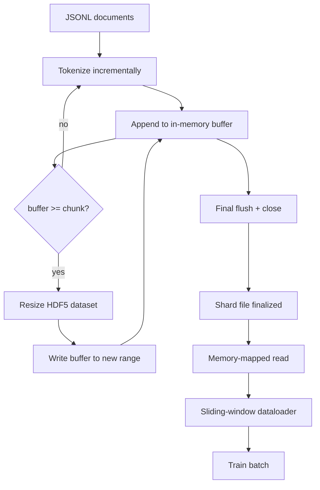

# Korpus Ter-tokenisasi HDF5

> Korpus hasil unduhan harus mendarat dalam tata letak yang bisa di-stream trainer pada kecepatan penuh. JSONL di disk tidak bertahan dari 16 pekerja dataloader. HDF5 dengan dataset integer yang bisa di-resize dan di-chunk bertahan. Pelajaran ini membangun tokenisasi streaming ke dalam dataset HDF5 yang bisa di-resize, penulisan ber-shard lintas beberapa file, pembacaan memory-mapped saat training, dan dataloader jendela-geser yang menghasilkan sekuens panjang tetap dengan packing yang tepat.

**Type:** Build
**Languages:** Python
**Prerequisites:** Phase 19 lessons 30-37
**Time:** ~90 minutes

## Tujuan Pembelajaran

- Stream dokumen ke dataset integer HDF5 yang bisa di-resize dengan chunking yang deterministik.
- Sebarkan penulisan ke beberapa file HDF5 supaya kegagalan terbatas dan parallelism dimungkinkan.
- Baca token kembali lewat tata letak chunked HDF5 yang ditopang page cache supaya dataloader hanya menyalin ke batch buffer pada saat batch.
- Implementasikan dataloader jendela-geser yang mengeluarkan sekuens training panjang tetap dengan aturan packing eksplisit.

## Masalahnya

Run training language model modern membaca token pada ratusan ribu sampel per detik di lusinan pekerja. JSONL di disk mati pada page fault cold-cache pertama: parser JSON-nya lambat, batas dokumen tidak bisa dialamatkan, dan melompat ke "sampel 4,217,884" menuntut pemindaian seluruh file. Bahkan Parquet, yang mengompresi dengan baik, kurang cocok karena trainer tidak ingin kolom; trainer ingin aliran token datar dengan akses acak O(1).

HDF5 cocok karena menawarkan dataset yang di-chunk, bisa di-resize, khusus integer, yang chunk-nya ramah page cache saat dibaca. Trainer meminta irisan `tokens[3,200,000 : 3,200,8192]` dan HDF5 menyalin hyperslab yang diminta dari page cache ke array NumPy yang baru dialokasikan. Biayanya satu handle file terbuka dan jejak page cache seukuran chunk per pekerja, yang tidak berarti dibanding biaya dekode JSONL.

Masalah build-nya adalah membuat sisi tulis menjadi jujur. Dataset yang bisa di-resize mudah disalahgunakan: menulis satu dokumen demi satu membuat file HDF5 terfragmentasi sampai tidak terpakai. Menulis semua dokumen dalam satu resize membuat kematian proses kehilangan seluruh shard. Disiplin yang benar adalah buffer-lalu-extend, dengan ukuran buffer yang cocok dengan ukuran chunk, dan penulisan ber-shard yang membagi beban kerja ke beberapa file supaya crash kehilangan paling banyak satu shard.

## Konsepnya



### HDF5 yang bisa di-resize, versi benar

Dataset token dibuat dengan `maxshape=(None,)` dan `chunks=(chunk_size,)` yang tetap. Penulisan berjalan dengan men-buffer token dalam array NumPy berpanjang `chunk_size`. Saat buffer penuh, dataset di-resize tepat sebesar `chunk_size` dan buffer ditulis ke rentang baru itu. Di akhir shard, buffer sisa ditulis ke rentang parsial terakhir. Setiap penulisan kontigu dan sejajar chunk kecuali yang terakhir, yang pembacanya disuruh memotong pada `token_count` yang tercatat di atribut HDF5 shard.

### Penulisan ber-shard

Satu file HDF5 adalah satu titik kegagalan. Pipeline menulis shard secara paralel: setiap shard input dari Phase 19 pelajaran 42 menghasilkan satu shard output HDF5. Indeks `shards.json` mencatat, per shard, path file, jumlah token, jumlah dokumen, dan sebuah sha256 di atas token-nya. Trainer membaca `shards.json` untuk menghitung offset global dan memvalidasi korpus.

### Pembacaan memory-mapped

Saat training, setiap pekerja membuka bagiannya dari file-file HDF5 dalam mode `swmr=True` dan meminta `tokens[start:stop]`. Tata letak chunk HDF5 membuatnya menjadi pembacaan yang ditopang page cache begitu chunk-nya panas. Pekerja tersebut tidak pernah mewujudkan seluruh file: irisannya disalin ke batch buffer dataloader, yang lalu disalin trainer ke tensor training pinned-memory pada saat batch. Hot path punya satu syscall per transisi chunk; sisanya akses RAM.

### Dataloader jendela-geser

Dataloader adalah satu-satunya tahap yang tahu soal panjang sekuens training. Ia memilih indeks acak di aliran token global, membaca `window_size + 1` token, dan mengembalikan `(input, target) = (tokens[:-1], tokens[1:])`. Batas dokumen tidak dipaksa: sebuah jendela bisa membentang dua dokumen, dengan `boundary_token_id` eksplisit di antaranya supaya model belajar memakai pemisah itu. Inilah aturan packing standar; ini juga aturan yang sering dilupakan pemula, sehingga ia berakhir dengan korpus yang 8 persen token batas training dan 92 persen teks alami.

```figure
cc-hdf5-corpus
```

## Bangun Sendiri

`code/main.py` mengimplementasikan:

- `Tokenizer` - tokenizer byte-level deterministik yang cukup baik untuk demo. Antarmukanya `encode(text) -> list[int]` dan `vocab_size`.
- `HDF5ShardWriter` - membuka dataset integer yang bisa di-resize, men-buffer token sampai ukuran chunk, me-resize dan menulis dengan stride berukuran tetap, mencatat `token_count` dan `sha256` sebagai atribut HDF5 saat ditutup.
- `ShardedTokenizationPipeline` - mengiterasi dokumen input, mengarahkannya ke writer, dan menghasilkan indeks `shards.json`.
- `MmapTokenStore` - membuka file shard untuk pembacaan memory-mapped, menghitung offset global, dan mengekspos satu API `get_slice(start, stop)`.
- `SlidingWindowDataloader` - memilih jendela acak dari aliran global dan me-yield array NumPy `(input_ids, target_ids)`.

Demo di bagian bawah file membangun korpus mini di memori, mentokenisasi ke dua shard, membukanya lewat memory map, menjalankan dataloader selama 10 batch, lalu mencetak shape per batch dan sebuah checksum.

Jalankan:

```bash
python3 code/main.py
```

Skrip keluar dengan kode nol dan mencetak checksum batch.

## Pola Produksi

Empat pola menskalakan pelajaran ini ke run training nyata.

**Ukuran chunk sama dengan pembacaan tipikal.** Trainer membaca `window_size + 1` token per sampel. Setel chunk HDF5 ke kelipatan `window_size` dan pembacaannya sejajar page cache. Chunk yang tidak cocok memangkas throughput separuh karena setiap sampel menyentuh dua chunk.

**Jumlah token di atribut, bukan di dataset.** Irisan ekor dataset bisa terisi sebagian karena ukuran chunk tidak membagi batas dokumen. Simpan `token_count` yang sebenarnya sebagai atribut HDF5 pada dataset dan suruh pembacanya memotong pada nilai itu. Tanpa ini, pembacanya melangkah melewati akhir ke token ber-padding nol dan model belajar memprediksi nol.

**sha256 ber-shard dengan verifikasi paralel.** Setiap shard punya sha256 sendiri di atas byte token-nya. Trainer bisa memverifikasi semua shard secara paralel sebelum training dimulai. sha256 yang salah membuat run gagal lebih awal, bukan pada epoch ketiga setelah enam belas jam.

**`swmr=True` di kedua sisi, dengan `libver="latest"` di writer.** Mode Single-Writer-Multiple-Reader menuntut writer membuka dengan `libver="latest"`, membuat setiap dataset di muka, lalu menyetel `file.swmr_mode = True`. Setelah itu writer harus memanggil `dataset.flush()` setiap kali resize supaya pekerja pembaca (yang dibuka dengan `swmr=True`) melihat data yang konsisten. Melewatkan `libver="latest"` atau mengaktifkan SWMR setelah perubahan struktural adalah sumber kegagalan "file is locked" yang umum.

## Gunakan

Pola produksi:

- **Satu HDF5 per shard sumber.** Downloader (pelajaran 42) mengeluarkan satu shard per URL; tokenisasi (pelajaran ini) mengeluarkan satu HDF5 per shard sumber. Pemetaan 1:1 membuat resume dan pemulihan kegagalan parsial jadi mudah.
- **Boundary token id.** Token batas adalah bagian dari vocab tokenizer dan satu-satunya token yang disuntikkan dataloader. Loss training mem-mask token batas jika model memang seharusnya mengabaikannya; kalau tidak, model belajar memakainya sebagai pemisah sekuens.
- **`shards.json` sebagai sumber kebenaran.** Menambahkan shard baru berarti menulis HDF5-nya, menghitung sha256-nya, dan menambahkan sebuah entri. Trainer membaca file itu sekali saat startup dan tidak pernah menyentuh daftar direktori.

## Rilis

`outputs/skill-hdf5-tokenized-corpus.md` pada proyek nyata akan menjelaskan tokenizer mana yang memberi makan pipeline, ukuran chunk apa yang cocok dengan jendela trainer, di mana `shards.json` berada dalam version control, dan bagaimana pekerja dataloader di-shard lintas file. Pelajaran ini mengirimkan mesinnya.

## Latihan

1. Tambahkan flag `--compression gzip` ke writer HDF5 dan ukur biaya throughput-nya pada korpus demo. Pertahankan default yang kamu pilih.
2. Tambahkan seed deterministik ke dataloader jendela-geser dan verifikasi dua run dengan seed sama menghasilkan batch yang identik.
3. Tambahkan mode `--validate` yang membaca setiap shard, menghitung ulang sha256 di atas token-nya, dan membandingkannya dengan `shards.json`. CI seharusnya menjalankan ini sebelum training dimulai.
4. Bandingkan throughput dataloader pada ukuran chunk yang sama dengan, setengah dari, dan dua kali ukuran jendela. Laporkan efek page cache-nya.
5. Tambahkan flag `--max-document-tokens` yang memotong dokumen sangat panjang pada saat penulihan. Pertahankan trade-off itu dibanding memutuskan saat pembacaan.

## Istilah Kunci

| Term | What people say | What it actually means |
|------|-----------------|------------------------|
| Resizable dataset | "Append-only" | An HDF5 dataset with `maxshape=(None,)` that grows via `resize` calls in chunk-sized strides |
| Chunked layout | "How HDF5 stores it" | Fixed-size on-disk pages that the kernel can memory-map and the dataloader can read contiguously |
| `swmr` mode | "Read-while-write" | Single-Writer-Multiple-Reader mode that lets dataloader workers share the file safely |
| Shard index | "shards.json" | The durable index of all token shards with offsets and content hashes |
| Sliding window | "Training sample" | A fixed-length slice of the global token stream that the trainer pairs with its shift-by-one target |

## Bacaan Lanjutan

- [HDF5 chunking documentation](https://support.hdfgroup.org/documentation/hdf5/latest/hdf5_chunking.html) - tata letak dataset di-chunk dan bisa di-resize yang dipakai pelajaran ini
- [h5py user guide](https://docs.h5py.org/en/stable/) - binding Python untuk HDF5
- [NumPy memory mapping](https://numpy.org/doc/stable/reference/generated/numpy.memmap.html) - primitif sisi baca yang diekspos HDF5 lewat h5py
- Phase 19 · 42 - downloader yang keluarannya ditokenisasi pelajaran ini
- Phase 19 · 44 - jadwal cosine yang memakai dataloader ini
- Phase 19 · 45 - loop AMP yang membungkus langkah training
