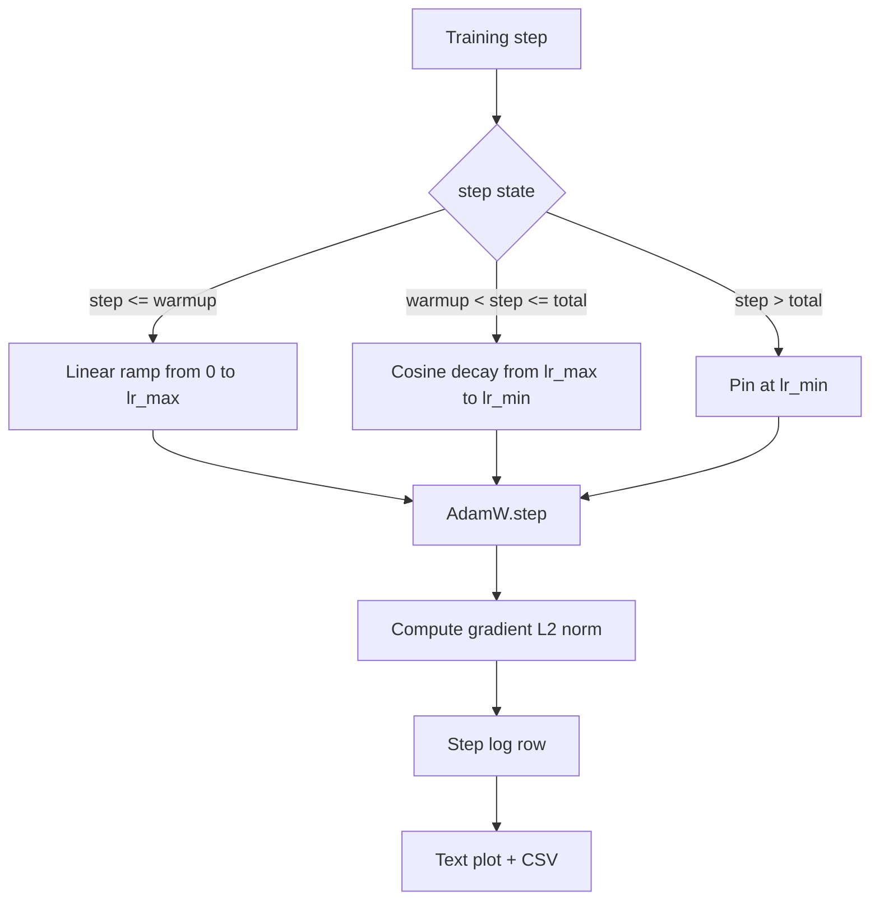

# LR Cosine dengan Warmup Linier

> Jadwal learning rate adalah keputusan kedua terpenting setelah fungsi loss. AdamW dengan cosine decay dan linear warmup adalah default modern untuk training language model karena ia membiarkan model melihat langkah efektif yang kecil selama seribu update pertama yang rapuh, naik ke puncak yang dikonfigurasi, lalu meredam halus kembali ke nol. Pelajaran ini membangun jadwal itu, mengplot kurvanya di atas langkah training, mencatat gradient norm di samping jadwal, dan membuktikan jadwal itu menghormati batas warmup, puncak, dan decay.

**Type:** Build
**Languages:** Python
**Prerequisites:** Phase 19 lessons 30-37
**Time:** ~90 minutes

## Tujuan Pembelajaran

- Implementasikan optimizer AdamW yang tersambung ke jadwal learning rate cosine dengan linear warmup.
- Hitung nilai persis jadwal pada langkah mana pun tanpa drift floating-point antar run.
- Catat norm L2 gradient berdampingan dengan learning rate supaya kesehatan training teramati.
- Render jadwal ke plot teks yang bisa dibaca mata dan CSV yang bisa dikonsumsi alat apa pun.

## Masalahnya

Seribu langkah training pertama paling bising. Bobot model masih dekat dengan inisialisasi. Estimasi second-moment berjalan dari optimizer belum stabil. Norm gradient besar dan berisik. Jika learning rate berada di puncaknya selama update-update ini, model entah divergens total atau mengendap di plateau loss yang tak pernah ia tinggalkan. Dua perbaikan yang terkenal adalah gradient clipping, yang menjadi subjek Phase 19 pelajaran 45, dan jadwal learning rate yang mulai kecil lalu naik.

Jadwal cosine-dengan-warmup punya tiga wilayah. Dari langkah nol sampai langkah `warmup_steps`, learning rate diskalakan linear dari nol ke puncak terkonfigurasi `lr_max`. Dari langkah `warmup_steps` sampai langkah `total_steps`, learning rate mengikuti paruh atas kurva cosine, meredam dari `lr_max` ke `lr_min`. Setelah `total_steps`, learning rate dipatok di `lr_min` supaya trainer yang salah konfigurasi dan melampaui target tidak keluar dari jadwal secara diam-diam.

Masalah build-nya adalah jadwal mudah salah off-by-one. Off-by-one itu muncul enam jam ke dalam run training sebagai learning rate yang 1 persen terlalu tinggi atau terlalu rendah tepat saat model mulai overfit, yang tidak terlihat kecuali jadwal diuji menyeluruh di batas-batasnya.

## Konsepnya



### Rumus warmup

Untuk `step` di `[0, warmup_steps]` dengan `warmup_steps > 0`, learning rate adalah `lr_max * step / warmup_steps`. Kasus degen `warmup_steps = 0` diperlakukan sebagai "tanpa warmup": jadwal langsung mulai di `lr_max` pada langkah nol dan seketika masuk ke cosine decay. Beberapa harness pengujian mengoper `warmup_steps = 0` untuk memeriksa jadwal tetap menghasilkan kurva yang bisa dipakai.

### Rumus cosine

Untuk `step` di `(warmup_steps, total_steps]`, learning rate adalah `lr_min + 0.5 * (lr_max - lr_min) * (1 + cos(pi * progress))` dengan `progress = (step - warmup_steps) / max(1, total_steps - warmup_steps)`. Pada `step = warmup_steps`, cosine dievaluasi ke `cos(0) = 1`, yang menghasilkan `lr_max`, cocok persis dengan titik akhir warmup. Pada `step = total_steps`, cosine dievaluasi ke `cos(pi) = -1`, yang menghasilkan `lr_min`, cocok persis dengan titik akhir decay.

Kesinambungan di kedua titik akhir itu bukan kebetulan. Itulah alasan jadwal diimplementasikan sebagai satu fungsi atas `step`, bukan sebagai tiga fungsi berbeda yang ditempel. Jadwal hasil tempelan kehilangan satu batas sejak pertama kali `lr_max` diubah.

### Floor setelah total steps

Untuk `step > total_steps`, learning rate tetap di `lr_min`. Kontraknya eksplisit: jadwal tidak error dan tidak mengekstrapolasi; ia mematok di floor dan membiarkan trainer mencatat peringatan. Trainer yang perlu memperpanjang training mengubah `total_steps` jadwalnya, bukan loop-nya.

### Pencatatan norm gradient di samping laju

Jadwal adalah separuh dari kesehatan training. Norm gradient adalah separuhnya. Loop training mencatat keduanya per langkah. Run training yang divergen menunjukkan norm gradient melonjak sebelum loss-nya; warmup yang di-tune baik menjaga norm naik linear bersama lajunya; puncak yang terlalu agresif muncul sebagai norm yang tetap tinggi setelah warmup. Dataset di disk berisi `step, lr, grad_l2_norm, loss`. CSV-nya adalah satu-satunya catatan yang tahan lama.

```figure
cap-cosine-warmup
```

## Bangun Sendiri

`code/main.py` mengimplementasikan:

- `CosineWithWarmup` - fungsi tanpa keadaan `lr(step) -> float` atas jadwal yang dikonfigurasi.
- `TrainState` - membungkus model, optimizer `AdamW`, dan jadwal menjadi satu fungsi langkah.
- `TrainState.step` - menjalankan satu forward pass, satu backward pass, mencatat norm L2 gradient, dan menerapkan `lr(step)` ke optimizer.
- `plot_schedule_ascii` - merender jadwal sebagai plot teks yang bisa dibaca mata.
- `write_schedule_csv` - mengeluarkan satu baris per langkah berisi learning rate.

Demo di bagian bawah file membangun model `nn.Linear` mini, melatihnya 20 langkah di atas batch input tetap, lalu mencetak learning rate, norm gradient, dan loss per langkah. Jadwalnya juga dirender sebagai plot teks untuk pemeriksaan visual.

Jalankan:

```bash
python3 code/main.py
```

Skrip keluar dengan kode nol dan mencetak log training per langkah plus plot jadwal.

## Pola Produksi

Empat pola mengangkat jadwal menjadi artefak produksi.

**Jadwal hidup di config, bukan di kode.** Trainer membaca `warmup_steps`, `total_steps`, `lr_max`, `lr_min` dari config YAML atau JSON yang di-commit ke git. Jadwal bisa direproduksi karena config-nya content-addressed; jadwal bisa diaudit karena config-nya bagian dari diff PR.

**Penghitung langkah monoton dan terlepas dari epoch.** Beberapa framework bingung antara step dan epoch saat dataset di-shard atau dataloader restart. Jadwal membaca `global_step` dari checkpoint trainer, bukan dari penghitung lokal. Run yang dilanjutkan berlanjut di posisi jadwal yang benar karena penghitung langkah adalah sumbu yang tahan lama.

**Plot jadwal di direktori run.** Setiap run training menulis `outputs/lr_schedule.png` (atau di pelajaran ini sebuah plot teks) ke direktori run-nya. Peninjau yang menyapu direktori bisa memeriksa kewarasannya tanpa menjalankan ulang apa pun. Ini menangkap kelas bug jadwal salah-konfigurasi di waktu PR.

**Skema baris log tetap.** `step, lr, grad_l2_norm, loss` dalam urutan itu. Notebook atau dashboard downstream membaca skemanya; mengganti nama kolom tanpa menaikkan versi membatalkan setiap dashboard yang ada.

## Gunakan

Pola produksi:

- **Sweep puncak sebelum menyapu apa pun.** `lr_max` adalah kenop paling sensitif. Sapu dulu pada model kecil; `lr_max` optimal berskala lemah terhadap ukuran model, jadi sweep model kecil adalah prior yang kuat.
- **Warmup adalah fraksi dari total langkah, bukan hitungan absolut.** Run 200 juta langkah dengan 2.000 langkah warmup hampir langsung mulai di puncak; run 20.000 langkah dengan angka yang sama hanya warmup 10 persen. Konfigurasikan warmup sebagai fraksi (tipikal: 1-3 persen) supaya jadwal menskalakan diri dengan durasi training.
- **`lr_min` sengaja bukan nol.** Floor yang 10 persen dari `lr_max` membuat optimizer tetap belajar selama ekor panjang. Jadwal dengan `lr_min = 0` menghasilkan kurva training yang tampak bagus di plot dan model yang sebenarnya belum selesai dilatih.

## Rilis

`outputs/skill-cosine-warmup.md` pada proyek nyata akan menjelaskan config mana yang membawa jadwal, langkah trainer mana tempat penghitung global dibaca, dan sweep `lr_max` apa yang menghasilkan nilai yang dideploy. Pelajaran ini mengirimkan mesinnya.

## Latihan

1. Tambahkan varian inverse-square-root dari jadwal dan bandingkan pada run training mainan 200 langkah. Kurva mana yang menghasilkan loss akhir lebih rendah?
2. Tambahkan flag `--restart` yang menambahkan warmup kedua di `total_steps / 2`. Pertahankan apakah warm restart memperbaiki atau merugikan pada run mainan.
3. Tambahkan unit test bahwa jadwal itu kontinu: untuk setiap langkah di `[0, total_steps]`, selisih `|lr(step+1) - lr(step)|` dibatasi oleh `lr_max / warmup_steps`.
4. Sambungkan jadwal ke `torch.optim.lr_scheduler.LambdaLR` supaya bisa dikomposisikan dengan kode framework. Pelajaran ini memakai fungsi langkah biasa; apa yang berubah dari wrapper itu?
5. Tambahkan flag `--plot-png` yang menulis plot sungguhan lewat `matplotlib`. Pertahankan apakah plot teks pelajaran atau PNG yang menjadi default lebih baik untuk run CI.

## Istilah Kunci

| Term | What people say | What it actually means |
|------|-----------------|------------------------|
| Warmup | "Slow start" | Linear ramp from zero to `lr_max` over the first `warmup_steps` updates |
| Cosine decay | "Smooth drop" | Upper-half cosine curve from `lr_max` to `lr_min` over the remaining steps |
| Floor | "After training" | The fixed `lr_min` value the schedule pins at past `total_steps` |
| Gradient norm | "L2 of grads" | The Euclidean norm of the concatenated gradient vector, logged each step |
| Global step | "Schedule axis" | A monotonic step counter that survives restarts and drives the schedule |

## Bacaan Lanjutan

- [Loshchilov and Hutter, SGDR: Stochastic Gradient Descent with Warm Restarts (arXiv 1608.03983)](https://arxiv.org/abs/1608.03983) - paper rujukan jadwal cosine
- [Loshchilov and Hutter, Decoupled Weight Decay Regularization (arXiv 1711.05101)](https://arxiv.org/abs/1711.05101) - paper rujukan AdamW
- [PyTorch torch.optim.lr_scheduler](https://docs.pytorch.org/docs/stable/optim.html#how-to-adjust-learning-rate) - bagaimana fungsi langkah mengkomposisikan diri dengan scheduler framework
- Phase 19 · 42 - downloader yang korpusnya dikonsumsi jadwal ini
- Phase 19 · 43 - dataloader yang berevolusi bersama jadwal ini
- Phase 19 · 45 - gradient clipping dan AMP, lapisan berikutnya dalam loop
