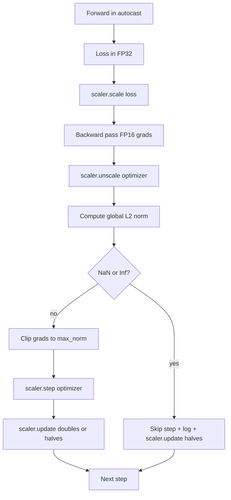

# Gradient Clipping dan Mixed Precision

> Optimizer dan jadwal dari pelajaran sebelumnya mengasumsikan gradient dalam kondisi waras. Biasanya tidak. Satu batch yang buruk bisa melonjakkan norm gradient sebesar tiga orde magnitudo. Training mixed-precision memperparahnya dengan memperkenalkan overflow FP16 di sisi loss. Pelajaran ini membangun dua sabuk pengaman yang tidak bisa dilepas training produksi: gradient clipping ke norm L2 global terkonfigurasi, dan loop mixed-precision dengan autocast dan GradScaler yang mendeteksi NaN dan Inf, melompati langkah dengan bersih, dan mencatat faktor skaling untuk forensik.

**Type:** Build
**Languages:** Python
**Prerequisites:** Phase 19 lessons 30-37
**Time:** ~90 minutes

## Tujuan Pembelajaran

- Hitung norm L2 global di atas seluruh gradient parameter dan clip di tempat saat melebihi ambang terkonfigurasi.
- Bungkus langkah training dengan autocast plus GradScaler supaya forward dan backward pass FP16 selamat dari overflow.
- Deteksi NaN dan Inf pada loss atau gradient, lewati langkah optimizer, dan catat lompatannya.
- Laporkan faktor skaling GradScaler setiap langkah supaya rangkaian lompatan panjang langsung terlihat.

## Masalahnya

Run training yang kemarin berjalan mulus menghasilkan kurva loss yang mendadak vertikal di langkah 8.217. Pelakunya adalah satu batch yang norm gradient-nya 4.200, dua puluh kali puncak sebelumnya. Tanpa clipping, optimizer menerapkan langkah yang mereset semua yang sudah dipelajari model selama jam sebelumnya. Dengan clipping L2 global di norm 1.0, batch yang sama menyumbang update bernorm satuan; loss tetap di garis trennya; run selamat.

Training mixed-precision mendorong throughput 2-3x dengan menghitung forward pass dan sebagian besar backward pass dalam FP16. Harganya adalah FP16 punya rentang eksponen sempit. Gradient tipikal yang overflow di FP16 terevaluasi ke Inf, yang merambat ke layer berikutnya sebagai NaN, yang menyetel setiap bobot ke NaN di langkah optimizer berikutnya. GradScaler PyTorch memecahkannya dengan mengalikan loss dengan faktor skaling besar sebelum backward pass dan membagi gradient dengan faktor yang sama sebelum langkah optimizer. Jika ada gradient Inf atau NaN saat waktu unscale, scaler melewati langkah itu dan membagi dua faktor skalingnya; jika N langkah sebelumnya bersih, scaler mengalikan dua fakturnya. Sepanjang training, faktor itu menemukan nilai tertinggi yang diizinkan rentang FP16.

Masalah build-nya adalah menyambung keduanya dengan benar. Clip sebelum unscale dan ambangnya berlaku pada gradient yang sudah di-scale; clip setelah unscale dan urutan operasi pada GradScaler jadi menentukan. Urutan yang benar adalah: `scaler.scale(loss).backward()`, lalu `scaler.unscale_(optimizer)`, lalu `clip_grad_norm_`, lalu `scaler.step(optimizer)`, lalu `scaler.update()`. Urutan apa pun menghasilkan loop yang rusak diam-diam.

## Konsepnya



### Norm L2 global

Norm L2 global adalah norm Euklides dari vektor gradient yang digabung, bukan norm per-parameter. PyTorch mengimplementasikannya sebagai `torch.nn.utils.clip_grad_norm_(parameters, max_norm)`. Fungsi itu mengembalikan norm sebelum clip sehingga pelajaran bisa mencatat nilai alami maupun nilai hasil clip, yang diperlukan untuk diagnosis "kita melakukan clipping di setiap langkah".

### autocast dan GradScaler

`torch.amp.autocast(device_type)` adalah context manager yang menjalankan operasi yang memenuhi syarat (kebanyakan operasi kelas matmul) secara selektif dalam FP16. `torch.amp.GradScaler(device_type)` adalah helper yang men-scale loss sebelum backward dan meng-inversi-scale gradient sebelum langkah optimizer. Keduanya dirancang bersama; memakai salah satu tanpa yang lain adalah kesalahan konfigurasi yang seharusnya ditangkap oleh tes.

Pelajaran ini memakai CPU autocast karena itulah yang berjalan di CI; pola yang sama berpindah verbatim ke CUDA dengan mengubah `device_type="cpu"` menjadi `device_type="cuda"`. GradScaler pada CPU adalah stub (autocast CPU memang sudah beroperasi dalam BF16 secara default dan tidak butuh loss scaling), tetapi pelajaran tetap menyertakan situs pemanggilannya supaya penyambungannya identik dengan loop GPU.

### Deteksi NaN dan Inf

Deteksinya terjadi di dua tempat. Pertama, loss-nya sendiri diperiksa dengan `torch.isfinite` sebelum backward; loss Inf atau NaN tidak menghasilkan gradient yang berguna dan dilompati tanpa masuk ke optimizer. Kedua, setelah `scaler.unscale_(optimizer)`, pelajaran memindai gradient yang sudah di-unscale dengan `has_non_finite_grad(...)` dan memperlakukan Inf atau NaN apa pun sebagai lompatan. Dua pemeriksaan bersama menutupi mode kegagalan forward-pass maupun backward-pass.

### Diagnostika faktor skaling

Faktor skaling adalah keadaan internal GradScaler. Setiap langkah pelajaran membaca `scaler.get_scale()` dan mencatatnya di samping learning rate dan norm gradient. Run yang sehat menunjukkan faktor skaling naik dalam pangkat dua sampai jenuh di sekitar `2^17` atau `2^18`. Bermasalah, faktornya berayun antara nilai tinggi dan rendah, yang merupakan tanda bahwa gradient model kadang di dalam rentang dan kadang tidak. Diagnostik ini tidak terlihat tanpa pencatatan.

```figure
grad-clip-monitor
```

## Bangun Sendiri

`code/main.py` mengimplementasikan:

- `clip_global_l2_norm` - pembungkus di sekitar `torch.nn.utils.clip_grad_norm_` yang mengembalikan norm sebelum dan sesudah clip.
- `has_non_finite_grad` - helper yang memindai gradient untuk NaN dan Inf.
- `AmpTrainState` - membungkus model, optimizer `AdamW`, GradScaler, dan sebuah perangkat autocast. Mengekspos `step(inputs, targets)` yang menjalankan pipeline clipping, scaling, dan skip-on-NaN lengkap.
- `StepLog` dan `SkipLog` - catatan per langkah yang terstruktur.
- Demo yang melatih model `nn.Linear` kecil selama 20 langkah, menyuntikkan sebuah Inf ke gradient pada langkah 5 untuk menguji jalur skip, dan mencetak log yang dihasilkannya.

Jalankan:

```bash
python3 code/main.py
```

Skrip keluar dengan kode nol dan mencetak log per langkah di mana setiap baris ditandai `STEP` atau `SKIP`; setidaknya satu baris adalah `SKIP`.

## Pola Produksi

Empat pola mengangkat loop menjadi langkah training produksi.

**Penghitung lompatan sebagai peringatan, bukan baris log.** Segelintir langkah terlewat per run training itu sehat. Ratusan lompatan per epoch adalah peringatan keras: model berada di rezim yang tidak bisa dipegang FP16 dan loop gagal diam-diam. Pelajaran melacak laju lompatan bergulir 1.000 langkah dan pada produksi akan mem-paging saat laju di atas 5 persen.

**Ambang clip hidup di config.** `max_norm = 1.0` adalah default modern untuk training language model. Sapu dulu pada model kecil; ambang yang lebih besar membiarkan model pulih dari batch yang memang sulit; ambang yang lebih kecil membatasi kasus terburuk dengan harga kurva loss yang lebih berisik. Ambang itu berada di config YAML atau JSON yang sama dengan jadwal dari pelajaran 44.

**Log norm masuk ke CSV bersama jadwal.** Kolom CSV adalah `step, lr, grad_l2_pre_clip, grad_l2_post_clip, loss, skipped, skip_reason, scaler_scale`. Peninjau yang membuka file itu melihat jadwal, cerita gradient, faktor skaling, dan hasil lompatan (beserta alasannya) dalam satu baris. Membagi kolom-kolom ke beberapa file adalah resep untuk analisis yang tidak sejajar.

**`scaler.update()` berjalan setiap langkah, termasuk saat skip.** Pada langkah bersih, scaler membaca penghitung no-inf-nya, menambahkannya, dan mungkin mengalikan dua faktornya. Pada langkah yang terlewat, scaler membagi dua faktornya dan mereset penghitungnya. Lupa `update()` di jalur skip adalah bug yang menghasilkan "faktor skalingnya tidak pernah berubah".

## Gunakan

Pola produksi:

- **Perangkat autocast cocok dengan perangkat optimizer.** `torch.amp.autocast(device_type="cuda")` untuk training GPU; `torch.amp.autocast(device_type="cpu")` untuk CPU. Mencampur perangkat menghasilkan kesalahan tipe diam-diam yang muncul sebagai kurva loss yang tampak baik tetapi model yang tidak belajar.
- **Cek loss sebelum backward.** `torch.isfinite(loss).all()` adalah satu reduksi tensor; biayanya bisa diabaikan dan penghematannya pada loss NaN adalah seluruh langkah training. Selalu jalankan.
- **`set_to_none=True` di `zero_grad`.** Menyetel gradient ke `None` alih-alih nol, yang membiarkan optimizer melewati komputasi untuk kelompok parameter yang tidak terpengaruh. Pengaturan itu adalah peningkatan throughput gratis dan sedikit pengurangan permukaan bug.

## Rilis

`outputs/skill-clip-amp.md` pada proyek nyata akan menjelaskan ambang clip dan perangkat autocast apa yang dipakai langkah training, di mana CSV per langkah berada dalam version control, dan berapa ambang peringatan laju-lompatan produksi. Pelajaran ini mengirimkan mesinnya.

## Latihan

1. Ganti penyuntikanan Inf sintetis dengan spike loss sungguhan (kalikan target satu batch dengan 1e8) dan verifikasi jalur skip terpicu.
2. Tambahkan mode `--bf16` yang mengalihkan autocast ke BF16 alih-alih FP16. BF16 punya rentang eksponen lebih luas daripada FP16 dan jarang butuh loss scaling; verifikasi laju lompatan turun ke nol pada demo yang sama.
3. Tambahkan unit test bahwa pembungkus gradient-clip mengembalikan norm sebelum dan sesudah clip dengan benar saat tidak terjadi clipping.
4. Tambahkan komputasi laju-lompatan jendela bergulir dan sebuah flag CLI yang menggagalkan run jika lajunya melebihi ambang terkonfigurasi selama 100 langkah berturut-turut.
5. Sambungkan loop untuk menulis CSV kanonik (`step, lr, grad_l2_pre_clip, grad_l2_post_clip, loss, skipped, skip_reason, scaler_scale`) dan pastikan file itu bertahan dari Ctrl-C dengan flush setelah setiap baris.

## Istilah Kunci

| Term | What people say | What it actually means |
|------|-----------------|------------------------|
| Global L2 norm | "Clip target" | Euclidean norm of the concatenated gradient vector across all trainable parameters |
| autocast | "Mixed precision" | Selective FP16 (or BF16) execution of eligible operations inside a `with` block |
| GradScaler | "Loss scaler" | Helper that multiplies the loss before backward and inverse-scales gradients before the optimizer step |
| Skip | "Bad step" | An optimizer step refused because the gradient or loss was non-finite; the scaler halves the factor |
| Scaling factor | "Scaler state" | The GradScaler's current multiplier; doubles after clean stretches and halves on every skip |

## Bacaan Lanjutan

- [Micikevicius et al., Mixed Precision Training (arXiv 1710.03740)](https://arxiv.org/abs/1710.03740) - proposal loss scaling asli
- [Pascanu, Mikolov, Bengio, On the difficulty of training recurrent neural networks (arXiv 1211.5063)](https://arxiv.org/abs/1211.5063) - paper rujukan gradient clipping
- [PyTorch torch.amp.GradScaler](https://docs.pytorch.org/docs/stable/amp.html) - API scaler yang dibungkus pelajaran ini
- [PyTorch torch.nn.utils.clip_grad_norm_](https://docs.pytorch.org/docs/stable/generated/torch.nn.utils.clip_grad_norm_.html) - primitif clipping yang dipakai pelajaran ini
- Phase 19 · 42 - downloader yang korpusnya memberi makan loop ini
- Phase 19 · 43 - dataloader yang dikonsumsi loop ini
- Phase 19 · 44 - jadwal yang dikomposisikan loop ini
