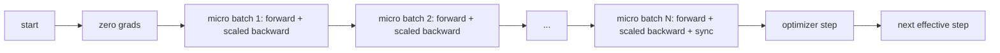
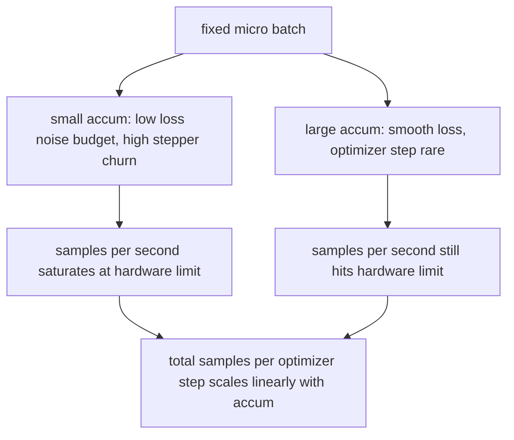

# Gradient Accumulation

> Latih pada effective batch yang tidak mampu kamu beli, satu micro-batch demi satu micro-batch. Skalakan loss, tahan langkah optimizer, dan biarkan gradient menumpuk.

**Type:** Build
**Languages:** Python
**Prerequisites:** Phase 19 lessons 42 to 45
**Time:** ~90 minutes

## Tujuan Pembelajaran

- Turunkan identitas effective batch: `effective_batch = micro_batch * accum_steps`.
- Implementasikan scaling loss-per-micro-batch supaya gradient terakumulasi cocok dengan satu backward full-batch.
- Tunda sinkronisasi optimizer sampai micro-batch terakhir (sync-on-last-step).
- Baca kurva throughput terhadap effective batch dan jelaskan diminishing return-nya.

## Masalahnya

Kamu ingin melatih pada effective batch 512 karena kurva loss-nya lebih halus dan langkah optimizer lebih masuk akal pada skala itu. Akselerator di meja kamu menampung 32 contoh sebelum kehabisan memori. Menggandakan batch bukan pilihan. Membagi dua model bukan pilihan. Trik yang dipakai bidang ini sejak 2017 dan tak pernah berhenti dipakai adalah menjalankan 16 backward pass, membiarkan gradient menumpuk di dalam buffer parameter, dan hanya melangkah optimizer saat hitungannya mencapai target.

Risikonya adalah loss-nya tidak lagi angka yang sama seperti pada batch yang lebih besar. Cross entropy dari 16 mini-batch yang dijumlahkan secara naif adalah 16 kali loss satu full batch. Tanpa scaling, arah gradient benar tetapi magnitudunya salah, dan langkah optimizer 16 kali terlalu besar. Perbaikannya satu pembagian. Perbaikannya juga mudah dilupakan.

## Konsepnya



Kontraknya pendek:

- Loss untuk setiap micro-batch dibagi `accum_steps` sebelum `backward()`. Secara default PyTorch menjumlahkan gradient ke `param.grad`; pembagian itu mengembalikan penjumlahan berjalan ke skala yang benar.
- Langkah optimizer menyala sekali per effective batch, setelah backward micro-batch terakhir. Melangkah di tengah akumulasi miringkan setiap parameter yang diandalkan sisa run.
- Keadaan optimizer (buffer momentum, momen Adam) maju sekali per effective step, bukan sekali per micro-batch. Jika tidak, exponential moving average melihat frekuensi yang salah dan membakar habis jadwalnya.
- Pada satu perangkat ini hanya pembukuan. Pada cluster multi-rank, pola yang sama membungkus micro-batch bukan-terakhir dalam konteks `no_sync` yang melewatkan all-reduce gradient; micro-batch terakhir mereduksi seluruh gradient terakumulasi dalam satu pass alih-alih membayar biaya jaringan N kali.

### Bukti ekuivalensinya dalam kode

```python
loss = criterion(model(x_full), y_full)
loss.backward()
opt.step()
```

setara dengan

```python
for x, y in chunks(x_full, y_full, n):
    scaled = criterion(model(x), y) / n
    scaled.backward()
opt.step()
```

sampai pada urutan penjumlahan floating-point. Buffer gradient terakumulasi di akhir loop adalah tensor yang sama dengan yang dihasilkan satu backward full-batch. Kode pelajaran mengasersikan ini dengan selisih max-abs di bawah 1e-4 dalam `equivalence_check`.

### Ke mana biayanya pergi

Setiap micro-batch berharga satu forward dan satu backward. Dengan akumulasi kamu menukar memori dengan waktu. Kurva throughput di `outputs/accum-curve.json` menunjukkan apa yang terjadi saat effective batch tumbuh dengan micro-batch tetap:



Tidak ada makan siang gratis. Menggandakan `accum_steps` menggandakan waktu dinding per langkah optimizer. Yang berubah adalah variansi dari estimasi gradient: dengan anggaran dinding yang sama kamu melakukan lebih sedikit langkah optimizer tetapi masing-masing dirata-ratakan di atas lebih banyak sampel. Literatur memperlakukan batch besar dan batch kecil sebagai masalah optimisasi yang berbeda; pelajaran di sini bersifat mekanis, bukan statistis.

```figure
cc-grad-accumulation
```

## Bangun Sendiri

`code/main.py` adalah artefak yang bisa dijalankan. Ia melakukan tiga hal.

### Langkah 1: pemeriksaan ekuivalensi

`equivalence_check()` membangun dua salinan jaringan yang sama dengan seed yang sama. Satu melihat batch 16 sampel dalam satu forward pass. Yang lain melihat empat chunk 4 sampel dengan loss dibagi empat. Fungsi itu membandingkan buffer gradient sebelum langkah optimizer dan parameter sesudahnya. Asersinya adalah `max_abs_diff < 1e-4`.

### Langkah 2: pola sync-on-last-step

`train_one_optimizer_step` menelusuri micro-batch. Untuk setiap micro-batch kecuali yang terakhir, ia masuk `no_sync_context(model)`. Pada satu proses, konteks itu no-op; pada DDP, di sinilah all-reduce gradient dilewatkan. Pembukuannya sama apa pun kondisinya. Sebuah `sync_counter` mencatat berapa kali kita keluar dari cakupan no_sync; untuk N micro-batch, hitungannya satu per effective step, bukan N.

### Langkah 3: kurva throughput

`sweep_effective_batches` menjalankan model yang sama dengan micro-batch tetap dan daftar langkah akumulasi. Untuk setiap pengaturan, ia mencatat:

- `samples_per_sec`: total sampel yang dilihat dibagi waktu dinding
- `median_step_ms`: persentil ke-50 per effective step
- `sync_calls`: titik kolektif yang dipakai
- `avg_loss`: rata-rata di seluruh langkah optimizer sweep

Keluarannya mendarat di `outputs/accum-curve.json` dan bisa dipakai ulang dari notebook.

Jalankan:

```bash
python3 code/main.py
```

Skrip mencetak selisih ekuivalensi, lalu tabel sweep, lalu path JSON. Kode keluar nol.

## Gunakan

Dalam training produksi, gradient accumulation hidup di balik satu kenop. Pola PyTorch adalah `accumulation_steps = effective_batch // (micro_batch * world_size)`. Framework yang tidak boleh kamu pakai di sini membungkus loop yang sama, tetapi langkah-langkahnya identik: skalakan loss, lewati sync pada micro non-terakhir, akumulasikan, langkah sekali.

Tiga pola di lapangan:

- Ukuran micro-batch dipilih untuk memenuhi memori perangkat. Apa pun yang lebih kecil membuang siklus akselerator. Apa pun yang lebih besar crash.
- Effective batch dipilih dari jadwal learning rate. Effective batch besar butuh learning rate yang diskalakan dan warmup; inilah aturan linear scaling yang dibicarakan sejak 2017.
- Jumlah akumulasi adalah jembatan antara keduanya dan satu-satunya kenop yang bebas kamu setel saat runtime tanpa menulis ulang data loader.

## Rilis

`outputs/skill-gradient-accumulation.md` menangkap resepnya supaya rekan bisa menjatuhkannya ke repo baru: skalakan loss dengan `accum_steps`, lewati sinkronisasi optimizer pada micro non-terakhir, langkah optimizer sekali per effective batch, dan catat throughput terhadap effective batch sebagai JSON supaya trade-off-nya terlihat.

## Latihan

1. Jalankan ulang sweep dengan `--num-steps 100` dan plot sampel per detik terhadap effective batch. Di mana kurvanya mendatar?
2. Tambahkan varian scaling yang salah (tanpa pembagian) dan tunjukkan selisih parameter pada langkah 1 dibanding referensi.
3. Tukar SGD dengan AdamW dan konfirmasikan keadaan optimizer maju sekali per effective step, bukan sekali per micro-batch.
4. Perkenalkan pembungkus `DistributedDataParallel` sungguhan dan arahkan `no_sync_context` ke metodenya. Konfirmasikan sync_calls turun N-1 per effective batch.
5. Ubah pemeriksaan ekuivalensi untuk membandingkan dua split micro yang berbeda (2 kali 8 vs 4 kali 4) dan jelaskan toleransi apa pun yang longgar yang kamu butuhkan.

## Istilah Kunci

| Term | What people say | What it actually means |
|------|-----------------|------------------------|
| Micro batch | The batch you forward | The slice that fits in memory in a single forward pass |
| Accum steps | Backward passes per step | Number of backwards summed before one optimizer step |
| Effective batch | The batch | Micro batch times accum steps times data parallel world size |
| Loss scaling | Divide by N | Per-micro-batch division so summed gradients match full batch |
| Sync on last | Skip the rest | Only run the gradient collective on the last backward in the window |

## Bacaan Lanjutan

- Dokumentasi PyTorch tentang `DistributedDataParallel.no_sync` untuk versi produksi dari trik sync-on-last-step.
- Goyal et al., 2017, tentang linear scaling untuk training batch besar, alasan kanonis untuk peduli pada effective batch.
- Pelacakan issue PyTorch tentang interaksi gradient accumulation dengan unscaling mixed precision.
- Phase 19 pelajaran 42 sampai 45 mencakup model, data loader, optimizer, dan kerangka trainer yang diasumsikan pelajaran ini.
- Phase 19 pelajaran 47 mencakup checkpoint dan resume supaya run akumulasi panjang selamat dari batas wallclock.
