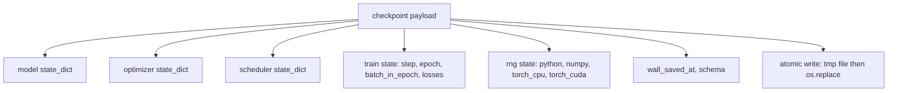
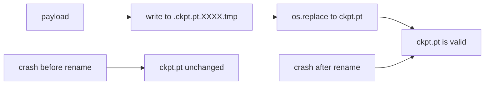
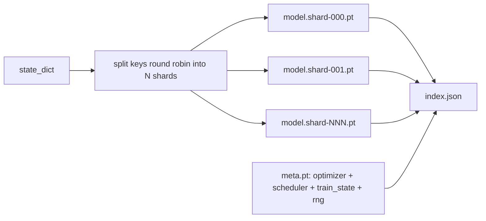

# Checkpoint Save dan Resume

> Interrupt training membunuh run; checkpoint membiarkannya lanjut. Simpan model, optimizer, scheduler, riwayat loss, penghitung langkah, dan keadaan RNG secara atomik, supaya kill di momen mana pun meninggalkan file yang valid di disk.

**Type:** Build
**Languages:** Python
**Prerequisites:** Phase 19 lessons 42 to 45
**Time:** ~90 minutes

## Tujuan Pembelajaran

- Tangkap seluruh keadaan training ke dalam satu payload yang bisa dimuat ulang ke proses segar.
- Implementasikan save atomik dengan tulis-ke-temp lalu rename supaya crash tidak pernah meninggalkan file setengah-tulis.
- Pulihkan keadaan RNG untuk Python, NumPy, dan PyTorch supaya loss setelah resume cocok dengan baseline yang tidak terputus.
- Bangun tata letak checkpoint ber-shard untuk model yang sudah tidak muat dalam satu file, dengan shard yang diverifikasi hash dan indeks JSON.

## Masalahnya

Kamu menjadwalkan job training 18 jam. Batas wallclock-nya 4 jam. Cluster reboot di jam ke-11 karena seseorang di atasmu menyetujui upgrade kernel. Tanpa checkpoint, kamu mulai dari nol. Tanpa resume, kamu juga kehilangan keadaan optimizer yang butuh 11 jam pertama untuk dipelajari, jadi meski bobot model selamat, momen AdamW-nya hilang dan langkah berikutnya tersentak ke arah yang sudah ditinggalkan trajektori training.

Artefak yang benar adalah satu file yang berisi semua yang diperlukan untuk melanjutkan: parameter model, keadaan optimizer, keadaan scheduler, riwayat loss untuk plot, penghitung langkah dan epoch dan batch-in-epoch saat ini, serta keadaan RNG untuk setiap sumber keacakan. Tanpa keadaan RNG, kurva loss setelah resume adalah kurva yang berbeda. Model sama, data sama, shuffle beda, mask dropout beda, angka di dashboard berbeda.

Save atomik adalah separuh kontrak yang lain. Menulis ke nama file final berarti crash di tengah penulisan meninggalkan file yang rusak; resume membaca sampah. Menulis ke file sementara di direktori yang sama lalu me-rename berarti crash di tengah penulisan meninggalkan file lama yang baik tanpa tersentuh. Rename bersifat atomik pada sistem file POSIX.

## Konsepnya



### Lima ember keadaan

| Bucket | Why it matters |
|--------|----------------|
| Model | Weights and buffers; what the model is. |
| Optimizer | Momentum and adaptive moments; without these the next step is a different optimization problem. |
| Scheduler | Where the learning rate is on its curve; cosine schedules in particular care. |
| Train counters | Step, epoch, batch-in-epoch, plus the loss history that draws the dashboard. |
| RNG state | Determinism for dropout, data shuffling, and any sampling inside the model. |

### Save atomik



Dua aturan. Pertama, file sementara hidup di direktori yang sama dengan target supaya rename tetap berada dalam sistem file yang sama; rename lintas perangkat bukan atomik. Kedua, nama sementara unik per percobaan supaya dua penulis tidak saling menginjak.

### Checkpoint ber-shard

Saat model membesar, payload satu file menjadi terlalu besar untuk dimuat cepat, terlalu besar untuk diperiksa, dan terlalu menyakitkan ketika share jaringan tersendat di tengah pembacaan. Perbaikannya adalah memecah keadaan parameter menjadi shard dan menulis indeks kecil yang menautkan semuanya.



Indeks mencatat jumlah shard, sha256 setiap shard, dan sha256 dari file meta. Loader gagal dengan keras saat ada hash yang tidak cocok. Shard-shard bisa mendarat di disk fisik yang berbeda; meta-nya kecil dan dibaca lebih dulu.

### Resume lanjut di tengah epoch

Resume yang melompat ke awal epoch berikutnya membuang waktu mulai dari menit sampai sehari. Perbaikannya adalah `(epoch, batch_in_epoch)` plus keadaan RNG. Setelah dimuat, loop training memajukan cepat generator angka acak melewati batch yang sudah dikonsumsi di epoch berjalan dan melanjutkan dari `batch_in_epoch`. Kode pelajaran melakukan ini persis; asersinya adalah trajektori loss setelah resume cocok dengan baseline yang tidak terputus dalam selisih 1e-4.

```figure
cc-atomic-checkpoint
```

## Bangun Sendiri

`code/main.py` menyediakan empat primitif dan sebuah driver demo.

### Langkah 1: tangkap dan pulihkan keadaan RNG

`capture_rng_state` mengembalikan dict berisi `random.getstate` Python, `np.random.get_state` NumPy, dan byte RNG CPU serta CUDA PyTorch. Setiap bagian disimpan sebagai angka, tuple, dan list Python biasa (array kunci NumPy melalui `tolist()`), supaya loader di Langkah 3 bisa membacanya kembali tanpa unpickle objek sembarangan. `restore_rng_state` membalikkannya. Tensor CPU adalah buffer byte uint8 yang RNG PyTorch tahu cara mengonsumsinya.

### Langkah 2: save atomik

`atomic_save` menulis payload ke file temp di direktori target, lalu `os.replace` menukarnya ke nama final. `atomic_write_json` melakukan hal yang sama untuk indeks ber-shard.

### Langkah 3: round trip checkpoint penuh

`save_checkpoint` mengemas model, optimizer, scheduler, train state, dan RNG ke dalam satu dict. `load_checkpoint` membalikkannya dan mengembalikan sebuah `TrainState`. Field schema adalah kait peningkatan: perubahan format di masa depan menaikkan string versi dan loader meng dispatch.

`load_checkpoint` memanggil `torch.load(..., weights_only=True)`. File `.pt` adalah pickle, dan unpickle file yang tidak tepercaya dengan `weights_only=False` menjalankan kode apa pun yang disebut file itu. Loader weights-only menerima tensor dan kontainer primitif serta menolak sisanya, itulah sebabnya Langkah 1 menyimpan keadaan RNG dalam list biasa. Pemeriksaan integritas menaikkan `ValueError` alih-alih memakai `assert`, karena `python -O` membuang assert. Gunakan torch 2.6 atau lebih baru: sebelum rilis itu `weights_only=True` punya bypass yang diketahui (CVE-2025-32434), jadi jaminan yang diandalkan pelajaran ini hanya berlaku sejak 2.6.

### Langkah 4: varian ber-shard

`save_sharded_checkpoint` mendistribusikan kunci parameter round-robin ke N shard, menulis setiap shard dengan save atomiknya sendiri, menulis file meta berisi optimizer dan scheduler serta train state, dan menulis indeks JSON beserta sha256 shard. `load_sharded_checkpoint` memverifikasi setiap shard sebelum menggabungkannya dan menolak path shard mana pun yang berada di luar direktori checkpoint.

### Langkah 5: demo resume

`run_resume_demo` melatih model kecil selama `total_steps`, menyimpan checkpoint di `interrupt_at`, lalu melanjutkan. Proses kedua memulihkan checkpoint dan menjalankan sisa langkahnya. Fungsi itu mengembalikan selisih absolut maksimum antara dua trajektori loss setelah titik interupsi. Dengan RNG yang dipulihkan, selisihnya nol atau noise floating-point.

Jalankan:

```bash
python3 code/main.py
```

Demo satu file dan ber-shard sama-sama mengassert max-diff di bawah 1e-4. Ringkasannya mendarat di `outputs/resume-demo.json`.

## Gunakan

Stack training produksi mengirimkan checkpointing sebagai bagian dari trainer. Bentuknya sama: model + optimizer + scheduler + penghitung + RNG, ditulis secara atomik, dinamai berdasarkan langkah supaya yang terbaru mudah ditemukan. Tata letak ber-shard menopang pemuatan model besar dengan pembacaan paralel; index.json-lah yang membuatnya bekerja.

Empat pola untuk ditegakkan:

- **Muat dengan `weights_only=True`.** Checkpoint yang ditarik dari drive bersama atau unduhan adalah input yang tidak tepercaya. Loader weights-only mencegah file berbahaya menjalankan kode di mesin yang melanjutkan run.
- **Schema adalah string di payload.** Migrasi bercabang padanya. Tanpa itu kamu tidak bisa meng-evolve format tanpa merusak run lama.
- **Sha256 setiap shard.** Unduhan yang terpotong diam-diam adalah jenis bug terburuk; loader gagal cepat atau ia gagal lambat.
- **Jaga cadence checkpoint tetap jujur.** Simpan setiap N langkah dan setiap menit wallclock, mana yang lebih pendek. Kalau tidak, langkah panjang yang crash membuang satu jendela kerja penuh.

## Rilis

`outputs/skill-checkpoint-save-resume.md` adalah resep untuk skrip training baru mana pun: bentuk payload, penulisan atomik, penangkapan RNG, indeks ber-shard. Jatuhkan skill itu ke repo, sambungkan `save_checkpoint` di titik save berkala, sambungkan `load_checkpoint` saat startup, dan run-nya selamat dari kill.

## Latihan

1. Ganti sharding round-robin dengan sharding berdasarkan kelompok parameter (layer yang diakhiri `.weight` vs `.bias`). Kapan masing-masing tata letak lebih unggul?
2. Perpanjang loop simpan untuk menyimpan K checkpoint terakhir dan memangkas yang lebih lama. Berapa K yang tepat saat disk kecil?
3. Tambahkan flag `--ckpt-every-seconds` yang memicu save pada interval wallclock, bukan hanya hitungan langkah.
4. Tambahkan jalur verifikasi checksum yang berjalan saat startup, memindai setiap checkpoint di direktori, dan melaporkan mana yang rusak.
5. Implementasikan fungsi `migrate_v1_to_v2` yang menambahkan field baru ke payload dan menaikkan string schema. Buat load mentolerir kedua versi.

## Istilah Kunci

| Term | What people say | What it actually means |
|------|-----------------|------------------------|
| Atomic save | "Write and pray" | Write to a temp file in the same directory, then os.replace into the target name |
| State dict | "The weights" | Model parameters and buffers, keyed by parameter name |
| Sharded checkpoint | "Big model file" | Multiple files, one per shard, plus a meta file and a JSON index with sha256s |
| RNG state | "Random seed" | Captured state for python random, numpy, torch CPU, torch CUDA; not just the seed |
| Mid-epoch resume | "Restart" | Fast-forward the RNG and continue from the next batch in the same epoch |

## Bacaan Lanjutan

- Semantik `rename` POSIX untuk klaim atomicity yang diandalkan `os.replace`.
- Dokumentasi PyTorch tentang `torch.save` dan `torch.load`, termasuk `map_location` untuk restore lintas perangkat dan `weights_only` untuk memuat file yang tidak tepercaya.
- Phase 19 pelajaran 46 mencakup gradient accumulation yang dilewati payload checkpoint pelajaran ini.
- Phase 19 pelajaran 48 mencakup pembungkus distributed yang format state dict-nya ditampung skema ini.
- Dokumentasi kernel Linux tentang `fsync` untuk jaminan daya tahu di balik rename atomik.
