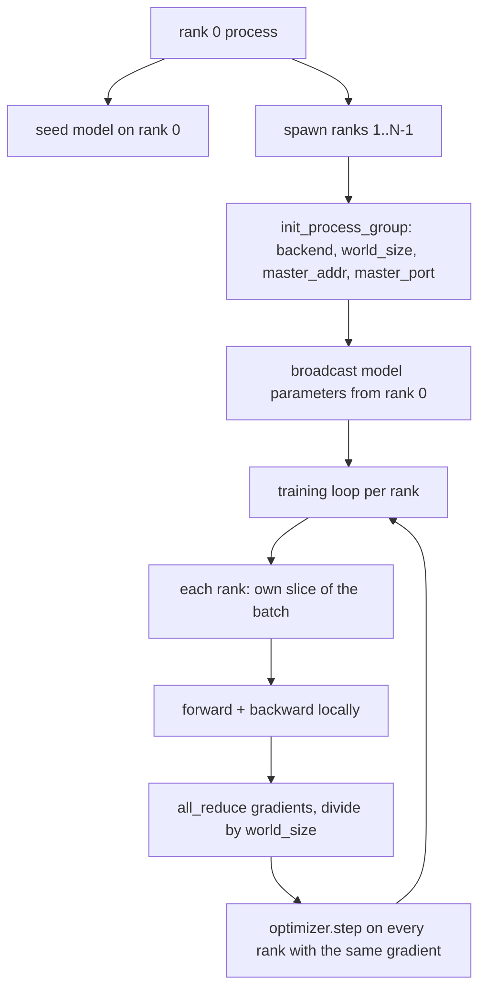
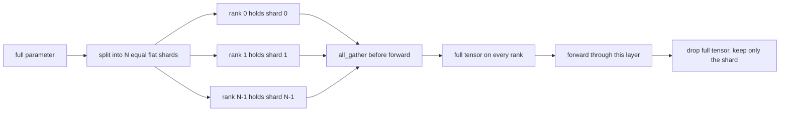

# Distributed Data Parallel dan FSDP dari Nol

> Training multi-rank adalah dua kolektif dan satu aturan. Broadcast parameter saat startup, rata-ratakan gradient setelah backward, dan jangan pernah biarkan rank berselisih soal langkah mana yang sedang mereka jalani.

**Type:** Build
**Languages:** Python
**Prerequisites:** Phase 19 lessons 42 to 45
**Time:** ~90 minutes

## Tujuan Pembelajaran

- Bangun process group lintas N rank dengan backend `gloo`, tanpa perangkat keras khusus.
- Implementasikan pembungkus DDP minimal yang me-broadcast parameter saat konstruksi dan all-reduce gradient setelah backward.
- Buktikan bahwa all-reduce gradient per-rank cocok dengan gradient single-process pada input yang digabung.
- Sketsakan sharding parameter FSDP: setiap rank memegang satu irisan, tensor penuh dikumpulkan untuk forward pass lalu dibuang.

## Masalahnya

Modelnya muat di satu perangkat. Dataset-nya tidak. Anggaran optimisasi bilang kamu ingin melihat N kali contoh per detik wallclock. Tuas pertama adalah data parallel: setiap rank menjalankan model yang sama pada irisan batch yang berbeda, lalu merata-ratakan gradient sebelum langkah optimizer. Tuas kedua adalah FSDP: modelnya juga tidak muat di satu perangkat, jadi setiap rank memegang fraksi dari setiap parameter dan merekonstruksi tensor penuh layer demi layer selama forward pass.

Sakitnya ada di pembukuan. Jika parameter menyimpang antar rank, run-nya rusak diam-diam. Jika kamu merata-ratakan gradient tetapi bukan loss-nya, dashboard-nya berbohong. Jika backend kolektif tidak sepakat soal topologi, run menggantung selamanya. Perbaikannya adalah menulis kolektif-kolektif itu dengan tangan sekali dan tidak pernah mempercayai pembungkus yang tidak bisa kamu reproduksi.

Pelajaran ini berjalan di CPU. CUDA tidak diasumsikan. Backend `gloo` dikirim bersama setiap build PyTorch dan menerima pekerja `torch.multiprocessing`; kode yang sama berpindah ke `nccl` pada node multi-GPU tanpa mengubah struktur.

## Konsepnya



### Dua kolektif yang penting

| Collective | What it does | When |
|------------|--------------|------|
| `broadcast` | Copy a tensor from one rank to all others | Parameter init, scheduler state, any one-to-all sync |
| `all_reduce` | Sum (or mean, or max) a tensor across all ranks, every rank gets the result | Gradient averaging after backward |
| `all_gather` | Each rank contributes a tensor, every rank gets the concatenation | Logits collection, FSDP parameter unshard |

Kontrak DDP adalah `broadcast` saat konstruksi dan `all_reduce` setelah backward. Sketsa FSDP menambahkan `all_gather` sebelum forward pass setiap layer.

### Perataan gradient cocok dengan gradient single-process

Model yang dilatih pada batch B contoh di lintas N rank harus menghasilkan gradient yang sama dengan satu proses yang melatih batch N*B. Triknya adalah menjumlahkan gradient per-rank dan membagi dengan N menghasilkan gradient loss rata-rata, yaitu apa yang dihasilkan cross entropy dengan reduksi mean pada full batch. Kode pelajaran mengasersikan ini dengan `max-abs-diff < 1e-3` antara gradient all-reduce manual dan gradient referensi single-process.

### Sketsa FSDP



Kemenangan memorinya tepat: memori per rank untuk parameter turun menjadi 1/N. Harganya adalah gather, yang dibayarkan setiap forward pass. FSDP produksi menindihkan gather dengan komputasi layer sebelumnya sehingga biaya wallclock jauh lebih kecil daripada yang dihitung secara naif. Pelajaran melakukan round trip pada setiap parameter dan mengassert rekonstruksinya bit-equal dengan yang asli.

### CPU dan backend gloo

CUDA adalah target produksi, tetapi jalur kode yang sama ada di CPU. `gloo` adalah backend kolektif CPU. Ia lebih lambat dari `nccl` di GPU beberapa orde magnitudo, tetapi permukaan API-nya identik. Process group pelajaran diinisialisasi dengan `backend="gloo"` dan rank di-spawn dengan `torch.multiprocessing` alih-alih `torchrun`; keduanya berakhir pada panggilan `torch.distributed` yang sama. Di node multi-GPU, satu-satunya perubahan adalah `backend="nccl"`, tensor perangkat, dan `torchrun` untuk meluncurkan.

```figure
cg-allreduce-ring
```

## Bangun Sendiri

`code/main.py` adalah artefak yang bisa dijalankan.

### Langkah 1: naikkan process group

```python
os.environ["MASTER_ADDR"] = "127.0.0.1"
os.environ["MASTER_PORT"] = str(port)
dist.init_process_group(backend="gloo", rank=rank, world_size=world_size)
```

`MASTER_ADDR` dan `MASTER_PORT` adalah titik rendezvous: setiap rank men-dial port yang sama di host yang sama. Pelajaran memilih port bebas lewat trik bind-and-close untuk menghindari tabrakan saat beberapa run berbagi satu mesin.

### Langkah 2: broadcast saat konstruksi

`MinimalDDP.__init__` menelusuri setiap parameter dan buffer serta memanggil `dist.broadcast(tensor, src=0)`. Nilai rank 0 menjadi init kanonik. Tanpa ini, setiap rank menginisialisasi dengan seed-nya sendiri dan rank-rank menyimpang sejak langkah pertama.

### Langkah 3: all-reduce gradient setelah backward

```python
def all_reduce_grads_(module, world_size):
    for p in module.parameters():
        if p.grad is None:
            p.grad = torch.zeros_like(p.data)
        dist.all_reduce(p.grad.data, op=dist.ReduceOp.SUM)
        p.grad.data.div_(world_size)
```

Setiap rank berakhir dengan gradient rata-rata yang sama. Langkah optimizer kini menjadi fungsi dari input yang sama di setiap rank, itulah sebabnya parameter tetap sinkron sepanjang run.

### Langkah 4: buktikan ekuivalensinya

`manual_all_reduce_matches_single_process` membangun model yang sama di rank 0 dan membandingkan gradient pasca-all-reduce dengan gradient yang akan dihitung satu proses pada input yang digabung. Max-abs-diff-nya sekitar 1e-8.

### Langkah 5: round trip FSDP

`fsdp_round_trip_sketch` meratakan setiap parameter, menambahkan padding ke kelipatan `world_size`, memotong, melakukan all-gather, lalu melepas padding. Rekonstruksi setiap rank sama dengan yang asli. Inilah langkah unshard; inversnya (re-shard setelah forward) adalah satu irisan dari tensor hasil gather.

Jalankan:

```bash
python3 code/main.py
```

World size default-nya 2. Dua proses CPU di-spawn, saling berbicara lewat `gloo`, lalu keluar dengan kode nol. Keluaran `outputs/ddp-demo.json` menangkap jumlah parameter per rank, norm gradient setelah all-reduce, hasil round-trip FSDP, dan selisih gradient manual-vs-referensi.

## Gunakan

Stack training produksi memanggil primitif yang sama. `DistributedDataParallel` PyTorch menambahkan: hook gradient pasca-backward yang menindihkan all-reduce dengan backward, all-reduce ber-bucket yang menggabungkan beberapa gradient kecil menjadi satu kolektif, dan konteks `no_sync` yang dipakai pelajaran 46.

FSDP PyTorch menambahkan: tampilan parameter flat per layer supaya setiap rank memegang satu buffer kontigu, penindihan unshard layer berikutnya dengan komputasi layer saat ini, dan CPU offload opsional untuk shard-shardnya.

Bentuknya tetap sama: broadcast saat startup, reduce setelah backward, shard parameter saat sudah tidak muat.

## Rilis

`outputs/skill-distributed-fsdp-ddp.md` membawa resep untuk skrip training baru: naikkan process group dengan `gloo` untuk CPU dan `nccl` untuk GPU, bungkus model dalam cangkang DDP yang me-broadcast saat konstruksi dan reduce setelah backward, dan opsional shard parameter dengan pola all_gather dari sketsa FSDP.

## Latihan

1. Jalankan dengan `--world-size 4` dan konfirmasikan sebaran parameter tetap di bawah 1e-3 sepanjang run.
2. Ganti perataan manual dengan `dist.all_reduce(op=dist.ReduceOp.AVG)` dan ukur beda waktunya.
3. Tambahkan hook pasca-backward ke pembungkus DDP supaya all-reduce menindih sisa backward; ukur perbaikan wallclock-nya.
4. Implementasikan langkah re-shard FSDP: setelah forward pass, ganti tensor penuh kembali dengan shard lokal. Konfirmasikan memori per rank turun.
5. Alihkan backend ke `nccl` di kotak CUDA. Catat variabel lingkungan mana yang berubah dan mana yang tetap sama.

## Istilah Kunci

| Term | What people say | What it actually means |
|------|-----------------|------------------------|
| Backend | "gloo or nccl" | The library that implements the collective ops; gloo is CPU, nccl is GPU |
| World size | "Total ranks" | Number of processes in the group; the group is the unit collectives operate on |
| Rank | "Worker id" | Process identifier within the group, zero indexed |
| All-reduce | "Sum the grads" | Sum a tensor across all ranks, every rank ends with the same result |
| Unshard | "Gather the params" | Reconstruct the full tensor from per-rank slices via all_gather |

## Bacaan Lanjutan

- Dokumentasi `torch.distributed` PyTorch untuk semantik kolektif yang diandalkan pelajaran ini.
- Daftar kolektif dari library `gloo`, identik bentuknya dengan primitif `nccl` yang ditopang CUDA.
- Phase 19 pelajaran 46 untuk pola gradient accumulation yang membungkus all-reduce DDP dalam `no_sync`.
- Phase 19 pelajaran 47 untuk tata letak checkpoint yang selamat dari run DDP dan FSDP.
- Dokumentasi FSDP PyTorch untuk implementasi produksi dari sharding parameter yang digambar di sini.
