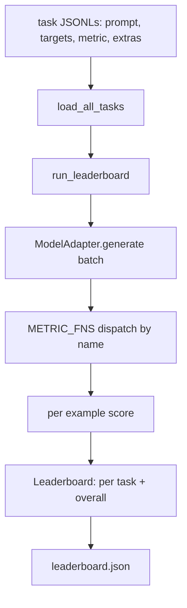
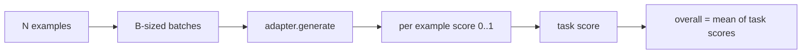

# Harness Evaluasi Language Model

> Model yang bagus pada tugas yang tidak bisa kamu definisikan adalah model yang bagus secara kebetulan. Harness-nya adalah definisi tugas, metrik, runner, dan leaderboard, dalam satu bentuk pendek yang bisa ditukar.

**Type:** Build
**Languages:** Python
**Prerequisites:** Phase 19 lessons 42 to 45
**Time:** ~90 minutes

## Tujuan Pembelajaran

- Definisikan sebuah tugas sebagai file JSONL berisi `prompt`, `targets`, `metric`, dan `extras` opsional per contoh.
- Implementasikan lima metrik: exact match, rouge-l F1, executable check, multiple choice, dan substring contains.
- Bangun runner yang meng-batch contoh per tugas dan mendispatch ke model adapter yang bisa ditukar.
- Keluarkan JSON leaderboard dengan skor per tugas, latensi, dan rata-rata keseluruhan yang bisa direproduksi.

## Masalahnya

Language model baru bermunculan setiap minggu. Klaim pemasarannya adalah model itu bagus. Pertanyaan yang jujur adalah: bagus di mana? Jawaban jujurnya adalah leaderboard yang kamu tulis sendiri, karena leaderboard vendor adalah yang mereka setel sendiri.

Tanpa harness di repo kamu, kamu membandingkan dua model berdasarkan firasat. Dengan harness, kamu membandingkannya berdasarkan skor pada set tugas tetap dengan metrik tetap, pada keluaran JSON yang bisa kamu diff. Harness adalah kontrak antara run kemarin dan run hari ini. Tanpanya, regresi ikut ter-deploy.

Jebakannya adalah over-fit harness ke satu model. Perbaikannya adalah jebakan yang sama dalam arah terbalik: harness-nya cukup kecil untuk dibaca dalam lima belas menit, tugas-tugasnya cukup kecil untuk dikirim di repo, metrik ditulis dari nol supaya rekan bisa mengauditnya, dan adapter adalah satu-satunya tempat di mana kode khusus-model hidup. Tukar adapter, leaderboard bergerak; tukar tugas, leaderboard bergerak. Tak ada yang lain yang seharusnya bergerak.

## Konsepnya



### Spesifikasi tugas

Setiap contoh adalah satu baris JSONL:

```json
{"id": "arith-00", "prompt": "compute: 2 + 2", "targets": ["4"], "metric": "exact_match"}
```

Untuk metrik yang butuh helper penilaian, `extras` membawa payload sampingan:

```json
{
  "id": "code-00",
  "prompt": "python: write a function f that doubles its input",
  "targets": ["ok"],
  "metric": "code_exec",
  "extras": {"io_pairs": [[1, 2], [3, 6]]}
}
```

Sebuah tugas adalah file `.jsonl` di bawah `outputs/tasks/`. Nama filenya adalah nama tugasnya. Semua contoh dalam satu file memakai metrik yang sama.

### Lima tugas fixture

| Task | Metric | What it tests |
|------|--------|---------------|
| arithmetic | exact_match | Token-level correctness on a deterministic answer |
| summary | rouge_l | Longest common subsequence F1 against a one-line reference summary |
| code-exec | code_exec | Executable test: the predicted function must satisfy a list of input-output pairs |
| multiple-choice | multiple_choice | First letter of the prediction must match an allowed letter |
| generation | substring_contains | Free-form text must contain at least one target substring |

### Kontrak metrik

Setiap metrik adalah fungsi dari `(prediction, targets, extras) -> float in [0.0, 1.0]`. Harness merata-ratakan skor per contoh untuk mendapatkan skor tugas, lalu merata-ratakan skor tugas untuk mendapatkan keseluruhan. Fungsi metriknya mungil:

- `exact_match`: huruf kecil semua, runtihkan whitespace, kesamaan.
- `substring_contains`: normalisasi yang sama, uji substring.
- `multiple_choice`: karakter pertama dijadikan huruf besar.
- `rouge_l`: panjang LCS dibagi panjang prediksi dan referensi, F1 dari precision dan recall.
- `code_exec`: eksekusi prediksi di namespace builtins yang dipangkas, panggil `f(x)` di setiap pasangan input-output, hitung kecocokannya.

Metrik code_exec menjalankan prediksi di namespace builtins yang dipangkas. Tes pelajaran mengassert bahwa `import os` meledak karena `os` tidak ada di namespace; kamu tidak bisa mencapai sistem file dari sebuah prediksi kode.

### Model adapter

```python
class ModelAdapter(Protocol):
    def generate(self, prompts: Sequence[str]) -> List[str]: ...
    @property
    def name(self) -> str: ...
```

Adapter adalah sambungannya. Pelajaran mengirimkan `ToyAdapter`, pemeta pola deterministik yang mengembalikan jawaban yang benar untuk setiap prompt di lima tugas fixture. Adapter sungguhan memanggil model dan mengembalikan keluarannya. Harness tidak peduli yang mana.

### Runner

`run_task` meng-batch `batch_size` prompt demi satu dan mendispatch ke fungsi metrik. `run_leaderboard` menelusuri setiap tugas lalu merata-ratakan. `write_leaderboard` mengeluarkan JSON dengan string schema supaya perubahan format di masa depan tidak merusak dashboard secara diam-diam.



```figure
eval-harness-matrix
```

## Bangun Sendiri

`code/main.py` adalah artefak yang bisa dijalankan.

### Langkah 1: seed tugas fixture

`seed_fixture_tasks(target_dir)` menulis lima file `.jsonl`. Run pertama `main.py` men-seed mereka saat direktorinya kosong.

### Langkah 2: muat tugas

`load_all_tasks(task_dir)` membaca setiap `.jsonl` dan mengembalikan dict dari nama tugas ke daftar record `Example`. Baris komentar yang diawali `#` dan baris kosong dilewati supaya kontributor bisa memberi anotasi pada file.

### Langkah 3: implementasikan metrik

Setiap metrik adalah fungsi kecil dengan unit test. Suite tes pelajaran mencakup 13 kasus yang menutupi normalisasi, tumpang tindih sebagian, eksekusi kode, dan penolakan kode tak aman.

### Langkah 4: tulis runner

`run_task` mengiterasi batch dan menghasilkan `TaskResult` berisi skor, jumlah benar, jumlah total, dan latensi. `run_leaderboard` menelusuri semua tugas dan menghasilkan `Leaderboard` berisi rata-rata keseluruhan.

### Langkah 5: keluarkan JSON

`write_leaderboard` menserialisasi board-nya. Flag `--include-per-example` mem-dump record per contoh supaya kamu bisa men-diff prediksi terhadap run sebelumnya saat skor berubah.

Jalankan:

```bash
python3 code/main.py
```

Skrip men-seed fixture pada run pertama, menilainya dengan adapter mainan (yang mendapat semua fixture benar), dan menulis `outputs/leaderboard.json`. Skor keseluruhan 1.0 dengan adapter mainan; tes adapter stub di `test_main.py` menunjukkan harness yang sama menghasilkan 0.0 saat adapter tidak bisa menjawab.

## Gunakan

Untuk mencolokkan model sungguhan, tulis sebuah adapter. Bentuknya:

```python
class HttpAdapter:
    name = "vendor.v1"

    def __init__(self, endpoint, api_key):
        self.endpoint = endpoint
        self.api_key = api_key

    def generate(self, prompts):
        out = []
        for prompt in prompts:
            response = http_post(self.endpoint, prompt, self.api_key)
            out.append(response["text"])
        return out
```

Tukar `ToyAdapter` dengan `HttpAdapter` di bagian atas `main()`. Harness, tugas-tugas, metrik, dan leaderboard-nya tetap sama.

Tiga pola untuk ditegakkan saat mengirimkan harness di proyek nyata:

- **Pin file tugas.** leaderboard.json membawa konten tugas yang di-pin hash-nya atau membawa JSONL-nya di sampingnya; kalau tidak, skornya bergerak saat file tugas bergerak, dan kamu tidak bisa membedakan mana penyebabnya.
- **Diff prediksi, bukan hanya skor.** Flag `--include-per-example` membiarkan kamu melihat apa yang dikatakan model pada hari skor turun.
- **Batas ukuran batch.** Adapter sungguhan punya rate limit. Ukuran batch kecil menjaga harness tetap kompatibel lintas vendor.

## Rilis

`outputs/skill-lm-eval-harness.md` membawa resepnya: spesifikasi tugas JSONL, lima metrik, adapter yang bisa ditukar, runner ber-batch, dan JSON leaderboard dengan string schema. File tugas di `outputs/tasks/` adalah fixture-nya; salin mereka ke proyek nyata sebagai starter.

## Latihan

1. Tambahkan tugas keenam dengan metrik kustom yang kamu tulis dari nol (overlap ala BLEU, penilaian referensi ala BLEURT, apa pun dengan kontrak yang jelas).
2. Perpanjang `code_exec` untuk menangkap stdout dan menerima daftar stdout yang diharapkan sebagai target.
3. Tambahkan perintah diff leaderboard: dengan dua file `leaderboard.json`, cetak tugas mana yang bergerak dan seberapa besar.
4. Batasi latensi per contoh. Bungkus panggilan adapter dalam timeout; tampilkan kolom `timeouts` terpisah di leaderboard.
5. Pin konten tugas dengan sebuah sha256 di leaderboard supaya pembaca di masa depan bisa memverifikasi bahwa mereka menilai tugas yang sama.

## Istilah Kunci

| Term | What people say | What it actually means |
|------|-----------------|------------------------|
| Task spec | "The eval format" | JSONL file with prompt, targets, metric, optional extras per example |
| Metric | "How you score" | Function from (prediction, targets, extras) to a float in [0, 1] |
| Adapter | "The model client" | Object with a generate(prompts) -> list[str] method; the only model-specific code |
| Leaderboard | "The scoreboard" | JSON with per-task scores, total counts, latency, and an overall average |
| Code exec metric | "Run it and check" | Execute the prediction in a restricted namespace, compare against input-output pairs |

## Bacaan Lanjutan

- lm-evaluation-harness asli sebagai referensi produksi, jauh lebih besar tetapi bentuknya sama.
- lighteval dari HuggingFace sebagai implementasi alternatif untuk kontrak yang sama.
- Phase 19 pelajaran 46 mencakup pola gradient accumulation yang dipakai stack training yang dinilai harness ini.
- Phase 19 pelajaran 47 mencakup format checkpoint yang kamu nilai terhadapnya; pin hash checkpoint di leaderboard.
- Phase 19 pelajaran 48 mencakup stack training terdistribusi yang menghasilkan model yang diuji.
